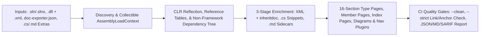

# Documentation.Exporter

**Documentation.Exporter** is an extensible .NET 11 & C# 1–14 documentation generator, CLI tool, and embeddable library that transforms compiled `.dll` assemblies, compiler XML documentation files (`.xml`), and `.sln`/`.slnx` solutions into Microsoft Learn-style MkDocs Markdown, Mermaid or PlantUML diagrams, assembly reference & transitive dependency graphs, site navigation manifests, and CI quality reports.

> **Quick Links:** [Documentation Portal](docs/index.md) · [Getting Started & Demo Showcase](docs/user/getting-started-and-demo.md) · [CLI & JSON Configuration](docs/user/cli-and-configuration.md) · [Developer Onboarding](docs/developer/onboarding.md) · [Architecture Overview](docs/architectural/index.md) · [License (MIT)](LICENSE)

---

## How It Works



---

## Key Capabilities

| Capability | Description | Documentation |
| :--- | :--- | :--- |
| **Three CLI Modes & JSON Config** | Export entire `.sln`/`.slnx` solutions (`solution`), explicit `.dll`/`.xml` pairs (`assembly`), or reproducible CI configs (`config` via `doc-exporter.json`) with clear exit codes (`0`, `1`, `2`) | [CLI & Configuration](docs/user/cli-and-configuration.md) · [CLI Deep-Dive](docs/developer/functionalities/cli-and-configuration.md) |
| **Modern .NET 11 & C# 1–14 Reflection** | Loads binaries in a collectible `AssemblyLoadContext` with partial recovery; formats C# 9–14 constructs (`record`, `readonly`/`ref struct`, primary constructors, `required`/`init`, C# 14 `extension(...)` blocks & `field`, `allows ref struct`, `notnull`, `params` collections, `delegate*`, named tuples, checked/compound operators, NRT `?`, `[Obsolete]`/`[Experimental]`, and linked custom attributes) | [.NET & C# Support Matrix](docs/architectural/dotnet-language-support-matrix.md) · [Assembly Loading & Reflection](docs/developer/functionalities/assembly-loading-and-reflection.md) |
| **XML Comments, `<inheritdoc/>`, & Extras** | Indexes compiler XML comments, transforms tags (`<note>`, `<list type="table">`, `<code language="...">`, `<see>`/`<seealso>`), merges `<inheritdoc/>`, attaches `.cs` snippet files, and injects 5-anchor `.md` YAML-frontmatter sidecars | [XML Authoring Guide](docs/user/xml-documentation-authoring.md) · [Examples & Sidecars](docs/user/examples-overrides-and-external-links.md) |
| **Assembly References & Dependency Tree** | Correlates IL references, `.deps.json`, `.csproj`, and `Directory.Packages.props` (CPM) into `## Assembly References` tables (cross-linking sibling solution assemblies) and cycle-free non-framework `## Assembly Dependency Tree` graphs | [Diagrams & Assembly Insights](docs/user/diagrams-and-assembly-insights.md) · [Reference Analysis](docs/developer/functionalities/assembly-references-and-dependency-tree.md) |
| **Isolated Plugin Architecture** | Zero-Core extension SPI in [`Documentation.Exporter.Abstractions`](src/Documentation.Exporter.Abstractions/Documentation.Exporter.Abstractions.csproj) with subdirectory discovery (`plugins/` or `--plugins-dir`); ships [`Plugins.Diagrams`](src/Documentation.Exporter.Plugins.Diagrams/Documentation.Exporter.Plugins.Diagrams.csproj) (`Mermaid` & `PlantUml`) and [`Plugins.Navigation.MkDocs`](src/Documentation.Exporter.Plugins.Navigation.MkDocs/Documentation.Exporter.Plugins.Navigation.MkDocs.csproj) (`mkdocs.nav.yml` in-place merging) | [Plugin System & SPI](docs/developer/functionalities/plugin-system.md) · [Extensibility Guide](docs/developer/extensibility-guide.md) |
| **CI Quality Gates & Reports** | Safe manifest-tracked `--clean`, `--strict` relative-link & GFM `#anchor` checking, `--fail-on-missing`, `--fail-on-undocumented`, and `DOC001`–`DOC007` diagnostics exported to JSON, Markdown, or SARIF v2.1.0 | [MkDocs & CI Integration](docs/user/mkdocs-and-ci-integration.md) · [Quality Gates & Nav](docs/developer/functionalities/navigation-quality-gates-and-localization.md) |
| **Docker & Multi-Language Support** | Multi-stage Linux container image ([`Dockerfile`](Dockerfile)) and `.resx`-localized prompts, Markdown headings, validation messages, and `[LoggerMessage]` telemetry | [Scripts & Containerization](docs/developer/scripts-and-automation.md) · [Logging & Localization](docs/developer/logging-and-localization.md) |

---

## Quick Start

### Prerequisites

- **.NET 11 SDK** (`net11.0`)
- **PowerShell 5.1+ or 7+ (`pwsh`)** *(optional, for helper scripts in [`scripts/manual/`](scripts/manual))*
- **Docker** *(optional, for containerized Linux runs via [`Dockerfile`](Dockerfile))*

### 1. Install as a .NET Tool (`doc-exporter`) or Build from Source

Install globally from NuGet.org (or locally via `dotnet new tool-manifest` + `dotnet tool install`):

```powershell
# Global install
dotnet tool install --global Documentation.Exporter.Cli

# Verify CLI & resolved version
doc-exporter --version
```

Or build directly from source:

```powershell
dotnet build src/Documentation.Exporter.Cli/Documentation.Exporter.Cli.csproj -c Release
```

The standalone executable and staged `plugins/` directory are emitted under `build/bin/Documentation.Exporter.Cli/release/`:

- **Windows**: `.\build\bin\Documentation.Exporter.Cli\release\Documentation.Exporter.Cli.exe`
- **Linux / macOS**: `./build/bin/Documentation.Exporter.Cli/release/Documentation.Exporter.Cli`

### 2. Run the Included Demo Showcase

The repository includes a two-project C# 14 showcase solution ([`demo/Documentation.Exporter.Demo.slnx`](demo/Documentation.Exporter.Demo.slnx)) exercising XML tags, `.cs` snippets, `.md` sidecars, custom attributes, and MkDocs navigation merging into `.demo-output/`:

```powershell
# Local demo export (Mermaid diagrams by default)
powershell -ExecutionPolicy Bypass -File scripts/manual/Run-DemoExport.ps1

# Switch preferred diagram syntax to PlantUML (also emits standalone architecture.puml files)
powershell -ExecutionPolicy Bypass -File scripts/manual/Run-DemoExport.ps1 -DiagramFormat PlantUml

# Containerized Linux Docker run
powershell -ExecutionPolicy Bypass -File scripts/manual/Run-DemoExport-Docker.ps1
```

### 3. CLI Usage Examples

```powershell
# Export an entire .sln / .slnx solution with strict link checking and SARIF report (using `doc-exporter` or the compiled binary)
doc-exporter solution `
  --solution "demo\Documentation.Exporter.Demo.slnx" `
  --configuration Release `
  --exclude "*.Tests" "*.Benchmarks" `
  --diagram-format Mermaid `
  --output "docs/api" `
  --nav-file "mkdocs.nav.yml" `
  --nav-entry-point "Developer Portal/API Reference" `
  --strict `
  --report-file "docs/quality-report.sarif" `
  --report-format Sarif

# Export explicit compiled assemblies (sibling .xml files are inferred automatically if --xml is omitted)
doc-exporter assembly `
  --assembly "path\to\MyContracts.dll" "path\to\MyLibrary.dll" `
  --output "docs/api" `
  --strict

# Export from a checked-in declarative JSON config (paths resolve relative to the JSON file's folder)
doc-exporter config `
  --config "demo\doc-exporter.demo.json" `
  --strict
```

### 4. Programmatic Embedding

Embed the core engine directly in any .NET 11 host via `Microsoft.Extensions.DependencyInjection`:

```csharp
using Documentation.Exporter.Abstractions.Models;
using Documentation.Exporter.Core;
using Documentation.Exporter.Core.DependencyInjection;
using Microsoft.Extensions.DependencyInjection;

ServiceCollection services = new();
services.AddDocumentationExporter();

await using var provider = services.BuildServiceProvider();
var engine = provider.GetRequiredService<IDocumentationExporterEngine>();

var result = await engine.ExportDocumentationAsync(new ExporterOptions
{
    SolutionFilePath = "MySolution.slnx",
    OutputDirectoryPath = "docs/api",
    StrictLinkValidation = true
});
```

> [!TIP]
> **Using `Documentation.Exporter` on another C# project?** Copy the ready-made AI agent workflow in [AI Agent Command for Authoring C# Interface & API XML Documentation](docs/user/ai-agent-documentation-command.md) to automatically enrich your target project's interfaces and public APIs with thorough XML documentation before exporting.

---

## Documentation Portal

This `README.md` serves as the top-level entry point to the repository documentation hosted under **[`docs/index.md`](docs/index.md)**:

| Audience | Entry Point | Focus |
| :--- | :--- | :--- |
| **Users & Technical Writers** | [User Documentation Hub](docs/user/index.md) | CLI commands, `doc-exporter.json`, XML doc tags, `.cs` snippets, `.md` sidecars, diagrams, and MkDocs CI pipelines |
| **New Contributors** | [Developer Onboarding Guide](docs/developer/onboarding.md) | Prerequisites, repository map, day-1 build/test/coverage loop, debugging locators, and first-PR checklist |
| **Maintainers & Plugin Authors** | [Developer Documentation Hub](docs/developer/index.md) | Coding mandates, DI composition, **9 subsystem deep-dive specifications**, extensibility recipes, tests, and scripts |
| **Architects & Reviewers** | [Architecture Documentation](docs/architectural/index.md) | System landscape, capability catalog, C# 1–14 support matrix, runtime data flow, domain models, and DI lifetimes |

### Quick Index by Section

- **Central Portal**: [Documentation Portal (`docs/index.md`)](docs/index.md)
- **User Guides (`docs/user/`)**:
  - [Getting Started & Demo Showcase](docs/user/getting-started-and-demo.md)
  - [CLI Commands, Options, & JSON Configuration](docs/user/cli-and-configuration.md)
  - [Authoring XML Documentation Comments](docs/user/xml-documentation-authoring.md)
  - [External Examples, Sidecar Overrides, & External Links](docs/user/examples-overrides-and-external-links.md)
  - [Diagrams, Assembly References, & Dependency Tree](docs/user/diagrams-and-assembly-insights.md)
  - [MkDocs Navigation, Quality Gates, & Linux/Docker CI](docs/user/mkdocs-and-ci-integration.md)
  - [AI Agent Command for C# XML Documentation](docs/user/ai-agent-documentation-command.md)
  - [Recommended AI Agent Rules for Any C# Project](docs/user/ai-agent-recommended-csharp-rules.md)
- **Architecture (`docs/architectural/`)**:
  - [Architecture Overview](docs/architectural/index.md)
  - [Functionality Catalog](docs/architectural/functionality-catalog.md)
  - [.NET & C# Language Support Matrix](docs/architectural/dotnet-language-support-matrix.md)
  - [Component Interactions & Data Flow](docs/architectural/component-interactions.md)
  - [Domain Models, Strong Enums, & DI Lifetimes](docs/architectural/domain-models-and-lifetimes.md)
- **Developer Guides & Subsystem Specs (`docs/developer/`)**:
  - [Developer Onboarding](docs/developer/onboarding.md) · [Coding Standards & DI](docs/developer/coding-standards-and-di.md) · [Extensibility Guide](docs/developer/extensibility-guide.md)
  - [Testing & 90% Coverage Gates](docs/developer/testing-and-coverage.md) · [Scripts & Containerization](docs/developer/scripts-and-automation.md) · [Logging & Localization](docs/developer/logging-and-localization.md)
  - **Functionality Specifications**: [CLI & Config](docs/developer/functionalities/cli-and-configuration.md) · [Discovery](docs/developer/functionalities/solution-and-artifact-discovery.md) · [Loading & Reflection](docs/developer/functionalities/assembly-loading-and-reflection.md) · [References & Dependency Tree](docs/developer/functionalities/assembly-references-and-dependency-tree.md) · [XML & Link Resolution](docs/developer/functionalities/xml-parsing-and-link-resolution.md) · [Enrichment & Overrides](docs/developer/functionalities/enrichment-snippets-and-overrides.md) · [Markdown & Diagrams](docs/developer/functionalities/markdown-and-diagram-generation.md) · [Nav, Quality Gates, & Localization](docs/developer/functionalities/navigation-quality-gates-and-localization.md) · [Plugin System & SPI](docs/developer/functionalities/plugin-system.md)

---

## Repository Structure

| Path | Role |
| :--- | :--- |
| [`documentation-exporter.slnx`](documentation-exporter.slnx) | Solution file linking core, CLI, plugins, tests, and demo assemblies |
| [`src/Documentation.Exporter.Abstractions/`](src/Documentation.Exporter.Abstractions/Documentation.Exporter.Abstractions.csproj) | Zero-Core plugin SPI, immutable `sealed record` domain models, extensible format value objects, subsystem contracts, and validation `.resx` |
| [`src/Documentation.Exporter.Core/`](src/Documentation.Exporter.Core/Documentation.Exporter.Core.csproj) | Core engine, 10-step workflow, `DirectoryPluginLoader`, discovery, collectible ALC loading, reflection, XML/link resolution, enrichment, Markdown emission, and quality reporting |
| [`src/Documentation.Exporter.Cli/`](src/Documentation.Exporter.Cli/Documentation.Exporter.Cli.csproj) | `System.CommandLine` console executable (`solution`, `assembly`, `config`), `--plugins-dir`, and MSBuild `plugins/` staging |
| [`src/Documentation.Exporter.Plugins.Diagrams/`](src/Documentation.Exporter.Plugins.Diagrams/Documentation.Exporter.Plugins.Diagrams.csproj) | Built-in `StandardDiagramsPlugin` providing Mermaid and PlantUML type, architecture, and dependency-tree generators |
| [`src/Documentation.Exporter.Plugins.Navigation.MkDocs/`](src/Documentation.Exporter.Plugins.Navigation.MkDocs/Documentation.Exporter.Plugins.Navigation.MkDocs.csproj) | Built-in `MkDocsNavigationPlugin` providing idempotent `mkdocs.nav.yml` generation and merging |
| [`test/Documentation.Exporter.Core.Tests/`](test/Documentation.Exporter.Core.Tests/Documentation.Exporter.Core.Tests.csproj) | Mirrored xUnit test suite (`AwesomeAssertions`/`FluentAssertions`, `Moq`, `[UnitTest]`/`[IntegrationTest]` governance) |
| [`demo/`](demo/Documentation.Exporter.Demo.slnx) | Two-project showcase (`DemoContracts` & `DemoLibrary`), [`doc-exporter.demo.json`](demo/doc-exporter.demo.json), [`mkdocs.base.nav.yml`](demo/mkdocs.base.nav.yml), snippets, and sidecars |
| [`scripts/manual/`](scripts/manual) | Interactive PowerShell automation scripts ([`Run-CodeCoverage.ps1`](scripts/manual/Run-CodeCoverage.ps1), [`Run-DemoExport.ps1`](scripts/manual/Run-DemoExport.ps1), [`Run-DemoExport-Docker.ps1`](scripts/manual/Run-DemoExport-Docker.ps1)) |
| [`.github/workflows/ci.yml`](.github/workflows/ci.yml) | GitHub Actions gated CI workflow (`CI Gate`) for PRs and merges into `main` across Linux and Windows |
| [`.github/workflows/release.yml`](.github/workflows/release.yml) | Tag-triggered (`v*.*.*`) GitHub Release workflow packaging `linux-x64`, `win-x64`, and `osx-arm64` CLI + plugin bundles |
| [`.github/release.yml`](.github/release.yml) | GitHub Release notes categorization rules grouping merged PRs by label for automatic changelogs |
| [`.github/dependabot.yml`](.github/dependabot.yml) | Weekly automated NuGet, GitHub Actions, and Docker dependency update PRs |
| [`.github/ISSUE_TEMPLATE/`](.github/ISSUE_TEMPLATE) & [`PULL_REQUEST_TEMPLATE.md`](.github/PULL_REQUEST_TEMPLATE.md) | Structured GitHub bug/feature forms and PR verification checklist |
| [`src/Directory.Build.props`](src/Directory.Build.props) | MinVer SemVer configuration (`v` tag prefix) stamping all shippable `src/` assemblies and `Documentation.Exporter.Cli --version` |
| [`docs/`](docs/index.md) | Complete three-tier Architecture, Developer, and User documentation portal |
| [`Dockerfile`](Dockerfile) & [`Directory.Build.props`](Directory.Build.props) | Multi-stage .NET 11 Linux runtime image and centralized `build/` artifact & analyzer settings |

---

## Building, Testing & Code Coverage

```powershell
# Build all projects with warnings treated as errors
dotnet build documentation-exporter.slnx

# Run the full xUnit unit & integration test suite
dotnet test documentation-exporter.slnx

# Run Coverlet Cobertura coverage across all 5 source assemblies (enforces >= 90% gates by default)
powershell -ExecutionPolicy Bypass -File scripts/manual/Run-CodeCoverage.ps1

# Run only fast unit tests without failing on integration-only branches
powershell -ExecutionPolicy Bypass -File scripts/manual/Run-CodeCoverage.ps1 -Category Unit -MinimumLineCoverage 0 -MinimumBranchCoverage 0
```

> [!NOTE]
> Pull requests and merges targeting `main` are gated by [`.github/workflows/ci.yml`](.github/workflows/ci.yml) (`CI Gate`), which validates Release builds, CLI plugin staging, cross-platform tests (`ubuntu-latest` and `windows-latest`), Cobertura coverage thresholds, and `--strict` demo exports. Configure **`CI Gate`** as a required status check in GitHub Branch Protection / Rulesets on `main` (see [Scripts & Automation](docs/developer/scripts-and-automation.md)).
>
> **Semantic Versioning & Releases:** All `src/` assemblies, the `Documentation.Exporter.Cli` `.NET Tool` (`doc-exporter`), and the `Documentation.Exporter.Abstractions` NuGet library are stamped automatically from Git tags (`v*.*.*`) via **MinVer** ([`src/Directory.Build.props`](src/Directory.Build.props)). Pushing a SemVer tag such as `v1.0.0` triggers [`.github/workflows/release.yml`](.github/workflows/release.yml) to verify tests, attach `linux-x64`, `win-x64`, `osx-arm64`, `.nupkg`/`.snupkg`, and `checksums.sha256` assets to GitHub Releases, and publish both packages to **NuGet.org** via OIDC Trusted Publishing (`NuGet/login@v1`).

---

## Contributing & License

- **Contribution Guide & Community**: See [CONTRIBUTING.md](CONTRIBUTING.md), [Code of Conduct](CODE_OF_CONDUCT.md), and [Security Policy](SECURITY.md).
- **Engineering & Documentation Rules**: Before submitting changes, review [Developer Onboarding](docs/developer/onboarding.md), [Coding Standards & DI Setup](docs/developer/coding-standards-and-di.md), and [`.agents/AGENTS.md`](.agents/AGENTS.md) (all code/script edits must stay synchronized with `docs/`).
- **License**: Released under the [MIT License](LICENSE) (`Copyright (c) 2026 trodent83`).
