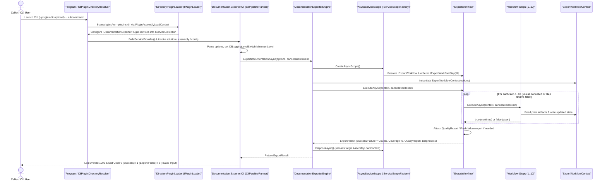
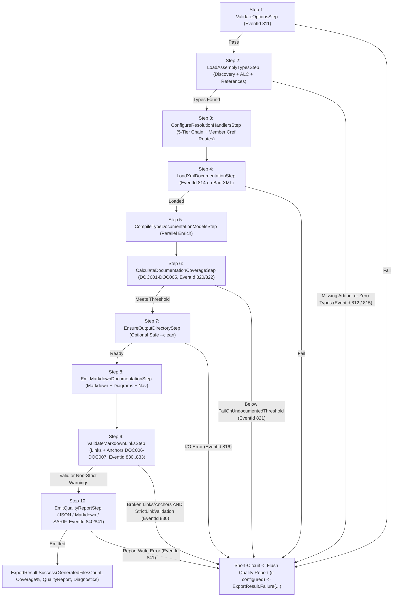
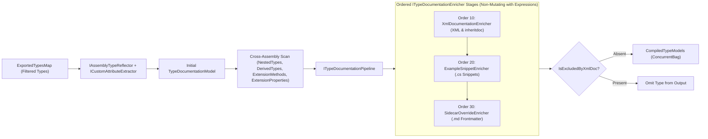
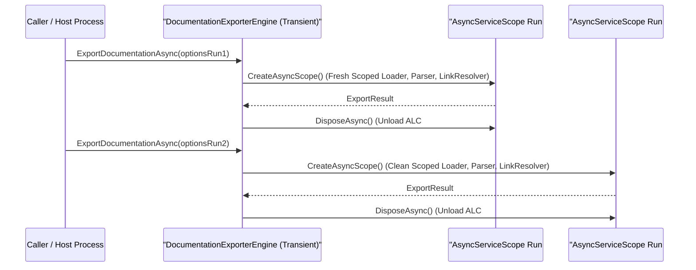

# Component Interactions & End-to-End Data Flow

This document traces how `Documentation.Exporter` components coordinate at runtime—from CLI argument binding through scoped container creation, the 10-step sequential workflow, concurrent type reflection and enrichment, single-format diagram selection, output emission, link/anchor integrity checking, and structured quality report emission.

---

## 1. End-to-End Execution Sequence

Every export invocation transitions through three distinct runtime boundaries:
1. The **CLI Host** (optional when embedded programmatically via [`IDocumentationExporterEngine`](../../src/Documentation.Exporter.Core/IDocumentationExporterEngine.cs)), which parses CLI arguments, sets log verbosity on [`CliLoggingLevelSwitch`](../../src/Documentation.Exporter.Cli/CliLoggingLevelSwitch.cs), logs quality diagnostics (`EventId` `1005`), and translates results into exit codes `0`, `1`, or `2`.
2. The **Engine & Scoped DI Boundary** inside [`DocumentationExporterEngine`](../../src/Documentation.Exporter.Core/DocumentationExporterEngine.cs), which creates a fresh `AsyncServiceScope` and disposes it cleanly—unloading the collectible `AssemblyLoadContext` even if a step fails or is cancelled.
3. The **10-Step Sequential Export Workflow** orchestrated by [`ExportWorkflow`](../../src/Documentation.Exporter.Core/Workflow/ExportWorkflow.cs) over a single per-run [`ExportWorkflowContext`](../../src/Documentation.Exporter.Abstractions/Workflow/ExportWorkflowContext.cs), including failure-safe flushing of [`DocumentationQualityReport`](../../src/Documentation.Exporter.Abstractions/Models/DocumentationQualityReport.cs) if a validation/quality gate short-circuits execution.

---

## 2. 10-Step Workflow Control Flow & Short-Circuiting

Steps run sequentially in strict registration order inside [`ExportWorkflow`](../../src/Documentation.Exporter.Core/Workflow/ExportWorkflow.cs). Before emitting any file on disk (Steps 7–8), Steps 1–6 validate inputs, load assemblies, build reference graphs, compile models, and run coverage/quality diagnostics—preventing partial corrupt output when validation or quality gates fail:

### Workflow Step State Transitions (`ExportWorkflowContext`)

[`ExportWorkflowContext`](../../src/Documentation.Exporter.Abstractions/Workflow/ExportWorkflowContext.cs) acts as the single mutable state carrier passed across all 10 steps in [`ExportWorkflow`](../../src/Documentation.Exporter.Core/Workflow/ExportWorkflow.cs). Every step checks `CancellationToken`, verifies preconditions, reads previously populated properties, and mutates only its designated output properties:

| Step | Concrete Step | Consumes | Produces / Side Effects | Short-Circuits Export When |
| :--- | :--- | :--- | :--- | :--- |
| **1** | [`ValidateOptionsStep`](../../src/Documentation.Exporter.Core/Workflow/Steps/ValidateOptionsStep.cs) | `context.Options` ([`ExporterOptions`](../../src/Documentation.Exporter.Abstractions/Models/ExporterOptions.cs)), `ExternalDocLinkRules` | Logs validation errors (`EventId` `811`) | Any `[Required]`, `[MinLength]`, `[Range]`, or `[EnumDataType]` rule fails |
| **2** | [`LoadAssemblyTypesStep`](../../src/Documentation.Exporter.Core/Workflow/Steps/LoadAssemblyTypesStep.cs) | `Options` -> [`IExportArtifactDiscoveryService`](../../src/Documentation.Exporter.Core/Parsing/IExportArtifactDiscoveryService.cs) | Sets `ExportedTypesMap`, `ResolvedXmlDocumentationFilePaths`, `AssemblyReferencesByAssemblyName`, `AssemblyDependencyEdgesByAssemblyName` | Missing artifact under `--fail-on-missing` (`EventId` `815`), assembly load failure, or zero exported public types after exclusions (`EventId` `812`) |
| **3** | [`ConfigureResolutionHandlersStep`](../../src/Documentation.Exporter.Core/Workflow/Steps/ConfigureResolutionHandlersStep.cs) | [`IEnumerable<INamespaceHandlerProvider>`](../../src/Documentation.Exporter.Abstractions/Resolution/INamespaceHandlerProvider.cs), `IEnumerable<INamespaceHandler>`, `ExportWorkflowContext` | Calls [`ITypeLinkResolver.ClearHandlers()`](../../src/Documentation.Exporter.Abstractions/Resolution/ITypeLinkResolver.cs), materializes provider and standalone handlers sorted ascending by effective `Order` (Local `-1000`, CustomOptions `-500`, Pattern `500`, MicrosoftDocs `1000`), and registers them on [`ITypeLinkResolver`](../../src/Documentation.Exporter.Abstractions/Resolution/ITypeLinkResolver.cs) | *(Does not fail unless cancelled)* |
| **4** | [`LoadXmlDocumentationStep`](../../src/Documentation.Exporter.Core/Workflow/Steps/LoadXmlDocumentationStep.cs) | `ResolvedXmlDocumentationFilePaths`, `Options.XmlDocumentationFilePath` | Calls [`XmlDocumentationParser.Clear()`](../../src/Documentation.Exporter.Core/Parsing/XmlDocumentationParser.cs) and populates XML comment index asynchronously | Any `.xml` file fails to load or parse cleanly (`EventId` `814`) |
| **5** | [`CompileTypeDocumentationModelsStep`](../../src/Documentation.Exporter.Core/Workflow/Steps/CompileTypeDocumentationModelsStep.cs) | `ExportedTypesMap`, `Options` | Reflects & enriches types concurrently into `context.CompiledTypeModels` (`ConcurrentBag`), captures multi-level `DeclaringTypeChain` and `[Obsolete]` `DiagnosticId`/`UrlFormat`, extracts linked assembly-level custom attributes into `context.AssemblyAttributesByAssemblyName`, computes cross-assembly links, filters `<exclude/>` | *(Does not fail unless cancelled)* |
| **6** | [`CalculateDocumentationCoverageStep`](../../src/Documentation.Exporter.Core/Workflow/Steps/CalculateDocumentationCoverageStep.cs) | `CompiledTypeModels`, `Options.FailOnUndocumentedThreshold`, [`IDocumentationQualityAnalyzer`](../../src/Documentation.Exporter.Core/Quality/IDocumentationQualityAnalyzer.cs) | Populates `DocumentationCoveragePercentage`, `TotalDocumentableSymbols`, `DocumentedSymbols`, and `DOC001`–`DOC005` diagnostics in `context.Diagnostics`; logs `EventId` `820` / `822` | Calculated coverage `< FailOnUndocumentedThreshold` (`EventId` `821`) |
| **7** | [`EnsureOutputDirectoryStep`](../../src/Documentation.Exporter.Core/Workflow/Steps/EnsureOutputDirectoryStep.cs) | `Options.OutputDirectoryPath`, `Options.CleanOutputDirectory` | Creates directory; deletes stale `.md` and `.puml` files when `--clean` is true (`EventId` `818`) | Directory creation/cleanup fails (`EventId` `816`) |
| **8** | [`EmitMarkdownDocumentationStep`](../../src/Documentation.Exporter.Core/Workflow/Steps/EmitMarkdownDocumentationStep.cs) | `CompiledTypeModels`, `AssemblyReferencesByAssemblyName`, `AssemblyDependencyEdgesByAssemblyName`, `AssemblyAttributesByAssemblyName`, `Options` | Writes root `index.md`, assembly `index.md` (with linked assembly & type custom attributes), type `index.md`, member `.md` files, optional `architecture.puml`, and `mkdocs.nav.yml`; sets `GeneratedFilesCount` | I/O error propagates or cancelled |
| **9** | [`ValidateMarkdownLinksStep`](../../src/Documentation.Exporter.Core/Workflow/Steps/ValidateMarkdownLinksStep.cs) | Generated `.md` files in `OutputDirectoryPath`, `StrictLinkValidation` | Strips fenced/inline code while preserving line numbers, checks relative file targets + GFM heading `#anchor` slugs, increments `VerifiedLinksCount`, records `DOC006` / `DOC007` diagnostics (`EventId` `831` / `833` / `832`) | `StrictLinkValidation` is `true` and >= 1 broken link or broken anchor is found (`EventId` `830`) |
| **10** | [`EmitQualityReportStep`](../../src/Documentation.Exporter.Core/Workflow/Steps/EmitQualityReportStep.cs) | `context.BuildQualityReportSnapshot()`, `Options.ReportFilePath`, `Options.ReportFormat`, [`IDocumentationQualityReportWriter`](../../src/Documentation.Exporter.Core/Quality/IDocumentationQualityReportWriter.cs) | Materializes `context.QualityReport` on the context and optionally writes JSON, Markdown, or SARIF v2.1.0 report (`EventId` `840`) | Writing report file fails (`EventId` `841`) |

If any step throws `OperationCanceledException`, returns `false`, or `context.HasFailed` becomes `true`, [`ExportWorkflow`](../../src/Documentation.Exporter.Core/Workflow/ExportWorkflow.cs) stops the step loop immediately (`EventId` `803`), ensures `context.QualityReport` is snapshotted and optionally flushed via [`IDocumentationQualityReportWriter`](../../src/Documentation.Exporter.Core/Quality/IDocumentationQualityReportWriter.cs) (so failed coverage or strict-link runs still emit diagnostic reports), and [`DocumentationExporterEngine`](../../src/Documentation.Exporter.Core/DocumentationExporterEngine.cs) returns [`ExportResult.Failure(qualityReport)`](../../src/Documentation.Exporter.Abstractions/Models/ExportResult.cs).

---

## 3. Concurrent Compilation & Multi-Stage Enrichment

Inside Step 5 ([`CompileTypeDocumentationModelsStep`](../../src/Documentation.Exporter.Core/Workflow/Steps/CompileTypeDocumentationModelsStep.cs)) and Step 8 ([`EmitMarkdownDocumentationStep`](../../src/Documentation.Exporter.Core/Workflow/Steps/EmitMarkdownDocumentationStep.cs)), independent type transformations fan out across worker threads via `Parallel.ForEachAsync` while operating solely on immutable domain records. Meanwhile, Step 9 ([`ValidateMarkdownLinksStep`](../../src/Documentation.Exporter.Core/Workflow/Steps/ValidateMarkdownLinksStep.cs)) fans out again to read and verify every generated Markdown file concurrently:

### How Type, Dependency Tree, & Architecture Diagram Selection Interacts

Every diagram rendering site ([`TypeDiagramSectionRenderer`](../../src/Documentation.Exporter.Core/Generation/Sections/TypeDiagramSectionRenderer.cs) on type pages, [`IndexPageMarkdownGenerator`](../../src/Documentation.Exporter.Core/Generation/IndexPageMarkdownGenerator.cs) for both `## Assembly Dependency Tree` and `## Architecture Diagram`, and [`EmitMarkdownDocumentationStep`](../../src/Documentation.Exporter.Core/Workflow/Steps/EmitMarkdownDocumentationStep.cs) for standalone `architecture.puml`) delegates selection to **[`IDiagramGeneratorSelector`](../../src/Documentation.Exporter.Abstractions/Generation/Diagrams/IDiagramGeneratorSelector.cs)** ([`DiagramGeneratorSelector`](../../src/Documentation.Exporter.Core/Generation/Diagrams/DiagramGeneratorSelector.cs)):

1. If [`DiagramFormat`](../../src/Documentation.Exporter.Abstractions/Models/DiagramFormat.cs) `== DiagramFormat.None`, [`IDiagramGeneratorSelector`](../../src/Documentation.Exporter.Abstractions/Generation/Diagrams/IDiagramGeneratorSelector.cs) returns `null` immediately without invoking any generator's `CanGenerate(...)`.
2. Otherwise, the selector queries all registered [`IDiagramGenerator`](../../src/Documentation.Exporter.Abstractions/Generation/Diagrams/IDiagramGenerator.cs) strategies whose `Format == preferredFormat` (defaulting to `DiagramFormat.Mermaid`) and selects the first generator where `CanGenerate(...) == true`.
3. Only if **no** generator of the preferred format supports the input does the selector fall back to the first supporting alternative generator (`Format != preferredFormat && Format != DiagramFormat.None`).
4. This guarantees that **at most one** diagram block (either Mermaid or PlantUML, never both) is rendered per section, while [`EmitMarkdownDocumentationStep`](../../src/Documentation.Exporter.Core/Workflow/Steps/EmitMarkdownDocumentationStep.cs) passes the selected [`DiagramFormat`](../../src/Documentation.Exporter.Abstractions/Models/DiagramFormat.cs) consistently to both embedded index rendering and standalone `architecture.puml` creation.

---

## 4. Scoped Lifecycle Isolation Across Back-to-Back Exports

Because [`XmlDocumentationParser`](../../src/Documentation.Exporter.Core/Parsing/XmlDocumentationParser.cs), [`TypeLinkResolver`](../../src/Documentation.Exporter.Core/Resolution/TypeLinkResolver.cs), and [`IsolatedAssemblyLoader`](../../src/Documentation.Exporter.Core/Parsing/IsolatedAssemblyLoader.cs) maintain per-execution state (indexed XML dictionaries, active namespace handlers matching the current target assemblies, and open collectible `AssemblyLoadContext` handles), **[`DocumentationExporterEngine`](../../src/Documentation.Exporter.Core/DocumentationExporterEngine.cs) never shares those instances across runs**:

- **Singletons** ([`IFileSystem`](../../src/Documentation.Exporter.Abstractions/IO/IFileSystem.cs) / [`PhysicalFileSystem`](../../src/Documentation.Exporter.Core/IO/PhysicalFileSystem.cs), [`IPluginLoader`](../../src/Documentation.Exporter.Abstractions/Plugins/IPluginLoader.cs) / [`DirectoryPluginLoader`](../../src/Documentation.Exporter.Core/Plugins/DirectoryPluginLoader.cs), [`IExporterConfigurationLoader`](../../src/Documentation.Exporter.Core/Configuration/IExporterConfigurationLoader.cs), [`IMicrosoftLearnReferenceRegistry`](../../src/Documentation.Exporter.Core/Resolution/IMicrosoftLearnReferenceRegistry.cs), [`IMemberCrefRouteIndexBuilder`](../../src/Documentation.Exporter.Core/Resolution/IMemberCrefRouteIndexBuilder.cs), [`INamespaceHandlerProvider`](../../src/Documentation.Exporter.Abstractions/Resolution/INamespaceHandlerProvider.cs) & standalone [`INamespaceHandler`](../../src/Documentation.Exporter.Abstractions/Resolution/INamespaceHandler.cs) strategies, [`IDocumentationQualityAnalyzer`](../../src/Documentation.Exporter.Core/Quality/IDocumentationQualityAnalyzer.cs), [`IQualityReportFormatter`](../../src/Documentation.Exporter.Abstractions/Quality/IQualityReportFormatter.cs) strategies, [`ICSharpSignatureFormatter`](../../src/Documentation.Exporter.Core/Parsing/ICSharpSignatureFormatter.cs), [`IDiagramIdentifierFormatter`](../../src/Documentation.Exporter.Abstractions/Generation/Diagrams/IDiagramIdentifierFormatter.cs), [`IDiagramGeneratorSelector`](../../src/Documentation.Exporter.Abstractions/Generation/Diagrams/IDiagramGeneratorSelector.cs), plugin diagram generators, formatters, [`INavigationGenerator`](../../src/Documentation.Exporter.Abstractions/Generation/INavigationGenerator.cs) strategies including [`MkDocsNavigationGenerator`](../../src/Documentation.Exporter.Plugins.Navigation.MkDocs/MkDocsNavigationGenerator.cs); CLI: [`CliLoggingLevelSwitch`](../../src/Documentation.Exporter.Cli/CliLoggingLevelSwitch.cs), [`IConsoleOutput`](../../src/Documentation.Exporter.Cli/IConsoleOutput.cs) ([`SystemConsoleOutput`](../../src/Documentation.Exporter.Cli/SystemConsoleOutput.cs)), [`ISharedCliOptions`](../../src/Documentation.Exporter.Cli/ISharedCliOptions.cs) ([`SharedCliOptions`](../../src/Documentation.Exporter.Cli/SharedCliOptions.cs))) are stateless and shared safely across runs.
- **`Scoped`** services live strictly inside the `AsyncServiceScope` created in [`DocumentationExporterEngine.ExportDocumentationAsync`](../../src/Documentation.Exporter.Core/DocumentationExporterEngine.cs) and are torn down cleanly in `await using var serviceScope = ...` at the end of every export.
