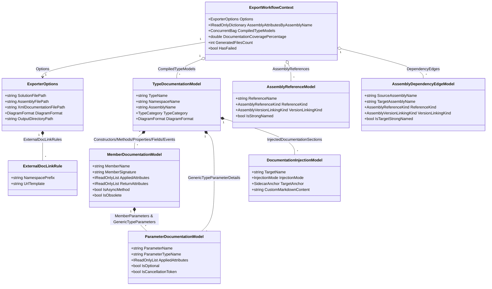
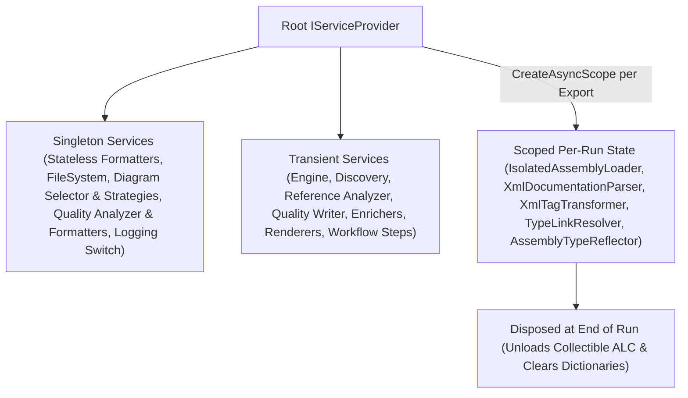

# Domain Models, Strong Enums, & DI Lifetimes

This reference documents the immutable data contracts, strongly typed enumerations, extensible [`DiagramFormat`](../../src/Documentation.Exporter.Abstractions/Models/DiagramFormat.cs) / [`NavigationFormat`](../../src/Documentation.Exporter.Abstractions/Models/NavigationFormat.cs) / [`QualityReportFormat`](../../src/Documentation.Exporter.Abstractions/Models/QualityReportFormat.cs) value objects, plugin descriptors, localized DataAnnotations validation rules, object relationships, and Dependency Injection service lifetimes shared across [`Documentation.Exporter.Abstractions`](../../src/Documentation.Exporter.Abstractions/Documentation.Exporter.Abstractions.csproj), [`Documentation.Exporter.Core`](../../src/Documentation.Exporter.Core/Documentation.Exporter.Core.csproj), [`Documentation.Exporter.Plugins.Diagrams`](../../src/Documentation.Exporter.Plugins.Diagrams/Documentation.Exporter.Plugins.Diagrams.csproj), [`Documentation.Exporter.Plugins.Navigation.MkDocs`](../../src/Documentation.Exporter.Plugins.Navigation.MkDocs/Documentation.Exporter.Plugins.Navigation.MkDocs.csproj), and [`Documentation.Exporter.Cli`](../../src/Documentation.Exporter.Cli/Documentation.Exporter.Cli.csproj).

---

## Domain Model & Enum Relationships

Every reflected type and dependency graph flows downstream through immutable `sealed record` types composed strictly of other records, strong enums, and read-only collections (`IReadOnlyList`, `IReadOnlyDictionary`):

---

## 1. Configuration, Result, & Workflow State Contracts

| Type | Role & Mutability | Validation & Key Members |
| :--- | :--- | :--- |
| [`ExporterOptions`](../../src/Documentation.Exporter.Abstractions/Models/ExporterOptions.cs) | Mutable input configuration bound from CLI or `doc-exporter.json` | Localized DataAnnotations via [`ValidationMessagesResources`](../../src/Documentation.Exporter.Abstractions/Resources/ValidationMessagesResources.cs): `[Required]`/`[MinLength(1)]` on `AssemblyFilePath`, `XmlDocumentationFilePath`, `OutputDirectoryPath`, `MicrosoftDocsBaseUrl`; `[Range(0.0, 100.0)]` on `FailOnUndocumentedThreshold`; `[ValidDiagramFormat]` on [`DiagramFormat`](../../src/Documentation.Exporter.Abstractions/Models/DiagramFormat.cs) (default `DiagramFormat.Mermaid`), `[ValidNavigationFormat]` on [`NavigationFormat`](../../src/Documentation.Exporter.Abstractions/Models/NavigationFormat.cs) (default `NavigationFormat.MkDocs`), and `[ValidQualityReportFormat]` on [`QualityReportFormat`](../../src/Documentation.Exporter.Abstractions/Models/QualityReportFormat.cs) (`ReportFormat`, default `QualityReportFormat.Json`); optional `ReportFilePath` (`--report-file` / `-r`). Smart fallback getters let `AssemblyFilePath` fall back to `AssemblyFilePaths` or `SolutionFilePath`, and `XmlDocumentationFilePath` fall back to `XmlDocumentationFilePaths`, sibling `.xml` inference (`Path.ChangeExtension`), or `SolutionFilePath`. Defaults `SolutionConfiguration = "Debug"`, `ExcludeEditorBrowsableNever = true`. |
| [`ExportArtifactDiscoveryResult`](../../src/Documentation.Exporter.Core/Parsing/IExportArtifactDiscoveryService.cs) | Output record from [`IExportArtifactDiscoveryService.DiscoverArtifactDetails`](../../src/Documentation.Exporter.Core/Parsing/IExportArtifactDiscoveryService.cs) | `IReadOnlyList<string> AssemblyFilePaths`, `IReadOnlyList<string> XmlDocumentationFilePaths`, `IReadOnlyDictionary<string, string> ProjectFilePathsByAssemblyPath` |
| [`DiscoveredAssemblyArtifact`](../../src/Documentation.Exporter.Core/Parsing/ISolutionAssemblyResolver.cs) | Per-project artifact record from [`ISolutionAssemblyResolver`](../../src/Documentation.Exporter.Core/Parsing/ISolutionAssemblyResolver.cs) | `AssemblyFilePath`, optional `XmlDocumentationFilePath`, optional `ProjectFilePath` |
| [`ExportWorkflowContext`](../../src/Documentation.Exporter.Abstractions/Workflow/ExportWorkflowContext.cs) | Per-run mutable pipeline state bag (primary ctor `(ExporterOptions)`) | `Options`, `ExportedTypesMap`, `ResolvedXmlDocumentationFilePaths`, `AssemblyReferencesByAssemblyName`, `AssemblyDependencyEdgesByAssemblyName`, `AssemblyAttributesByAssemblyName`, `CompiledTypeModels` (`ConcurrentBag`), `Diagnostics` (`ConcurrentBag<DocumentationDiagnostic>`), `TotalDocumentableSymbols`, `DocumentedSymbols`, `GeneratedFilesCount`, `DocumentationCoveragePercentage`, `VerifiedLinksCount`, `QualityReport`, `IsQualityReportWritten`, `HasFailed`, `BuildQualityReportSnapshot()` |
| [`ExportResult`](../../src/Documentation.Exporter.Abstractions/Models/ExportResult.cs) | Immutable operation outcome returned to callers | `IsSuccess`, `GeneratedFilesCount`, `DocumentationCoveragePercentage`, `QualityReport`, `Diagnostics`; static factories `Success(...)` and `Failure(...)` |

---

## 2. Immutable Domain Models (`sealed record` with `init`)

All domain models in `Documentation.Exporter.Core.Models` are `public sealed record` types exposing read-only collections (`IReadOnlyList<T>`, `IReadOnlyDictionary<string, string>`). Step 5 and Step 8 execute concurrently across threads using `Parallel.ForEachAsync`, so immutability paired with non-destructive `with` expressions ensures enrichers and renderers cannot introduce data races.

| Record | Purpose | Key Properties & Validation |
| :--- | :--- | :--- |
| **[`TypeDocumentationModel`](../../src/Documentation.Exporter.Abstractions/Models/TypeDocumentationModel.cs)** | Complete reflected + enriched documentation snapshot of a public type | `[Required]`/`[MinLength(1)]` `TypeName`, `[Required]` `NamespaceName`, `[EnumDataType]` [`TypeCategory`](../../src/Documentation.Exporter.Abstractions/Models/TypeCategory.cs) and [`DiagramFormat`](../../src/Documentation.Exporter.Abstractions/Models/DiagramFormat.cs); `DeclaringTypeName`, `DeclaringTypeChain`, `AssemblyName`, `CSharpDeclarationSignature`, `EnumUnderlyingTypeLink`, `AccessModifier`, `ConstructorKind`, `IsAbstractType`, `IsSealedType`, `IsStaticType`, `IsRecordType`, `IsReadOnlyType`, `IsRefStructType`, `IsGenericType`, `GenericTypeParameters`, `GenericTypeParameterDetails`, `IsObsolete`, `ObsoleteMessage`, `IsObsoleteError`, `ObsoleteDiagnosticId`, `ObsoleteUrlFormat`, `IsExperimental`, `ExperimentalDiagnosticId`, `ExperimentalUrlFormat`, `SummaryDescription`, `RemarksDescription`, `DocumentedExceptions`, `HasInheritDoc`, `InheritDocCref`, `InheritanceHierarchy`, `ImplementedInterfaces`, `DerivedTypes`, `AppliedAttributes`, `Constructors`, `Properties`, `Methods`, `ExtensionMethods`, `ExtensionProperties`, `Fields`, `Events`, `CodeExamples`, `SeeAlsoReferences`, `InjectedDocumentationSections`, `NestedTypes`, `IsExcludedByXmlDoc`, plus `EnumerateAllMembers()` |
| **[`MemberDocumentationModel`](../../src/Documentation.Exporter.Abstractions/Models/MemberDocumentationModel.cs)** | Reflected + enriched metadata for a constructor, property, method, field, or event | `[Required]`/`[MinLength(1)]` `MemberName`; `MemberSignature`, `VisibilityModifier`, `ReturnTypeName`, `ResolvedReturnTypeDocumentationLink`, `ReturnAttributes`, `IsStaticMember`, `IsPrimaryConstructor`, `IsObsolete`, `ObsoleteMessage`, `IsObsoleteError`, `ObsoleteDiagnosticId`, `ObsoleteUrlFormat`, `IsExperimental`, `ExperimentalDiagnosticId`, `ExperimentalUrlFormat`, `IsExtensionProperty`, `IsAsyncMethod`, `IsAsyncEnumerable`, `AppliedAttributes`, `ExtensionTargetTypeFullName`, `ResolvedMemberDetailUrl`, `IsEditorBrowsableNever`, `IsExcludedByXmlDoc`, `XmlMemberKey`, `SummaryDescription`, `RemarksDescription`, `HasInheritDoc`, `InheritDocCref`, `ReturnValueDescription`, `MemberParameters`, `GenericTypeParameters`, `DocumentedExceptions`, `CodeExamples`, `SeeAlsoReferences` |
| **[`ParameterDocumentationModel`](../../src/Documentation.Exporter.Abstractions/Models/ParameterDocumentationModel.cs)** | Method, constructor, or generic type parameter documentation entry | `[Required]`/`[MinLength(1)]` `ParameterName`, `[Required]` `ParameterTypeName`; `ParameterDescription`, `ResolvedTypeDocumentationLink`, `ParameterConstraints`, `AppliedAttributes`, `IsCancellationToken`, `IsEnumeratorCancellation`, `IsOptional`, `DefaultValue`, `IsParams`, `ParameterModifier`, `IsExtensionTarget`, `IsNullable`, `CallerInformationAttribute` |
| **[`AssemblyReferenceModel`](../../src/Documentation.Exporter.Abstractions/Models/AssemblyReferenceModel.cs)** | Direct compiled/project/package/framework reference for `## Assembly References` | `[Required]`/`[MinLength(1)]` `ReferenceName`, `[EnumDataType]` [`AssemblyReferenceKind`](../../src/Documentation.Exporter.Abstractions/Models/AssemblyReferenceKind.cs) (default `Assembly`), `[EnumDataType]` [`AssemblyVersionLinkingKind`](../../src/Documentation.Exporter.Abstractions/Models/AssemblyVersionLinkingKind.cs) (default `Compiled`); `AssemblyVersion`, `PackageVersion`, `VersionConstraintExpression`, `IsStrongNamed`, `PublicKeyToken` |
| **[`AssemblyDependencyEdgeModel`](../../src/Documentation.Exporter.Abstractions/Models/AssemblyDependencyEdgeModel.cs)** | Directed non-framework edge in a root assembly's transitive dependency tree | `[Required]`/`[MinLength(1)]` `SourceAssemblyName` (`DependencySourceNameRequired`) & `TargetAssemblyName` (`ReferenceNameRequired`), `[EnumDataType]` [`AssemblyReferenceKind`](../../src/Documentation.Exporter.Abstractions/Models/AssemblyReferenceKind.cs) & [`AssemblyVersionLinkingKind`](../../src/Documentation.Exporter.Abstractions/Models/AssemblyVersionLinkingKind.cs); `VersionConstraintExpression`, `ResolvedVersion`, `IsTargetStrongNamed`, `TargetPublicKeyToken` |
| **[`DocumentationInjectionModel`](../../src/Documentation.Exporter.Abstractions/Models/DocumentationInjectionModel.cs)** | Sidecar Markdown override parsed from `docs_extra/overrides/` | `[Required]`/`[MinLength(1)]` `TargetName`, `[EnumDataType]` `InjectionMode` ([`InjectionMode`](../../src/Documentation.Exporter.Abstractions/Models/InjectionMode.cs), default `Extend`), `[EnumDataType]` `TargetAnchor` ([`SidecarAnchor`](../../src/Documentation.Exporter.Abstractions/Models/SidecarAnchor.cs), default `AfterRemarks`), `[Required]` `CustomMarkdownContent` |
| **[`ExternalDocLinkRule`](../../src/Documentation.Exporter.Abstractions/Models/ExternalDocLinkRule.cs)** | Custom third-party URL rule | `[Required]`/`[MinLength(1)]` `NamespacePrefix` and `UrlTemplate`; includes `TryParse("Prefix=Template", out ...)` |
| **[`DocumentationDiagnostic`](../../src/Documentation.Exporter.Abstractions/Models/DocumentationDiagnostic.cs)** | Actionable quality or broken-link diagnostic (`DOC001`–`DOC007`) | `[Required]` `Code` & `Message`, `[EnumDataType]` [`DocumentationDiagnosticKind`](../../src/Documentation.Exporter.Abstractions/Models/DocumentationDiagnosticKind.cs) (`Kind`) & [`DocumentationDiagnosticSeverity`](../../src/Documentation.Exporter.Abstractions/Models/DocumentationDiagnosticSeverity.cs) (`Severity`); `SymbolName`, `FilePath`, `LineNumber`, `TargetReference` |
| **[`DocumentationQualityReport`](../../src/Documentation.Exporter.Abstractions/Models/DocumentationQualityReport.cs)** | Aggregated quality & link verification report attached to [`ExportResult`](../../src/Documentation.Exporter.Abstractions/Models/ExportResult.cs) and persisted in Step 10 | `GeneratedAtUtc`, `[Range(0.0, 100.0)]` `DocumentationCoveragePercentage`, `TotalDocumentableSymbols`, `DocumentedSymbols`, `GeneratedFilesCount`, `VerifiedLinksCount`, `ErrorCount`, `WarningCount`, `InfoCount`, `Diagnostics` |
| **[`PluginDescriptor`](../../src/Documentation.Exporter.Abstractions/Plugins/PluginDescriptor.cs)** | Immutable metadata record describing a discovered [`IDocumentationExporterPlugin`](../../src/Documentation.Exporter.Abstractions/Plugins/IDocumentationExporterPlugin.cs) | `[Required]`/`[MinLength(1)]` `PluginName`, `AssemblyName`, `AssemblyPath`, and `PluginTypeFullName` |

---

## 3. Strong Enumerations

All enumerations validate via `[EnumDataType]` backed by localized messages in [`ValidationMessagesResources`](../../src/Documentation.Exporter.Abstractions/Resources/ValidationMessagesResources.cs), ensuring invalid values are caught cleanly in Step 1 ([`ValidateOptionsStep`](../../src/Documentation.Exporter.Core/Workflow/Steps/ValidateOptionsStep.cs)) or JSON configuration binding.

| Enum | Values | Meaning |
| :--- | :--- | :--- |
| **[`DiagramFormat`](../../src/Documentation.Exporter.Abstractions/Models/DiagramFormat.cs)** | Extensible `readonly record struct` (`Mermaid`, `PlantUml`, `None`, or custom plugin formats such as `DiagramFormat.Custom("D2")`) | Selects preferred diagram generator with automatic fallback to another supporting registered generator; `None` disables diagrams with no fallback; validates via `[ValidDiagramFormat]` |
| **[`TypeCategory`](../../src/Documentation.Exporter.Abstractions/Models/TypeCategory.cs)** | `Class`, `Interface`, `Struct`, `Enum`, `Delegate` | Reflected C# kind of a documented type |
| **[`SidecarAnchor`](../../src/Documentation.Exporter.Abstractions/Models/SidecarAnchor.cs)** | `ReplaceSummary`, `BeforeRemarks`, `AfterRemarks`, `AfterExamples`, `PageAppend` | Target insertion slot for `.md` sidecar overrides |
| **[`InjectionMode`](../../src/Documentation.Exporter.Abstractions/Models/InjectionMode.cs)** | `Extend`, `Replace` | Whether a sidecar appends to (`Extend`) or replaces (`Replace`, honored at `ReplaceSummary`) the anchored slot |
| **[`AssemblyReferenceKind`](../../src/Documentation.Exporter.Abstractions/Models/AssemblyReferenceKind.cs)** | `Project`, `Package`, `Assembly`, `Framework` | Origin of an assembly reference resolved across `.csproj`, `.deps.json`, and IL metadata |
| **[`AssemblyVersionLinkingKind`](../../src/Documentation.Exporter.Abstractions/Models/AssemblyVersionLinkingKind.cs)** | `Compiled`, `ProjectLinked`, `Fixed`, `Minimum`, `Range`, `Floating`, `Framework` | Version constraint policy attached to a reference or dependency edge |
| **[`NavigationFormat`](../../src/Documentation.Exporter.Abstractions/Models/NavigationFormat.cs)** | Extensible `readonly record struct` (`MkDocs` *(default)*, `None`, or custom plugin formats such as `NavigationFormat.Custom("Docusaurus")`) | Selects target static-site navigation manifest generator (`--nav-format`); `None` disables navigation generation; validates via `[ValidNavigationFormat]` |
| **[`QualityReportFormat`](../../src/Documentation.Exporter.Abstractions/Models/QualityReportFormat.cs)** | Extensible `readonly record struct` (`Json` *(default)*, `Markdown`, `Sarif`, or custom plugin formats such as `QualityReportFormat.Custom("JUnit")`) | Selects output serialization format produced by [`IQualityReportFormatter`](../../src/Documentation.Exporter.Abstractions/Quality/IQualityReportFormatter.cs) in Step 10 (`EmitQualityReportStep`); validates via `[ValidQualityReportFormat]` |
| **[`DocumentationDiagnosticSeverity`](../../src/Documentation.Exporter.Abstractions/Models/DocumentationDiagnosticSeverity.cs)** | `Info`, `Warning`, `Error` | Severity classification for documentation coverage and broken-link diagnostics |
| **[`DocumentationDiagnosticKind`](../../src/Documentation.Exporter.Abstractions/Models/DocumentationDiagnosticKind.cs)** | `MissingTypeSummary`, `MissingMemberSummary`, `MissingParameterDocumentation`, `MissingTypeParameterDocumentation`, `MissingReturnDocumentation`, `BrokenMarkdownLink`, `BrokenMarkdownAnchor` | Categorizes `DOC001`–`DOC007` findings emitted by [`IDocumentationQualityAnalyzer`](../../src/Documentation.Exporter.Core/Quality/IDocumentationQualityAnalyzer.cs) and [`ValidateMarkdownLinksStep`](../../src/Documentation.Exporter.Core/Workflow/Steps/ValidateMarkdownLinksStep.cs) |

---

## 4. Dependency Injection Lifetimes & Captive-Dependency Safety

All registrations live in [`DocumentationExporterServiceCollectionExtensions`](../../src/Documentation.Exporter.Core/DependencyInjection/DocumentationExporterServiceCollectionExtensions.cs) ([`Core`](../../src/Documentation.Exporter.Core/Documentation.Exporter.Core.csproj)) and [`CliServiceCollectionExtensions`](../../src/Documentation.Exporter.Cli/CliServiceCollectionExtensions.cs) ([`Cli`](../../src/Documentation.Exporter.Cli/Documentation.Exporter.Cli.csproj)). Automated tests in [`DocumentationExporterServiceCollectionExtensionsTests`](../../test/Documentation.Exporter.Core.Tests/DependencyInjection/DocumentationExporterServiceCollectionExtensionsTests.cs) validate the container with `ValidateScopes = true` and `ValidateOnBuild = true` to prohibit captive dependencies (`Singleton` holding `Scoped` services):

| Lifetime | Registered Abstractions & Concrete Types | Rationale |
| :--- | :--- | :--- |
| **`Singleton`** | [`IFileSystem`](../../src/Documentation.Exporter.Abstractions/IO/IFileSystem.cs) ([`PhysicalFileSystem`](../../src/Documentation.Exporter.Core/IO/PhysicalFileSystem.cs)), [`IExporterConfigurationLoader`](../../src/Documentation.Exporter.Core/Configuration/IExporterConfigurationLoader.cs) ([`ExporterConfigurationLoader`](../../src/Documentation.Exporter.Core/Configuration/ExporterConfigurationLoader.cs)), [`IMicrosoftLearnReferenceRegistry`](../../src/Documentation.Exporter.Core/Resolution/IMicrosoftLearnReferenceRegistry.cs) ([`MicrosoftLearnReferenceRegistry`](../../src/Documentation.Exporter.Core/Resolution/MicrosoftLearnReferenceRegistry.cs)), [`IMemberCrefRouteIndexBuilder`](../../src/Documentation.Exporter.Core/Resolution/IMemberCrefRouteIndexBuilder.cs) ([`MemberCrefRouteIndexBuilder`](../../src/Documentation.Exporter.Core/Resolution/MemberCrefRouteIndexBuilder.cs)), [`IDocumentationQualityAnalyzer`](../../src/Documentation.Exporter.Core/Quality/IDocumentationQualityAnalyzer.cs) ([`DocumentationQualityAnalyzer`](../../src/Documentation.Exporter.Core/Quality/DocumentationQualityAnalyzer.cs)), all 3 [`IQualityReportFormatter`](../../src/Documentation.Exporter.Abstractions/Quality/IQualityReportFormatter.cs) strategies ([`JsonQualityReportFormatter`](../../src/Documentation.Exporter.Core/Quality/JsonQualityReportFormatter.cs), [`MarkdownQualityReportFormatter`](../../src/Documentation.Exporter.Core/Quality/MarkdownQualityReportFormatter.cs), [`SarifQualityReportFormatter`](../../src/Documentation.Exporter.Core/Quality/SarifQualityReportFormatter.cs)), [`ICSharpSignatureFormatter`](../../src/Documentation.Exporter.Core/Parsing/ICSharpSignatureFormatter.cs) ([`CSharpSignatureFormatter`](../../src/Documentation.Exporter.Core/Parsing/CSharpSignatureFormatter.cs)), [`IDiagramIdentifierFormatter`](../../src/Documentation.Exporter.Abstractions/Generation/Diagrams/IDiagramIdentifierFormatter.cs) ([`DiagramIdentifierFormatter`](../../src/Documentation.Exporter.Core/Generation/Diagrams/DiagramIdentifierFormatter.cs)), [`IDiagramGeneratorSelector`](../../src/Documentation.Exporter.Abstractions/Generation/Diagrams/IDiagramGeneratorSelector.cs) ([`DiagramGeneratorSelector`](../../src/Documentation.Exporter.Core/Generation/Diagrams/DiagramGeneratorSelector.cs)), all [`ITypeDiagramGenerator`](../../src/Documentation.Exporter.Abstractions/Generation/Diagrams/ITypeDiagramGenerator.cs) / [`IArchitectureDiagramGenerator`](../../src/Documentation.Exporter.Abstractions/Generation/Diagrams/IArchitectureDiagramGenerator.cs) / [`IAssemblyDependencyDiagramGenerator`](../../src/Documentation.Exporter.Abstractions/Generation/Diagrams/IAssemblyDependencyDiagramGenerator.cs) strategies, [`IRelativeLinkRewriter`](../../src/Documentation.Exporter.Core/Generation/IRelativeLinkRewriter.cs), [`IMemberFileNameFormatter`](../../src/Documentation.Exporter.Core/Generation/IMemberFileNameFormatter.cs), [`IExceptionTableFormatter`](../../src/Documentation.Exporter.Core/Generation/IExceptionTableFormatter.cs), [`INavigationGenerator`](../../src/Documentation.Exporter.Abstractions/Generation/INavigationGenerator.cs) ([`MkDocsNavigationGenerator`](../../src/Documentation.Exporter.Plugins.Navigation.MkDocs/MkDocsNavigationGenerator.cs)); CLI: [`CliLoggingLevelSwitch`](../../src/Documentation.Exporter.Cli/CliLoggingLevelSwitch.cs), [`IConsoleOutput`](../../src/Documentation.Exporter.Cli/IConsoleOutput.cs) ([`SystemConsoleOutput`](../../src/Documentation.Exporter.Cli/SystemConsoleOutput.cs)), [`ISharedCliOptions`](../../src/Documentation.Exporter.Cli/ISharedCliOptions.cs) ([`SharedCliOptions`](../../src/Documentation.Exporter.Cli/SharedCliOptions.cs)) | Pure stateless helpers, analyzers, serializers, compiled resource formatters, or process-wide console/logging infrastructure safe to reuse concurrently across scopes |
| **`Scoped`** | [`ITypeLinkResolver`](../../src/Documentation.Exporter.Abstractions/Resolution/ITypeLinkResolver.cs) ([`TypeLinkResolver`](../../src/Documentation.Exporter.Core/Resolution/TypeLinkResolver.cs)), [`IAssemblyLoader`](../../src/Documentation.Exporter.Core/Parsing/IAssemblyLoader.cs) ([`IsolatedAssemblyLoader`](../../src/Documentation.Exporter.Core/Parsing/IsolatedAssemblyLoader.cs)), [`ICustomAttributeExtractor`](../../src/Documentation.Exporter.Core/Parsing/ICustomAttributeExtractor.cs) ([`CustomAttributeExtractor`](../../src/Documentation.Exporter.Core/Parsing/CustomAttributeExtractor.cs)), [`IAssemblyTypeReflector`](../../src/Documentation.Exporter.Core/Parsing/IAssemblyTypeReflector.cs) ([`AssemblyTypeReflector`](../../src/Documentation.Exporter.Core/Parsing/AssemblyTypeReflector.cs)), [`IXmlDocumentationParser`](../../src/Documentation.Exporter.Core/Parsing/IXmlDocumentationParser.cs) ([`XmlDocumentationParser`](../../src/Documentation.Exporter.Core/Parsing/XmlDocumentationParser.cs)), [`IXmlTagTransformer`](../../src/Documentation.Exporter.Core/Parsing/IXmlTagTransformer.cs) ([`XmlTagTransformer`](../../src/Documentation.Exporter.Core/Parsing/XmlTagTransformer.cs)) | Hold per-export state (collectible `AssemblyLoadContext`, indexed `.xml` member lookup, target-specific [`INamespaceHandler`](../../src/Documentation.Exporter.Abstractions/Resolution/INamespaceHandler.cs) chain) isolated inside each `AsyncServiceScope` created by [`DocumentationExporterEngine`](../../src/Documentation.Exporter.Core/DocumentationExporterEngine.cs) |
| **`Transient`** | [`IDocumentationExporterEngine`](../../src/Documentation.Exporter.Core/IDocumentationExporterEngine.cs), [`ISolutionAssemblyResolver`](../../src/Documentation.Exporter.Core/Parsing/ISolutionAssemblyResolver.cs), [`IExportArtifactDiscoveryService`](../../src/Documentation.Exporter.Core/Parsing/IExportArtifactDiscoveryService.cs), [`IAssemblyReferenceAnalyzer`](../../src/Documentation.Exporter.Core/Parsing/IAssemblyReferenceAnalyzer.cs), [`IDocumentationQualityReportWriter`](../../src/Documentation.Exporter.Core/Quality/IDocumentationQualityReportWriter.cs) ([`DocumentationQualityReportWriter`](../../src/Documentation.Exporter.Core/Quality/DocumentationQualityReportWriter.cs)), [`IExampleProvider`](../../src/Documentation.Exporter.Core/Injection/IExampleProvider.cs), [`IDocumentationInjector`](../../src/Documentation.Exporter.Core/Injection/IDocumentationInjector.cs), all 7 [`IXmlTagHandler`](../../src/Documentation.Exporter.Abstractions/Parsing/Tags/IXmlTagHandler.cs) strategies, all 16 [`IMarkdownSectionRenderer`](../../src/Documentation.Exporter.Abstractions/Generation/Sections/IMarkdownSectionRenderer.cs) strategies, [`ITypePageMarkdownGenerator`](../../src/Documentation.Exporter.Core/Generation/ITypePageMarkdownGenerator.cs), [`IMemberDetailMarkdownGenerator`](../../src/Documentation.Exporter.Core/Generation/IMemberDetailMarkdownGenerator.cs), [`IIndexPageMarkdownGenerator`](../../src/Documentation.Exporter.Core/Generation/IIndexPageMarkdownGenerator.cs), all 3 [`ITypeDocumentationEnricher`](../../src/Documentation.Exporter.Abstractions/Enrichment/ITypeDocumentationEnricher.cs) stages, [`ITypeDocumentationPipeline`](../../src/Documentation.Exporter.Core/Enrichment/ITypeDocumentationPipeline.cs), all 10 [`IExportWorkflowStep`](../../src/Documentation.Exporter.Abstractions/Workflow/IExportWorkflowStep.cs) stages, [`IExportWorkflow`](../../src/Documentation.Exporter.Core/Workflow/IExportWorkflow.cs); CLI: [`ICliPipelineRunner`](../../src/Documentation.Exporter.Cli/ICliPipelineRunner.cs), 3 [`ICliSubcommand`](../../src/Documentation.Exporter.Cli/ICliSubcommand.cs) strategies, [`ICliCommandBuilder`](../../src/Documentation.Exporter.Cli/ICliCommandBuilder.cs) | Lightweight stateless orchestrators, parsers, writers, renderers, and command builders instantiated cleanly per scope/invocation |
