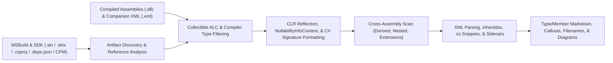

# .NET & C# Language Support Matrix

This architectural matrix provides a single, traceable inventory of every **.NET** and **C# (C# 1 through C# 14 / .NET 11)** language construct, compiler metadata rule, XML documentation feature, and SDK/MSBuild capability supported by `Documentation.Exporter`. Each entry links directly to its detailed functional specification under [`docs/developer/functionalities/`](../developer/functionalities/assembly-loading-and-reflection.md) and its primary implementation entry points under [`src/`](../../src/Documentation.Exporter.Core/Documentation.Exporter.Core.csproj).

> **Related Architecture Docs:** [Architecture Overview](index.md) · [Functionality Catalog (Subsystems)](functionality-catalog.md) · [Component Interactions & Data Flow](component-interactions.md) · [Domain Models & Lifetimes](domain-models-and-lifetimes.md)

---

## Feature Processing Pipeline Map

---

## 1. C# Type System & Access Control (C# 1–14)

| Supported .NET / C# Construct | Support Details & Emitted Output | Functional Description | Primary Code Entry Points |
| :--- | :--- | :--- | :--- |
| **Classes (`abstract`, `sealed`, `static`, nested, finalizers)** | Classifies [`TypeCategory.Class`](../../src/Documentation.Exporter.Abstractions/Models/TypeCategory.cs), emits modifier flags, `: BaseClass, IInterface` clauses, and `where T : ...` constraints in `## Syntax`, builds base-type breadcrumb chain, formats class finalizers as `~ClassName()` (`Finalize.md`), and recursively indexes multi-level nested public types (`Outer.Middle.Inner` -> `Outer/Middle/Inner/index.md`) | [Type Classification & Modifiers](../developer/functionalities/assembly-loading-and-reflection.md#21-modern-type-classification-primary-constructors-and-member-signatures) · [Cross-Assembly Indexing](../developer/functionalities/assembly-loading-and-reflection.md#3-cross-assembly-back-references--multi-layer-exclusion) | [`AssemblyTypeReflector.ReflectTypeMetadata`](../../src/Documentation.Exporter.Core/Parsing/AssemblyTypeReflector.cs) · [`LocalProjectNamespaceHandler.ComputeRuntimeTypeDirectoryUrlPath`](../../src/Documentation.Exporter.Core/Resolution/LocalProjectNamespaceHandler.cs) |
| **Interfaces, Default Interface Methods (DIMs, C# 8), & Explicit Interface Implementations** | Extracts direct/inherited contracts, populates `## Known Implementations`, formats Default Interface Methods (`virtual` / `sealed` on non-abstract interface members), and surfaces explicit interface implementations (`InterfaceName.Member`) with `[explicit] [interface]` visibility links | [Type Classification & Modifiers](../developer/functionalities/assembly-loading-and-reflection.md#21-modern-type-classification-primary-constructors-and-member-signatures) | [`AssemblyTypeReflector.BuildImplementedInterfaces`](../../src/Documentation.Exporter.Core/Parsing/AssemblyTypeReflector.cs) · [`CSharpSignatureFormatter.IsExplicitInterfaceImplementation`](../../src/Documentation.Exporter.Core/Parsing/CSharpSignatureFormatter.cs) |
| **Structs, `readonly struct` (C# 7.2), `[InlineArray(N)]` (C# 12), & `fixed` Buffers** | Detects value types vs. primitives and reads `[IsReadOnlyAttribute]`, `[InlineArray(N)]` (surfacing the element type and length `T[N]`), and `[FixedBuffer(typeof(T), N)]` (`fixed T Name[N]`); renders `readonly struct` declaration and **`ReadOnly: Yes`** row | [Type Classification & Modifiers](../developer/functionalities/assembly-loading-and-reflection.md#21-modern-type-classification-primary-constructors-and-member-signatures) | [`CSharpSignatureFormatter.IsReadOnlyStruct`](../../src/Documentation.Exporter.Core/Parsing/CSharpSignatureFormatter.cs) · [`SyntaxDeclarationSectionRenderer`](../../src/Documentation.Exporter.Core/Generation/Sections/SyntaxDeclarationSectionRenderer.cs) |
| **`ref struct` & `readonly ref struct` (C# 7.2 / 11)** | Detects `Type.IsByRefLike`; renders **`Ref Struct: Yes`** + `ReadOnly` metadata rows and filters Roslyn's compiler-synthesized `[Obsolete("Types with embedded references...")]` | [Type Classification & Modifiers](../developer/functionalities/assembly-loading-and-reflection.md#21-modern-type-classification-primary-constructors-and-member-signatures) · [Compiler Suppression](../developer/functionalities/assembly-loading-and-reflection.md#25-custom-attributes-experimental-apis-and-compiler-suppression) | [`CSharpSignatureFormatter.IsRefStruct`](../../src/Documentation.Exporter.Core/Parsing/CSharpSignatureFormatter.cs) · [`CustomAttributeExtractor.ExtractObsoleteMetadata`](../../src/Documentation.Exporter.Core/Parsing/CustomAttributeExtractor.cs) |
| **Records (`record`, `record struct`, `readonly record struct`) (C# 9–10)** | Detects `<Clone>$` on class records and compiler-generated `PrintMembers(StringBuilder)` on struct records; renders `Record: Yes` and hides synthesized `EqualityContract` | [Type Classification & Modifiers](../developer/functionalities/assembly-loading-and-reflection.md#21-modern-type-classification-primary-constructors-and-member-signatures) | [`CSharpSignatureFormatter.IsRecordType`](../../src/Documentation.Exporter.Core/Parsing/CSharpSignatureFormatter.cs) · [`AssemblyTypeReflector`](../../src/Documentation.Exporter.Core/Parsing/AssemblyTypeReflector.cs) |
| **Enums & `[Flags]` Underlying Types** | Resolves enum base types (`Byte`, `Int32`, etc.), renders inline `## Values` tables with constant values and `<remarks>`/`<example>` blocks, and escapes `[Flags]` attribute pipes | [Markdown Type & Enum Pages](../developer/functionalities/markdown-and-diagram-generation.md#2-type-page-assembly--the-16-section-renderers) | [`AssemblyTypeReflector.BuildFields`](../../src/Documentation.Exporter.Core/Parsing/AssemblyTypeReflector.cs) · [`MembersSectionRenderer`](../../src/Documentation.Exporter.Core/Generation/Sections/MembersSectionRenderer.cs) |
| **Delegates (`delegate`, generic, `ref` returns)** | Formats return type (with `ref` / `ref readonly`), parameter list, and variance from the delegate's `Invoke` method metadata | [Type Classification & Modifiers](../developer/functionalities/assembly-loading-and-reflection.md#21-modern-type-classification-primary-constructors-and-member-signatures) | [`CSharpSignatureFormatter.BuildTypeDeclarationSignature`](../../src/Documentation.Exporter.Core/Parsing/CSharpSignatureFormatter.cs) |
| **Access Modifiers (`public`, `protected`, `protected internal`, `private protected`)** | Preserves single and multi-word access modifiers across types and members, linking each C# keyword individually to Microsoft Learn | [Link Registry Details](../developer/functionalities/xml-parsing-and-link-resolution.md#canonical-microsoft-learn-reference-registry-microsoftlearnreferenceregistry) | [`CSharpSignatureFormatter.ResolveTypeAccessModifier`](../../src/Documentation.Exporter.Core/Parsing/CSharpSignatureFormatter.cs) · [`MicrosoftLearnReferenceRegistry.FormatAccessModifierLink`](../../src/Documentation.Exporter.Core/Resolution/MicrosoftLearnReferenceRegistry.cs) |

---

## 2. Constructors, Properties, Indexers, Fields, & Events (C# 9–14)

| Supported .NET / C# Construct | Support Details & Emitted Output | Functional Description | Primary Code Entry Points |
| :--- | :--- | :--- | :--- |
| **Primary Constructors & Secondary Overloads (C# 12)** | 3-stage detection (`<param>P` captured fields, record `Deconstruct`, single non-empty ctor), constructor overloads with secondary `: this(...)`, and type `<param>`/`<exception>` inheritance | [Type Classification & Modifiers](../developer/functionalities/assembly-loading-and-reflection.md#21-modern-type-classification-primary-constructors-and-member-signatures) · [Overloaded Primary Promotion](../developer/functionalities/enrichment-snippets-and-overrides.md#overloaded-primary-constructor-promotion-and-generic-inheritance) | [`CSharpSignatureFormatter.TryGetPrimaryConstructor`](../../src/Documentation.Exporter.Core/Parsing/CSharpSignatureFormatter.cs) · [`XmlDocumentationEnricher`](../../src/Documentation.Exporter.Core/Enrichment/XmlDocumentationEnricher.cs) |
| **`init`-Only Setters (C# 9)** | Detects `System.Runtime.CompilerServices.IsExternalInit` modreq on property setters and emits `{ get; init; }` | [Type Classification & Modifiers](../developer/functionalities/assembly-loading-and-reflection.md#21-modern-type-classification-primary-constructors-and-member-signatures) | [`CSharpSignatureFormatter.BuildPropertySignature`](../../src/Documentation.Exporter.Core/Parsing/CSharpSignatureFormatter.cs) |
| **`required` Properties & Fields (C# 11)** | Detects `RequiredMemberAttribute`, renders `required` in signatures, and suppresses Roslyn's compiler-synthesized constructor `[Obsolete("Constructors of types with required members...")]` | [Type Classification & Modifiers](../developer/functionalities/assembly-loading-and-reflection.md#21-modern-type-classification-primary-constructors-and-member-signatures) · [Compiler Suppression](../developer/functionalities/assembly-loading-and-reflection.md#25-custom-attributes-experimental-apis-and-compiler-suppression) | [`CSharpSignatureFormatter.BuildPropertySignature`](../../src/Documentation.Exporter.Core/Parsing/CSharpSignatureFormatter.cs) · [`CustomAttributeExtractor`](../../src/Documentation.Exporter.Core/Parsing/CustomAttributeExtractor.cs) |
| **C# 14 `field`-Backed Property Accessors** | Preserves public property signature (`get;` / `set;` / `init;`) and XML docs cleanly without leaking compiler-synthesized backing fields | [Type Classification & Modifiers](../developer/functionalities/assembly-loading-and-reflection.md#21-modern-type-classification-primary-constructors-and-member-signatures) | [`AssemblyTypeReflector.BuildFields`](../../src/Documentation.Exporter.Core/Parsing/AssemblyTypeReflector.cs) · [`CSharpSignatureFormatter.BuildPropertySignature`](../../src/Documentation.Exporter.Core/Parsing/CSharpSignatureFormatter.cs) |
| **Restricted Accessors & Write-Only Properties** | Renders restricted accessor modifiers (`private`, `internal`, `protected internal`, `private protected`), write-only `{ set; }`, and includes inherited properties cleanly | [Type Classification & Modifiers](../developer/functionalities/assembly-loading-and-reflection.md#21-modern-type-classification-primary-constructors-and-member-signatures) | [`CSharpSignatureFormatter.BuildPropertySignature`](../../src/Documentation.Exporter.Core/Parsing/CSharpSignatureFormatter.cs) |
| **Indexers (`this[...]`)** | Formats C# indexer signatures (`this[TKey key] { get; set; }`), resolves `P:Type.Item(...)` XML doc keys, emits `this.md` / `this_<Params>.md`, and hides compiler `DefaultMemberAttribute` | [Generics, Indexers, & Operators](../developer/functionalities/assembly-loading-and-reflection.md#24-generics-variance-constraints-indexers-and-operators) · [Member File Naming](../developer/functionalities/markdown-and-diagram-generation.md#overload-and-path-safe-member-file-naming) | [`AssemblyTypeReflector`](../../src/Documentation.Exporter.Core/Parsing/AssemblyTypeReflector.cs) · [`MemberFileNameFormatter`](../../src/Documentation.Exporter.Core/Generation/MemberFileNameFormatter.cs) |
| **`ref` / `ref readonly` Fields & Properties (C# 7–11)** | Detects `IsReadOnlyAttribute` on `ref readonly` fields (`ModReq` `InAttribute` + getter return `IsReadOnlyAttribute` on properties) cleanly alongside `const`/`static`/`readonly` fields | [Type Classification & Modifiers](../developer/functionalities/assembly-loading-and-reflection.md#21-modern-type-classification-primary-constructors-and-member-signatures) | [`CSharpSignatureFormatter.BuildFieldSignature`](../../src/Documentation.Exporter.Core/Parsing/CSharpSignatureFormatter.cs) · [`CSharpSignatureFormatter.BuildPropertySignature`](../../src/Documentation.Exporter.Core/Parsing/CSharpSignatureFormatter.cs) |
| **Events** | Formats `event HandlerType EventName` signatures with full `NullabilityInfo` and maps `E:` XML comments | [Type Classification & Modifiers](../developer/functionalities/assembly-loading-and-reflection.md#21-modern-type-classification-primary-constructors-and-member-signatures) | [`CSharpSignatureFormatter.BuildEventSignature`](../../src/Documentation.Exporter.Core/Parsing/CSharpSignatureFormatter.cs) · [`AssemblyTypeReflector.BuildEvents`](../../src/Documentation.Exporter.Core/Parsing/AssemblyTypeReflector.cs) |

---

## 3. Methods, Generics, Extensions, Operators, Async, & Parameters (C# 7–14)

| Supported .NET / C# Construct | Support Details & Emitted Output | Functional Description | Primary Code Entry Points |
| :--- | :--- | :--- | :--- |
| **C# 14 `extension(...)` Blocks (Methods & Properties)** | Reconstructs `<G>$...` / `<M>$...` skeleton metadata via `ExtensionMarkerAttribute`, emits **`## Extension Properties`** and instance/static extension methods across classes/structs/interfaces/enums, hides raw `get_`/`set_` accessors, and filters `<G>$`/`<M>$` marker types | [C# 14 Extension Block Discovery](../developer/functionalities/assembly-loading-and-reflection.md#22-c-14-extension-block-discovery-and-reconstruction) · [Collectible Loading](../developer/functionalities/assembly-loading-and-reflection.md#1-collectible-assemblyloadcontext--fault-recovery-isolatedassemblyloader) | [`AssemblyTypeReflector.DiscoverExtensionBlocks`](../../src/Documentation.Exporter.Core/Parsing/AssemblyTypeReflector.cs) · [`IsolatedAssemblyLoader`](../../src/Documentation.Exporter.Core/Parsing/IsolatedAssemblyLoader.cs) · [`CompileTypeDocumentationModelsStep`](../../src/Documentation.Exporter.Core/Workflow/Steps/CompileTypeDocumentationModelsStep.cs) |
| **Classic Extension Methods (`this`)** | Discovers `[Extension]` methods across all loaded assemblies in the run and surfaces them on target type pages with normalized relative links | [Cross-Assembly Indexing](../developer/functionalities/assembly-loading-and-reflection.md#3-cross-assembly-back-references--multi-layer-exclusion) | [`AssemblyTypeReflector.BuildMethods`](../../src/Documentation.Exporter.Core/Parsing/AssemblyTypeReflector.cs) · [`CompileTypeDocumentationModelsStep`](../../src/Documentation.Exporter.Core/Workflow/Steps/CompileTypeDocumentationModelsStep.cs) |
| **Generic Parameters, Own Arity, & Variance (`in`/`out`)** | Uses `ExtractOwnGenericArguments` for nested generic types and maps `Covariant` (`out`) / `Contravariant` (`in`) onto `ParameterModifier` and declarations | [Generics, Indexers, & Operators](../developer/functionalities/assembly-loading-and-reflection.md#24-generics-variance-constraints-indexers-and-operators) | [`CSharpSignatureFormatter.ExtractOwnGenericArguments`](../../src/Documentation.Exporter.Core/Parsing/CSharpSignatureFormatter.cs) · [`AssemblyTypeReflector`](../../src/Documentation.Exporter.Core/Parsing/AssemblyTypeReflector.cs) |
| **Generic Constraints (`class`, `struct`, `unmanaged`, `new()`, `notnull`, `allows ref struct`) (C# 7.3–13)** | Resolves `AllowByRefLike`, `IsUnmanagedAttribute`, and nullable metadata byte flag `1` (`notnull`) into linked **`#### Type Parameters`** constraint cells | [Generics, Indexers, & Operators](../developer/functionalities/assembly-loading-and-reflection.md#24-generics-variance-constraints-indexers-and-operators) · [Link Registry](../developer/functionalities/xml-parsing-and-link-resolution.md#canonical-microsoft-learn-reference-registry-microsoftlearnreferenceregistry) | [`AssemblyTypeReflector`](../../src/Documentation.Exporter.Core/Parsing/AssemblyTypeReflector.cs) · [`MicrosoftLearnReferenceRegistry.FormatGenericConstraintsCell`](../../src/Documentation.Exporter.Core/Resolution/MicrosoftLearnReferenceRegistry.cs) |
| **Interface & Override Modifiers (`static abstract`, `static virtual`, `virtual`, `override`, `sealed override`, `readonly` methods) (C# 8–11)** | Detects interface `static abstract`/`static virtual` contracts, base slot overrides, `sealed override`, and `readonly` instance methods on mutable value types | [Type Classification & Modifiers](../developer/functionalities/assembly-loading-and-reflection.md#21-modern-type-classification-primary-constructors-and-member-signatures) | [`CSharpSignatureFormatter.BuildMethodSignature`](../../src/Documentation.Exporter.Core/Parsing/CSharpSignatureFormatter.cs) · [`CSharpSignatureFormatter.BuildPropertySignature`](../../src/Documentation.Exporter.Core/Parsing/CSharpSignatureFormatter.cs) |
| **Operators, Checked, Unsigned Shift, & C# 14 Compound Operators (C# 11 / 14)** | Renders unary, binary, comparison, `checked` (`op_Checked*`), `>>>` (`op_UnsignedRightShift`), C# 14 compound assignment (`+=`, `checked +=`, `op_*Assignment`), and conversions (`implicit`/`explicit`/`checked explicit` with `~ReturnType` XML keys) under `## Methods` with safe `op_*` filenames | [Generics, Indexers, & Operators](../developer/functionalities/assembly-loading-and-reflection.md#24-generics-variance-constraints-indexers-and-operators) · [Member File Naming](../developer/functionalities/markdown-and-diagram-generation.md#overload-and-path-safe-member-file-naming) | [`CSharpSignatureFormatter.TryGetOperatorDisplayToken`](../../src/Documentation.Exporter.Core/Parsing/CSharpSignatureFormatter.cs) · [`MemberFileNameFormatter`](../../src/Documentation.Exporter.Core/Generation/MemberFileNameFormatter.cs) |
| **Async Methods, Streams, & Cancellation (`Task`, `ValueTask`, `IAsyncEnumerable<T>`, `[EnumeratorCancellation]`)** | Flags `IsAwaitableReturnType`, `IsAsyncEnumerableType`, and `[AsyncStateMachine]`/`[AsyncIteratorStateMachine]` (`async` badge + `CancellationToken` / `[EnumeratorCancellation]` badges) | [Type Classification & Modifiers](../developer/functionalities/assembly-loading-and-reflection.md#21-modern-type-classification-primary-constructors-and-member-signatures) | [`CSharpSignatureFormatter`](../../src/Documentation.Exporter.Core/Parsing/CSharpSignatureFormatter.cs) · [`MembersSectionRenderer`](../../src/Documentation.Exporter.Core/Generation/Sections/MembersSectionRenderer.cs) |
| **Parameters (`in`, `out`, `ref`, `ref readonly`, `scoped`, `params` Collections, Caller Info, Defaults) (C# 7–13)** | Surfaces `scoped` + by-ref modifier combinations, C# 13 `params ReadOnlySpan<T>` (`ParamCollectionAttribute`), `[Optional]`/default values, and `CallerMemberName` / `CallerArgumentExpression` badges | [Type Classification & Modifiers](../developer/functionalities/assembly-loading-and-reflection.md#21-modern-type-classification-primary-constructors-and-member-signatures) · [Modern Modifier Rendering](../developer/functionalities/markdown-and-diagram-generation.md#experimental-callouts-and-modern-modifier-rendering) | [`CSharpSignatureFormatter.DetermineParameterModifier`](../../src/Documentation.Exporter.Core/Parsing/CSharpSignatureFormatter.cs) · [`CustomAttributeExtractor.GetCallerInformationAttribute`](../../src/Documentation.Exporter.Core/Parsing/CustomAttributeExtractor.cs) |

---

## 4. Nullability, Type Expressions, & Custom Attributes

| Supported .NET / C# Construct | Support Details & Emitted Output | Functional Description | Primary Code Entry Points |
| :--- | :--- | :--- | :--- |
| **Nullable Reference Types (NRT `?`) & `Nullable<T>` (C# 8)** | Uses `NullabilityInfoContext` across properties, fields, events, returns, nested generic arguments, arrays, and by-ref (`out`/`ref`/`in` `ReadState`/`WriteState`) parameters | [Nullable Reference Types & By-Ref Unwrapping](../developer/functionalities/assembly-loading-and-reflection.md#23-nullable-reference-types-and-by-ref-unwrapping) | [`CSharpSignatureFormatter.FormatDisplayTypeName`](../../src/Documentation.Exporter.Core/Parsing/CSharpSignatureFormatter.cs) · [`AssemblyTypeReflector`](../../src/Documentation.Exporter.Core/Parsing/AssemblyTypeReflector.cs) |
| **Single, Jagged, & Multi-Dimensional Arrays (`[]`, `[][]`, `[,]`), Pointers (`*`), Function Pointers (`delegate*`), Named ValueTuples, `nint`/`nuint`, & `dynamic`** | Formats C# brackets (`[,]`), pointer suffixes (`Void*`), managed/unmanaged function pointers (`delegate* unmanaged[Cdecl]<T, R>` with `=FUNC:` XML keys), named tuples (`(String Id, Int32 Count)` via `[TupleElementNames]`), native integers (`nint`/`nuint` via `[NativeInteger]`), and `dynamic` (via `[Dynamic]`) | [Nullable Reference Types & By-Ref Unwrapping](../developer/functionalities/assembly-loading-and-reflection.md#23-nullable-reference-types-and-by-ref-unwrapping) | [`CSharpSignatureFormatter.FormatDisplayTypeName`](../../src/Documentation.Exporter.Core/Parsing/CSharpSignatureFormatter.cs) · [`AssemblyTypeReflector.FormatXmlParameterType`](../../src/Documentation.Exporter.Core/Parsing/AssemblyTypeReflector.cs) |
| **Custom Attributes Across All Targets** | Extracts linked attributes on assemblies, types, generic parameters, enum values, constructors, properties, methods, fields, events, parameters, and return values with formatted arguments (`typeof(...)`, arrays, `[Flags]` pipe escaping) | [Custom Attributes & Suppression](../developer/functionalities/assembly-loading-and-reflection.md#25-custom-attributes-experimental-apis-and-compiler-suppression) | [`CustomAttributeExtractor.BuildAppliedAttributes`](../../src/Documentation.Exporter.Core/Parsing/CustomAttributeExtractor.cs) |
| **`[Experimental]` Preview Callouts (.NET 8+)** | Renders `> [!IMPORTANT]` banners on type and member pages (formatting optional `UrlFormat`), `**[Experimental]**` table prefixes on index/overview tables, and suppresses raw `[ExperimentalAttribute]` noise | [Custom Attributes & Suppression](../developer/functionalities/assembly-loading-and-reflection.md#25-custom-attributes-experimental-apis-and-compiler-suppression) · [Modern Modifier Rendering](../developer/functionalities/markdown-and-diagram-generation.md#experimental-callouts-and-modern-modifier-rendering) | [`CustomAttributeExtractor.ExtractExperimentalMetadata`](../../src/Documentation.Exporter.Core/Parsing/CustomAttributeExtractor.cs) · [`MicrosoftLearnReferenceRegistry.FormatExperimentalWarningBlock`](../../src/Documentation.Exporter.Core/Resolution/MicrosoftLearnReferenceRegistry.cs) |
| **`[Obsolete]` Banners, `DiagnosticId`/`UrlFormat` (.NET 5+), & Compiler Obsolete Suppression** | Renders `> [!WARNING]` or `> [!CAUTION]` (`IsError = true`) callout banners with optional `DiagnosticId`/`UrlFormat` badges (`([DEMO002](...))`), while suppressing Roslyn's compiler-synthesized `[Obsolete]` messages on `required` constructors and `ref struct` types | [Custom Attributes & Suppression](../developer/functionalities/assembly-loading-and-reflection.md#25-custom-attributes-experimental-apis-and-compiler-suppression) | [`CustomAttributeExtractor.ExtractObsoleteMetadata`](../../src/Documentation.Exporter.Core/Parsing/CustomAttributeExtractor.cs) · [`MicrosoftLearnReferenceRegistry.FormatObsoleteWarningBlock`](../../src/Documentation.Exporter.Core/Resolution/MicrosoftLearnReferenceRegistry.cs) |
| **`[EditorBrowsable(Never)]` & Compiler Plumbing Filters** | Excludes `[EditorBrowsable(EditorBrowsableState.Never)]` types/members (configurable) and filters compiler-generated attributes (`CompilerGenerated`, `ParamCollection`, `ExtensionMarker`, `NativeInteger`, `DefaultMember`, `NullableContext`, etc.) | [Custom Attributes & Suppression](../developer/functionalities/assembly-loading-and-reflection.md#25-custom-attributes-experimental-apis-and-compiler-suppression) | [`CustomAttributeExtractor.IsEditorBrowsableNever`](../../src/Documentation.Exporter.Core/Parsing/CustomAttributeExtractor.cs) · [`CompileTypeDocumentationModelsStep`](../../src/Documentation.Exporter.Core/Workflow/Steps/CompileTypeDocumentationModelsStep.cs) |

---

## 5. XML Documentation Comments & Cross-Linking

| Supported .NET / C# Construct | Support Details & Emitted Output | Functional Description | Primary Code Entry Points |
| :--- | :--- | :--- | :--- |
| **Standard XML Doc Tags (`
`, `<remarks>`, `<para>`, `<list>`, `<note>`, `<c>`, `<code>`, `<example>`, `<param>`, `<typeparam>`, `<paramref>`, `<typeparamref>`, `<returns>`, `<value>`, `<see>`, `<seealso>`, `<exclude/>`)** | Parses `.xml` files asynchronously, renders `<list type="table">` + `<term>`/`<listheader>`, `<note type="...">` GitHub alerts, `<code language="...">` dedenting, custom `<see cref="...">label</see>` text, overloaded `cref` routing (`MemberCrefRouteIndexBuilder`), merges duplicate `<exception cref="...">` rows, supports extensible `IXmlTagHandler` strategies (`PassthroughTagHandler` fallback), and drops `<exclude/>` items | [Compiler XML Indexing](../developer/functionalities/xml-parsing-and-link-resolution.md#1-compiler-xml-indexing-xmldocumentationparser) · [Recursive Tag Transformation](../developer/functionalities/xml-parsing-and-link-resolution.md#2-recursive-xml-tag-transformation-xmltagtransformer--ixmltaghandler) · [User XML Authoring Guide](../user/xml-documentation-authoring.md) | [`XmlDocumentationParser`](../../src/Documentation.Exporter.Core/Parsing/XmlDocumentationParser.cs) · [`XmlTagTransformer`](../../src/Documentation.Exporter.Core/Parsing/XmlTagTransformer.cs) · [`MemberCrefRouteIndexBuilder`](../../src/Documentation.Exporter.Core/Resolution/MemberCrefRouteIndexBuilder.cs) · [`IXmlTagHandler`](../../src/Documentation.Exporter.Abstractions/Parsing/Tags/IXmlTagHandler.cs) |
| **`<inheritdoc/>` & Generic Base/Interface Inheritance** | Resolves explicit `cref` targets or walks implemented interfaces + base classes upward without overwriting local text, normalizing constructed generic interfaces/base types via `GetGenericTypeDefinition()` | [XML Comments & inheritdoc](../developer/functionalities/enrichment-snippets-and-overrides.md#2-stage-1-order--10-xml-comments--inheritdoc-xmldocumentationenricher) · [Overloaded Primary Promotion](../developer/functionalities/enrichment-snippets-and-overrides.md#overloaded-primary-constructor-promotion-and-generic-inheritance) | [`XmlDocumentationEnricher`](../../src/Documentation.Exporter.Core/Enrichment/XmlDocumentationEnricher.cs) · [`XmlDocumentationParser.ResolveCrefKey`](../../src/Documentation.Exporter.Core/Parsing/XmlDocumentationParser.cs) |
| **Order-Sorted Cross-Assembly, Pattern, & Microsoft Learn Link Resolution** | Thread-safe lock-free `INamespaceHandler` (`Order`) & `INamespaceHandlerProvider` priority chain resolving exported solution types, DI/plugin handlers, custom rules, `{placeholder}` templates (`--external-docs`), and `.NET` BCL Microsoft Learn URLs | [Ordered Namespace Link Resolution](../developer/functionalities/xml-parsing-and-link-resolution.md#3-ordered-namespace-link-resolution-configureresolutionhandlersstep--typelinkresolver) | [`ITypeLinkResolver`](../../src/Documentation.Exporter.Abstractions/Resolution/ITypeLinkResolver.cs) · [`TypeLinkResolver`](../../src/Documentation.Exporter.Core/Resolution/TypeLinkResolver.cs) · [`LocalProjectNamespaceHandler`](../../src/Documentation.Exporter.Core/Resolution/LocalProjectNamespaceHandler.cs) · [`MicrosoftDocsNamespaceHandler`](../../src/Documentation.Exporter.Core/Resolution/MicrosoftDocsNamespaceHandler.cs) |
| **External `.cs` Snippets, `.md` Sidecars, & Pluggable Site Nav** | Attaches case-insensitive `.cs` code snippets (`{ExamplesDir}`), parses YAML-frontmatter sidecars across 5 page anchors, updates `mkdocs.nav.yml` idempotently (or delegates via `--nav-format` plugins), and verifies all links (`--strict`) | [Enrichment, Snippets, & Overrides](../developer/functionalities/enrichment-snippets-and-overrides.md) · [Navigation & Quality Gates](../developer/functionalities/navigation-quality-gates-and-localization.md) | [`FileExampleProvider`](../../src/Documentation.Exporter.Core/Injection/FileExampleProvider.cs) · [`FileDocumentationInjector`](../../src/Documentation.Exporter.Core/Injection/FileDocumentationInjector.cs) · [`MkDocsNavigationGenerator`](../../src/Documentation.Exporter.Plugins.Navigation.MkDocs/MkDocsNavigationGenerator.cs) |

---

## 6. .NET SDK, Solutions, Assembly Loading, & Dependencies

| Supported .NET / MSBuild Feature | Support Details & Emitted Output | Functional Description | Primary Code Entry Points |
| :--- | :--- | :--- | :--- |
| **`.sln` & XML `.slnx` Solution Discovery** | Parses classic `.sln` GUID lines and modern `.NET` `.slnx` XML `<Project>` entries cleanly across Windows/Linux path separators, excluding test projects and wildcards | [Solution & Artifact Discovery](../developer/functionalities/solution-and-artifact-discovery.md#1-unified-discovery-decision-tree-exportartifactdiscoveryservice) · [Parsing .sln & .slnx](../developer/functionalities/solution-and-artifact-discovery.md#2-parsing-classic-sln-and-modern-xml-slnx-files) | [`SolutionAssemblyResolver`](../../src/Documentation.Exporter.Core/Parsing/SolutionAssemblyResolver.cs) · [`ExportArtifactDiscoveryService`](../../src/Documentation.Exporter.Core/Parsing/ExportArtifactDiscoveryService.cs) |
| **Centralized `<ArtifactsPath>` (`build/bin`) & Standard `bin/` Probing** | Walks parent directories for centralized `build/bin` outputs (including `<config>_<tfm>` pivot folders) before falling back to local `bin/`, pairing `.dll` + companion `.xml` | [Build Output Probing](../developer/functionalities/solution-and-artifact-discovery.md#4-build-output-probing-centralized-artifactspath-vs-standard-bin) | [`SolutionAssemblyResolver`](../../src/Documentation.Exporter.Core/Parsing/SolutionAssemblyResolver.cs) |
| **Collectible `AssemblyLoadContext` & Partial Recovery** | Loads assemblies in isolated collectible scopes unloaded on disposal, resolves dependencies via `.deps.json` and sibling folders, salvages loadable types on `ReflectionTypeLoadException`, and excludes `<...>` compiler types | [Collectible Loading](../developer/functionalities/assembly-loading-and-reflection.md#1-collectible-assemblyloadcontext--fault-recovery-isolatedassemblyloader) | [`IsolatedAssemblyLoader`](../../src/Documentation.Exporter.Core/Parsing/IsolatedAssemblyLoader.cs) |
| **Assembly References, NuGet CPM, & Transitive Dependency Tree** | Correlates IL references, `.deps.json`, `.csproj`, and `Directory.Packages.props` (`CPM`) into `## Assembly References` and cycle-free non-framework `## Assembly Dependency Tree` Mermaid/PlantUML graphs | [Reference Correlation](../developer/functionalities/assembly-references-and-dependency-tree.md#1-correlating-four-metadata-sources-analyzeassemblyreferences) · [Transitive Dependency Tree](../developer/functionalities/assembly-references-and-dependency-tree.md#2-transitive-non-framework-dependency-tree-analyzeassemblydependencytrees) | [`AssemblyReferenceAnalyzer`](../../src/Documentation.Exporter.Core/Parsing/AssemblyReferenceAnalyzer.cs) · [`IndexPageMarkdownGenerator`](../../src/Documentation.Exporter.Core/Generation/IndexPageMarkdownGenerator.cs) |

---

## 7. Known Boundaries & Intentional Exclusions

To keep public API documentation noise-free and deterministic, the constructs below are intentionally filtered or outside current scope:

| Boundary / Excluded Construct | Current Behavior | Where Controlled |
| :--- | :--- | :--- |
| **`private`, `internal`, & `file`-scoped Types (C# 11)** | Excluded from API export (only externally accessible `public`, `protected`, `protected internal`, and `private protected` members on public types are documented) | [`IsolatedAssemblyLoader`](../../src/Documentation.Exporter.Core/Parsing/IsolatedAssemblyLoader.cs) · [`CSharpSignatureFormatter.IsMethodAccessible`](../../src/Documentation.Exporter.Core/Parsing/CSharpSignatureFormatter.cs) |
| **Compiler-Generated Types & Members** | Excludes `<G>$...` / `<M>$...` C# 14 extension containers, `<PrivateImplementationDetails>`, `<Clone>$`, `EqualityContract`, `<param>P` captured fields, async/iterator state machines, and direct `get_`/`set_` accessors | [`IsolatedAssemblyLoader`](../../src/Documentation.Exporter.Core/Parsing/IsolatedAssemblyLoader.cs) · [`AssemblyTypeReflector`](../../src/Documentation.Exporter.Core/Parsing/AssemblyTypeReflector.cs) · [`CustomAttributeExtractor`](../../src/Documentation.Exporter.Core/Parsing/CustomAttributeExtractor.cs) |
| **Multi-Targeted `.csproj` Single-TFM Selection** | Solution discovery selects one compiled `<AssemblyName>.dll` + `.xml` pair matching the active `-c` configuration (`Debug`/`Release`) rather than generating separate per-TFM output trees | [`SolutionAssemblyResolver`](../../src/Documentation.Exporter.Core/Parsing/SolutionAssemblyResolver.cs) |
| **Live Demo & Test Verification** | Every construct in Sections 1–5 is exercised end-to-end in [`ModernCSharpShowcase.cs`](../../demo/Documentation.Exporter.DemoLibrary/ModernCSharp/ModernCSharpShowcase.cs) and verified by [`AssemblyTypeReflectorTests.cs`](../../test/Documentation.Exporter.Core.Tests/Parsing/AssemblyTypeReflectorTests.cs), [`CSharpSignatureFormatterTests.cs`](../../test/Documentation.Exporter.Core.Tests/Parsing/CSharpSignatureFormatterTests.cs), [`CustomAttributeExtractorTests.cs`](../../test/Documentation.Exporter.Core.Tests/Parsing/CustomAttributeExtractorTests.cs), and [`MultiAssemblyAndSolutionEndToEndTests.cs`](../../test/Documentation.Exporter.Core.Tests/Integration/MultiAssemblyAndSolutionEndToEndTests.cs) | [Testing Architecture & Coverage](../developer/testing-and-coverage.md) |
