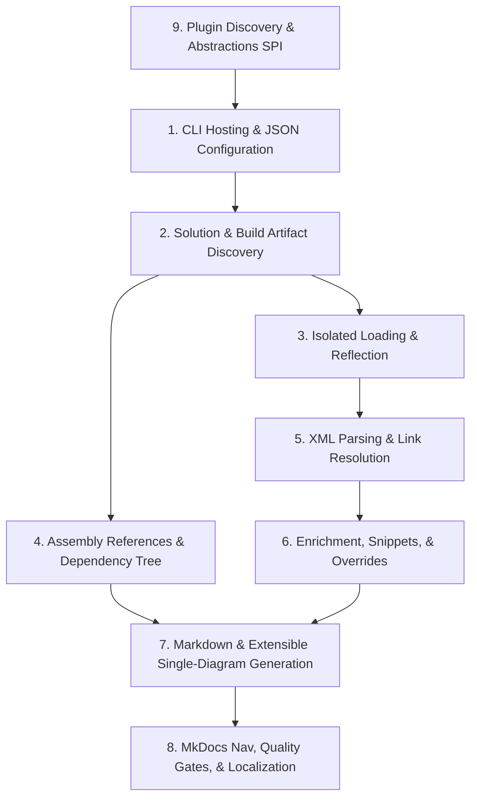

# Functionality Catalog

This catalog inventories every user-facing and internal capability implemented in `Documentation.Exporter`, organized into **nine functional domains**. Each domain pairs its architectural contract matrix (owning interfaces, implementations, inputs, and outputs) with a link to its dedicated developer specification under `docs/developer/functionalities/`.

For runtime step sequencing and shared state transitions across these domains, see [Component Interactions & Data Flow](component-interactions.md). For an itemized C# 1–14 / .NET feature inventory mapped to code entry points, see [.NET & C# Language Support Matrix](dotnet-language-support-matrix.md).

---

## Functional Domains Map

---

## 1. CLI Hosting & Configuration Input

Provides a cross-platform command-line experience built on `System.CommandLine` and JSON deserialization so teams can run exports interactively or declaratively in CI pipelines.

> **Dedicated Deep-Dive:** [CLI Hosting, Subcommands, & JSON Configuration](../developer/functionalities/cli-and-configuration.md) · **User Guide:** [CLI Commands & Configuration](../user/cli-and-configuration.md)

| Functionality | Owning Contracts & Classes | Inputs | Outputs |
| :--- | :--- | :--- | :--- |
| **Root Command & Subcommand Registration** | [`CliServiceCollectionExtensions`](../../src/Documentation.Exporter.Cli/CliServiceCollectionExtensions.cs), [`ICliCommandBuilder`](../../src/Documentation.Exporter.Cli/ICliCommandBuilder.cs) ([`CliCommandBuilder`](../../src/Documentation.Exporter.Cli/CliCommandBuilder.cs)), [`ICliSubcommand`](../../src/Documentation.Exporter.Cli/ICliSubcommand.cs) | Process CLI arguments (`string[]`) | Configured `System.CommandLine` `RootCommand` |
| **Solution Export Command (`solution`)** | [`SolutionCliSubcommand`](../../src/Documentation.Exporter.Cli/SolutionCliSubcommand.cs), [`ISharedCliOptions`](../../src/Documentation.Exporter.Cli/ISharedCliOptions.cs) ([`SharedCliOptions`](../../src/Documentation.Exporter.Cli/SharedCliOptions.cs)) | `--solution`, `--configuration`, `--include-tests`, shared export options | Bound [`ExporterOptions`](../../src/Documentation.Exporter.Abstractions/Models/ExporterOptions.cs) + `LogLevel` passed to [`ICliPipelineRunner`](../../src/Documentation.Exporter.Cli/ICliPipelineRunner.cs) |
| **Multi-Assembly Export Command (`assembly`)** | [`AssemblyCliSubcommand`](../../src/Documentation.Exporter.Cli/AssemblyCliSubcommand.cs), [`ISharedCliOptions`](../../src/Documentation.Exporter.Cli/ISharedCliOptions.cs) ([`SharedCliOptions`](../../src/Documentation.Exporter.Cli/SharedCliOptions.cs)) | `--assembly` (`-a`), `--xml` (`-x`), shared export options | Bound [`ExporterOptions`](../../src/Documentation.Exporter.Abstractions/Models/ExporterOptions.cs) with explicit `.dll`/`.xml` paths |
| **Declarative JSON Config Command (`config`)** | [`ConfigCliSubcommand`](../../src/Documentation.Exporter.Cli/ConfigCliSubcommand.cs), [`IExporterConfigurationLoader`](../../src/Documentation.Exporter.Core/Configuration/IExporterConfigurationLoader.cs) ([`ExporterConfigurationLoader`](../../src/Documentation.Exporter.Core/Configuration/ExporterConfigurationLoader.cs)) | `--config` (`-f`) path to `doc-exporter.json` plus optional CLI override flags (`--strict`, `--clean`, `--diagram-format`, `--fail-on-missing`, `--fail-on-undocumented`, `--report-file`, `--report-format`, `--log-level`) | Asynchronously deserialized [`ExporterOptions`](../../src/Documentation.Exporter.Abstractions/Models/ExporterOptions.cs) with strict unmapped-property rejection (`JsonUnmappedMemberHandling.Disallow`) and paths resolved relative to config file folder |
| **External Doc Rule CLI Parsing** | [`SharedCliOptions.ParseExternalDocRules`](../../src/Documentation.Exporter.Cli/SharedCliOptions.cs), [`ExternalDocLinkRule.TryParse`](../../src/Documentation.Exporter.Abstractions/Models/ExternalDocLinkRule.cs) | `--external-docs` (`-d`) strings (`Prefix=Template`), `--report-file` (`-r`), `--report-format` | Validated list of [`ExternalDocLinkRule`](../../src/Documentation.Exporter.Abstractions/Models/ExternalDocLinkRule.cs) records and quality report configuration, or exit code `2` via [`IConsoleOutput`](../../src/Documentation.Exporter.Cli/IConsoleOutput.cs) |
| **Dynamic Logging & Exit Code Mapping** | [`ICliPipelineRunner`](../../src/Documentation.Exporter.Cli/ICliPipelineRunner.cs) ([`CliPipelineRunner`](../../src/Documentation.Exporter.Cli/CliPipelineRunner.cs)), [`CliLoggingLevelSwitch`](../../src/Documentation.Exporter.Cli/CliLoggingLevelSwitch.cs) | [`ExporterOptions`](../../src/Documentation.Exporter.Abstractions/Models/ExporterOptions.cs), `LogLevel`, `CancellationToken` | Structured console logs (`EventId` `1001`–`1005`), diagnostics summary line, exit code `0`, `1`, or `2` |

---

## 2. Solution & Artifact Discovery

Translates either `.sln`/`.slnx` solutions or explicit assembly lists into verified binary/XML pairs while excluding test suites and matching wildcard exclusion patterns across both centralized (`build/`) and classic (`bin/`) MSBuild output trees.

> **Dedicated Deep-Dive:** [Solution & Build Artifact Discovery](../developer/functionalities/solution-and-artifact-discovery.md)

| Functionality | Owning Contracts & Classes | Inputs | Outputs |
| :--- | :--- | :--- | :--- |
| **`.sln` & `.slnx` Project Parsing** | [`ISolutionAssemblyResolver`](../../src/Documentation.Exporter.Core/Parsing/ISolutionAssemblyResolver.cs) ([`SolutionAssemblyResolver`](../../src/Documentation.Exporter.Core/Parsing/SolutionAssemblyResolver.cs)) | Solution file path, build configuration (`Debug`/`Release`), `--include-tests`, `--exclude` patterns | Ordered list of [`DiscoveredAssemblyArtifact`](../../src/Documentation.Exporter.Core/Parsing/ISolutionAssemblyResolver.cs) records (`AssemblyFilePath`, `XmlDocumentationFilePath`, `ProjectFilePath`) |
| **Unified Artifact Resolution** | [`IExportArtifactDiscoveryService`](../../src/Documentation.Exporter.Core/Parsing/IExportArtifactDiscoveryService.cs) ([`ExportArtifactDiscoveryService`](../../src/Documentation.Exporter.Core/Parsing/ExportArtifactDiscoveryService.cs)) | [`ExporterOptions`](../../src/Documentation.Exporter.Abstractions/Models/ExporterOptions.cs) (either solution mode or multi-assembly mode) | [`ExportArtifactDiscoveryResult`](../../src/Documentation.Exporter.Core/Parsing/IExportArtifactDiscoveryService.cs) (resolved `.dll` paths, `.xml` paths, and `ProjectFilePathsByAssemblyPath`) |
| **Test Project & Wildcard Project Exclusion** | [`SolutionAssemblyResolver`](../../src/Documentation.Exporter.Core/Parsing/SolutionAssemblyResolver.cs) (`IsExcludedByPatterns`, test project heuristics) | Project name, assembly name, wildcard `*`/`?` lists | Filtered project set excluding matching/test projects |
| **Strict Missing Artifact Detection** | [`SolutionAssemblyResolver`](../../src/Documentation.Exporter.Core/Parsing/SolutionAssemblyResolver.cs), [`LoadAssemblyTypesStep`](../../src/Documentation.Exporter.Core/Workflow/Steps/LoadAssemblyTypesStep.cs) | `--fail-on-missing` (`FailOnMissingProjectArtifacts`), project XML/MSBuild conventions | Warnings (`EventId` `601`/`602`) or `FileNotFoundException` aborting export (`EventId` `815`) |

---

## 3. Isolated Assembly Loading, Reflection, & Filtering

Loads target binaries in a collectible `AssemblyLoadContext`, recovers safely from partial loader errors, extracts full C# API metadata and formatted signatures, and resolves cross-assembly nested types, derived classes, and extension methods.

> **Dedicated Deep-Dive:** [Isolated Assembly Loading, Reflection, & Cross-Assembly Indexing](../developer/functionalities/assembly-loading-and-reflection.md)

| Functionality | Owning Contracts & Classes | Inputs | Outputs |
| :--- | :--- | :--- | :--- |
| **Isolated Collectible Loading** | [`IAssemblyLoader`](../../src/Documentation.Exporter.Core/Parsing/IAssemblyLoader.cs) ([`IsolatedAssemblyLoader`](../../src/Documentation.Exporter.Core/Parsing/IsolatedAssemblyLoader.cs)) | One or more `.dll` paths | Public exported `Type` dictionary keyed by full type name inside collectible `AssemblyLoadContext`, filtering compiler-generated types and C# 14 extension marker containers (`<G>$`, `<M>$`, `IsSpecialName`) |
| **Partial Type Recovery & Collision Guard** | [`IsolatedAssemblyLoader`](../../src/Documentation.Exporter.Core/Parsing/IsolatedAssemblyLoader.cs) | `ReflectionTypeLoadException`, duplicate full type names | Recovered non-null types (`EventId` `106` warning) + retained-first deduplication (`EventId` `107` warning) |
| **Type & Member Metadata Extraction** | [`IAssemblyTypeReflector`](../../src/Documentation.Exporter.Core/Parsing/IAssemblyTypeReflector.cs) ([`AssemblyTypeReflector`](../../src/Documentation.Exporter.Core/Parsing/AssemblyTypeReflector.cs)), [`ICustomAttributeExtractor`](../../src/Documentation.Exporter.Core/Parsing/ICustomAttributeExtractor.cs) ([`CustomAttributeExtractor`](../../src/Documentation.Exporter.Core/Parsing/CustomAttributeExtractor.cs)), [`ICSharpSignatureFormatter`](../../src/Documentation.Exporter.Core/Parsing/ICSharpSignatureFormatter.cs) ([`CSharpSignatureFormatter`](../../src/Documentation.Exporter.Core/Parsing/CSharpSignatureFormatter.cs)) | Loaded `Assembly` and `Type` instances, constructors, properties, indexers, methods, operators, fields, enum values, events, parameters, generic type parameters, and return parameters | Assembly-level linked custom attributes and [`TypeDocumentationModel`](../../src/Documentation.Exporter.Abstractions/Models/TypeDocumentationModel.cs) / [`MemberDocumentationModel`](../../src/Documentation.Exporter.Abstractions/Models/MemberDocumentationModel.cs) / [`ParameterDocumentationModel`](../../src/Documentation.Exporter.Abstractions/Models/ParameterDocumentationModel.cs) records covering modern C# 9–14 constructs (`record`, `readonly struct`, `ref struct`, `init`/`required`, `allows ref struct`, `notnull`, `in`/`out` variance, `scoped`, `static abstract`/`static virtual`, indexers `this[...]`, checked/unsigned-shift/compound-assignment operators, C# 14 `extension(...)` blocks and `field`, full `NullabilityInfoContext` NRT `?`, `[Obsolete]`, `[Experimental]`, compiler metadata/synthesized-obsolete filtering, and linked custom attributes across all targets) |
| **Cross-Assembly Relationships** | [`CompileTypeDocumentationModelsStep`](../../src/Documentation.Exporter.Core/Workflow/Steps/CompileTypeDocumentationModelsStep.cs) | All exported `Type` definitions in [`ExportWorkflowContext.ExportedTypesMap`](../../src/Documentation.Exporter.Abstractions/Workflow/ExportWorkflowContext.cs) | Populated `NestedTypes`, `DerivedTypes` / implementations, `ExtensionMethods`, and `ExtensionProperties` across assemblies (targeting classes, structs, interfaces, and enums) |
| **Exclusion Filters** | [`LoadAssemblyTypesStep`](../../src/Documentation.Exporter.Core/Workflow/Steps/LoadAssemblyTypesStep.cs), [`CompileTypeDocumentationModelsStep`](../../src/Documentation.Exporter.Core/Workflow/Steps/CompileTypeDocumentationModelsStep.cs), [`SolutionAssemblyResolver`](../../src/Documentation.Exporter.Core/Parsing/SolutionAssemblyResolver.cs) | `ExcludedTypes`, `ExcludedNamespaces`, `ExcludeEditorBrowsableNever`, `<exclude/>` XML tag | Filtered exported types and members omitted from output |

---

## 4. Assembly Reference & Transitive Dependency Analysis

Correlates IL assembly references with `.deps.json`, `.csproj`, and `Directory.Packages.props` Central Package Management rules to classify every dependency's origin, version constraint policy, and strong-name `PublicKeyToken`, and builds a cycle-free non-framework dependency tree.

> **Dedicated Deep-Dive:** [Assembly Reference & Transitive Dependency Tree Analysis](../developer/functionalities/assembly-references-and-dependency-tree.md) · **User Guide:** [Diagrams & Assembly Insights](../user/diagrams-and-assembly-insights.md)

| Functionality | Owning Contracts & Classes | Inputs | Outputs |
| :--- | :--- | :--- | :--- |
| **Direct Assembly Reference Inspection** | [`IAssemblyReferenceAnalyzer`](../../src/Documentation.Exporter.Core/Parsing/IAssemblyReferenceAnalyzer.cs) ([`AssemblyReferenceAnalyzer`](../../src/Documentation.Exporter.Core/Parsing/AssemblyReferenceAnalyzer.cs)) | Loaded `Assembly` instances, sibling `.deps.json`, source `.csproj`, parent `Directory.Packages.props` | `IReadOnlyDictionary<string, IReadOnlyList<AssemblyReferenceModel>>` ([`AssemblyReferenceModel`](../../src/Documentation.Exporter.Abstractions/Models/AssemblyReferenceModel.cs)) classified by kind ([`AssemblyReferenceKind`](../../src/Documentation.Exporter.Abstractions/Models/AssemblyReferenceKind.cs): `Project`, `Package`, `Assembly`, `Framework`), linking policy ([`AssemblyVersionLinkingKind`](../../src/Documentation.Exporter.Abstractions/Models/AssemblyVersionLinkingKind.cs): `Compiled`, `ProjectLinked`, `Fixed`, `Minimum`, `Range`, `Floating`, `Framework`), version constraints, and `PublicKeyToken` |
| **Central Package Management (CPM) Resolution** | [`AssemblyReferenceAnalyzer`](../../src/Documentation.Exporter.Core/Parsing/AssemblyReferenceAnalyzer.cs) | Nearest ancestor `Directory.Packages.props` + `<PackageVersion>` / `VersionOverride` | Resolved exact package constraint expressions & versions |
| **Transitive Non-Framework Dependency Tree** | [`IAssemblyReferenceAnalyzer.AnalyzeAssemblyDependencyTrees`](../../src/Documentation.Exporter.Core/Parsing/IAssemblyReferenceAnalyzer.cs) | Loaded assemblies, direct [`AssemblyReferenceModel`](../../src/Documentation.Exporter.Abstractions/Models/AssemblyReferenceModel.cs) map, `.deps.json` `"targets"` / `"libraries"`, local `.dll` probing | Cycle-free, deduplicated `IReadOnlyDictionary<string, IReadOnlyList<AssemblyDependencyEdgeModel>>` ([`AssemblyDependencyEdgeModel`](../../src/Documentation.Exporter.Abstractions/Models/AssemblyDependencyEdgeModel.cs)) excluding `.NET` BCL framework assemblies and preserving strong-name flags (`IsTargetStrongNamed`, `TargetPublicKeyToken`) |

---

## 5. XML Documentation Parsing, Tag Transformation, & Link Resolution

Indexes compiler XML files per run, transforms nested XML documentation tags into GitHub Flavored Markdown through extensible `IXmlTagHandler` strategies, and resolves local, custom, pattern-based, and Microsoft Learn type links concurrently.

> **Dedicated Deep-Dive:** [XML Documentation Parsing, Tag Transformation, & Link Resolution](../developer/functionalities/xml-parsing-and-link-resolution.md) · **User Guide:** [Authoring XML Documentation Comments](../user/xml-documentation-authoring.md)

| Functionality | Owning Contracts & Classes | Inputs | Outputs |
| :--- | :--- | :--- | :--- |
| **XML Comment Indexing & Whitespace Normalization** | [`IXmlDocumentationParser`](../../src/Documentation.Exporter.Core/Parsing/IXmlDocumentationParser.cs) ([`XmlDocumentationParser`](../../src/Documentation.Exporter.Core/Parsing/XmlDocumentationParser.cs)) | Compiler-generated `.xml` documentation files loaded asynchronously | Normalized `<member name="...">` XML index per scoped export run |
| **Extensible XML Tag Transformation** | [`IXmlTagTransformer`](../../src/Documentation.Exporter.Core/Parsing/IXmlTagTransformer.cs) ([`XmlTagTransformer`](../../src/Documentation.Exporter.Core/Parsing/XmlTagTransformer.cs)), 7 [`IXmlTagHandler`](../../src/Documentation.Exporter.Abstractions/Parsing/Tags/IXmlTagHandler.cs) strategies ([`CodeTagHandler`](../../src/Documentation.Exporter.Core/Parsing/Tags/CodeTagHandler.cs), [`SeeTagHandler`](../../src/Documentation.Exporter.Core/Parsing/Tags/SeeTagHandler.cs), [`ParamRefTagHandler`](../../src/Documentation.Exporter.Core/Parsing/Tags/ParamRefTagHandler.cs), [`ParagraphTagHandler`](../../src/Documentation.Exporter.Core/Parsing/Tags/ParagraphTagHandler.cs), [`NoteTagHandler`](../../src/Documentation.Exporter.Core/Parsing/Tags/NoteTagHandler.cs), [`ListTagHandler`](../../src/Documentation.Exporter.Core/Parsing/Tags/ListTagHandler.cs), [`PassthroughTagHandler`](../../src/Documentation.Exporter.Core/Parsing/Tags/PassthroughTagHandler.cs)) | `<see>`/`<seealso>` (custom labels), `<paramref>`/`<typeparamref>`, `<c>`, `<code>` (`language`/`lang` + dedenting), `<para>`, `<note type="...">` (GitHub Alerts), `<list>` (`bullet`, `number`, `table` with `<listheader>`/`<term>`), unknown tags | Markdown prose, code spans/blocks, alert callouts, tables, and resolved cross-links |
| **Multi-Layer Type & Member Link Resolution** | [`ITypeLinkResolver`](../../src/Documentation.Exporter.Abstractions/Resolution/ITypeLinkResolver.cs) ([`TypeLinkResolver`](../../src/Documentation.Exporter.Core/Resolution/TypeLinkResolver.cs)), [`INamespaceHandlerProvider`](../../src/Documentation.Exporter.Abstractions/Resolution/INamespaceHandlerProvider.cs) ([`LocalProjectNamespaceHandlerProvider`](../../src/Documentation.Exporter.Core/Resolution/Providers/LocalProjectNamespaceHandlerProvider.cs), [`CustomOptionsNamespaceHandlerProvider`](../../src/Documentation.Exporter.Core/Resolution/Providers/CustomOptionsNamespaceHandlerProvider.cs), [`PatternNamespaceHandlerProvider`](../../src/Documentation.Exporter.Core/Resolution/Providers/PatternNamespaceHandlerProvider.cs), [`MicrosoftDocsNamespaceHandlerProvider`](../../src/Documentation.Exporter.Core/Resolution/Providers/MicrosoftDocsNamespaceHandlerProvider.cs)), [`TypeDocumentationPaths`](../../src/Documentation.Exporter.Abstractions/Resolution/TypeDocumentationPaths.cs), [`IMemberCrefRouteIndexBuilder`](../../src/Documentation.Exporter.Core/Resolution/IMemberCrefRouteIndexBuilder.cs) ([`MemberCrefRouteIndexBuilder`](../../src/Documentation.Exporter.Core/Resolution/MemberCrefRouteIndexBuilder.cs)), [`INamespaceHandler`](../../src/Documentation.Exporter.Abstractions/Resolution/INamespaceHandler.cs) (ordered by `Order`), [`IMicrosoftLearnReferenceRegistry`](../../src/Documentation.Exporter.Core/Resolution/IMicrosoftLearnReferenceRegistry.cs) ([`MicrosoftLearnReferenceRegistry`](../../src/Documentation.Exporter.Core/Resolution/MicrosoftLearnReferenceRegistry.cs)) | Exported `Type` lookup, overloaded member `cref` IDs, `DeclaringTypeChain`, `ExternalDocLinkRules`, `CustomNamespaceHandlers`, plugin `INamespaceHandler`/`INamespaceHandlerProvider`, `MicrosoftDocsBaseUrl` | Relative Markdown links between multi-level nested types and exact overloaded member pages, templated 3rd-party doc URLs, and canonical Microsoft Learn URLs for .NET APIs and C# keywords |

---

## 6. Type Enrichment & External Content Injection

Runs an ordered non-mutating pipeline across every reflected type to inherit/merge XML documentation, inject standalone `.cs` examples, and attach YAML-frontmatter Markdown sidecar overrides safely for parallel execution.

> **Dedicated Deep-Dive:** [Enrichment Pipeline, External Snippets, & Sidecar Overrides](../developer/functionalities/enrichment-snippets-and-overrides.md) · **User Guide:** [External Examples & Sidecar Overrides](../user/examples-overrides-and-external-links.md)

| Functionality | Owning Contracts & Classes | Inputs | Outputs |
| :--- | :--- | :--- | :--- |
| **Sequential Type Enrichment Pipeline** | [`ITypeDocumentationPipeline`](../../src/Documentation.Exporter.Core/Enrichment/ITypeDocumentationPipeline.cs) ([`TypeDocumentationPipeline`](../../src/Documentation.Exporter.Core/Enrichment/TypeDocumentationPipeline.cs)), [`ITypeDocumentationEnricher`](../../src/Documentation.Exporter.Abstractions/Enrichment/ITypeDocumentationEnricher.cs) | Initial reflected [`TypeDocumentationModel`](../../src/Documentation.Exporter.Abstractions/Models/TypeDocumentationModel.cs) + `Type` + [`ExporterOptions`](../../src/Documentation.Exporter.Abstractions/Models/ExporterOptions.cs) | Enriched immutable [`TypeDocumentationModel`](../../src/Documentation.Exporter.Abstractions/Models/TypeDocumentationModel.cs) via `Order`-sorted enrichers |
| **XML Comment & `<inheritdoc/>` Merging** | [`XmlDocumentationEnricher`](../../src/Documentation.Exporter.Core/Enrichment/XmlDocumentationEnricher.cs) (`Order = 10`) | Indexed XML elements, base classes, implemented interfaces, primary constructor XML, explicit `cref` | Merged `
`, `<remarks>`, `<example>`, `<exception>` (merged per exception type), `<seealso>`, `<param>`, `<typeparam>`, `<returns>`, `<value>` |
| **External `.cs` Snippet Injection** | [`ExampleSnippetEnricher`](../../src/Documentation.Exporter.Core/Enrichment/ExampleSnippetEnricher.cs) (`Order = 20`), [`IExampleProvider`](../../src/Documentation.Exporter.Core/Injection/IExampleProvider.cs) ([`FileExampleProvider`](../../src/Documentation.Exporter.Core/Injection/FileExampleProvider.cs)) | `{ExamplesDir}/{TypeName}.cs` and `{ExamplesDir}/{TypeName}/{MemberName}.cs` (case-insensitive fallback) | Appended Markdown code blocks on type and member models |
| **Markdown Sidecar Overrides** | [`SidecarOverrideEnricher`](../../src/Documentation.Exporter.Core/Enrichment/SidecarOverrideEnricher.cs) (`Order = 30`), [`IDocumentationInjector`](../../src/Documentation.Exporter.Core/Injection/IDocumentationInjector.cs) ([`FileDocumentationInjector`](../../src/Documentation.Exporter.Core/Injection/FileDocumentationInjector.cs)) | `{OverridesDir}/{TypeName}.md` with YAML frontmatter (`injection_mode: extend \| replace`, `target_anchor`) | [`DocumentationInjectionModel`](../../src/Documentation.Exporter.Abstractions/Models/DocumentationInjectionModel.cs) records anchored at [`SidecarAnchor`](../../src/Documentation.Exporter.Abstractions/Models/SidecarAnchor.cs) (`ReplaceSummary`, `BeforeRemarks`, `AfterRemarks`, `AfterExamples`, or `PageAppend`) |

---

## 7. Markdown & Single-Diagram Generation

Composes rich Microsoft Learn-style Markdown pages through 16 ordered section renderers, disambiguates overloaded member files, formats root/assembly index pages with sibling cross-links, and selects a single diagram format per slot with automatic fallback.

> **Dedicated Deep-Dive:** [Markdown Emission, Section Renderers, & Single-Diagram Selection](../developer/functionalities/markdown-and-diagram-generation.md) · **User Guide:** [Diagrams & Assembly Insights](../user/diagrams-and-assembly-insights.md)

| Functionality | Owning Contracts & Classes | Inputs | Outputs |
| :--- | :--- | :--- | :--- |
| **Type Overview Page Rendering (`index.md`)** | [`ITypePageMarkdownGenerator`](../../src/Documentation.Exporter.Core/Generation/ITypePageMarkdownGenerator.cs) ([`TypePageMarkdownGenerator`](../../src/Documentation.Exporter.Core/Generation/TypePageMarkdownGenerator.cs)), [`IRelativeLinkRewriter`](../../src/Documentation.Exporter.Core/Generation/IRelativeLinkRewriter.cs) ([`RelativeLinkRewriter`](../../src/Documentation.Exporter.Core/Generation/RelativeLinkRewriter.cs)), 16 ordered [`IMarkdownSectionRenderer`](../../src/Documentation.Exporter.Abstractions/Generation/Sections/IMarkdownSectionRenderer.cs) strategies (`Order` `10`–`110`) | Enriched [`TypeDocumentationModel`](../../src/Documentation.Exporter.Abstractions/Models/TypeDocumentationModel.cs), assembly directory mode flag | Formatted `<TypeName>/index.md` with title, `[Obsolete]` & `[Experimental]` (`> [!IMPORTANT]`) banners, inheritance chain, linked attributes (including `Enum` and generic type parameter attributes), metadata badges (`Record`, `ReadOnly`, `Ref Struct`, `protected internal`, `allows ref struct`), implemented interfaces, nested/derived types, type diagram, member tables (`## Extension Properties`, indexers `this[...]`, operators in `## Methods`, enum values with linked attributes), type exceptions, remarks, examples, see-also, and sidecar sections |
| **Member Detail Page Rendering** | [`IMemberDetailMarkdownGenerator`](../../src/Documentation.Exporter.Core/Generation/IMemberDetailMarkdownGenerator.cs) ([`MemberDetailMarkdownGenerator`](../../src/Documentation.Exporter.Core/Generation/MemberDetailMarkdownGenerator.cs)), [`IMemberFileNameFormatter`](../../src/Documentation.Exporter.Core/Generation/IMemberFileNameFormatter.cs) ([`MemberFileNameFormatter`](../../src/Documentation.Exporter.Core/Generation/MemberFileNameFormatter.cs)), [`IExceptionTableFormatter`](../../src/Documentation.Exporter.Core/Generation/IExceptionTableFormatter.cs) ([`ExceptionTableFormatter`](../../src/Documentation.Exporter.Core/Generation/ExceptionTableFormatter.cs)) | [`TypeDocumentationModel`](../../src/Documentation.Exporter.Abstractions/Models/TypeDocumentationModel.cs), constructors/methods/operators/properties/indexers/extension properties/fields/events | Per-member `.md` files with safe, overload-disambiguated filenames (`op_*`, `_T{n}` generic arity, `in_`/`out_`/`ref_`/`ref_readonly_` prefixes, `Method_TypeA_TypeB.md`), syntax block, declaring type link, `Async` / `CancellationToken` / `[Obsolete]` / `[Experimental]` / `scoped` badges, linked attributes on the member, generic type parameters, parameters, and return value, parameter/return/exception tables, remarks, and examples |
| **Index Overview Page Generation** | [`IIndexPageMarkdownGenerator`](../../src/Documentation.Exporter.Core/Generation/IIndexPageMarkdownGenerator.cs) ([`IndexPageMarkdownGenerator`](../../src/Documentation.Exporter.Core/Generation/IndexPageMarkdownGenerator.cs)), [`EmitMarkdownDocumentationStep`](../../src/Documentation.Exporter.Core/Workflow/Steps/EmitMarkdownDocumentationStep.cs) | Exported types, [`DiagramFormat`](../../src/Documentation.Exporter.Abstractions/Models/DiagramFormat.cs), [`AssemblyReferenceModel`](../../src/Documentation.Exporter.Abstractions/Models/AssemblyReferenceModel.cs) list, analyzed assembly set, [`AssemblyDependencyEdgeModel`](../../src/Documentation.Exporter.Abstractions/Models/AssemblyDependencyEdgeModel.cs) list, assembly-level linked attributes | Multi-assembly root `index.md`, per-assembly `<AssemblyName>/index.md`, or single-assembly root `index.md` with assembly-level linked custom attributes, namespace tables displaying linked type attributes, **`## Assembly References`** (cross-linking sibling analyzed assemblies), **`## Assembly Dependency Tree`**, and **`## Architecture Diagram`** |
| **Preferred Diagram Selection with Fallback** | [`IDiagramGenerator`](../../src/Documentation.Exporter.Abstractions/Generation/Diagrams/IDiagramGenerator.cs), [`IDiagramGeneratorSelector`](../../src/Documentation.Exporter.Abstractions/Generation/Diagrams/IDiagramGeneratorSelector.cs) ([`DiagramGeneratorSelector`](../../src/Documentation.Exporter.Core/Generation/Diagrams/DiagramGeneratorSelector.cs)) | Registered candidate generators from plugins/DI, preferred [`DiagramFormat`](../../src/Documentation.Exporter.Abstractions/Models/DiagramFormat.cs) (`Mermaid` default, `PlantUml`, `None`, or custom plugin format names), `CanGenerate(...)` predicate | At most **one** supporting diagram generator per diagram slot; falls back to another registered generator only when preferred returns `CanGenerate == false`; emits nothing for `DiagramFormat.None` |
| **Mermaid & PlantUML Plugin Diagram Syntaxes** | [`IDiagramIdentifierFormatter`](../../src/Documentation.Exporter.Abstractions/Generation/Diagrams/IDiagramIdentifierFormatter.cs) ([`DiagramIdentifierFormatter`](../../src/Documentation.Exporter.Core/Generation/Diagrams/DiagramIdentifierFormatter.cs)), [`StandardDiagramsPlugin`](../../src/Documentation.Exporter.Plugins.Diagrams/StandardDiagramsPlugin.cs), [`ITypeDiagramGenerator`](../../src/Documentation.Exporter.Abstractions/Generation/Diagrams/ITypeDiagramGenerator.cs) ([`MermaidTypeDiagramGenerator`](../../src/Documentation.Exporter.Plugins.Diagrams/MermaidTypeDiagramGenerator.cs), [`PlantUmlTypeDiagramGenerator`](../../src/Documentation.Exporter.Plugins.Diagrams/PlantUmlTypeDiagramGenerator.cs)), [`IArchitectureDiagramGenerator`](../../src/Documentation.Exporter.Abstractions/Generation/Diagrams/IArchitectureDiagramGenerator.cs) ([`MermaidArchitectureDiagramGenerator`](../../src/Documentation.Exporter.Plugins.Diagrams/MermaidArchitectureDiagramGenerator.cs), [`PlantUmlArchitectureDiagramGenerator`](../../src/Documentation.Exporter.Plugins.Diagrams/PlantUmlArchitectureDiagramGenerator.cs)), [`IAssemblyDependencyDiagramGenerator`](../../src/Documentation.Exporter.Abstractions/Generation/Diagrams/IAssemblyDependencyDiagramGenerator.cs) ([`MermaidAssemblyDependencyDiagramGenerator`](../../src/Documentation.Exporter.Plugins.Diagrams/MermaidAssemblyDependencyDiagramGenerator.cs), [`PlantUmlAssemblyDependencyDiagramGenerator`](../../src/Documentation.Exporter.Plugins.Diagrams/PlantUmlAssemblyDependencyDiagramGenerator.cs)) | Type hierarchies, solution/assembly types, non-framework dependency edges | Single Markdown code fence block (`mermaid` or `plantuml`), localized legend via `IDiagramIdentifierFormatter.DependencyTreeLegend`, and standalone `architecture.puml` files when PlantUML is active |

---

## 8. MkDocs Navigation, Quality Gates, & Cross-Cutting Operations

Synchronizes navigation idempotently into existing MkDocs sites, cleans stale generated Markdown safely without touching hand-authored assets, enforces documentation coverage percentages, verifies every emitted hyperlink on disk, and localizes all feedback through `.resx` bundles.

> **Dedicated Deep-Dive:** [MkDocs Navigation Merging, Quality Gates, & Localization](../developer/functionalities/navigation-quality-gates-and-localization.md) · **User Guide:** [MkDocs Navigation & CI Integration](../user/mkdocs-and-ci-integration.md)

| Functionality | Owning Contracts & Classes | Inputs | Outputs |
| :--- | :--- | :--- | :--- |
| **Pluggable Navigation Manifest Generation & Merging** | [`INavigationGenerator`](../../src/Documentation.Exporter.Abstractions/Generation/INavigationGenerator.cs), [`NavigationFormat`](../../src/Documentation.Exporter.Abstractions/Models/NavigationFormat.cs), [`MkDocsNavigationPlugin`](../../src/Documentation.Exporter.Plugins.Navigation.MkDocs/MkDocsNavigationPlugin.cs) ([`MkDocsNavigationGenerator`](../../src/Documentation.Exporter.Plugins.Navigation.MkDocs/MkDocsNavigationGenerator.cs)) | [`TypeDocumentationModel`](../../src/Documentation.Exporter.Abstractions/Models/TypeDocumentationModel.cs) list, `--nav-format` (`MkDocs`, `None`, or custom plugin format), existing manifest file, `--nav-entry-point`, `--nav-url-prefix` | Fresh `mkdocs.nav.yml` (or custom plugin `DefaultFileName`) or idempotent in-place update preserving `site_name`, `theme`, `plugins`, and sibling `nav:` entries |
| **Pre-Execution Options Validation** | [`ValidateOptionsStep`](../../src/Documentation.Exporter.Core/Workflow/Steps/ValidateOptionsStep.cs) (`Step 1`) | [`ExporterOptions`](../../src/Documentation.Exporter.Abstractions/Models/ExporterOptions.cs) + `ExternalDocLinkRules` | Validated configuration or `EventId` `811` validation failure |
| **Documentation Coverage & Quality Diagnostics Gate** | [`CalculateDocumentationCoverageStep`](../../src/Documentation.Exporter.Core/Workflow/Steps/CalculateDocumentationCoverageStep.cs) (`Step 6`), [`IDocumentationQualityAnalyzer`](../../src/Documentation.Exporter.Core/Quality/IDocumentationQualityAnalyzer.cs) ([`DocumentationQualityAnalyzer`](../../src/Documentation.Exporter.Core/Quality/DocumentationQualityAnalyzer.cs)) | Compiled types & members, `FailOnUndocumentedThreshold` | Coverage % on [`ExportResult`](../../src/Documentation.Exporter.Abstractions/Models/ExportResult.cs) (`EventId` `820`), structured `DOC001`–`DOC005` diagnostics (`EventId` `822`), or abort (`EventId` `821`) when below minimum |
| **Safe Output Cleanup** | [`EnsureOutputDirectoryStep`](../../src/Documentation.Exporter.Core/Workflow/Steps/EnsureOutputDirectoryStep.cs) (`Step 7`), [`IFileSystem`](../../src/Documentation.Exporter.Abstractions/IO/IFileSystem.cs) | `OutputDirectoryPath`, `CleanOutputDirectory` (`--clean`), `.docexporter-manifest.json` | Created output directory; removes previously generated files tracked in `.docexporter-manifest.json` (falling back to `.md`/`.puml` cleanup when no manifest exists) while preserving hand-authored pages and assets (`EventId` `818`) |
| **Relative Link & Anchor Integrity Verification** | [`ValidateMarkdownLinksStep`](../../src/Documentation.Exporter.Core/Workflow/Steps/ValidateMarkdownLinksStep.cs) (`Step 9`) | All emitted `.md` files in `OutputDirectoryPath`, `--strict` (`StrictLinkValidation`) | Line-preserving fenced/inline-code stripping, file existence + GFM heading slug (`#anchor`) verification, verified link count (`EventId` `832`), broken file links (`DOC006`, `EventId` `831`) and broken anchors (`DOC007`, `EventId` `833`), strict failure (`EventId` `830`) |
| **Quality & Diagnostics Report Emission** | [`EmitQualityReportStep`](../../src/Documentation.Exporter.Core/Workflow/Steps/EmitQualityReportStep.cs) (`Step 10`), [`IDocumentationQualityReportWriter`](../../src/Documentation.Exporter.Core/Quality/IDocumentationQualityReportWriter.cs) ([`DocumentationQualityReportWriter`](../../src/Documentation.Exporter.Core/Quality/DocumentationQualityReportWriter.cs)), 3 [`IQualityReportFormatter`](../../src/Documentation.Exporter.Abstractions/Quality/IQualityReportFormatter.cs) strategies ([`JsonQualityReportFormatter`](../../src/Documentation.Exporter.Core/Quality/JsonQualityReportFormatter.cs), [`MarkdownQualityReportFormatter`](../../src/Documentation.Exporter.Core/Quality/MarkdownQualityReportFormatter.cs), [`SarifQualityReportFormatter`](../../src/Documentation.Exporter.Core/Quality/SarifQualityReportFormatter.cs)) | `ReportFilePath` (`--report-file`), `ReportFormat` (`Json`/`Markdown`/`Sarif`), collected diagnostics (`DOC001`–`DOC007`), [`ExportWorkflow`](../../src/Documentation.Exporter.Core/Workflow/ExportWorkflow.cs) failure fallback | In-memory [`DocumentationQualityReport`](../../src/Documentation.Exporter.Abstractions/Models/DocumentationQualityReport.cs) on [`ExportResult`](../../src/Documentation.Exporter.Abstractions/Models/ExportResult.cs) plus optional persisted JSON, Markdown, or SARIF v2.1.0 report (`EventId` `840` / `841`, flushed even when Steps 6/9 fail) |
| **Localization** | [`CliCommandResources`](../../src/Documentation.Exporter.Core/Resources/CliCommandResources.cs), [`ValidationMessagesResources`](../../src/Documentation.Exporter.Abstractions/Resources/ValidationMessagesResources.cs), [`MarkdownGenerationResources`](../../src/Documentation.Exporter.Core/Resources/MarkdownGenerationResources.cs), [`ExecutionMessagesResources`](../../src/Documentation.Exporter.Core/Resources/ExecutionMessagesResources.cs) | Active `CultureInfo.CurrentUICulture` | Localized CLI prompts, validation messages, logs, and Markdown labels |

---

## 9. Plugin Discovery, `AssemblyLoadContext` Isolation, & Abstractions SPI

Separates external extension contracts into [`Documentation.Exporter.Abstractions`](../../src/Documentation.Exporter.Abstractions/Documentation.Exporter.Abstractions.csproj), dynamically scans `plugins/` (or `--plugins-dir`) during DI composition, isolates plugin dependencies, and allows third-party plugins to introduce new diagram formats and pipeline extensions without touching Core.

> **Dedicated Deep-Dive:** [Plugin Architecture, Isolation, & Abstractions Contract](../developer/functionalities/plugin-system.md) · **Developer Recipes:** [Extensibility Guide](../developer/extensibility-guide.md)

| Functionality | Owning Contracts & Classes | Inputs | Outputs |
| :--- | :--- | :--- | :--- |
| **External Extension Contracts (`Abstractions`)** | [`Documentation.Exporter.Abstractions`](../../src/Documentation.Exporter.Abstractions/Documentation.Exporter.Abstractions.csproj): [`IDocumentationExporterPlugin`](../../src/Documentation.Exporter.Abstractions/Plugins/IDocumentationExporterPlugin.cs), [`IPluginLoader`](../../src/Documentation.Exporter.Abstractions/Plugins/IPluginLoader.cs), [`PluginDescriptor`](../../src/Documentation.Exporter.Abstractions/Plugins/PluginDescriptor.cs), [`DocumentationExporterPluginServiceCollectionExtensions`](../../src/Documentation.Exporter.Abstractions/DependencyInjection/DocumentationExporterPluginServiceCollectionExtensions.cs), [`DiagramGeneratorServiceCollectionExtensions`](../../src/Documentation.Exporter.Abstractions/DependencyInjection/DiagramGeneratorServiceCollectionExtensions.cs), plus all domain models & subsystem interfaces | External plugin references (`<Private>false</Private>`) | Zero-Core-dependency extension surface shared by host and plugins |
| **Subdirectory Plugin Scanning & Isolation** | [`DirectoryPluginLoader`](../../src/Documentation.Exporter.Core/Plugins/DirectoryPluginLoader.cs), [`PluginAssemblyLoadContext`](../../src/Documentation.Exporter.Core/Plugins/PluginAssemblyLoadContext.cs), [`CliPluginDirectoryResolver`](../../src/Documentation.Exporter.Cli/CliPluginDirectoryResolver.cs) | `<AppContext.BaseDirectory>/plugins` or `--plugins-dir` argument | Loaded [`PluginDescriptor`](../../src/Documentation.Exporter.Abstractions/Plugins/PluginDescriptor.cs) entries, fault-isolated discovery (`EventId` `1101`–`1106`), and DI registrations |
| **Built-In Standard Plugins (`Diagrams` & `Navigation.MkDocs`)** | [`StandardDiagramsPlugin`](../../src/Documentation.Exporter.Plugins.Diagrams/StandardDiagramsPlugin.cs), [`MkDocsNavigationPlugin`](../../src/Documentation.Exporter.Plugins.Navigation.MkDocs/MkDocsNavigationPlugin.cs) | Staged `plugins/Documentation.Exporter.Plugins.Diagrams/` and `plugins/Documentation.Exporter.Plugins.Navigation.MkDocs/` binaries | Registers Mermaid & PlantUML diagram generators and MkDocs YAML navigation generator |
| **Extensible Format Identifiers (`Diagram`, `Navigation`, `QualityReport`)** | [`DiagramFormat`](../../src/Documentation.Exporter.Abstractions/Models/DiagramFormat.cs), [`NavigationFormat`](../../src/Documentation.Exporter.Abstractions/Models/NavigationFormat.cs), [`QualityReportFormat`](../../src/Documentation.Exporter.Abstractions/Models/QualityReportFormat.cs) (`Valid*FormatAttribute`, `*JsonConverter`) | `--diagram-format <Name>`, `--nav-format <Name>`, `--report-format <Name>`, JSON config strings, or `.Custom(...)` | Validated case-insensitive format tokens supporting built-ins and custom plugin formats (`D2`, `Docusaurus`, `JUnit`, etc.) |
