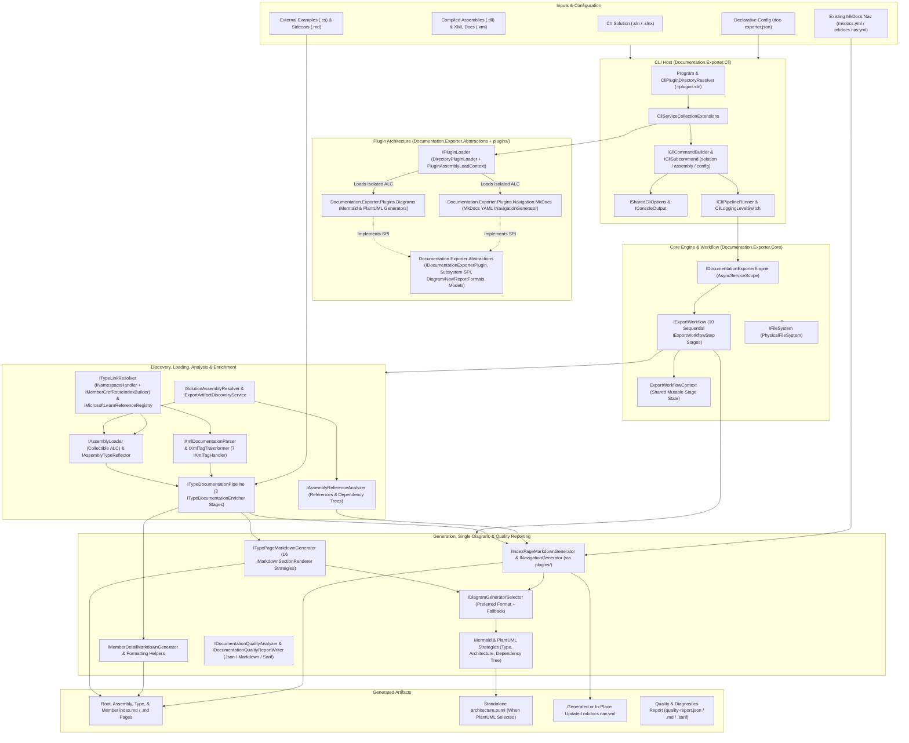
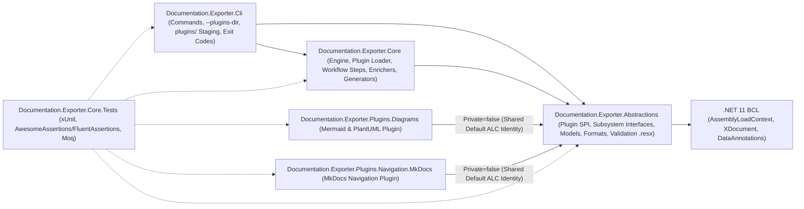

# Architecture Overview

`Documentation.Exporter` is a modular .NET 11 contracts base ([`Documentation.Exporter.Abstractions`](../../src/Documentation.Exporter.Abstractions/Documentation.Exporter.Abstractions.csproj)), core engine ([`Documentation.Exporter.Core`](../../src/Documentation.Exporter.Core/Documentation.Exporter.Core.csproj)), dynamic plugin bundles ([`Documentation.Exporter.Plugins.Diagrams`](../../src/Documentation.Exporter.Plugins.Diagrams/Documentation.Exporter.Plugins.Diagrams.csproj) and [`Documentation.Exporter.Plugins.Navigation.MkDocs`](../../src/Documentation.Exporter.Plugins.Navigation.MkDocs/Documentation.Exporter.Plugins.Navigation.MkDocs.csproj)), and console host ([`Documentation.Exporter.Cli`](../../src/Documentation.Exporter.Cli/Documentation.Exporter.Cli.csproj)) engineered around **sequential workflow orchestration**, **immutable domain modeling**, **non-mutating enrichment pipelines**, **strategy-driven rendering**, **plugin isolation via `AssemblyLoadContext`**, and **strict dependency injection**.

Rather than tightly coupling file I/O, reflection, XML parsing, or rendering formats inside monolithic classes, every subsystem exposes fine-grained interfaces composed through `Microsoft.Extensions.DependencyInjection` and executed within per-export `AsyncServiceScope` boundaries with source-generated `[LoggerMessage]` telemetry. This design makes every component independently testable in memory and extensible without modifying Core files.

---

## System Landscape

At runtime, user inputs flow downward from the CLI host (or an embedded caller) into an isolated Core engine scope. Discovery and loading build a clean CLR reflection snapshot paired with assembly reference/dependency metadata; transformation and enrichment enrich immutable records; and generation strategies emit Markdown, diagrams, and MkDocs navigation through an abstracted filesystem:

---

## Layered Dependency & Isolation Boundaries

Dependencies point strictly inward toward [`Documentation.Exporter.Abstractions`](../../src/Documentation.Exporter.Abstractions/Documentation.Exporter.Abstractions.csproj), while plugin implementations ([`Documentation.Exporter.Plugins.Diagrams`](../../src/Documentation.Exporter.Plugins.Diagrams/Documentation.Exporter.Plugins.Diagrams.csproj), [`Documentation.Exporter.Plugins.Navigation.MkDocs`](../../src/Documentation.Exporter.Plugins.Navigation.MkDocs/Documentation.Exporter.Plugins.Navigation.MkDocs.csproj), and external extensions) reference **only** `Abstractions` without coupling to Core or CLI:

Because built-in plugins reference `Abstractions` with `<Private>false</Private>` and `<ExcludeAssets>runtime</ExcludeAssets>`, [`PluginAssemblyLoadContext`](../../src/Documentation.Exporter.Core/Plugins/PluginAssemblyLoadContext.cs) shares `Abstractions` and `Microsoft.Extensions.*` contracts from `AssemblyLoadContext.Default` while isolating plugin-private assemblies inside per-plugin load contexts.

---

## Key Architectural Principles & Rationale

1. **Zero Hardcoded Component Lists & Subdirectory Plugin Discovery**: All extensible strategies (workflow steps, type enrichers, XML tag handlers, Markdown section renderers, diagram generators, navigation generators, namespace handler providers, quality report formatters, CLI subcommands) are registered exclusively in `IServiceCollection` (via [`DocumentationExporterServiceCollectionExtensions`](../../src/Documentation.Exporter.Core/DependencyInjection/DocumentationExporterServiceCollectionExtensions.cs), [`CliServiceCollectionExtensions`](../../src/Documentation.Exporter.Cli/CliServiceCollectionExtensions.cs), and dynamically loaded [`IDocumentationExporterPlugin`](../../src/Documentation.Exporter.Abstractions/Plugins/IDocumentationExporterPlugin.cs) assemblies). Concrete Mermaid & PlantUML emitters live in [`Documentation.Exporter.Plugins.Diagrams`](../../src/Documentation.Exporter.Plugins.Diagrams/Documentation.Exporter.Plugins.Diagrams.csproj), while MkDocs YAML navigation generation lives in [`Documentation.Exporter.Plugins.Navigation.MkDocs`](../../src/Documentation.Exporter.Plugins.Navigation.MkDocs/Documentation.Exporter.Plugins.Navigation.MkDocs.csproj)—both discovered automatically from `plugins/` (or `--plugins-dir`) via [`DirectoryPluginLoader`](../../src/Documentation.Exporter.Core/Plugins/DirectoryPluginLoader.cs) and [`PluginAssemblyLoadContext`](../../src/Documentation.Exporter.Core/Plugins/PluginAssemblyLoadContext.cs). *Why:* New diagram syntaxes (such as D2), site navigation formats (such as Docusaurus or DocFX), custom link resolvers, and custom quality reports plug in cleanly without recompiling Core or CLI.
2. **Scoped State Isolation**: Every invocation of [`IDocumentationExporterEngine.ExportDocumentationAsync`](../../src/Documentation.Exporter.Core/IDocumentationExporterEngine.cs) creates a fresh `AsyncServiceScope` via `IServiceScopeFactory`. Stateful per-run components ([`IsolatedAssemblyLoader`](../../src/Documentation.Exporter.Core/Parsing/IsolatedAssemblyLoader.cs), [`XmlDocumentationParser`](../../src/Documentation.Exporter.Core/Parsing/XmlDocumentationParser.cs), [`TypeLinkResolver`](../../src/Documentation.Exporter.Core/Resolution/TypeLinkResolver.cs)) are `Scoped` and cleaned/unloaded per run. *Why:* Back-to-back exports (such as multi-test suites or long-running build workers) never leak XML dictionaries, namespace rules, or assembly handles across runs.
3. **Immutable Domain Records**: Reflected and enriched metadata flows downstream as immutable `sealed record` types in [`Documentation.Exporter.Abstractions`](../../src/Documentation.Exporter.Abstractions/Documentation.Exporter.Abstractions.csproj) ([`TypeDocumentationModel`](../../src/Documentation.Exporter.Abstractions/Models/TypeDocumentationModel.cs), [`MemberDocumentationModel`](../../src/Documentation.Exporter.Abstractions/Models/MemberDocumentationModel.cs), [`AssemblyReferenceModel`](../../src/Documentation.Exporter.Abstractions/Models/AssemblyReferenceModel.cs), [`AssemblyDependencyEdgeModel`](../../src/Documentation.Exporter.Abstractions/Models/AssemblyDependencyEdgeModel.cs), [`PluginDescriptor`](../../src/Documentation.Exporter.Abstractions/Plugins/PluginDescriptor.cs)) updated via non-destructive `with` expressions. *Why:* Step 5 and Step 8 process types concurrently across threads using `Parallel.ForEachAsync` with zero shared-state race conditions.
4. **Collectible Assembly Loading & File System Abstraction**: Target `.dll` binaries are loaded in a collectible `AssemblyLoadContext` ([`IsolatedAssemblyLoader`](../../src/Documentation.Exporter.Core/Parsing/IsolatedAssemblyLoader.cs)) to release OS file locks on teardown and isolate dependency graphs. All disk access flows through [`IFileSystem`](../../src/Documentation.Exporter.Abstractions/IO/IFileSystem.cs) ([`PhysicalFileSystem`](../../src/Documentation.Exporter.Core/IO/PhysicalFileSystem.cs)) so tests can mock or overlay `.csproj`, `.deps.json`, `.xml`, and Markdown files safely in memory.
5. **Extensible Single-Diagram Strategy with Controlled Fallback**: Consumers never emit duplicate diagram blocks in competing syntaxes for the same artifact. Instead, [`IDiagramGeneratorSelector`](../../src/Documentation.Exporter.Abstractions/Generation/Diagrams/IDiagramGeneratorSelector.cs) selects at most one [`IDiagramGenerator`](../../src/Documentation.Exporter.Abstractions/Generation/Diagrams/IDiagramGenerator.cs) matching the extensible [`DiagramFormat`](../../src/Documentation.Exporter.Abstractions/Models/DiagramFormat.cs) (`Mermaid` by default, `PlantUml`, `None`, or custom plugin format names via `DiagramFormat.Custom(...)`) and falls back to another registered generator only when `CanGenerate(...)` returns `false`.
6. **Localized Feedback & Precondition Validation**: Input contracts use localized `System.ComponentModel.DataAnnotations` attributes ([`ValidationMessagesResources`](../../src/Documentation.Exporter.Abstractions/Resources/ValidationMessagesResources.cs)), argument preconditions use `ArgumentNullException.ThrowIfNull` / `ArgumentException.ThrowIfNullOrWhiteSpace`, and all user-facing headings, CLI prompts, and log messages are `.resx`-backed ([`CliCommandResources`](../../src/Documentation.Exporter.Core/Resources/CliCommandResources.resx), [`ExecutionMessagesResources`](../../src/Documentation.Exporter.Core/Resources/ExecutionMessagesResources.resx), [`MarkdownGenerationResources`](../../src/Documentation.Exporter.Core/Resources/MarkdownGenerationResources.resx), [`ValidationMessagesResources`](../../src/Documentation.Exporter.Abstractions/Resources/ValidationMessagesResources.resx)).

---

## Architecture Documentation Sections

| Section | Focus |
| :--- | :--- |
| [Functionality Catalog](functionality-catalog.md) | Complete capability matrix across all 9 functional domains with links to dedicated per-functionality deep-dives |
| [.NET & C# Language Support Matrix](dotnet-language-support-matrix.md) | Exhaustive inventory of supported .NET & C# 1–14 constructs linked directly to their functional descriptions, code entry points, and known exclusions |
| [Component Interactions & Data Flow](component-interactions.md) | Sequence diagrams, plugin discovery handshake, 10-step [`ExportWorkflowContext`](../../src/Documentation.Exporter.Abstractions/Workflow/ExportWorkflowContext.cs) state transitions, parallel enrichment fan-out, and scoped isolation |
| [Domain Models, Strong Enums, & DI Lifetimes](domain-models-and-lifetimes.md) | Reference of immutable records, relationship class diagram, strong enums, DataAnnotations validation, and DI lifetimes |
| [Developer Documentation](../developer/index.md) | Dedicated per-functionality deep-dives, automation scripts guide, coding standards, extensibility recipes, and onboarding |
| [User Documentation](../user/index.md) | Task-oriented guides for running the CLI, authoring XML docs, configuring diagrams, and integrating with MkDocs |
