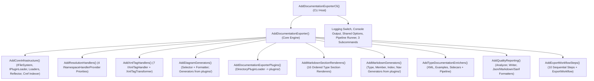

# Coding Standards, Mandates, & DI Setup

Every source and test file in `Documentation.Exporter` is governed by strict architectural mandates ([`.agents/AGENTS.md`](../../.agents/AGENTS.md)) and compiler-enforced [`.editorconfig`](../../.editorconfig) rules (`TreatWarningsAsErrors = true`, `EnforceCodeStyleInBuild = true` in [`Directory.Build.props`](../../Directory.Build.props)). Any deviation fails compilation immediately.

> [!TIP]
> **Want to reuse these C# agent rules in another repository?**
> Grab the project-agnostic template in **[Recommended AI Agent Rules for Any C# / .NET Project (`AGENTS.md`)](../user/ai-agent-recommended-csharp-rules.md)**.

---

## 1. Core Engineering Mandates

### Prohibition of Hardcoded Default Component Lists

Methods or helpers returning hardcoded default component instances (such as `GetDefaultRenderers()`, `GetDefaultHandlers()`, or `GetDefaultEnrichers()`) are **strictly prohibited**. All extensible components MUST be registered exclusively through `IServiceCollection` and injected into consuming classes via primary constructors (`IEnumerable<TComponent>`).

*Why this rule exists:* Fallback defaults silently hide incomplete DI wiring and make it impossible for hosts to swap out or omit a built-in strategy without patching Core code. Requiring explicit DI injection keeps composition transparent and testable.

**Prohibited Anti-Pattern:**

```csharp
// FORBIDDEN: Do not instantiate default strategies inside services
public sealed class TypePageGenerator(IEnumerable<IMarkdownSectionRenderer>? renderers = null)
{
    private readonly IReadOnlyList<IMarkdownSectionRenderer> sectionRenderers = renderers != null
        ? [.. renderers]
        : [new HeaderTitleSectionRenderer(), new SyntaxDeclarationSectionRenderer()];
}
```

**Compliant Pattern:**

```csharp
// COMPLIANT: Require injected collection via primary constructor
public sealed class TypePageMarkdownGenerator(
    IEnumerable<IMarkdownSectionRenderer> sectionRenderers,
    IRelativeLinkRewriter linkRewriter) : ITypePageMarkdownGenerator
{
    private readonly IReadOnlyList<IMarkdownSectionRenderer> renderers = [.. ArgumentGuard.EnsureNotNull(sectionRenderers).OrderBy(renderer => renderer.Order)];

    private readonly IRelativeLinkRewriter rewriter = ArgumentGuard.EnsureNotNull(linkRewriter);
}
```

### SOLID Design Principles & Dependency Injection First

All production types MUST apply the **SOLID** principles and resolve collaborators through Dependency Injection:

- **Single Responsibility (SRP)**: Each service, workflow step, enricher, tag handler, and renderer owns one cohesive responsibility cleanly separated from orchestration or formatting concerns.
- **Open/Closed (OCP)**: New capabilities plug in as additional DI-registered implementations (`IExportWorkflowStep`, `ITypeDocumentationEnricher`, `IMarkdownSectionRenderer`, `IXmlTagHandler`, `IDiagramGenerator`, `INamespaceHandler`, `ICliSubcommand`) instead of modifying orchestrators with hardcoded switches.
- **Liskov Substitution (LSP)**: Implementations preserve interface contracts, ordering guarantees, and expected exceptions without requiring concrete casts in callers.
- **Interface Segregation (ISP)**: Interfaces remain focused and role-specific (`IAssemblyLoader`, `IAssemblyTypeReflector`, `ICustomAttributeExtractor`, `ICSharpSignatureFormatter`) so implementers and unit tests only depend on methods they use.
- **Dependency Inversion (DIP) & DI First**: High-level services depend on interface abstractions injected via primary constructors rather than instantiating collaborators with `new ConcreteService(...)` or calling static disk I/O directly. Register every service explicitly in [`DocumentationExporterServiceCollectionExtensions`](../../src/Documentation.Exporter.Core/DependencyInjection/DocumentationExporterServiceCollectionExtensions.cs) or [`CliServiceCollectionExtensions`](../../src/Documentation.Exporter.Cli/CliServiceCollectionExtensions.cs) with deliberate lifetimes (`Singleton`, `Scoped`, `Transient`), avoiding the Service Locator pattern outside explicit scope boundaries (`IServiceScopeFactory` in [`DocumentationExporterEngine`](../../src/Documentation.Exporter.Core/DocumentationExporterEngine.cs)).

### Primary Constructors & Argument Throw Helpers

- **Primary Constructors (`IDE0290`)**: All classes accepting dependencies via constructor injection MUST use C# 12+ primary constructor syntax. Validate null arguments immediately inside field initializers using [`ArgumentGuard.EnsureNotNull(...)`](../../src/Documentation.Exporter.Core/ArgumentGuard.cs) (which delegates to `ArgumentNullException.ThrowIfNull`) or inside public methods using `ArgumentNullException.ThrowIfNull(parameter)` and `ArgumentException.ThrowIfNullOrWhiteSpace(parameter)`.
- **No Verbose Null-Check Blocks**: Never write manual `if (parameter == null) throw new ArgumentNullException(nameof(parameter));` blocks in methods when static .NET throw helpers apply.

### Early Returns & Human-Friendly Naming

- **Early Return Pattern & Guard Clauses**: Validate edge conditions and fail-fast checks upfront (`if (!canProcess) { return string.Empty; }`), omit redundant `else` blocks after `return`/`throw`/`continue`, and keep the primary happy path flat rather than nesting conditional trees. Keep return statements concise to satisfy [`.editorconfig`](../../.editorconfig) analyzer rules (`IDE0046`, `IDE0022`).
- **Human-Friendly Naming**: Single-letter or 1–3 character variable, parameter, and lambda parameter names are **strictly prohibited** (`a`, `c`, `ex`, `fs`, `id`, `kv`, `sb`, `vm` are forbidden). Always use full, descriptive identifiers (`category`, `service`, `exception`, `fileSystem`, `stringBuilder`, `dependencyEdge`, `typeModel`).

### Immutable Domain Models & DataAnnotations Validation

- Core models ([`TypeDocumentationModel`](../../src/Documentation.Exporter.Abstractions/Models/TypeDocumentationModel.cs), [`MemberDocumentationModel`](../../src/Documentation.Exporter.Abstractions/Models/MemberDocumentationModel.cs), [`ParameterDocumentationModel`](../../src/Documentation.Exporter.Abstractions/Models/ParameterDocumentationModel.cs), [`DocumentationInjectionModel`](../../src/Documentation.Exporter.Abstractions/Models/DocumentationInjectionModel.cs), [`AssemblyReferenceModel`](../../src/Documentation.Exporter.Abstractions/Models/AssemblyReferenceModel.cs), [`AssemblyDependencyEdgeModel`](../../src/Documentation.Exporter.Abstractions/Models/AssemblyDependencyEdgeModel.cs), [`ExternalDocLinkRule`](../../src/Documentation.Exporter.Abstractions/Models/ExternalDocLinkRule.cs)) are `public sealed record` types with `init`-only properties and read-only collection interfaces (`IReadOnlyList<T>`, `IReadOnlyDictionary<string, string>`).
- Pipeline transformations (e.g. [`ITypeDocumentationEnricher`](../../src/Documentation.Exporter.Abstractions/Enrichment/ITypeDocumentationEnricher.cs)) MUST return modified copies using C# `with` expressions rather than mutating records in place.
- Input models and options ([`ExporterOptions`](../../src/Documentation.Exporter.Abstractions/Models/ExporterOptions.cs)) MUST decorate properties with localized `System.ComponentModel.DataAnnotations` attributes (`[Required]`, `[MinLength]`, `[Range]`, `[EnumDataType]`) backed by [`ValidationMessagesResources`](../../src/Documentation.Exporter.Abstractions/Resources/ValidationMessagesResources.cs).

### Abstracted I/O (`IFileSystem`) & Cross-Platform Discipline

- Inject [`IFileSystem`](../../src/Documentation.Exporter.Abstractions/IO/IFileSystem.cs) ([`PhysicalFileSystem`](../../src/Documentation.Exporter.Core/IO/PhysicalFileSystem.cs)) rather than calling `System.IO.File` or `System.IO.Directory` directly in Core services.
- Never hardcode drive letters (`C:\`) or backslash separators (`\`); always use `Path.Combine(...)`, `Path.GetFileName(...)`, `Path.DirectorySeparatorChar`, or `Path.GetTempPath()`.
- Support case-sensitive Linux and Docker containers by using [`IFileSystem.FindFileCaseInsensitive`](../../src/Documentation.Exporter.Abstractions/IO/IFileSystem.cs) / `FindDirectoryCaseInsensitive(...)` for user-supplied filenames (such as `.cs` snippets and `.md` sidecars).

### Automation Script Organization & Comment-Based Help (`scripts/manual/`)

- Manual developer and showcase scripts live in [`scripts/manual/`](../../scripts/manual) (cleanly separated from automated build/CI scripts) and resolve the repository root dynamically from `$PSScriptRoot` (`Split-Path -Parent (Split-Path -Parent $PSScriptRoot)` with `Push-Location` / `Pop-Location`).
- Every `.ps1` script MUST begin with a complete PowerShell comment-based help block (`.SYNOPSIS`, `.DESCRIPTION`, a dedicated `.PARAMETER` section for every script parameter with valid values and defaults, and `.EXAMPLE` invocations) verifiable via `Get-Help -Full`.

---

## 2. Dependency Injection Container Composition

All extensible strategy collections are composed cleanly in layered extension methods so embedding applications can either wire everything via [`AddDocumentationExporter()`](../../src/Documentation.Exporter.Core/DependencyInjection/DocumentationExporterServiceCollectionExtensions.cs) or compose individual groups and append custom strategies:



### Programmatic Usage Example

Applications embedding [`Documentation.Exporter.Core`](../../src/Documentation.Exporter.Core/Documentation.Exporter.Core.csproj) wire everything through [`AddDocumentationExporter()`](../../src/Documentation.Exporter.Core/DependencyInjection/DocumentationExporterServiceCollectionExtensions.cs) from `Documentation.Exporter.Core.DependencyInjection`:

```csharp
using Documentation.Exporter.Core;
using Documentation.Exporter.Core.DependencyInjection;
using Documentation.Exporter.Core.Models;
using Microsoft.Extensions.DependencyInjection;
using Microsoft.Extensions.Logging;

var services = new ServiceCollection();
services.AddLogging(loggingBuilder => loggingBuilder.AddConsole());
services.AddDocumentationExporter();

await using var serviceProvider = services.BuildServiceProvider();
var exporterEngine = serviceProvider.GetRequiredService<IDocumentationExporterEngine>();

var options = new ExporterOptions
{
    SolutionFilePath = "./MySolution.slnx",
    SolutionConfiguration = "Release",
    ExcludedProjects = ["*.Tests", "*.Benchmarks"],
    DiagramFormat = DiagramFormat.Mermaid,
    OutputDirectoryPath = "./docs-output",
    NavigationFilePath = "./docs-output/mkdocs.nav.yml",
    NavigationEntryPoint = "Developer Portal/API Reference",
    ReportFilePath = "./docs-output/quality-report.json",
    ReportFormat = QualityReportFormat.Json
};

var exportResult = await exporterEngine.ExportDocumentationAsync(options);
```

Console applications extending or customizing the CLI host compose on top using [`AddDocumentationExporterCli()`](../../src/Documentation.Exporter.Cli/CliServiceCollectionExtensions.cs) ([`Documentation.Exporter.Cli`](../../src/Documentation.Exporter.Cli/Documentation.Exporter.Cli.csproj)):

### Modular Registration Helpers

| Extension Method | Scope | Registers |
| :--- | :--- | :--- |
| [`AddDocumentationExporter()`](../../src/Documentation.Exporter.Core/DependencyInjection/DocumentationExporterServiceCollectionExtensions.cs) | [`Core`](../../src/Documentation.Exporter.Core/Documentation.Exporter.Core.csproj) | Calls all modular groups below + [`IDocumentationExporterEngine`](../../src/Documentation.Exporter.Core/IDocumentationExporterEngine.cs) ([`DocumentationExporterEngine`](../../src/Documentation.Exporter.Core/DocumentationExporterEngine.cs)) |
| [`AddCoreInfrastructure()`](../../src/Documentation.Exporter.Core/DependencyInjection/DocumentationExporterServiceCollectionExtensions.cs) | [`Core`](../../src/Documentation.Exporter.Core/Documentation.Exporter.Core.csproj) | [`IFileSystem`](../../src/Documentation.Exporter.Abstractions/IO/IFileSystem.cs), [`IPluginLoader`](../../src/Documentation.Exporter.Abstractions/Plugins/IPluginLoader.cs), [`IExporterConfigurationLoader`](../../src/Documentation.Exporter.Core/Configuration/IExporterConfigurationLoader.cs), [`IMicrosoftLearnReferenceRegistry`](../../src/Documentation.Exporter.Core/Resolution/IMicrosoftLearnReferenceRegistry.cs), [`IMemberCrefRouteIndexBuilder`](../../src/Documentation.Exporter.Core/Resolution/IMemberCrefRouteIndexBuilder.cs), [`ICSharpSignatureFormatter`](../../src/Documentation.Exporter.Core/Parsing/ICSharpSignatureFormatter.cs), [`ITypeLinkResolver`](../../src/Documentation.Exporter.Abstractions/Resolution/ITypeLinkResolver.cs), [`IAssemblyLoader`](../../src/Documentation.Exporter.Core/Parsing/IAssemblyLoader.cs), [`ICustomAttributeExtractor`](../../src/Documentation.Exporter.Core/Parsing/ICustomAttributeExtractor.cs), [`IAssemblyTypeReflector`](../../src/Documentation.Exporter.Core/Parsing/IAssemblyTypeReflector.cs), [`IXmlDocumentationParser`](../../src/Documentation.Exporter.Core/Parsing/IXmlDocumentationParser.cs), [`ISolutionAssemblyResolver`](../../src/Documentation.Exporter.Core/Parsing/ISolutionAssemblyResolver.cs), [`IExportArtifactDiscoveryService`](../../src/Documentation.Exporter.Core/Parsing/IExportArtifactDiscoveryService.cs), [`IAssemblyReferenceAnalyzer`](../../src/Documentation.Exporter.Core/Parsing/IAssemblyReferenceAnalyzer.cs), [`IExampleProvider`](../../src/Documentation.Exporter.Core/Injection/IExampleProvider.cs), [`IDocumentationInjector`](../../src/Documentation.Exporter.Core/Injection/IDocumentationInjector.cs) |
| [`AddResolutionHandlers()`](../../src/Documentation.Exporter.Core/DependencyInjection/DocumentationExporterServiceCollectionExtensions.cs) | [`Core`](../../src/Documentation.Exporter.Core/Documentation.Exporter.Core.csproj) | 4 built-in [`INamespaceHandlerProvider`](../../src/Documentation.Exporter.Abstractions/Resolution/INamespaceHandlerProvider.cs) factories ([`LocalProjectNamespaceHandlerProvider`](../../src/Documentation.Exporter.Core/Resolution/Providers/LocalProjectNamespaceHandlerProvider.cs), [`CustomOptionsNamespaceHandlerProvider`](../../src/Documentation.Exporter.Core/Resolution/Providers/CustomOptionsNamespaceHandlerProvider.cs), [`PatternNamespaceHandlerProvider`](../../src/Documentation.Exporter.Core/Resolution/Providers/PatternNamespaceHandlerProvider.cs), [`MicrosoftDocsNamespaceHandlerProvider`](../../src/Documentation.Exporter.Core/Resolution/Providers/MicrosoftDocsNamespaceHandlerProvider.cs)) |
| [`AddXmlTagHandlers()`](../../src/Documentation.Exporter.Core/DependencyInjection/DocumentationExporterServiceCollectionExtensions.cs) | [`Core`](../../src/Documentation.Exporter.Core/Documentation.Exporter.Core.csproj) | 7 built-in [`IXmlTagHandler`](../../src/Documentation.Exporter.Abstractions/Parsing/Tags/IXmlTagHandler.cs) strategies + [`IXmlTagTransformer`](../../src/Documentation.Exporter.Core/Parsing/IXmlTagTransformer.cs) |
| [`AddDiagramGenerators()`](../../src/Documentation.Exporter.Core/DependencyInjection/DocumentationExporterServiceCollectionExtensions.cs) | [`Core`](../../src/Documentation.Exporter.Core/Documentation.Exporter.Core.csproj) | [`IDiagramIdentifierFormatter`](../../src/Documentation.Exporter.Abstractions/Generation/Diagrams/IDiagramIdentifierFormatter.cs) and [`IDiagramGeneratorSelector`](../../src/Documentation.Exporter.Abstractions/Generation/Diagrams/IDiagramGeneratorSelector.cs) (concrete diagram generators are loaded from plugins) |
| [`AddDocumentationExporterPlugins()`](../../src/Documentation.Exporter.Core/DependencyInjection/DocumentationExporterServiceCollectionExtensions.cs) | [`Core`](../../src/Documentation.Exporter.Core/Documentation.Exporter.Core.csproj) | Scans `plugins/` (or `--plugins-dir`) via [`DirectoryPluginLoader`](../../src/Documentation.Exporter.Core/Plugins/DirectoryPluginLoader.cs), invokes [`IDocumentationExporterPlugin.ConfigureServices`](../../src/Documentation.Exporter.Abstractions/Plugins/IDocumentationExporterPlugin.cs), and registers [`PluginDescriptor`](../../src/Documentation.Exporter.Abstractions/Plugins/PluginDescriptor.cs) entries |
| [`AddMarkdownSectionRenderers()`](../../src/Documentation.Exporter.Core/DependencyInjection/DocumentationExporterServiceCollectionExtensions.cs) | [`Core`](../../src/Documentation.Exporter.Core/Documentation.Exporter.Core.csproj) | All 16 ordered [`IMarkdownSectionRenderer`](../../src/Documentation.Exporter.Abstractions/Generation/Sections/IMarkdownSectionRenderer.cs) strategies |
| [`AddMarkdownGenerators()`](../../src/Documentation.Exporter.Core/DependencyInjection/DocumentationExporterServiceCollectionExtensions.cs) | [`Core`](../../src/Documentation.Exporter.Core/Documentation.Exporter.Core.csproj) | [`IRelativeLinkRewriter`](../../src/Documentation.Exporter.Core/Generation/IRelativeLinkRewriter.cs), [`IMemberFileNameFormatter`](../../src/Documentation.Exporter.Core/Generation/IMemberFileNameFormatter.cs), [`IExceptionTableFormatter`](../../src/Documentation.Exporter.Core/Generation/IExceptionTableFormatter.cs), [`ITypePageMarkdownGenerator`](../../src/Documentation.Exporter.Core/Generation/ITypePageMarkdownGenerator.cs), [`IMemberDetailMarkdownGenerator`](../../src/Documentation.Exporter.Core/Generation/IMemberDetailMarkdownGenerator.cs), [`IIndexPageMarkdownGenerator`](../../src/Documentation.Exporter.Core/Generation/IIndexPageMarkdownGenerator.cs) (`INavigationGenerator` strategies are loaded from plugins) |
| [`AddTypeDocumentationEnrichers()`](../../src/Documentation.Exporter.Core/DependencyInjection/DocumentationExporterServiceCollectionExtensions.cs) | [`Core`](../../src/Documentation.Exporter.Core/Documentation.Exporter.Core.csproj) | 3 ordered [`ITypeDocumentationEnricher`](../../src/Documentation.Exporter.Abstractions/Enrichment/ITypeDocumentationEnricher.cs) stages + [`ITypeDocumentationPipeline`](../../src/Documentation.Exporter.Core/Enrichment/ITypeDocumentationPipeline.cs) |
| [`AddQualityReporting()`](../../src/Documentation.Exporter.Core/DependencyInjection/DocumentationExporterServiceCollectionExtensions.cs) | [`Core`](../../src/Documentation.Exporter.Core/Documentation.Exporter.Core.csproj) | [`IDocumentationQualityAnalyzer`](../../src/Documentation.Exporter.Core/Quality/IDocumentationQualityAnalyzer.cs), [`IDocumentationQualityReportWriter`](../../src/Documentation.Exporter.Core/Quality/IDocumentationQualityReportWriter.cs), and 3 [`IQualityReportFormatter`](../../src/Documentation.Exporter.Abstractions/Quality/IQualityReportFormatter.cs) strategies (`Json`, `Markdown`, `Sarif`) |
| [`AddExportWorkflowSteps()`](../../src/Documentation.Exporter.Core/DependencyInjection/DocumentationExporterServiceCollectionExtensions.cs) | [`Core`](../../src/Documentation.Exporter.Core/Documentation.Exporter.Core.csproj) | All 10 sequential [`IExportWorkflowStep`](../../src/Documentation.Exporter.Abstractions/Workflow/IExportWorkflowStep.cs) stages + [`IExportWorkflow`](../../src/Documentation.Exporter.Core/Workflow/IExportWorkflow.cs) |
| [`AddDocumentationExporterCli()`](../../src/Documentation.Exporter.Cli/CliServiceCollectionExtensions.cs) | [`Cli`](../../src/Documentation.Exporter.Cli/Documentation.Exporter.Cli.csproj) | Calls [`AddDocumentationExporter()`](../../src/Documentation.Exporter.Core/DependencyInjection/DocumentationExporterServiceCollectionExtensions.cs), registers [`CliLoggingLevelSwitch`](../../src/Documentation.Exporter.Cli/CliLoggingLevelSwitch.cs), console logging filter, [`IConsoleOutput`](../../src/Documentation.Exporter.Cli/IConsoleOutput.cs), [`ISharedCliOptions`](../../src/Documentation.Exporter.Cli/ISharedCliOptions.cs), [`ICliPipelineRunner`](../../src/Documentation.Exporter.Cli/ICliPipelineRunner.cs), [`AddCliSubcommands()`](../../src/Documentation.Exporter.Cli/CliServiceCollectionExtensions.cs), [`ICliCommandBuilder`](../../src/Documentation.Exporter.Cli/ICliCommandBuilder.cs) |
| [`AddCliSubcommands()`](../../src/Documentation.Exporter.Cli/CliServiceCollectionExtensions.cs) | [`Cli`](../../src/Documentation.Exporter.Cli/Documentation.Exporter.Cli.csproj) | [`AssemblyCliSubcommand`](../../src/Documentation.Exporter.Cli/AssemblyCliSubcommand.cs), [`SolutionCliSubcommand`](../../src/Documentation.Exporter.Cli/SolutionCliSubcommand.cs), [`ConfigCliSubcommand`](../../src/Documentation.Exporter.Cli/ConfigCliSubcommand.cs) |

**Single-Strategy Extension Helpers** (available directly in [`Documentation.Exporter.Abstractions`](../../src/Documentation.Exporter.Abstractions/DependencyInjection/DocumentationExporterPluginServiceCollectionExtensions.cs) for zero-Core plugins and forwarded in Core):

- [`services.AddNamespaceHandler<THandler>()`](../../src/Documentation.Exporter.Abstractions/DependencyInjection/DocumentationExporterPluginServiceCollectionExtensions.cs)
- [`services.AddNamespaceHandlerProvider<TProvider>()`](../../src/Documentation.Exporter.Abstractions/DependencyInjection/DocumentationExporterPluginServiceCollectionExtensions.cs)
- [`services.AddXmlTagHandler<THandler>()`](../../src/Documentation.Exporter.Abstractions/DependencyInjection/DocumentationExporterPluginServiceCollectionExtensions.cs)
- [`services.AddTypeDiagramGenerator<TGenerator>()`](../../src/Documentation.Exporter.Abstractions/DependencyInjection/DiagramGeneratorServiceCollectionExtensions.cs)
- [`services.AddArchitectureDiagramGenerator<TGenerator>()`](../../src/Documentation.Exporter.Abstractions/DependencyInjection/DiagramGeneratorServiceCollectionExtensions.cs)
- [`services.AddAssemblyDependencyDiagramGenerator<TGenerator>()`](../../src/Documentation.Exporter.Abstractions/DependencyInjection/DiagramGeneratorServiceCollectionExtensions.cs)
- [`services.AddMarkdownSectionRenderer<TRenderer>()`](../../src/Documentation.Exporter.Abstractions/DependencyInjection/DocumentationExporterPluginServiceCollectionExtensions.cs)
- [`services.AddNavigationGenerator<TGenerator>()`](../../src/Documentation.Exporter.Abstractions/DependencyInjection/DocumentationExporterPluginServiceCollectionExtensions.cs)
- [`services.AddTypeDocumentationEnricher<TEnricher>()`](../../src/Documentation.Exporter.Abstractions/DependencyInjection/DocumentationExporterPluginServiceCollectionExtensions.cs)
- [`services.AddQualityReportFormatter<TFormatter>()`](../../src/Documentation.Exporter.Abstractions/DependencyInjection/DocumentationExporterPluginServiceCollectionExtensions.cs)
- [`services.AddExportWorkflowStep<TStep>()`](../../src/Documentation.Exporter.Abstractions/DependencyInjection/DocumentationExporterPluginServiceCollectionExtensions.cs)
- [`services.AddCliSubcommand<TSubcommand>()`](../../src/Documentation.Exporter.Cli/CliServiceCollectionExtensions.cs)
