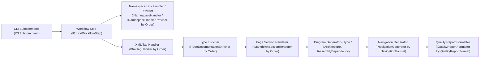

# Extensibility Guide

Because `Documentation.Exporter` resolves every workflow phase, XML tag handler, enricher, section renderer, diagram generator, namespace handler, and CLI subcommand exclusively through `Microsoft.Extensions.DependencyInjection` without hardcoded default component lists, custom extensions plug in cleanly without editing Core source files.

---

## Extension Seams Across the Export Pipeline



### Design Guidance for Custom Plugins

- **Ordering**: Enrichers (`10`, `20`, `30`), section renderers (`10`–`110`), and XML tag handlers (`0` before `PassthroughTagHandler` at `int.MaxValue`) sort ascending by `Order`. Pick intermediate integers (`15`, `48`, `50`) to slot cleanly alongside built-ins.
- **Immutability & Statelessness**: Diagram generators and section renderers run concurrently inside `Parallel.ForEachAsync`—never hold mutable per-type state inside a registered strategy.
- **Scope Validation**: Built-in extension helpers ([`DocumentationExporterPluginServiceCollectionExtensions`](../../src/Documentation.Exporter.Abstractions/DependencyInjection/DocumentationExporterPluginServiceCollectionExtensions.cs) and [`DocumentationExporterServiceCollectionExtensions`](../../src/Documentation.Exporter.Core/DependencyInjection/DocumentationExporterServiceCollectionExtensions.cs)) register strategies as `Singleton` (diagram generators, navigation generators, quality report formatters, namespace handlers/providers) or `Transient` (section renderers, XML handlers, enrichers, steps). Never inject a `Scoped` dependency into a `Singleton` extension.

---

## 1. Custom Workflow Step (`IExportWorkflowStep`)

Insert custom pre-checks, post-processors, or custom output generators into [`IExportWorkflow`](../../src/Documentation.Exporter.Core/Workflow/IExportWorkflow.cs) by implementing [`IExportWorkflowStep`](../../src/Documentation.Exporter.Abstractions/Workflow/IExportWorkflowStep.cs). Custom steps registered after [`AddExportWorkflowSteps()`](../../src/Documentation.Exporter.Core/DependencyInjection/DocumentationExporterServiceCollectionExtensions.cs) execute after Step 10 unless registered selectively:

```csharp
using Documentation.Exporter.Core.Workflow;

public sealed class ExportMetadataManifestStep : IExportWorkflowStep
{
    public string StepName => "Write Custom Export Manifest";

    public Task<bool> ExecuteAsync(ExportWorkflowContext context, CancellationToken cancellationToken = default)
    {
        ArgumentNullException.ThrowIfNull(context);
        cancellationToken.ThrowIfCancellationRequested();

        // Inspect context.CompiledTypeModels, context.AssemblyReferencesByAssemblyName, or context.Options
        return Task.FromResult(true);
    }
}
```

Register in DI:

```csharp
services.AddExportWorkflowStep<ExportMetadataManifestStep>();
```

---

## 2. Custom Type Documentation Enricher (`ITypeDocumentationEnricher`)

Enrichers ([`ITypeDocumentationEnricher`](../../src/Documentation.Exporter.Abstractions/Enrichment/ITypeDocumentationEnricher.cs)) run sequentially by `Order` (built-ins use `10`, `20`, `30`) and MUST return a new [`TypeDocumentationModel`](../../src/Documentation.Exporter.Abstractions/Models/TypeDocumentationModel.cs) copy using a non-destructive `with` expression:

```csharp
using Documentation.Exporter.Core.Enrichment;
using Documentation.Exporter.Core.Models;

public sealed class StabilityBadgeEnricher : ITypeDocumentationEnricher
{
    public int Order => 40;

    public Task<TypeDocumentationModel> EnrichAsync(
        Type targetType,
        TypeDocumentationModel typeModel,
        ExporterOptions options,
        CancellationToken cancellationToken = default)
    {
        ArgumentNullException.ThrowIfNull(targetType);
        ArgumentNullException.ThrowIfNull(typeModel);
        ArgumentNullException.ThrowIfNull(options);

        var updatedModel = typeModel with
        {
            SummaryDescription = $"**[API Tier]** {typeModel.SummaryDescription}"
        };
        return Task.FromResult(updatedModel);
    }
}
```

Register in DI:

```csharp
services.AddTypeDocumentationEnricher<StabilityBadgeEnricher>();
```

---

## 3. Custom Markdown Section Renderer (`IMarkdownSectionRenderer`)

Insert custom Markdown sections via [`IMarkdownSectionRenderer`](../../src/Documentation.Exporter.Abstractions/Generation/Sections/IMarkdownSectionRenderer.cs) on every type `index.md` page at any `Order` priority (`10`..`110`). Return `string.Empty` early when a type does not apply so no blank headings appear:

```csharp
using System.Globalization;
using System.Text;
using Documentation.Exporter.Core.Generation.Sections;
using Documentation.Exporter.Core.Models;

public sealed class ThreadSafetyNoticeSectionRenderer : IMarkdownSectionRenderer
{
    public int Order => 48; // Between Type Diagram (45) and Members (60)

    public string RenderSection(TypeDocumentationModel typeModel)
    {
        ArgumentNullException.ThrowIfNull(typeModel);

        if (typeModel.TypeCategory != TypeCategory.Class)
        {
            return string.Empty;
        }

        StringBuilder sectionBuilder = new();
        _ = sectionBuilder.AppendLine("## Thread Safety");
        _ = sectionBuilder.AppendLine();
        _ = sectionBuilder.AppendLine(
            CultureInfo.InvariantCulture,
            $"Inspect synchronization guarantees before sharing `{typeModel.TypeName}` across threads.");
        _ = sectionBuilder.AppendLine();
        return sectionBuilder.ToString();
    }
}
```

Register in DI:

```csharp
services.AddMarkdownSectionRenderer<ThreadSafetyNoticeSectionRenderer>();
```

---

## 4. Custom XML Tag Handler (`IXmlTagHandler`)

Transform custom XML documentation tags via [`IXmlTagHandler`](../../src/Documentation.Exporter.Abstractions/Parsing/Tags/IXmlTagHandler.cs) (for example `<alert>...</alert>` or `<callout>...</callout>`):

```csharp
using System.Text;
using System.Xml.Linq;
using Documentation.Exporter.Core.Parsing.Tags;

public sealed class AlertTagHandler : IXmlTagHandler
{
    public int Order => 50; // Runs well before PassthroughTagHandler (int.MaxValue)

    public bool CanHandleTag(string tagName) =>
        string.Equals(tagName, "alert", StringComparison.OrdinalIgnoreCase);

    public void TransformTag(
        XElement xmlElement,
        StringBuilder outputBuilder,
        Action<XElement, StringBuilder> processChildrenAction)
    {
        ArgumentNullException.ThrowIfNull(xmlElement);
        ArgumentNullException.ThrowIfNull(outputBuilder);
        ArgumentNullException.ThrowIfNull(processChildrenAction);

        _ = outputBuilder.AppendLine("> [!IMPORTANT]");
        _ = outputBuilder.Append("> ");
        processChildrenAction(xmlElement, outputBuilder);
        _ = outputBuilder.AppendLine();
    }
}
```

Register in DI:

```csharp
services.AddXmlTagHandler<AlertTagHandler>();
```

Handlers needing type link resolution (like built-in [`SeeTagHandler`](../../src/Documentation.Exporter.Core/Parsing/Tags/SeeTagHandler.cs)) inject [`ITypeLinkResolver`](../../src/Documentation.Exporter.Abstractions/Resolution/ITypeLinkResolver.cs) directly via primary constructor.

---

## 5. Custom Diagram Generator (`ITypeDiagramGenerator`, `IArchitectureDiagramGenerator`, `IAssemblyDependencyDiagramGenerator`)

Because diagram rendering uses [`IDiagramGeneratorSelector`](../../src/Documentation.Exporter.Abstractions/Generation/Diagrams/IDiagramGeneratorSelector.cs), registering a PlantUML generator ([`ITypeDiagramGenerator`](../../src/Documentation.Exporter.Abstractions/Generation/Diagrams/ITypeDiagramGenerator.cs), [`IArchitectureDiagramGenerator`](../../src/Documentation.Exporter.Abstractions/Generation/Diagrams/IArchitectureDiagramGenerator.cs), or [`IAssemblyDependencyDiagramGenerator`](../../src/Documentation.Exporter.Abstractions/Generation/Diagrams/IAssemblyDependencyDiagramGenerator.cs)) that supports types omitted by Mermaid (such as `Enum` value diagrams) automatically activates **fallback rendering** when `--diagram-format Mermaid` is set:

```csharp
using Documentation.Exporter.Core.Generation.Diagrams;
using Documentation.Exporter.Core.Models;

public sealed class PlantUmlEnumDiagramGenerator(IDiagramIdentifierFormatter identifierFormatter) : ITypeDiagramGenerator
{
    private readonly IDiagramIdentifierFormatter formatter = identifierFormatter ?? throw new ArgumentNullException(nameof(identifierFormatter));

    public DiagramFormat Format => DiagramFormat.PlantUml;

    public bool CanGenerate(TypeDocumentationModel typeModel)
    {
        ArgumentNullException.ThrowIfNull(typeModel);
        return typeModel.TypeCategory == TypeCategory.Enum && typeModel.Fields.Count > 0;
    }

    public string GenerateTypeDiagram(TypeDocumentationModel typeModel)
    {
        ArgumentNullException.ThrowIfNull(typeModel);
        var identifier = formatter.SanitizeIdentifier(typeModel.TypeName);
        return $"```plantuml\n@startuml\nenum {identifier}\n@enduml\n```\n\n";
    }
}
```

Register using the matching DI helper (available in both [`Documentation.Exporter.Abstractions`](../../src/Documentation.Exporter.Abstractions/DependencyInjection/DiagramGeneratorServiceCollectionExtensions.cs) for external plugins and Core):

```csharp
services.AddTypeDiagramGenerator<PlantUmlEnumDiagramGenerator>();
// Or for index diagrams:
// services.AddArchitectureDiagramGenerator<CustomArchitectureDiagramGenerator>();
// services.AddAssemblyDependencyDiagramGenerator<CustomDependencyDiagramGenerator>();
```

To package diagram generators or other strategies as an auto-discovered plugin assembly in `plugins/` (or `--plugins-dir`), reference **only** `Documentation.Exporter.Abstractions` (`<Private>false</Private><ExcludeAssets>runtime</ExcludeAssets>`), implement [`IDocumentationExporterPlugin`](../../src/Documentation.Exporter.Abstractions/Plugins/IDocumentationExporterPlugin.cs), and register your strategies inside `ConfigureServices(IServiceCollection services)`. See [Plugin Architecture, Isolation, & Abstractions Contract](functionalities/plugin-system.md) for a full walkthrough (including custom [`DiagramFormat.Custom("D2")`](../../src/Documentation.Exporter.Abstractions/Models/DiagramFormat.cs) plugins).

---

## 6. Custom External Namespace Link Resolvers (`INamespaceHandler` & `INamespaceHandlerProvider`)

Three mechanisms exist for customizing namespace link resolution (sorted ascending by `Order`: Local `-1000`, CustomOptions `-500`, Pattern `500`, MicrosoftDocs `1000`):

```csharp
using Documentation.Exporter.Abstractions.DependencyInjection;
using Documentation.Exporter.Abstractions.Models;
using Documentation.Exporter.Abstractions.Resolution;

// Option A: Declarative URL Template Rule
options.ExternalDocLinkRules.Add(new ExternalDocLinkRule
{
    NamespacePrefix = "Newtonsoft.Json",
    UrlTemplate = "https://www.newtonsoft.com/json/help/html/T_{fullNameUnderscore}.htm"
});

// Option B: Programmatic INamespaceHandler with explicit precedence Order
public sealed class NewtonsoftJsonNamespaceHandler : INamespaceHandler
{
    public int Order => -200; // Runs after local types (-1000) and before Pattern (500)

    public bool CanHandleNamespace(string fullTypeName) =>
        fullTypeName.StartsWith("Newtonsoft.Json", StringComparison.Ordinal);

    public string ResolveTypeLink(string fullTypeName) =>
        $"[{fullTypeName}](https://www.newtonsoft.com/json/help/html/N_{fullTypeName}.htm)";
}
```

Register via `options.CustomNamespaceHandlers.Add(new NewtonsoftJsonNamespaceHandler())` ([`ExporterOptions`](../../src/Documentation.Exporter.Abstractions/Models/ExporterOptions.cs), [`ExternalDocLinkRule`](../../src/Documentation.Exporter.Abstractions/Models/ExternalDocLinkRule.cs)), `services.AddNamespaceHandler<NewtonsoftJsonNamespaceHandler>()` ([`INamespaceHandler`](../../src/Documentation.Exporter.Abstractions/Resolution/INamespaceHandler.cs)), or `services.AddNamespaceHandlerProvider<CustomProvider>()` ([`INamespaceHandlerProvider`](../../src/Documentation.Exporter.Abstractions/Resolution/INamespaceHandlerProvider.cs)) for run-scoped factory logic reading [`ExportWorkflowContext`](../../src/Documentation.Exporter.Abstractions/Workflow/ExportWorkflowContext.cs).

---

## 7. Custom CLI Subcommand (`ICliSubcommand`)

Implement [`ICliSubcommand`](../../src/Documentation.Exporter.Cli/ICliSubcommand.cs) in a CLI host consuming [`AddDocumentationExporterCli()`](../../src/Documentation.Exporter.Cli/CliServiceCollectionExtensions.cs):

```csharp
using System.CommandLine;
using Documentation.Exporter.Cli;

public sealed class ValidateOnlySubcommand(ISharedCliOptions sharedOptions) : ICliSubcommand
{
    private readonly ISharedCliOptions options = sharedOptions ?? throw new ArgumentNullException(nameof(sharedOptions));

    public Command BuildCommand()
    {
        Command validateCommand = new("validate-config", "Validate export options without emitting files");
        options.AddExportOptionsTo(validateCommand, includeFailOnMissing: false);
        return validateCommand;
    }
}
```

Register with `services.AddCliSubcommand<ValidateOnlySubcommand>()` ([`CliServiceCollectionExtensions`](../../src/Documentation.Exporter.Cli/CliServiceCollectionExtensions.cs)).

---

## 8. Custom Quality Report Formatter (`IQualityReportFormatter` & Custom `QualityReportFormat`)

Emit custom report formats (such as JUnit XML, HTML, Checkstyle, or custom telemetry payloads) by implementing [`IQualityReportFormatter`](../../src/Documentation.Exporter.Abstractions/Quality/IQualityReportFormatter.cs) and registering it via [`AddQualityReportFormatter<TFormatter>()`](../../src/Documentation.Exporter.Abstractions/DependencyInjection/DocumentationExporterPluginServiceCollectionExtensions.cs):

```csharp
using Documentation.Exporter.Abstractions.Models;
using Documentation.Exporter.Abstractions.Quality;

public sealed class JUnitQualityReportFormatter : IQualityReportFormatter
{
    public QualityReportFormat Format => QualityReportFormat.Custom("JUnit");

    public string FormatReport(DocumentationQualityReport report)
    {
        ArgumentNullException.ThrowIfNull(report);
        return $"<testsuite name=\"Documentation.Exporter\" tests=\"{report.TotalDocumentableSymbols}\" failures=\"{report.ErrorCount}\" />";
    }
}
```

Register in DI (later registrations for the same `QualityReportFormat` take precedence inside [`DocumentationQualityReportWriter`](../../src/Documentation.Exporter.Core/Quality/DocumentationQualityReportWriter.cs)), then invoke `--report-format JUnit`:

```csharp
services.AddQualityReportFormatter<JUnitQualityReportFormatter>();
```

---

## 9. Custom Static-Site Navigation Generator (`INavigationGenerator` & `NavigationFormat`)

Support additional static-site generators (such as Docusaurus `sidebars.js`, DocFX `toc.yml`, or VitePress) by implementing [`INavigationGenerator`](../../src/Documentation.Exporter.Abstractions/Generation/INavigationGenerator.cs), computing canonical page URLs via [`TypeDocumentationPaths.GetTypeRelativeUrlPath`](../../src/Documentation.Exporter.Abstractions/Resolution/TypeDocumentationPaths.cs), and registering via [`AddNavigationGenerator<TGenerator>()`](../../src/Documentation.Exporter.Abstractions/DependencyInjection/DocumentationExporterPluginServiceCollectionExtensions.cs):

```csharp
using Documentation.Exporter.Abstractions.Generation;
using Documentation.Exporter.Abstractions.Models;
using Documentation.Exporter.Abstractions.Resolution;

public sealed class DocusaurusNavigationGenerator : INavigationGenerator
{
    public NavigationFormat Format => NavigationFormat.Custom("Docusaurus");

    public string DefaultFileName => "sidebars.js";

    public string GenerateNavigation(
        IReadOnlyList<TypeDocumentationModel> types,
        bool useAssemblySubdirectories = false,
        string? existingNavigationContent = null,
        string? navigationEntryPoint = null,
        string? navigationUrlPrefix = null)
    {
        ArgumentNullException.ThrowIfNull(types);
        var links = types.Select(typeModel => $"'{TypeDocumentationPaths.GetTypeRelativeUrlPath(typeModel, useAssemblySubdirectories)}'");
        return $"module.exports = {{ apiSidebar: [{string.Join(", ", links)}] }};";
    }
}
```

Register with `services.AddNavigationGenerator<DocusaurusNavigationGenerator>()` and run `--nav-format Docusaurus` (or `"navigationFormat": "Docusaurus"` in JSON).
