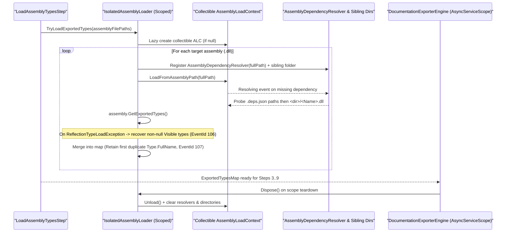
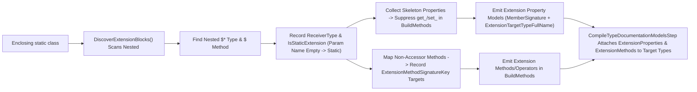
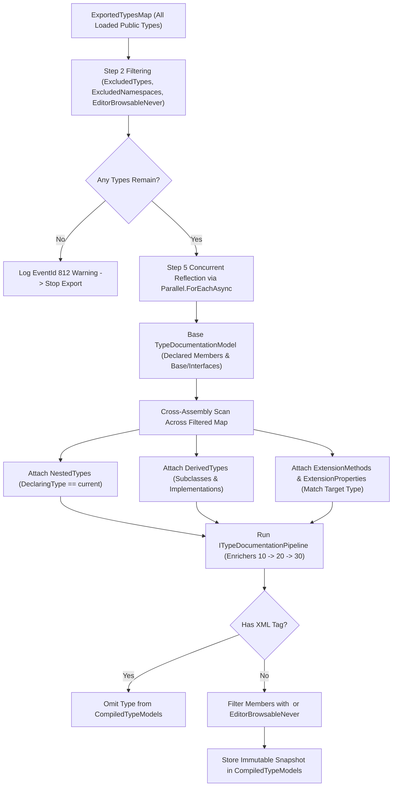

# Isolated Assembly Loading, Reflection, & Cross-Assembly Indexing

This deep-dive explains how [`IsolatedAssemblyLoader`](../../../src/Documentation.Exporter.Core/Parsing/IsolatedAssemblyLoader.cs) loads compiled `.dll` files safely without polluting or locking the host `AppDomain`, how [`AssemblyTypeReflector`](../../../src/Documentation.Exporter.Core/Parsing/AssemblyTypeReflector.cs), [`CustomAttributeExtractor`](../../../src/Documentation.Exporter.Core/Parsing/CustomAttributeExtractor.cs), and [`CSharpSignatureFormatter`](../../../src/Documentation.Exporter.Core/Parsing/CSharpSignatureFormatter.cs) translate CLR reflection metadata into immutable [`TypeDocumentationModel`](../../../src/Documentation.Exporter.Abstractions/Models/TypeDocumentationModel.cs) records, and how [`CompileTypeDocumentationModelsStep`](../../../src/Documentation.Exporter.Core/Workflow/Steps/CompileTypeDocumentationModelsStep.cs) computes cross-assembly type hierarchies and extension methods.

> **Related Docs:** [Architecture Overview](../../architectural/index.md) · [Domain Models & Lifetimes](../../architectural/domain-models-and-lifetimes.md) · [Solution & Artifact Discovery](solution-and-artifact-discovery.md) · [Enrichment, Snippets, & Overrides](enrichment-snippets-and-overrides.md)

---

## 1. Collectible `AssemblyLoadContext` & Fault Recovery (`IsolatedAssemblyLoader`)

Loading target binaries directly via `Assembly.LoadFrom` permanently locks loaded assemblies into the default `AppDomain` and risks dependency version conflicts against `Documentation.Exporter.Core`. Instead, [`IsolatedAssemblyLoader`](../../../src/Documentation.Exporter.Core/Parsing/IsolatedAssemblyLoader.cs) is registered with a **`Scoped`** DI lifetime and implements `IDisposable`.

Each export scope lazily creates a single collectible `AssemblyLoadContext("DocumentationExporter_<Guid>", isCollectible: true)` shared across all assemblies in that run (so cross-assembly references between e.g. `DemoLibrary` and `DemoContracts` resolve against the **same** loaded `Type` instances):

### Partial Type Recovery & Collision Semantics

- **Missing Transitive Dependencies (`ReflectionTypeLoadException`)**: If `GetExportedTypes()` throws `ReflectionTypeLoadException`, [`IsolatedAssemblyLoader`](../../../src/Documentation.Exporter.Core/Parsing/IsolatedAssemblyLoader.cs) counts loader errors, logs **`EventId` `106`** (`Warning`), and salvages all non-null visible types where `IsExportablePublicType` holds so partial documentation still succeeds.
- **Compiler & C# 14 Extension Marker Filtering**: Both normal `GetExportedTypes()` scans and `ReflectionTypeLoadException` recovery filter via `IsExportablePublicType`, excluding `IsSpecialName`, compiler-generated nested/internal types starting with `<` (such as C# 14 extension block containers `<G>$...` and `<M>$...`), and types carrying `[CompilerGeneratedAttribute]`.
- **Duplicate `FullName` Guard**: Across multi-assembly runs, [`MergeLoadedTypes`](../../../src/Documentation.Exporter.Core/Parsing/IsolatedAssemblyLoader.cs) preserves the first loaded `Type` for a given `FullName` and logs **`EventId` `107`** (`Warning`) naming both assemblies rather than throwing `ArgumentException`.

---

## 2. Reflection, Custom Attributes, & Signature Formatting

Once Step 2 populates `ExportWorkflowContext.ExportedTypesMap` and Step 5 ([`CompileTypeDocumentationModelsStep`](../../../src/Documentation.Exporter.Core/Workflow/Steps/CompileTypeDocumentationModelsStep.cs)) starts (after Step 3 configures `ITypeLinkResolver`), [`CompileTypeDocumentationModelsStep`](../../../src/Documentation.Exporter.Core/Workflow/Steps/CompileTypeDocumentationModelsStep.cs) extracts assembly-level attributes per distinct exported assembly into `context.AssemblyAttributesByAssemblyName` via [`ICustomAttributeExtractor`](../../../src/Documentation.Exporter.Core/Parsing/ICustomAttributeExtractor.cs) and three stateless helpers convert every public CLR `Type` (plus enum values, generic type parameters, method parameters, and return parameters) into an initial [`TypeDocumentationModel`](../../../src/Documentation.Exporter.Abstractions/Models/TypeDocumentationModel.cs):

| Component | Key Responsibilities |
| :--- | :--- |
| **[`AssemblyTypeReflector`](../../../src/Documentation.Exporter.Core/Parsing/AssemblyTypeReflector.cs)** | Classifies [`TypeCategory`](../../../src/Documentation.Exporter.Abstractions/Models/TypeCategory.cs) (`Class`, `Interface`, `Struct`, `Enum`, `Delegate`), `record` / `readonly` / `ref struct` type flags, full multi-level `DeclaringTypeChain` for nested types (`Outer/Middle/Inner`), multi-word access modifiers (`protected internal`, `private protected`), constructor shape (`Default`, `Primary (...)`, `Overloaded (...)`, `None`), inheritance chain, direct implemented interfaces, enum underlying type + raw field constants, generic type parameters with variance (`in`/`out`) & constraints (`class`, `struct`, `unmanaged`, `new()`, `notnull`, `allows ref struct`), `[Obsolete]` (with `DiagnosticId`/`UrlFormat`) & `[Experimental]` metadata, C# 14 `extension(...)` block discovery (`ExtensionProperties` and static/instance `ExtensionTargetTypeFullName` methods, omitting raw `get_`/`set_` accessors), compiler-synthesized record `EqualityContract` filtering, async/stream flags (`IsAsyncMethod`, `IsAsyncEnumerable`), full `NullabilityInfoContext` nullable links (`?` on properties, fields, events, returns, generic arguments, and by-ref parameters), parameter modifiers (`in`, `out`, `ref`, `ref readonly`, `scoped`, `params`, `this`, optional default values, `CancellationToken`, `[EnumeratorCancellation]`, caller-info attributes), and canonical compiler XML member keys (`T:`, `M:` including conversion `~ReturnType`, `P:` including indexers, `F:`, `E:`). |
| **[`CustomAttributeExtractor`](../../../src/Documentation.Exporter.Core/Parsing/CustomAttributeExtractor.cs)** | Implements [`ICustomAttributeExtractor`](../../../src/Documentation.Exporter.Core/Parsing/ICustomAttributeExtractor.cs) with three `BuildAppliedAttributes` overloads (`MemberInfo`, `ParameterInfo`, `Assembly`): detects `[EditorBrowsable(EditorBrowsableState.Never)]` (`IsEditorBrowsableNever`), `[Obsolete]` via `GetCustomAttributesData()` (extracting `Message`, `IsError`, `DiagnosticId`, and `UrlFormat` while ignoring compiler-synthesized Roslyn `[Obsolete]` messages emitted on constructors of `required`-member types and on `ref struct` types), `[Experimental]` (`ExtractExperimentalMetadata`), `[Extension]`, and `[AsyncStateMachine]`; filters compiler/internal metadata per target (including `AsyncIteratorStateMachineAttribute`, `ParamCollectionAttribute`, `ExtensionMarkerAttribute`, `ExtensionMarkerNameAttribute`, `NativeIntegerAttribute`, `FixedBufferAttribute`, `DefaultMemberAttribute`, `NullablePublicOnlyAttribute`, and `ExperimentalAttribute`); formats constructor/named arguments (`typeof(...)`, arrays, named/`[Flags]` enum combinations joined with `\|`); and resolves clickable links to attribute descriptions. |
| **[`CSharpSignatureFormatter`](../../../src/Documentation.Exporter.Core/Parsing/CSharpSignatureFormatter.cs)** | Formats modern C# 9–14 declaration signatures across types (`record`, `readonly record struct`, `readonly struct`, `ref struct`, generic types with `ExtractOwnGenericArguments` & `in`/`out` variance, delegates via `Invoke`), primary constructors (detected via captured `<param>P` compiler fields, record `Deconstruct`, or single non-empty overload) with secondary overloads, properties (`required`, `{ get; init; }`, restricted setter accessors, write-only `set`, indexers `this[...]`), interface/inheritance method modifiers (`static abstract`, `static virtual`, `virtual`, `override`, `sealed override`, `readonly` struct members), `ref`/`ref readonly` returns and fields (`IsReadOnlyAttribute`), `scoped` parameters, multi-dimensional arrays (`[,]`), `NullabilityInfo` `?` formatting, checked/unsigned-shift/C# 14 compound-assignment/conversion operators (`op_Checked*`, `op_UnsignedRightShift`, `op_*Assignment`, `op_Implicit`, `op_Explicit`), and events (`BuildEventSignature`). |

### 2.1 Modern Type Classification, Primary Constructors, and Member Signatures

[`CSharpSignatureFormatter`](../../../src/Documentation.Exporter.Core/Parsing/CSharpSignatureFormatter.cs) and [`AssemblyTypeReflector`](../../../src/Documentation.Exporter.Core/Parsing/AssemblyTypeReflector.cs) inspect CLR flags, custom modifiers (`modreq`), and compiler attributes to preserve exact C# 9–14 semantics:

- **Records, `readonly struct`, & `ref struct`**: `IsRecordType` identifies reference records via compiler-generated `<Clone>$` and struct records (`record struct`, `readonly record struct`) via compiler-generated `PrintMembers(StringBuilder)`. `IsReadOnlyStruct` checks `[IsReadOnlyAttribute]` on non-enum value types, and `IsRefStruct` reads `Type.IsByRefLike`. `BuildProperties` suppresses Roslyn's synthesized `EqualityContract` property on reference records so only user-declared properties remain.
- **3-Stage Primary Constructor Detection (`TryGetPrimaryConstructor`)**: Handles both standalone primary constructors (C# 12) and types combining a primary constructor with secondary `: this(...)` overloads:
  1. **Captured Parameter Fields (`<param>P`)**: Scans non-public compiler-generated instance fields named `<name>P` and selects the accessible constructor declaring all captured parameter names.
  2. **Record `Deconstruct` Match**: For `record` and `record struct` types, matches the accessible constructor whose parameters correspond to the compiler-generated `Deconstruct` method.
  3. **Single Non-Empty Constructor**: If only one accessible constructor has parameters, classifies it as primary; types whose primary parameters are not captured and that declare multiple overloads are resolved downstream during XML enrichment ([Overloaded Primary Promotion](enrichment-snippets-and-overrides.md#overloaded-primary-constructor-promotion-and-generic-inheritance)).
- **Property, Field, Method, & Delegate Signatures**:
  - `BuildPropertySignature` reads `RequiredMemberAttribute` (`required`), `IsExternalInit` modreq on setters (`init;`), accessor visibility vs. representative accessor (`private`, `internal`, `protected internal`, `private protected`), write-only `{ set; }`, indexers (`this[...]`), `ref`/`ref readonly` returns (via `IsReadOnlyAttribute` on getter return parameters), and C# 14 `field`-backed properties cleanly (and `BuildProperties` removes `DeclaredOnly` so inherited public/protected properties remain browsable).
  - `BuildFieldSignature` formats `required`, `const`, `static`, `readonly`, literal values, and `ref` vs. `ref readonly` fields (checking both `[IsReadOnlyAttribute]` on `FieldInfo` and `modreq(InAttribute)`).
  - `BuildMethodSignature` distinguishes interface `static abstract` / `static virtual`, class `abstract` / `virtual` / `override` (`ReuseSlot` with distinct base definition) / `sealed override`, non-readonly value-type `readonly` methods (`IsMethodMarkedReadOnly`), and `BuildDelegateDeclarationSignature` inspects the delegate's `Invoke` method (`ref`/`ref readonly` return, `NullabilityInfo`, and variance parameters).
  - `DetermineParameterModifier` resolves `this`, `in`, `out`, `ref`, `ref readonly` (`RequiresLocationAttribute`), `params` (`ParamArrayAttribute` or C# 13 `ParamCollectionAttribute`), and `scoped` (`ScopedRefAttribute`) combinations (e.g., `scoped ref readonly`, `this scoped ref readonly`).

### 2.2 C# 14 `extension(...)` Block Discovery and Reconstruction

C# 14 compiles `extension(TargetType paramName) { ... }` and `static extension(TargetType) { ... }` blocks into nested special-name types (`<G>$...`, `<M>$...`) paired with `[ExtensionMarkerAttribute]` / `[ExtensionMarkerNameAttribute]` references and emitted static implementation methods/accessors on the enclosing `static class`:

- Calling [`CompileTypeDocumentationModelsStep.CollectTargetedExtensionMembers`](../../../src/Documentation.Exporter.Core/Workflow/Steps/CompileTypeDocumentationModelsStep.cs) attaches both `ExtensionMethods` and `ExtensionProperties` onto matching exported classes, structs, interfaces, and enums while omitting compiler-synthesized `<G>$...` and `<M>$...` container types cleanly in [`IsolatedAssemblyLoader`](../../../src/Documentation.Exporter.Core/Parsing/IsolatedAssemblyLoader.cs).

### 2.3 Nullable Reference Types and By-Ref Unwrapping

- `.NET`'s `NullabilityInfoContext.Create(ParameterInfo)` for by-reference parameters (`out string?`, `ref T?`, `in string?`) sets `Type.IsByRef == true` with `ElementType == null`, storing `ReadState`, `WriteState`, and `GenericTypeArguments` directly on the outer `NullabilityInfo` instance.
- Both [`CSharpSignatureFormatter.FormatDisplayTypeName`](../../../src/Documentation.Exporter.Core/Parsing/CSharpSignatureFormatter.cs) (`FormatNullabilityWithCompilerMetadata(NullabilityInfo, ICustomAttributeProvider)`) and [`AssemblyTypeReflector`](../../../src/Documentation.Exporter.Core/Parsing/AssemblyTypeReflector.cs) (`ResolveTypeOrGenericLink(NullabilityInfo, ICustomAttributeProvider)`) unwrap `rawTargetType.GetElementType()` while preserving `ReadState == NullabilityState.Nullable || (rawTargetType.IsByRef && WriteState == NullabilityState.Nullable)` so `?` annotations render faithfully on `out`/`ref`/`in` parameters as well as `Nullable<T>`, nested generic arguments, multi-dimensional arrays (`[,]`, `[0:,0:]` XML keys), jagged arrays (`[]?[]`), pointers (`*`), function pointers (`delegate*<...>` / `delegate* unmanaged[Cdecl]<...>` with `=FUNC:` XML keys), named `ValueTuple` elements (`[TupleElementNamesAttribute]`), native-sized integers (`nint`/`nuint` via `[NativeIntegerAttribute]`), and `dynamic` (`[DynamicAttribute]`).

### 2.4 Generics, Variance, Constraints, Indexers, and Operators

- **Own Generic Arguments (`ExtractOwnGenericArguments`) & Declaration `where` Clauses**: Uses the type's own backtick arity suffix (instead of `Type.GetGenericArguments()`, which includes enclosing outer generic parameters on nested types) so nested generic types inside generic outer classes display only their own type parameters (`NestedGeneric<TInner>`), and appends `: BaseClass, IInterface` and `where T : ...` clauses directly to type, delegate, and generic method C# declaration blocks.
- **Generic Variance & Constraints**: `ExtractGenericTypeParameterDetails` maps `Covariant` (`out`) / `Contravariant` (`in`) onto `ParameterModifier`, detects `allows ref struct` (`GenericParameterAttributes.AllowByRefLike`), `unmanaged` (`IsUnmanagedAttribute`), and `notnull` (via `[NullableAttribute]` / `[NullableContextAttribute]` byte flag `1` in `HasNotNullConstraint`).
- **Indexers, Explicit Interface Members, Finalizers, Fixed Buffers, Inline Arrays, & Operators**: Indexers format `this[...]` (or `IContract.this[...]` for explicit interface indexers) and compute `P:{typeFullName}.{propertyInfo.Name}({paramTypes})`; explicit interface methods, properties, indexers, and events format with simplified interface prefixes and `explicit interface` visibility; finalizers format as `~ClassName()` (`Finalize.md`); `[FixedBuffer(typeof(T), N)]` fields format as `fixed T Name[N]`; `[InlineArray(N)]` structs surface their element field as `T[N]`; P/Invoke methods include `extern`; constructors/methods surface inline `[SetsRequiredMembers]` and `[OverloadResolutionPriority(n)]`; and operators use `TryGetOperatorDisplayToken` supporting C# 11 `checked` (`op_Checked*`) and unsigned right shift (`>>>` / `op_UnsignedRightShift`), C# 14 compound assignments (`+=`, `checked +=`, `op_*Assignment`), and conversions (`implicit`/`explicit`/`checked explicit`), appending `~{ReturnType}` to conversion operator `XmlMemberKey`s.

### 2.5 Custom Attributes, Experimental APIs, and Compiler Suppression

- [`CustomAttributeExtractor`](../../../src/Documentation.Exporter.Core/Parsing/CustomAttributeExtractor.cs) applies three target-specific exclusion sets (`ExcludedCompilerAttributeNames`, `ExcludedParameterAttributeNames`, `ExcludedAssemblyAttributeNames`) to strip compiler plumbing (`CompilerGeneratedAttribute`, `AsyncIteratorStateMachineAttribute`, `ParamCollectionAttribute`, `ExtensionMarkerAttribute`, `ExtensionMarkerNameAttribute`, `NativeIntegerAttribute`, `FixedBufferAttribute`, `DefaultMemberAttribute`, `ExperimentalAttribute`, etc.) while keeping and linking domain/validation/framework attributes on every C# target (`|` characters in `[Flags]` enum arguments escape as `\|`).
- `ExtractExperimentalMetadata` captures `[Experimental("ID", UrlFormat = "...")]` onto `IsExperimental`, `ExperimentalDiagnosticId`, and `ExperimentalUrlFormat`, while `IsCompilerSynthesizedObsolete` filters Roslyn's synthetic `[Obsolete("Constructors of types with required members are not supported...")]` and `[Obsolete("Types with embedded references are not supported...")]` compatibility attributes so `required`-member constructors and `ref struct` types never emit misleading deprecation warnings.

---

## 3. Cross-Assembly Back-References & Multi-Layer Exclusion

Single-type reflection only looks *upward* (base class, interfaces) and *inward* (declared members). Three key documentation features span across all exported assemblies in the run and are therefore computed globally across `ExportedTypesMap` in Step 2 / Step 5:

Because **extension methods**, **C# 14 extension properties**, **derived types**, and **interface implementations** frequently live in a different project than the contract assembly they extend (as [`OrderRequestExtensions`](../../../demo/Documentation.Exporter.DemoLibrary/Extensions/OrderRequestExtensions.cs), [`OrderRequestModernExtensions`](../../../demo/Documentation.Exporter.DemoLibrary/ModernCSharp/ModernCSharpShowcase.cs), and [`CrossAssemblyAuditReporter`](../../../demo/Documentation.Exporter.DemoLibrary/Auditing/CrossAssemblyAuditReporter.cs) in `DemoLibrary` extend [`OrderRequest`](../../../demo/Documentation.Exporter.DemoLibrary/Models/OrderRequest.cs) or [`ISettlementAuditSink`](../../../demo/Documentation.Exporter.DemoContracts/Auditing/ISettlementAuditSink.cs) in `DemoContracts`), computing these back-references across the unified `ExportedTypesMap` (`CollectExtensionMethods`, `CollectExtensionProperties`, and `Enum` targets as well as classes/structs/interfaces) surfaces them automatically on the target type's page with normalized relative links.

---

## 4. Owning Source & Test Files

- **Source**: [`IAssemblyLoader.cs`](../../../src/Documentation.Exporter.Core/Parsing/IAssemblyLoader.cs), [`IsolatedAssemblyLoader.cs`](../../../src/Documentation.Exporter.Core/Parsing/IsolatedAssemblyLoader.cs), [`IAssemblyTypeReflector.cs`](../../../src/Documentation.Exporter.Core/Parsing/IAssemblyTypeReflector.cs), [`AssemblyTypeReflector.cs`](../../../src/Documentation.Exporter.Core/Parsing/AssemblyTypeReflector.cs), [`ICustomAttributeExtractor.cs`](../../../src/Documentation.Exporter.Core/Parsing/ICustomAttributeExtractor.cs), [`CustomAttributeExtractor.cs`](../../../src/Documentation.Exporter.Core/Parsing/CustomAttributeExtractor.cs), [`ICSharpSignatureFormatter.cs`](../../../src/Documentation.Exporter.Core/Parsing/ICSharpSignatureFormatter.cs), [`CSharpSignatureFormatter.cs`](../../../src/Documentation.Exporter.Core/Parsing/CSharpSignatureFormatter.cs), [`LoadAssemblyTypesStep.cs`](../../../src/Documentation.Exporter.Core/Workflow/Steps/LoadAssemblyTypesStep.cs), [`CompileTypeDocumentationModelsStep.cs`](../../../src/Documentation.Exporter.Core/Workflow/Steps/CompileTypeDocumentationModelsStep.cs)
- **Tests**: [`IsolatedAssemblyLoaderTests.cs`](../../../test/Documentation.Exporter.Core.Tests/Parsing/IsolatedAssemblyLoaderTests.cs), [`AssemblyTypeReflectorTests.cs`](../../../test/Documentation.Exporter.Core.Tests/Parsing/AssemblyTypeReflectorTests.cs), [`CustomAttributeExtractorTests.cs`](../../../test/Documentation.Exporter.Core.Tests/Parsing/CustomAttributeExtractorTests.cs), [`CSharpSignatureFormatterTests.cs`](../../../test/Documentation.Exporter.Core.Tests/Parsing/CSharpSignatureFormatterTests.cs), [`CompileTypeDocumentationModelsStepTests.cs`](../../../test/Documentation.Exporter.Core.Tests/Workflow/Steps/CompileTypeDocumentationModelsStepTests.cs)
