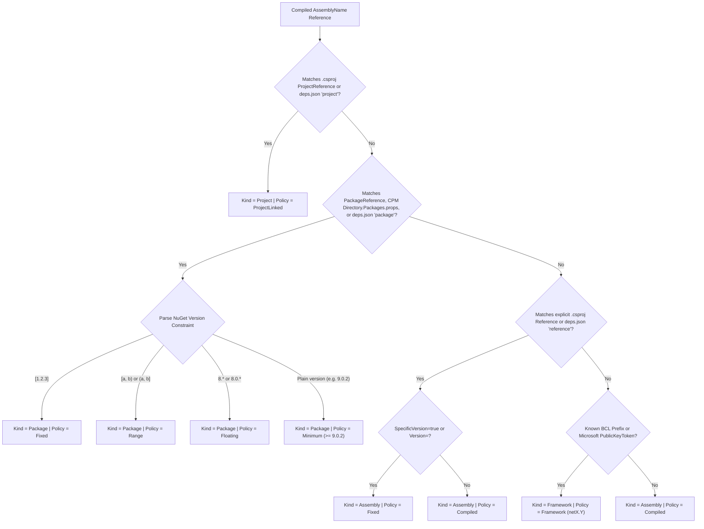
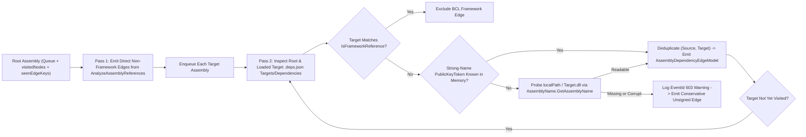

# Assembly Reference & Transitive Dependency Tree Analysis

This deep-dive explains how [`AssemblyReferenceAnalyzer`](../../../src/Documentation.Exporter.Core/Parsing/AssemblyReferenceAnalyzer.cs) ([`IAssemblyReferenceAnalyzer`](../../../src/Documentation.Exporter.Core/Parsing/IAssemblyReferenceAnalyzer.cs)) inspects compiled IL references, `.deps.json` dependency graphs, originating `.csproj` files, and ancestor [`Directory.Packages.props`](../../../Directory.Packages.props) manifests to build both direct [`AssemblyReferenceModel`](../../../src/Documentation.Exporter.Abstractions/Models/AssemblyReferenceModel.cs) tables and cycle-free transitive non-framework [`AssemblyDependencyEdgeModel`](../../../src/Documentation.Exporter.Abstractions/Models/AssemblyDependencyEdgeModel.cs) trees.

> **Related Docs:** [Functionality Catalog](../../architectural/functionality-catalog.md) · [User Assembly Insights Guide](../../user/diagrams-and-assembly-insights.md) · [Markdown & Diagram Generation](markdown-and-diagram-generation.md) · [Solution & Artifact Discovery](solution-and-artifact-discovery.md)

---

## 1. Correlating Four Metadata Sources (`AnalyzeAssemblyReferences`)

Compiled .NET metadata alone (`assembly.GetReferencedAssemblies()`) knows only the exact bound assembly version and `PublicKeyToken` — it cannot tell whether a reference came from a solution `<ProjectReference>`, a NuGet `<PackageReference>` with a floating or minimum range (`[1.0.0, 2.0.0)`), Central Package Management (`CPM`), or the `.NET` shared framework.

In Step 2 ([`LoadAssemblyTypesStep`](../../../src/Documentation.Exporter.Core/Workflow/Steps/LoadAssemblyTypesStep.cs)), [`AssemblyReferenceAnalyzer.AnalyzeAssemblyReferences`](../../../src/Documentation.Exporter.Core/Parsing/AssemblyReferenceAnalyzer.cs) correlates **four sources** per unique loaded `Assembly`:

1. **Compiled IL Metadata**: `assembly.GetReferencedAssemblies()` yields referenced `AssemblyName`, compiled `Version`, and hexadecimal `PublicKeyToken` (setting `IsStrongNamed = true` when an 8-byte non-empty token is present).
2. **Runtime Manifest (`<Assembly>.deps.json`)**: Parses all `"targets"` and `"libraries"` entries, mapping library `"type"` (`project`, `package`, `reference`, `runtimepack`) and wrapper packages whose runtime `.dll` asset name differs from the NuGet package ID.
3. **Originating Project File (`.csproj`)**: Resolved via `ProjectFilePathsByAssemblyPath` from [`ExportArtifactDiscoveryResult`](../../../src/Documentation.Exporter.Core/Parsing/IExportArtifactDiscoveryService.cs); extracts `<ProjectReference>`, `<PackageReference>` (`Version` or `VersionOverride`), `<Reference>` (`SpecificVersion`, `Version=`), and `<TargetFramework>` / `<TargetFrameworks>`.
4. **Central Package Management (`Directory.Packages.props`)**: Walks parent directories upward from the `.csproj` location via [`IFileSystem`](../../../src/Documentation.Exporter.Abstractions/IO/IFileSystem.cs) to merge hierarchical `Directory.Packages.props` manifests (stopping if `<ManagePackageVersionsCentrally>false</ManagePackageVersionsCentrally>` is encountered) when `<PackageReference>` omits inline versions.

### 4-Tier Classification & Version Linking Precedence

Framework classification recognizes standard `.NET` BCL prefixes (`mscorlib`, `netstandard`, `System.*`, `Microsoft.CSharp`, `WindowsBase`, etc.) and official Microsoft strong-name public key tokens (`b03f5f7f11d50a3a`, `7cec85d7bea7798e`, `b77a5c561934e089`, `cc7b13ffcd2ddd51`, `31bf3856ad364e35`), normalizing target framework monikers such as `net11.0` or `netstandard2.0` into the `VersionConstraintExpression`.

---

## 2. Transitive Non-Framework Dependency Tree (`AnalyzeAssemblyDependencyTrees`)

While `## Assembly References` lists only direct references of a single assembly, `## Assembly Dependency Tree` visualizes the full **transitive** graph of non-framework dependencies rooted at each documented assembly.

[`AnalyzeAssemblyDependencyTrees`](../../../src/Documentation.Exporter.Core/Parsing/AssemblyReferenceAnalyzer.cs) runs a cycle-safe, deduplicated breadth-first traversal seeded with each root assembly:

### Key Safeguards in Transitive Traversal

- **Deterministic Sorting & Deduplication**: Uses `visitedNodes` (`StringComparer.OrdinalIgnoreCase`) to break circular dependency graphs cleanly, and `seenEdgeKeys` on `(SourceAssemblyName, TargetAssemblyName)` pairs so shared diamond dependencies emit once per directed edge.
- **No Empty Framework Noise**: Assemblies whose dependencies are exclusively `.NET` BCL framework libraries (such as `Documentation.Exporter.DemoContracts`) yield zero non-framework edges, so [`IndexPageMarkdownGenerator`](../../../src/Documentation.Exporter.Core/Generation/IndexPageMarkdownGenerator.cs) cleanly omits the `## Assembly Dependency Tree` section for them.
- **Fault-Resilient Binary Probing (`EventId` `603`)**: Malformed `.deps.json` manifests, malformed `.csproj` / `Directory.Packages.props` XML, or unreadable local `.dll` files during `AssemblyName.GetAssemblyName` token probing never crash documentation exports; instead, they log structured `EventId` `603` warnings and fall back gracefully.

---

## 3. Rendered Cross-Links & Strong-Name Styling Downstream

Downstream in Step 8 ([`EmitMarkdownDocumentationStep`](../../../src/Documentation.Exporter.Core/Workflow/Steps/EmitMarkdownDocumentationStep.cs)), [`IndexPageMarkdownGenerator`](../../../src/Documentation.Exporter.Core/Generation/IndexPageMarkdownGenerator.cs) and [`IAssemblyDependencyDiagramGenerator`](../../../src/Documentation.Exporter.Abstractions/Generation/Diagrams/IAssemblyDependencyDiagramGenerator.cs) consume both outputs:

- **Sibling Cross-Linking**: In multi-assembly subdirectory mode, any row in `## Assembly References` matching another assembly in `analyzedAssemblyNames` renders as `[<AssemblyName>](../<AssemblyName>/index.md)`.
- **Signed vs. Unsigned Visual Distinction**: Both [`MermaidAssemblyDependencyDiagramGenerator`](../../../src/Documentation.Exporter.Plugins.Diagrams/MermaidAssemblyDependencyDiagramGenerator.cs) (`linkStyle`) and [`PlantUmlAssemblyDependencyDiagramGenerator`](../../../src/Documentation.Exporter.Plugins.Diagrams/PlantUmlAssemblyDependencyDiagramGenerator.cs) render solid green arrows (`#2E7D32`) when `IsTargetStrongNamed == true` and dashed gray arrows (`#757575`) when unsigned, paired with a localized legend.

---

## 4. Owning Source & Test Files

- **Source**: [`IAssemblyReferenceAnalyzer.cs`](../../../src/Documentation.Exporter.Core/Parsing/IAssemblyReferenceAnalyzer.cs), [`AssemblyReferenceAnalyzer.cs`](../../../src/Documentation.Exporter.Core/Parsing/AssemblyReferenceAnalyzer.cs), [`AssemblyReferenceModel.cs`](../../../src/Documentation.Exporter.Abstractions/Models/AssemblyReferenceModel.cs), [`AssemblyDependencyEdgeModel.cs`](../../../src/Documentation.Exporter.Abstractions/Models/AssemblyDependencyEdgeModel.cs), [`AssemblyReferenceKind.cs`](../../../src/Documentation.Exporter.Abstractions/Models/AssemblyReferenceKind.cs), [`AssemblyVersionLinkingKind.cs`](../../../src/Documentation.Exporter.Abstractions/Models/AssemblyVersionLinkingKind.cs)
- **Tests**: [`AssemblyReferenceAnalyzerTests.cs`](../../../test/Documentation.Exporter.Core.Tests/Parsing/AssemblyReferenceAnalyzerTests.cs) (exercises [`OverlayFileSystem`](../../../test/Documentation.Exporter.Core.Tests/Parsing/AssemblyReferenceAnalyzerTests.cs) over `.csproj`, `.deps.json`, CPM `Directory.Packages.props`, and error fallbacks), [`AssemblyReferenceModelTests.cs`](../../../test/Documentation.Exporter.Core.Tests/Models/AssemblyReferenceModelTests.cs), [`AssemblyDependencyEdgeModelTests.cs`](../../../test/Documentation.Exporter.Core.Tests/Models/AssemblyDependencyEdgeModelTests.cs)
