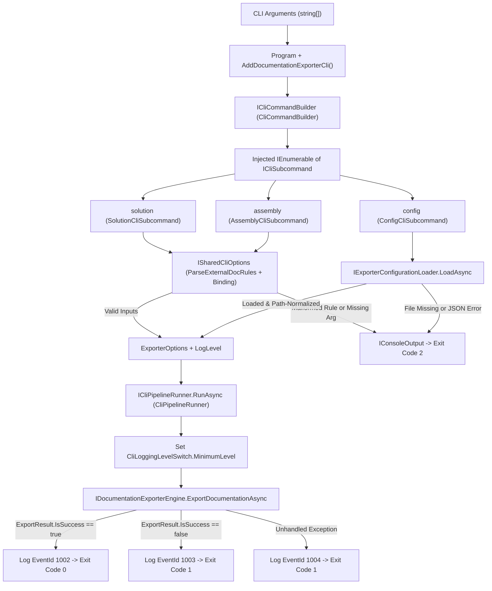
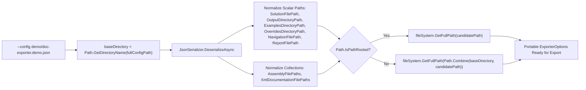

# CLI Hosting, Subcommands, & JSON Configuration

This deep-dive explains how [`Documentation.Exporter.Cli`](../../../src/Documentation.Exporter.Cli/Documentation.Exporter.Cli.csproj) boots the application, composes subcommands dynamically through Dependency Injection, binds and validates options into [`ExporterOptions`](../../../src/Documentation.Exporter.Abstractions/Models/ExporterOptions.cs), normalizes relative paths inside JSON configuration files via [`ExporterConfigurationLoader`](../../../src/Documentation.Exporter.Core/Configuration/ExporterConfigurationLoader.cs), switches log verbosity per run, and maps workflow outcomes to OS exit codes.

> **Related Docs:** [Architecture Overview](../../architectural/index.md) · [Functionality Catalog](../../architectural/functionality-catalog.md) · [User CLI & Config Reference](../../user/cli-and-configuration.md) · [Structured Logging & Localization](../logging-and-localization.md)

---

## 1. CLI Bootstrapping & Subcommand Architecture

[`Program`](../../../src/Documentation.Exporter.Cli/Program.cs) builds a single `ServiceCollection`, registers both Core and CLI services via [`CliServiceCollectionExtensions.AddDocumentationExporterCli`](../../../src/Documentation.Exporter.Cli/CliServiceCollectionExtensions.cs), resolves [`ICliCommandBuilder`](../../../src/Documentation.Exporter.Cli/ICliCommandBuilder.cs) ([`CliCommandBuilder`](../../../src/Documentation.Exporter.Cli/CliCommandBuilder.cs)), and parses process arguments with `System.CommandLine`.

In accordance with the **no hardcoded component list mandate** ([`.agents/AGENTS.md`](../../../.agents/AGENTS.md)), [`CliCommandBuilder`](../../../src/Documentation.Exporter.Cli/CliCommandBuilder.cs) does not instantiate subcommands itself. Instead, it receives `IEnumerable<ICliSubcommand>` from DI, where [`AddCliSubcommands`](../../../src/Documentation.Exporter.Cli/CliServiceCollectionExtensions.cs) registers the three built-in commands:

- **`solution`** ([`SolutionCliSubcommand`](../../../src/Documentation.Exporter.Cli/SolutionCliSubcommand.cs)): Discovers non-test projects inside a `.sln` or `.slnx` solution (`--solution`, `--configuration`, `--include-tests`) and sets up multi-assembly export.
- **`assembly`** ([`AssemblyCliSubcommand`](../../../src/Documentation.Exporter.Cli/AssemblyCliSubcommand.cs)): Accepts one or more explicit `--assembly` (`.dll`) paths and optional `--xml` paths.
- **`config`** ([`ConfigCliSubcommand`](../../../src/Documentation.Exporter.Cli/ConfigCliSubcommand.cs)): Reads a declarative JSON file (`--config` / `-f`) via [`IExporterConfigurationLoader`](../../../src/Documentation.Exporter.Core/Configuration/IExporterConfigurationLoader.cs).

Shared flags (`--output`, `--exclude`, `--exclude-types`, `--exclude-namespaces`, `--exclude-editor-browsable-never`, `--diagram-format`, `--examples-dir`, `--overrides-dir`, `--msdocs-url`, `--external-docs`, `--nav-file`, `--nav-entry-point`, `--nav-url-prefix`, `--clean`, `--strict`, `--fail-on-missing`, `--fail-on-undocumented`, `--report-file`, `--report-format`, and `--log-level`) are attached uniformly through [`ISharedCliOptions`](../../../src/Documentation.Exporter.Cli/ISharedCliOptions.cs) ([`SharedCliOptions`](../../../src/Documentation.Exporter.Cli/SharedCliOptions.cs)).

---

## 2. Smart Fallbacks Inside `ExporterOptions`

Before [`ValidateOptionsStep`](../../../src/Documentation.Exporter.Core/Workflow/Steps/ValidateOptionsStep.cs) validates DataAnnotations rules on [`ExporterOptions`](../../../src/Documentation.Exporter.Abstractions/Models/ExporterOptions.cs), two calculated property getters eliminate redundant configuration across the three invocation modes:

1. **`AssemblyFilePath` fallback**: When a single explicit `AssemblyFilePath` is not set, its getter returns the first non-whitespace entry in `AssemblyFilePaths`, or falls back to `SolutionFilePath` so `[Required]` and `[MinLength(1)]` succeed in multi-assembly and solution modes without duplicating path fields.
2. **`XmlDocumentationFilePath` fallback**: When an explicit single `XmlDocumentationFilePath` is not set, its getter checks:
   - First non-whitespace entry in `XmlDocumentationFilePaths`;
   - Companion `.xml` inferred alongside `assemblyFilePath` (via `Path.ChangeExtension(candidate, ".xml")` when ending in `.dll`);
   - Companion `.xml` inferred alongside `AssemblyFilePaths.FirstOrDefault()`;
   - `SolutionFilePath` when operating in solution discovery mode.

External link mappings passed via `--external-docs` (`-d`) are parsed by [`SharedCliOptions.ParseExternalDocRules`](../../../src/Documentation.Exporter.Cli/SharedCliOptions.cs) using [`ExternalDocLinkRule.TryParse`](../../../src/Documentation.Exporter.Abstractions/Models/ExternalDocLinkRule.cs) (`NamespacePrefix=UrlTemplate`). Any syntax failure writes localized feedback via [`IConsoleOutput`](../../../src/Documentation.Exporter.Cli/IConsoleOutput.cs) ([`SystemConsoleOutput`](../../../src/Documentation.Exporter.Cli/SystemConsoleOutput.cs)) and exits immediately with code **`2`**.

---

## 3. Portable JSON Configuration Loading (`ExporterConfigurationLoader`)

When invoked via `config --config path/to/doc-exporter.json`, [`ExporterConfigurationLoader.LoadAsync`](../../../src/Documentation.Exporter.Core/Configuration/ExporterConfigurationLoader.cs) checks file existence via [`IFileSystem`](../../../src/Documentation.Exporter.Abstractions/IO/IFileSystem.cs) (throwing `FileNotFoundException` if absent) and deserializes [`ExporterOptions`](../../../src/Documentation.Exporter.Abstractions/Models/ExporterOptions.cs) using strict schema settings:

- `PropertyNameCaseInsensitive = true`
- `ReadCommentHandling = JsonCommentHandling.Skip`
- `AllowTrailingCommas = true`
- `UnmappedMemberHandling = JsonUnmappedMemberHandling.Disallow` (rejecting misspelled or unknown JSON properties immediately with exit code `2`)
- Optional CLI flags (`--strict`, `--clean`, `--diagram-format`, `--fail-on-missing`, `--fail-on-undocumented`, `--report-file`, `--report-format`) passed alongside `config --config ...` override the loaded JSON values via [`SharedCliOptions.ApplyOptionalOverrides`](../../../src/Documentation.Exporter.Cli/SharedCliOptions.cs).

Every configured filesystem path is normalized against the **directory containing the JSON configuration file** (`Path.GetDirectoryName(fullConfigPath)`), rather than the shell's arbitrary current working directory. Rooted paths pass through unchanged via `fileSystem.GetFullPath(...)`, while relative paths combine cleanly with the config file's parent folder:

Because of this normalization, checked-in files such as [`demo/doc-exporter.demo.json`](../../../demo/doc-exporter.demo.json) work identically regardless of whether the user runs from the repository root, inside `demo/`, or in a Docker container mount.

---

## 4. Dynamic Logging & Exit Code Contract (`CliPipelineRunner`)

The logger pipeline in [`CliServiceCollectionExtensions`](../../../src/Documentation.Exporter.Cli/CliServiceCollectionExtensions.cs) registers [`CliLoggingLevelSwitch`](../../../src/Documentation.Exporter.Cli/CliLoggingLevelSwitch.cs) as a singleton and attaches a global logging filter checking `level >= loggingLevelSwitch.MinimumLevel`. At execution time, [`CliPipelineRunner.RunAsync`](../../../src/Documentation.Exporter.Cli/CliPipelineRunner.cs) updates `levelSwitch.MinimumLevel = logLevel` before logging `EventId` `1001` and invoking [`IDocumentationExporterEngine.ExportDocumentationAsync`](../../../src/Documentation.Exporter.Core/IDocumentationExporterEngine.cs).

| Exit Code | Trigger Condition | Logged Telemetry |
| :--- | :--- | :--- |
| **`0`** | `exportResult.IsSuccess == true` | `EventId` `1001` -> step logs -> optional `EventId` `1005` diagnostics summary -> `EventId` `1002` ([`ExecutionMessagesResources.CliExportSuccess`](../../../src/Documentation.Exporter.Core/Resources/ExecutionMessagesResources.resx)) |
| **`1`** | `exportResult.IsSuccess == false` or unhandled pipeline exception | Optional `EventId` `1005` diagnostics summary -> `EventId` `1003` ([`ExecutionMessagesResources.CliExportError`](../../../src/Documentation.Exporter.Core/Resources/ExecutionMessagesResources.resx)) or `EventId` `1004` with exception details |
| **`2`** | Missing required CLI option, missing config file, invalid `--external-docs` rule, or invalid option parse | Localized [`CliCommandResources`](../../../src/Documentation.Exporter.Core/Resources/CliCommandResources.resx) error written via [`IConsoleOutput`](../../../src/Documentation.Exporter.Cli/IConsoleOutput.cs) |

---

## 5. Owning Source & Test Files

- **CLI Host**: [`Program.cs`](../../../src/Documentation.Exporter.Cli/Program.cs), [`CliServiceCollectionExtensions.cs`](../../../src/Documentation.Exporter.Cli/CliServiceCollectionExtensions.cs), [`CliCommandBuilder.cs`](../../../src/Documentation.Exporter.Cli/CliCommandBuilder.cs), [`SolutionCliSubcommand.cs`](../../../src/Documentation.Exporter.Cli/SolutionCliSubcommand.cs), [`AssemblyCliSubcommand.cs`](../../../src/Documentation.Exporter.Cli/AssemblyCliSubcommand.cs), [`ConfigCliSubcommand.cs`](../../../src/Documentation.Exporter.Cli/ConfigCliSubcommand.cs), [`SharedCliOptions.cs`](../../../src/Documentation.Exporter.Cli/SharedCliOptions.cs), [`CliPipelineRunner.cs`](../../../src/Documentation.Exporter.Cli/CliPipelineRunner.cs), [`CliLoggingLevelSwitch.cs`](../../../src/Documentation.Exporter.Cli/CliLoggingLevelSwitch.cs), [`SystemConsoleOutput.cs`](../../../src/Documentation.Exporter.Cli/SystemConsoleOutput.cs)
- **Core Config & Models**: [`ExporterConfigurationLoader.cs`](../../../src/Documentation.Exporter.Core/Configuration/ExporterConfigurationLoader.cs), [`ExporterOptions.cs`](../../../src/Documentation.Exporter.Abstractions/Models/ExporterOptions.cs), [`ExternalDocLinkRule.cs`](../../../src/Documentation.Exporter.Abstractions/Models/ExternalDocLinkRule.cs)
- **Tests**: [`DocumentationExporterCliTests.cs`](../../../test/Documentation.Exporter.Core.Tests/Cli/DocumentationExporterCliTests.cs), [`CliPipelineRunnerTests.cs`](../../../test/Documentation.Exporter.Core.Tests/Cli/CliPipelineRunnerTests.cs), [`CliServiceCollectionExtensionsTests.cs`](../../../test/Documentation.Exporter.Core.Tests/Cli/CliServiceCollectionExtensionsTests.cs), [`MultiAssemblyAndSolutionEndToEndTests.cs`](../../../test/Documentation.Exporter.Core.Tests/Integration/MultiAssemblyAndSolutionEndToEndTests.cs)
