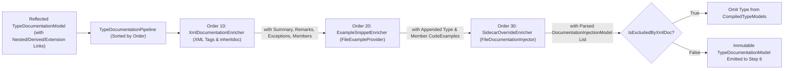
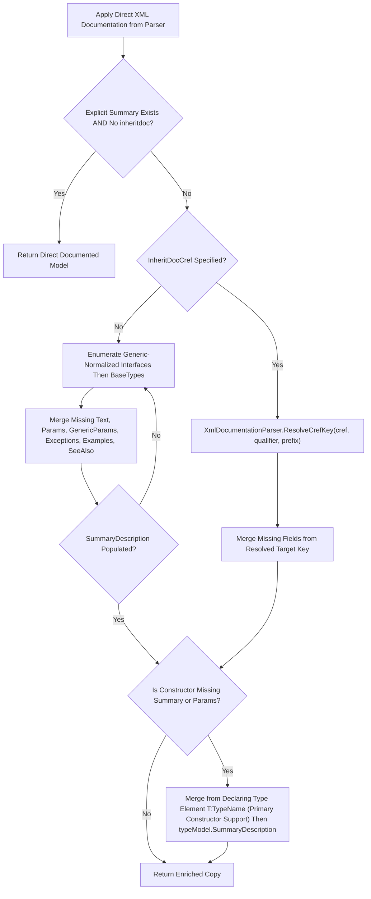

# Enrichment Pipeline, External Snippets, & Sidecar Overrides

This deep-dive explains Step 5's immutable enrichment pipeline ([`ITypeDocumentationPipeline`](../../../src/Documentation.Exporter.Core/Enrichment/ITypeDocumentationPipeline.cs) / [`TypeDocumentationPipeline`](../../../src/Documentation.Exporter.Core/Enrichment/TypeDocumentationPipeline.cs)): how three ordered [`ITypeDocumentationEnricher`](../../../src/Documentation.Exporter.Abstractions/Enrichment/ITypeDocumentationEnricher.cs) stages merge compiler XML docs (`<inheritdoc/>` included), attach external `.cs` snippet files via [`FileExampleProvider`](../../../src/Documentation.Exporter.Core/Injection/FileExampleProvider.cs), and load YAML-frontmatter `.md` sidecar overrides via [`FileDocumentationInjector`](../../../src/Documentation.Exporter.Core/Injection/FileDocumentationInjector.cs) without mutating reflected models in place.

> **Related Docs:** [Component Interactions](../../architectural/component-interactions.md) · [Domain Models & Lifetimes](../../architectural/domain-models-and-lifetimes.md) · [XML Parsing & Link Resolution](xml-parsing-and-link-resolution.md) · [User Snippets & Overrides Guide](../../user/examples-overrides-and-external-links.md)

---

## 1. Non-Mutating Ordered Pipeline (`TypeDocumentationPipeline`)

In Step 5 ([`CompileTypeDocumentationModelsStep`](../../../src/Documentation.Exporter.Core/Workflow/Steps/CompileTypeDocumentationModelsStep.cs)), after [`AssemblyTypeReflector`](../../../src/Documentation.Exporter.Core/Parsing/AssemblyTypeReflector.cs) constructs the initial [`TypeDocumentationModel`](../../../src/Documentation.Exporter.Abstractions/Models/TypeDocumentationModel.cs) and cross-assembly nested/derived/extension relationships are attached, the model enters [`TypeDocumentationPipeline`](../../../src/Documentation.Exporter.Core/Enrichment/TypeDocumentationPipeline.cs).

The pipeline sorts all DI-registered [`ITypeDocumentationEnricher`](../../../src/Documentation.Exporter.Abstractions/Enrichment/ITypeDocumentationEnricher.cs) implementations by ascending `Order` and passes `(targetType, currentModel, options, cancellationToken)` sequentially through each stage. Every built-in and custom enricher treats domain records as immutable, returning updated copies via C# `with` expressions:

---

## 2. Stage 1 (`Order = 10`): XML Comments & `<inheritdoc/>` (`XmlDocumentationEnricher`)

[`XmlDocumentationEnricher`](../../../src/Documentation.Exporter.Core/Enrichment/XmlDocumentationEnricher.cs) bridges the indexed XML lookup in [`IXmlDocumentationParser`](../../../src/Documentation.Exporter.Core/Parsing/IXmlDocumentationParser.cs) with reflected CLR types and members.

### Type & Member Key Matching

- **Type Elements (`T:`)**: Normalizes nested CLR `+` separators to `.` (`Namespace.Outer+Nested` becomes `Namespace.Outer.Nested`) before looking up `T:{typeFullName}`.
- **Constructors (`M:...#ctor`)**: Uses precomputed `XmlMemberKey` or matches constructor parameter signatures via `AssemblyTypeReflector.BuildConstructorXmlKey`. When a type mixes a primary constructor with secondary `: this(...)` overloads whose parameters are not captured in compiler fields, `PromoteOverloadedPrimaryConstructorIfMatched` promotes the documented overload whose parameters match all XML `<param>` descriptions and the type summary to `IsPrimaryConstructor = true` (`Primary (...)`).
- **Methods (`M:`)**: Preserves generic arity (`` ``1 ``, `` ``2 ``), explicit/implicit conversion return suffixes (`~ReturnType`), multi-dimensional array brackets (`[0:,0:]`), and parameter signatures using `AssemblyTypeReflector.BuildMethodXmlKey` so overloaded methods and conversion operators never collide.
- **Simple Members & Indexers (`P:`, `F:`, `E:`)**: Looks up properties, indexers (`P:Type.Item(...)`), fields, and events by `{Prefix}:{typeFullName}.{MemberName}`.

### `<inheritdoc/>` Resolution & Fallback Rules

When `<inheritdoc/>` is present—or when a member's own `
` is blank—[`XmlDocumentationEnricher`](../../../src/Documentation.Exporter.Core/Enrichment/XmlDocumentationEnricher.cs) normalizes constructed generic interfaces and base types via `ResolveCandidateTypeFullName` (unwrapping `GetGenericTypeDefinition()` and nested `+` separators) and executes deterministic non-destructive merging (`MergeInheritedTypeDocumentation` / `MergeInheritedMemberDocumentation`):

**Partial Override Semantics**: Merging never clobbers documentation already written on the subclass or implementing member:
- `SummaryDescription`, `RemarksDescription`, and `ReturnValueDescription` keep local text when non-whitespace (`PreferExistingText`).
- Missing parameter and type-parameter descriptions are filled individually by parameter name first, falling back to positional declaration index when an implementing method or derived type renames a parameter or generic type parameter.
- `DocumentedExceptions` merges base and derived exception entries via `TryAdd`, preserving local conditions first.
- `CodeExamples` and `SeeAlsoReferences` inherit only when the subtype declared none of its own.
- If either the type or an individual member carries `<exclude/>`, `IsExcludedByXmlDoc` becomes `true`, dropping that type or member cleanly in Step 5 ([`CompileTypeDocumentationModelsStep`](../../../src/Documentation.Exporter.Core/Workflow/Steps/CompileTypeDocumentationModelsStep.cs)).

### Overloaded Primary Constructor Promotion and Generic Inheritance

- **Uncaptured Overloaded Primary Constructors (`PromoteOverloadedPrimaryConstructorIfMatched`)**: When a type combines a C# 12 primary constructor with secondary `: this(...)` overloads and does not emit compiler-captured `<param>P` fields (for instance when parameters pass straight into base constructors or initializers), `XmlDocumentationParser.ApplyTypeDocumentation` populates matching `<param>` entries from `T:<TypeName>` onto the matching constructor overload. [`XmlDocumentationEnricher`](../../../src/Documentation.Exporter.Core/Enrichment/XmlDocumentationEnricher.cs) then promotes that constructor (`Constructors.Count > 1`, no existing `IsPrimaryConstructor`, all parameters documented, and `SummaryDescription` equal to the type's summary) to `IsPrimaryConstructor = true` and updates `ConstructorKind` to `"Primary (...)"`.
- **Generic Interface & Base-Type Definition Normalization (`ResolveCandidateTypeFullName` & `TryResolveGenericDefinitionMethod`)**: When walking implemented interfaces and base types in `EnrichType`, `InheritMethodDocumentation`, and `InheritMemberDocumentationByPrefix`, [`XmlDocumentationEnricher`](../../../src/Documentation.Exporter.Core/Enrichment/XmlDocumentationEnricher.cs) unwraps constructed generic types via `candidateType.GetGenericTypeDefinition()`, preserves indexer `Item(...)` XML key suffixes (`ExtractMemberKeySuffix`), and resolves open generic definition `MethodInfo`/`PropertyInfo` signatures (via `GetInterfaceMap` and `MetadataToken` matching) so closed generic implementations (`class ClosedService : IContract<string>`) and indexers locate `M:...IContract`1.FormatPayload``1(`0,``0)` and `P:...IContract`1.Item(`0)` cleanly in XML docs.

---

## 3. Stage 2 (`Order = 20`): External `.cs` Snippets (`ExampleSnippetEnricher`)

[`ExampleSnippetEnricher`](../../../src/Documentation.Exporter.Core/Enrichment/ExampleSnippetEnricher.cs) invokes [`IExampleProvider.GetExamplesAsync`](../../../src/Documentation.Exporter.Core/Injection/IExampleProvider.cs) ([`FileExampleProvider`](../../../src/Documentation.Exporter.Core/Injection/FileExampleProvider.cs)) for the type and every non-excluded constructor, method, property, field, and event when `Options.ExamplesDirectoryPath` is configured:

- **Sanitized Path Resolution (`GetCandidateTypeNames`)**: Probes namespace-qualified `{Namespace}.{DirectorySegmentName}` first before falling back to simple `{CleanTypeName}` (stripping generic arity suffixes so `AuditableEnvelope`1` becomes `AuditableEnvelope` or `AuditableEnvelope_T1` on collision).
- **Type-Level Snippets**: Looks for `{ExamplesDirectoryPath}/{Namespace}.{CleanTypeName}.cs`, then `{ExamplesDirectoryPath}/{CleanTypeName}.cs`.
- **Member-Level Snippets**: Looks inside `{ExamplesDirectoryPath}/{Namespace}.{CleanTypeName}/{CleanMemberName}.cs`, then `{ExamplesDirectoryPath}/{CleanTypeName}/{CleanMemberName}.cs`.
- **Cross-Platform Linux Case-Insensitivity**: If exact-case paths miss on case-sensitive filesystems (`ext4`/`XFS`), [`FileExampleProvider`](../../../src/Documentation.Exporter.Core/Injection/FileExampleProvider.cs) invokes `IFileSystem.FindDirectoryCaseInsensitive` and `IFileSystem.FindFileCaseInsensitive`, catching `IOException` / `UnauthorizedAccessException` safely with `EventId` `403`. Successful loads log `EventId` `402` (type) or `EventId` `401` (member) and append each snippet as a `csharp` fenced block inside `CodeExamples` after XML `<example>` entries.

---

## 4. Stage 3 (`Order = 30`): Markdown Sidecar Overrides (`SidecarOverrideEnricher`)

[`SidecarOverrideEnricher`](../../../src/Documentation.Exporter.Core/Enrichment/SidecarOverrideEnricher.cs) invokes [`IDocumentationInjector.GetInjectionsAsync`](../../../src/Documentation.Exporter.Core/Injection/IDocumentationInjector.cs) ([`FileDocumentationInjector`](../../../src/Documentation.Exporter.Core/Injection/FileDocumentationInjector.cs)) against `Options.OverridesDirectoryPath` for both the type and each non-excluded member (also using case-insensitive file lookup and logging `EventId` `501` on load or `EventId` `502` on directory enumeration errors).

- **File Naming**: Probes namespace-qualified `{Namespace}.{CleanTypeName}.md` first before falling back to `{CleanTypeName}.md` (or `{DirectorySegmentName}.md` when generic arities collide) for type overrides, and `{CleanTypeName}.{CleanMemberName}.md` for member overrides (rendered on member detail pages by [`MemberDetailMarkdownGenerator`](../../../src/Documentation.Exporter.Core/Generation/MemberDetailMarkdownGenerator.cs) across `replace_summary`, `before_remarks`, `after_remarks`, `after_examples`, and `page_append`).
- **Frontmatter Parsing**: Inspects line-anchored opening and closing `---` markers (`FindClosingFrontmatterLineIndex`) for `injection_mode` (`extend` or `replace`) and `target_anchor` (`replace_summary`, `before_remarks`, `after_remarks`, `after_examples`, `page_append`). Missing or incomplete frontmatter safely defaults to `InjectionMode.Extend` and `SidecarAnchor.AfterRemarks` (`DocumentationInjectionModel` with `TargetName`, `InjectionMode`, `TargetAnchor`, `CustomMarkdownContent`).

---

## 5. Owning Source & Test Files

- **Source**: [`ITypeDocumentationPipeline.cs`](../../../src/Documentation.Exporter.Core/Enrichment/ITypeDocumentationPipeline.cs), [`TypeDocumentationPipeline.cs`](../../../src/Documentation.Exporter.Core/Enrichment/TypeDocumentationPipeline.cs), [`ITypeDocumentationEnricher.cs`](../../../src/Documentation.Exporter.Abstractions/Enrichment/ITypeDocumentationEnricher.cs), [`XmlDocumentationEnricher.cs`](../../../src/Documentation.Exporter.Core/Enrichment/XmlDocumentationEnricher.cs), [`ExampleSnippetEnricher.cs`](../../../src/Documentation.Exporter.Core/Enrichment/ExampleSnippetEnricher.cs), [`SidecarOverrideEnricher.cs`](../../../src/Documentation.Exporter.Core/Enrichment/SidecarOverrideEnricher.cs), [`IExampleProvider.cs`](../../../src/Documentation.Exporter.Core/Injection/IExampleProvider.cs), [`FileExampleProvider.cs`](../../../src/Documentation.Exporter.Core/Injection/FileExampleProvider.cs), [`IDocumentationInjector.cs`](../../../src/Documentation.Exporter.Core/Injection/IDocumentationInjector.cs), [`FileDocumentationInjector.cs`](../../../src/Documentation.Exporter.Core/Injection/FileDocumentationInjector.cs), [`DocumentationInjectionModel.cs`](../../../src/Documentation.Exporter.Abstractions/Models/DocumentationInjectionModel.cs), [`SidecarAnchor.cs`](../../../src/Documentation.Exporter.Abstractions/Models/SidecarAnchor.cs), [`InjectionMode.cs`](../../../src/Documentation.Exporter.Abstractions/Models/InjectionMode.cs)
- **Tests**: [`TypeDocumentationPipelineTests.cs`](../../../test/Documentation.Exporter.Core.Tests/Enrichment/TypeDocumentationPipelineTests.cs), [`XmlDocumentationEnricherTests.cs`](../../../test/Documentation.Exporter.Core.Tests/Enrichment/XmlDocumentationEnricherTests.cs), [`ExampleSnippetEnricherTests.cs`](../../../test/Documentation.Exporter.Core.Tests/Enrichment/ExampleSnippetEnricherTests.cs), [`SidecarOverrideEnricherTests.cs`](../../../test/Documentation.Exporter.Core.Tests/Enrichment/SidecarOverrideEnricherTests.cs), [`FileExampleProviderTests.cs`](../../../test/Documentation.Exporter.Core.Tests/Injection/FileExampleProviderTests.cs), [`FileDocumentationInjectorTests.cs`](../../../test/Documentation.Exporter.Core.Tests/Injection/FileDocumentationInjectorTests.cs)
