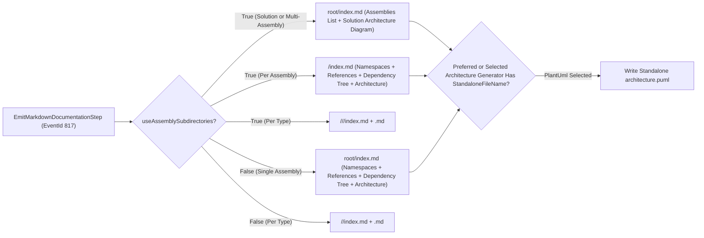
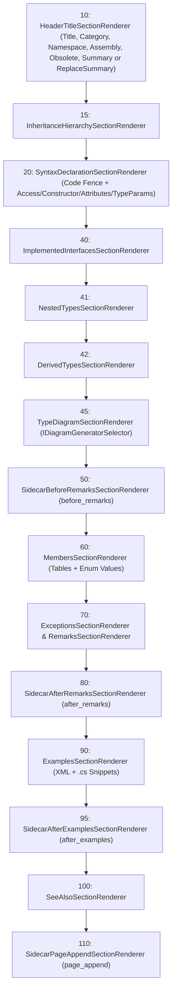
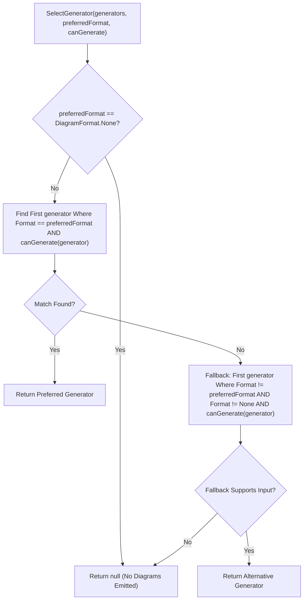

# Markdown Emission, Section Renderers, & Single-Diagram Selection

This deep-dive explains Step 8 ([`EmitMarkdownDocumentationStep`](../../../src/Documentation.Exporter.Core/Workflow/Steps/EmitMarkdownDocumentationStep.cs)): how [`TypePageMarkdownGenerator`](../../../src/Documentation.Exporter.Core/Generation/TypePageMarkdownGenerator.cs) orchestrates 16 ordered section renderers, how [`MemberDetailMarkdownGenerator`](../../../src/Documentation.Exporter.Core/Generation/MemberDetailMarkdownGenerator.cs) disambiguates overloaded members, how [`IndexPageMarkdownGenerator`](../../../src/Documentation.Exporter.Core/Generation/IndexPageMarkdownGenerator.cs) switches between solution-root and assembly-index layouts, and how [`IDiagramGeneratorSelector`](../../../src/Documentation.Exporter.Abstractions/Generation/Diagrams/IDiagramGeneratorSelector.cs) renders a single preferred diagram with controlled fallback.

> **Related Docs:** [Functionality Catalog](../../architectural/functionality-catalog.md) · [Component Interactions](../../architectural/component-interactions.md) · [Extensibility Guide](../extensibility-guide.md) · [User Diagrams & Insights Guide](../../user/diagrams-and-assembly-insights.md)

---

## 1. Output Topology (`EmitMarkdownDocumentationStep`)

Step 8 computes `useAssemblySubdirectories = distinctAssemblies.Count > 1 || !string.IsNullOrWhiteSpace(context.Options.SolutionFilePath)`. When `true` (solution exports or multi-assembly runs), types are placed under `<AssemblyName>/<NamespaceSegments>/<TypeName>/` and per-assembly `index.md` overviews are generated alongside a solution-wide root `index.md`. When exporting a single explicit assembly, types live directly under `<NamespaceSegments>/<TypeName>/` with a single combined root `index.md`:

All type directories are generated concurrently via `Parallel.ForEachAsync`.

---

## 2. Type Page Assembly & The 16 Section Renderers

[`TypePageMarkdownGenerator`](../../../src/Documentation.Exporter.Core/Generation/TypePageMarkdownGenerator.cs) sorts injected `IEnumerable<IMarkdownSectionRenderer>` instances by ascending `Order`, concatenates their string outputs, adjusts root-relative links downward to the type's folder depth via [`IRelativeLinkRewriter.AdjustLocalLinksForTypeDirectory`](../../../src/Documentation.Exporter.Core/Generation/IRelativeLinkRewriter.cs), and normalizes final line endings and trailing spacing via `NormalizeMarkdown`:

- **Sidecar `replace_summary` Semantics**: [`HeaderTitleSectionRenderer`](../../../src/Documentation.Exporter.Core/Generation/Sections/HeaderTitleSectionRenderer.cs) renders `[Obsolete]` warning/caution alerts, `[Experimental]` (`> [!IMPORTANT]` with optional `UrlFormat` diagnostic link), and checks `typeModel.InjectedDocumentationSections` for an entry matching `InjectionMode.Replace` and `SidecarAnchor.ReplaceSummary`, substituting its Markdown content directly beneath the assembly/namespace header block. The four positional sidecar renderers inherit [`SidecarAnchorSectionRendererBase`](../../../src/Documentation.Exporter.Core/Generation/Sections/SidecarAnchorSectionRendererBase.cs) (`BeforeRemarks` at `50`, `AfterRemarks` at `80`, `AfterExamples` at `95`, `PageAppend` at `110`) to emit matching injected blocks in their designated page slot.
- **Modern C# Modifiers & `[Experimental]` Callouts**: [`SyntaxDeclarationSectionRenderer`](../../../src/Documentation.Exporter.Core/Generation/Sections/SyntaxDeclarationSectionRenderer.cs) surfaces `Record`, `ReadOnly`, and `Ref Struct` boolean rows, multi-word access modifier links (`protected internal`, `private protected`), and `allows ref struct` / `notnull` constraints. [`IndexPageMarkdownGenerator`](../../../src/Documentation.Exporter.Core/Generation/IndexPageMarkdownGenerator.cs) prefixes `[Experimental]` badges in namespace tables, [`MembersSectionRenderer`](../../../src/Documentation.Exporter.Core/Generation/Sections/MembersSectionRenderer.cs) renders `## Extension Properties`, indexers (`this[...]`), and operators under `## Methods`, and [`MemberDetailMarkdownGenerator`](../../../src/Documentation.Exporter.Core/Generation/MemberDetailMarkdownGenerator.cs) emits `[Experimental]` callouts and `[scoped]` parameter modifier links.
- **Custom Attributes Across All C# Objects**: Linked custom attributes render on assembly index pages via [`IndexPageMarkdownGenerator`](../../../src/Documentation.Exporter.Core/Generation/IndexPageMarkdownGenerator.cs) (`AppendAssemblyAttributesLine` with `AdjustAssemblyIndexLinks`, plus `AppendTypeAttributesToDescription` in namespace tables), on all type pages including `Enum` declarations and `#### Type Parameters` via [`SyntaxDeclarationSectionRenderer`](../../../src/Documentation.Exporter.Core/Generation/Sections/SyntaxDeclarationSectionRenderer.cs), in member overview and enum `## Values` tables via [`MembersSectionRenderer`](../../../src/Documentation.Exporter.Core/Generation/Sections/MembersSectionRenderer.cs), and across member headers, generic type parameters, parameter `Modifiers`, and `#### Returns` sections via [`MemberDetailMarkdownGenerator`](../../../src/Documentation.Exporter.Core/Generation/MemberDetailMarkdownGenerator.cs). All table cells escape `|` as `\|` (for `[Flags]` enum arguments such as `AttributeTargets.Class | AttributeTargets.Struct`) while diagrams stay free of attribute clutter.
- **Overload-Disambiguated & Path-Safe Member Pages**: For non-enum types, [`MemberDetailMarkdownGenerator`](../../../src/Documentation.Exporter.Core/Generation/MemberDetailMarkdownGenerator.cs) generates individual `<Member>.md` files using [`MemberFileNameFormatter`](../../../src/Documentation.Exporter.Core/Generation/MemberFileNameFormatter.cs) (mapping operator names like `operator checked +` or `operator +=` to safe `op_*` tokens, appending `_T{n}` generic arity, preserving `in_`/`out_`/`ref_`/`ref_readonly_` by-ref prefixes, and appending sanitized parameter type names when overloaded, e.g. `ProcessOrder_OrderRequest.md` vs. `ProcessOrder_String_Decimal.md`), [`ExceptionTableFormatter`](../../../src/Documentation.Exporter.Core/Generation/ExceptionTableFormatter.cs) for `#### Exceptions` tables, and `Async` / `CancellationToken` / `[Obsolete]` / `[Experimental]` metadata badges. Enum value documentation renders directly inside `## Values` via [`MembersSectionRenderer`](../../../src/Documentation.Exporter.Core/Generation/Sections/MembersSectionRenderer.cs).

### Experimental Callouts and Modern Modifier Rendering

- **`[Experimental]` Alert Formatting**: [`MicrosoftLearnReferenceRegistry.FormatExperimentalWarningBlock`](../../../src/Documentation.Exporter.Core/Resolution/MicrosoftLearnReferenceRegistry.cs) emits GitHub/DocFX `> [!IMPORTANT]` callout blocks on both type pages ([`HeaderTitleSectionRenderer`](../../../src/Documentation.Exporter.Core/Generation/Sections/HeaderTitleSectionRenderer.cs)) and member pages ([`MemberDetailMarkdownGenerator`](../../../src/Documentation.Exporter.Core/Generation/MemberDetailMarkdownGenerator.cs)). When `ExperimentalUrlFormat` is present, `{0}` is formatted with `ExperimentalDiagnosticId` into `[ID](resolvedUrl)` (falling back safely to raw `urlFormat` on malformed format strings or `` (`ID`) `` when omitted).
- **Index & Overview Status Badges**: [`IndexPageMarkdownGenerator`](../../../src/Documentation.Exporter.Core/Generation/IndexPageMarkdownGenerator.cs) and [`MembersSectionRenderer`](../../../src/Documentation.Exporter.Core/Generation/Sections/MembersSectionRenderer.cs) prefix **`[Experimental]`** badges (joining seamlessly with `[Obsolete]` notices via ` ` / em-dash when both apply) and emit dedicated `## Extension Properties` tables alongside constructors (`Primary Constructor` badge), properties, indexers (`this[...]`), methods (including operators), fields, and events.
- **Type & Parameter Metadata Rows**: [`SyntaxDeclarationSectionRenderer`](../../../src/Documentation.Exporter.Core/Generation/Sections/SyntaxDeclarationSectionRenderer.cs) adds conditional `Record`, `ReadOnly`, and `Ref Struct` rows (`Yes` only when active), formats multi-word access modifiers (`[protected](...) [internal](...)`), and links `allows ref struct` and `notnull` type parameter constraints. [`MemberDetailMarkdownGenerator`](../../../src/Documentation.Exporter.Core/Generation/MemberDetailMarkdownGenerator.cs) splits combined parameter modifiers such as `scoped ref readonly` or `this scoped ref readonly` into individually linked keywords (`[scoped](...)`, `[ref readonly](...)`, `[this](...)`).

### Overload and Path-Safe Member File Naming

[`MemberFileNameFormatter`](../../../src/Documentation.Exporter.Core/Generation/MemberFileNameFormatter.cs) guarantees valid cross-platform Markdown filenames without invalid path characters (`+`, `*`, `/`, `<`, `>`, `?`, `[`, `]`, `=`):

| Member Kind / Case | File Naming Rule | Example Output |
| :--- | :--- | :--- |
| **Constructors** | `<SafeTypeName>.ctor.md` (appending `_<ParamTokens>` when overloaded) | `SettlementRecordBase.ctor_String.md` |
| **Operators** | Maps C# operator display names (`operator +`, `operator checked +`, `operator >>>`, `operator +=`, `operator checked +=`, `operator implicit`, `operator explicit`, `operator checked explicit`) via `OperatorFileTokenMap` to CLR `op_*` tokens, appending `_{ReturnType}` when conversion operators are overloaded across target types | `op_CheckedAddition.md`, `op_CheckedExplicit.md`, `op_Explicit_OrderId_Int32.md` |
| **Indexers (`this`)** | Sanitizes `"this"` as base token; renders header title `this[<Types>]` | `this.md`, `this_Int32_String.md` |
| **Overloaded Generic Methods** | Appends `_T{arity}` before parameter suffix when `GenericTypeParameters.Count > 0` | `Transform_T2_in_TInput_ref_Int32.md` |
| **By-Ref Overloads** | Prepends `in_`, `out_`, `ref_`, or `ref_readonly_` to sanitized parameter type tokens | `Inspect_out_String.md`, `Combine_ref_readonly_Decimal.md` |
| **Sanitization Fallbacks** | Empty member names default to `"Member"`; empty sanitized parameter type tokens (e.g., `[]`) default to `"Param"` | `Member.md`, `RunVoid_Param.md` |

---

## 3. Preferred Single-Diagram Selection with Fallback (`IDiagramGeneratorSelector`)

Rather than emitting redundant Mermaid and PlantUML blocks for the same diagram, [`IDiagramGeneratorSelector.SelectGenerator`](../../../src/Documentation.Exporter.Abstractions/Generation/Diagrams/IDiagramGeneratorSelector.cs) ([`DiagramGeneratorSelector`](../../../src/Documentation.Exporter.Core/Generation/Diagrams/DiagramGeneratorSelector.cs)) guarantees **at most one** generator per diagram slot:

[`EmitMarkdownDocumentationStep`](../../../src/Documentation.Exporter.Core/Workflow/Steps/EmitMarkdownDocumentationStep.cs) applies the exact same [`IDiagramGeneratorSelector`](../../../src/Documentation.Exporter.Abstractions/Generation/Diagrams/IDiagramGeneratorSelector.cs) check when emitting standalone `architecture.puml` files beside root and assembly `index.md` pages, so standalone PlantUML files appear only if an `IArchitectureDiagramGenerator` with a non-empty `StandaloneFileName` is selected for that scope.

---

## 4. Built-In Diagram Strategies & Styling

| Diagram Role | Mermaid Generator | PlantUML Generator | Node Sanitization & Visual Rules |
| :--- | :--- | :--- | :--- |
| **Type Hierarchy** ([`ITypeDiagramGenerator`](../../../src/Documentation.Exporter.Abstractions/Generation/Diagrams/ITypeDiagramGenerator.cs)) | [`MermaidTypeDiagramGenerator`](../../../src/Documentation.Exporter.Plugins.Diagrams/MermaidTypeDiagramGenerator.cs) | [`PlantUmlTypeDiagramGenerator`](../../../src/Documentation.Exporter.Plugins.Diagrams/PlantUmlTypeDiagramGenerator.cs) | Uses [`DiagramIdentifierFormatter.ExtractTypeDiagramRelationships`](../../../src/Documentation.Exporter.Core/Generation/Diagrams/DiagramIdentifierFormatter.cs); skips enums or types with zero base/interface/derived edges (`CanGenerate == false`). |
| **Architecture Overview** ([`IArchitectureDiagramGenerator`](../../../src/Documentation.Exporter.Abstractions/Generation/Diagrams/IArchitectureDiagramGenerator.cs)) | [`MermaidArchitectureDiagramGenerator`](../../../src/Documentation.Exporter.Plugins.Diagrams/MermaidArchitectureDiagramGenerator.cs) | [`PlantUmlArchitectureDiagramGenerator`](../../../src/Documentation.Exporter.Plugins.Diagrams/PlantUmlArchitectureDiagramGenerator.cs) | Groups types by namespace (`namespace` / `package` blocks) and plots inheritance and interface realization edges across the solution or single assembly. |
| **Assembly Dependency Tree** ([`IAssemblyDependencyDiagramGenerator`](../../../src/Documentation.Exporter.Abstractions/Generation/Diagrams/IAssemblyDependencyDiagramGenerator.cs)) | [`MermaidAssemblyDependencyDiagramGenerator`](../../../src/Documentation.Exporter.Plugins.Diagrams/MermaidAssemblyDependencyDiagramGenerator.cs) | [`PlantUmlAssemblyDependencyDiagramGenerator`](../../../src/Documentation.Exporter.Plugins.Diagrams/PlantUmlAssemblyDependencyDiagramGenerator.cs) | Anchors root assembly first via `BuildUniqueNodeIdentifiers`, labels edges using `FormatDependencyEdgeLabel`, and styles strong-named targets solid green (`#2E7D32`) vs. unsigned targets dashed gray (`#757575`) plus a localized legend. |

---

## 5. Owning Source & Test Files

- **Generators & Helpers**: [`ITypePageMarkdownGenerator.cs`](../../../src/Documentation.Exporter.Core/Generation/ITypePageMarkdownGenerator.cs), [`TypePageMarkdownGenerator.cs`](../../../src/Documentation.Exporter.Core/Generation/TypePageMarkdownGenerator.cs), [`IMemberDetailMarkdownGenerator.cs`](../../../src/Documentation.Exporter.Core/Generation/IMemberDetailMarkdownGenerator.cs), [`MemberDetailMarkdownGenerator.cs`](../../../src/Documentation.Exporter.Core/Generation/MemberDetailMarkdownGenerator.cs), [`IIndexPageMarkdownGenerator.cs`](../../../src/Documentation.Exporter.Core/Generation/IIndexPageMarkdownGenerator.cs), [`IndexPageMarkdownGenerator.cs`](../../../src/Documentation.Exporter.Core/Generation/IndexPageMarkdownGenerator.cs), [`IMemberFileNameFormatter.cs`](../../../src/Documentation.Exporter.Core/Generation/IMemberFileNameFormatter.cs), [`MemberFileNameFormatter.cs`](../../../src/Documentation.Exporter.Core/Generation/MemberFileNameFormatter.cs), [`IExceptionTableFormatter.cs`](../../../src/Documentation.Exporter.Core/Generation/IExceptionTableFormatter.cs), [`ExceptionTableFormatter.cs`](../../../src/Documentation.Exporter.Core/Generation/ExceptionTableFormatter.cs), [`IRelativeLinkRewriter.cs`](../../../src/Documentation.Exporter.Core/Generation/IRelativeLinkRewriter.cs), [`RelativeLinkRewriter.cs`](../../../src/Documentation.Exporter.Core/Generation/RelativeLinkRewriter.cs), [`EmitMarkdownDocumentationStep.cs`](../../../src/Documentation.Exporter.Core/Workflow/Steps/EmitMarkdownDocumentationStep.cs)
- **Sections (`Sections/`)**: [`IMarkdownSectionRenderer.cs`](../../../src/Documentation.Exporter.Abstractions/Generation/Sections/IMarkdownSectionRenderer.cs), [`HeaderTitleSectionRenderer.cs`](../../../src/Documentation.Exporter.Core/Generation/Sections/HeaderTitleSectionRenderer.cs), [`InheritanceHierarchySectionRenderer.cs`](../../../src/Documentation.Exporter.Core/Generation/Sections/InheritanceHierarchySectionRenderer.cs), [`SyntaxDeclarationSectionRenderer.cs`](../../../src/Documentation.Exporter.Core/Generation/Sections/SyntaxDeclarationSectionRenderer.cs), [`ImplementedInterfacesSectionRenderer.cs`](../../../src/Documentation.Exporter.Core/Generation/Sections/ImplementedInterfacesSectionRenderer.cs), [`NestedTypesSectionRenderer.cs`](../../../src/Documentation.Exporter.Core/Generation/Sections/NestedTypesSectionRenderer.cs), [`DerivedTypesSectionRenderer.cs`](../../../src/Documentation.Exporter.Core/Generation/Sections/DerivedTypesSectionRenderer.cs), [`TypeDiagramSectionRenderer.cs`](../../../src/Documentation.Exporter.Core/Generation/Sections/TypeDiagramSectionRenderer.cs), [`SidecarAnchorSectionRendererBase.cs`](../../../src/Documentation.Exporter.Core/Generation/Sections/SidecarAnchorSectionRendererBase.cs), [`SidecarBeforeRemarksSectionRenderer.cs`](../../../src/Documentation.Exporter.Core/Generation/Sections/SidecarBeforeRemarksSectionRenderer.cs), [`MembersSectionRenderer.cs`](../../../src/Documentation.Exporter.Core/Generation/Sections/MembersSectionRenderer.cs), [`ExceptionsSectionRenderer.cs`](../../../src/Documentation.Exporter.Core/Generation/Sections/ExceptionsSectionRenderer.cs), [`RemarksSectionRenderer.cs`](../../../src/Documentation.Exporter.Core/Generation/Sections/RemarksSectionRenderer.cs), [`SidecarAfterRemarksSectionRenderer.cs`](../../../src/Documentation.Exporter.Core/Generation/Sections/SidecarAfterRemarksSectionRenderer.cs), [`ExamplesSectionRenderer.cs`](../../../src/Documentation.Exporter.Core/Generation/Sections/ExamplesSectionRenderer.cs), [`SidecarAfterExamplesSectionRenderer.cs`](../../../src/Documentation.Exporter.Core/Generation/Sections/SidecarAfterExamplesSectionRenderer.cs), [`SeeAlsoSectionRenderer.cs`](../../../src/Documentation.Exporter.Core/Generation/Sections/SeeAlsoSectionRenderer.cs), [`SidecarPageAppendSectionRenderer.cs`](../../../src/Documentation.Exporter.Core/Generation/Sections/SidecarPageAppendSectionRenderer.cs)
- **Diagrams Infrastructure & Built-In Plugin**: [`IDiagramGenerator.cs`](../../../src/Documentation.Exporter.Abstractions/Generation/Diagrams/IDiagramGenerator.cs), [`IDiagramGeneratorSelector.cs`](../../../src/Documentation.Exporter.Abstractions/Generation/Diagrams/IDiagramGeneratorSelector.cs), [`DiagramGeneratorSelector.cs`](../../../src/Documentation.Exporter.Core/Generation/Diagrams/DiagramGeneratorSelector.cs), [`IDiagramIdentifierFormatter.cs`](../../../src/Documentation.Exporter.Abstractions/Generation/Diagrams/IDiagramIdentifierFormatter.cs), [`DiagramIdentifierFormatter.cs`](../../../src/Documentation.Exporter.Core/Generation/Diagrams/DiagramIdentifierFormatter.cs), [`StandardDiagramsPlugin.cs`](../../../src/Documentation.Exporter.Plugins.Diagrams/StandardDiagramsPlugin.cs), [`ITypeDiagramGenerator.cs`](../../../src/Documentation.Exporter.Abstractions/Generation/Diagrams/ITypeDiagramGenerator.cs), [`MermaidTypeDiagramGenerator.cs`](../../../src/Documentation.Exporter.Plugins.Diagrams/MermaidTypeDiagramGenerator.cs), [`PlantUmlTypeDiagramGenerator.cs`](../../../src/Documentation.Exporter.Plugins.Diagrams/PlantUmlTypeDiagramGenerator.cs), [`IArchitectureDiagramGenerator.cs`](../../../src/Documentation.Exporter.Abstractions/Generation/Diagrams/IArchitectureDiagramGenerator.cs), [`MermaidArchitectureDiagramGenerator.cs`](../../../src/Documentation.Exporter.Plugins.Diagrams/MermaidArchitectureDiagramGenerator.cs), [`PlantUmlArchitectureDiagramGenerator.cs`](../../../src/Documentation.Exporter.Plugins.Diagrams/PlantUmlArchitectureDiagramGenerator.cs), [`IAssemblyDependencyDiagramGenerator.cs`](../../../src/Documentation.Exporter.Abstractions/Generation/Diagrams/IAssemblyDependencyDiagramGenerator.cs), [`MermaidAssemblyDependencyDiagramGenerator.cs`](../../../src/Documentation.Exporter.Plugins.Diagrams/MermaidAssemblyDependencyDiagramGenerator.cs), [`PlantUmlAssemblyDependencyDiagramGenerator.cs`](../../../src/Documentation.Exporter.Plugins.Diagrams/PlantUmlAssemblyDependencyDiagramGenerator.cs)
- **Tests**: [`TypePageMarkdownGeneratorTests.cs`](../../../test/Documentation.Exporter.Core.Tests/Generation/TypePageMarkdownGeneratorTests.cs), [`MemberDetailMarkdownGeneratorTests.cs`](../../../test/Documentation.Exporter.Core.Tests/Generation/MemberDetailMarkdownGeneratorTests.cs), [`IndexPageMarkdownGeneratorTests.cs`](../../../test/Documentation.Exporter.Core.Tests/Generation/IndexPageMarkdownGeneratorTests.cs), [`DiagramGeneratorSelectorTests.cs`](../../../test/Documentation.Exporter.Core.Tests/Generation/Diagrams/DiagramGeneratorSelectorTests.cs), [`DiagramIdentifierFormatterTests.cs`](../../../test/Documentation.Exporter.Core.Tests/Generation/Diagrams/DiagramIdentifierFormatterTests.cs)
