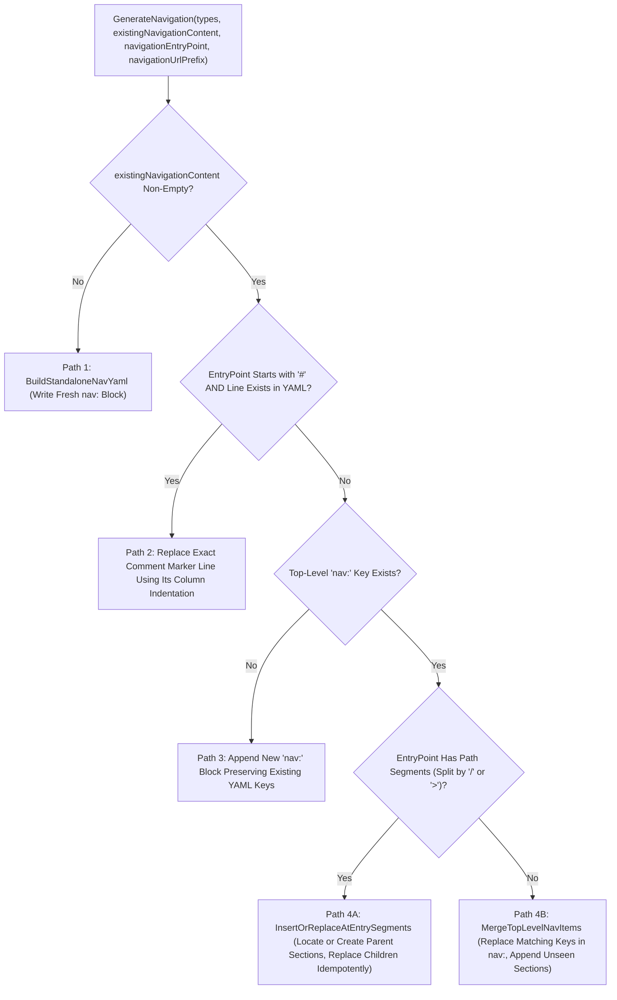
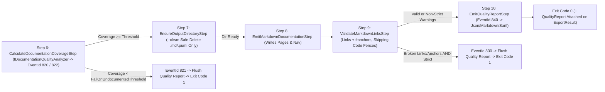

# MkDocs Navigation Merging, Quality Gates, & Localization

This deep-dive explains the operational and verification tail of the export pipeline: pluggable static-site navigation generation ([`INavigationGenerator`](../../../src/Documentation.Exporter.Abstractions/Generation/INavigationGenerator.cs), [`NavigationFormat`](../../../src/Documentation.Exporter.Abstractions/Models/NavigationFormat.cs), and idempotent MkDocs YAML navigation generation/merging in [`MkDocsNavigationGenerator`](../../../src/Documentation.Exporter.Plugins.Navigation.MkDocs/MkDocsNavigationGenerator.cs)), documentation coverage thresholds and `DOC001`–`DOC005` diagnostics in Step 6 ([`CalculateDocumentationCoverageStep`](../../../src/Documentation.Exporter.Core/Workflow/Steps/CalculateDocumentationCoverageStep.cs)), safe directory cleaning in Step 7 ([`EnsureOutputDirectoryStep`](../../../src/Documentation.Exporter.Core/Workflow/Steps/EnsureOutputDirectoryStep.cs)), concurrent relative-link and heading-anchor verification (`DOC006`–`DOC007`) in Step 9 ([`ValidateMarkdownLinksStep`](../../../src/Documentation.Exporter.Core/Workflow/Steps/ValidateMarkdownLinksStep.cs)), extensible multi-format quality report emission ([`QualityReportFormat`](../../../src/Documentation.Exporter.Abstractions/Models/QualityReportFormat.cs)) in Step 10 ([`EmitQualityReportStep`](../../../src/Documentation.Exporter.Core/Workflow/Steps/EmitQualityReportStep.cs)), and `.resx`-backed UI localization.

> **Related Docs:** [Functionality Catalog](../../architectural/functionality-catalog.md) · [Structured Logging & Localization](../logging-and-localization.md) · [User MkDocs & CI Guide](../../user/mkdocs-and-ci-integration.md) · [Testing & Coverage](../testing-and-coverage.md)

---

## 1. Pluggable Site Navigation & Idempotent MkDocs Merging (`INavigationGenerator` & `MkDocsNavigationGenerator`)

In Step 8 ([`EmitMarkdownDocumentationStep`](../../../src/Documentation.Exporter.Core/Workflow/Steps/EmitMarkdownDocumentationStep.cs)), when `Options.NavigationFormat` (`--nav-format`) is not `NavigationFormat.None`, the step selects the matching registered [`INavigationGenerator`](../../../src/Documentation.Exporter.Abstractions/Generation/INavigationGenerator.cs) from `IEnumerable<INavigationGenerator>` (logging `EventId` `819` warning and skipping cleanly if none is registered for a custom format) and writes to `Options.NavigationFilePath` or `Path.Combine(outputDir, selectedGenerator.DefaultFileName)`.

For the default `NavigationFormat.MkDocs` strategy supplied by [`Documentation.Exporter.Plugins.Navigation.MkDocs`](../../../src/Documentation.Exporter.Plugins.Navigation.MkDocs/Documentation.Exporter.Plugins.Navigation.MkDocs.csproj), [`MkDocsNavigationGenerator.GenerateNavigation`](../../../src/Documentation.Exporter.Plugins.Navigation.MkDocs/MkDocsNavigationGenerator.cs) builds a hierarchical navigation tree (`Overview`, optional assembly grouping when `useAssemblySubdirectories == true`, ordered namespaces, and type links resolved via [`TypeDocumentationPaths.GetTypeRelativeUrlPath`](../../../src/Documentation.Exporter.Abstractions/Resolution/TypeDocumentationPaths.cs) prefixed with `navigationUrlPrefix` normalized with `/` slashes), then selects one of four YAML output paths:



### Why Repeated CI Runs Are Idempotent

- **Section-Path Merging (`InsertOrReplaceAtEntrySegments`)**: Walks `nav:` indentation levels dynamically (`DetectListIndent`, `FindChildBlockEnd`), locates existing segments (even if quoted with `'` or `"`), deletes only the stale child lines beneath the final target section (`- API Reference:`), and splices the newly generated entries at `matchedIndent + 4`. Non-API sibling nodes (`Home`, `Architecture Guide`, `Getting Started`, `Release Notes` in [`demo/mkdocs.base.nav.yml`](../../../demo/mkdocs.base.nav.yml)) remain completely untouched across infinite CI reruns.
- **Comment Marker Region Preservation (`# MARKER` / `# MARKER-END`)**: When `navigationEntryPoint` is a `#` comment placeholder, the generator preserves the opening comment marker and encloses generated navigation items with a matching `<Marker>-END` comment line so subsequent runs replace the exact bounded block idempotently.
- **Top-Level User Overview Preservation & Safe YAML Quoting**: Top-level merging preserves custom user `- Overview:` entries pointing to non-generated pages, and automatically quotes navigation keys containing `:` or `#` (or falls back to `Global` for global-namespace types).
- **Prefix Normalization**: Trailing slashes and backslashes in `--nav-url-prefix` are normalized via `Replace('\\', '/').Trim('/') + "/"` so cross-platform Linux and Windows runs emit valid web URLs.

---

## 2. CI Quality Gates & Diagnostics Reporting (Steps 6, 7, 9, & 10)

Four dedicated workflow steps turn documentation export into an actionable build-time quality gate:



### Step 6: Coverage Enforcement & Actionable Diagnostics (`CalculateDocumentationCoverageStep` + `DocumentationQualityAnalyzer`)

- Delegates evaluation to [`IDocumentationQualityAnalyzer`](../../../src/Documentation.Exporter.Core/Quality/IDocumentationQualityAnalyzer.cs) ([`DocumentationQualityAnalyzer`](../../../src/Documentation.Exporter.Core/Quality/DocumentationQualityAnalyzer.cs)).
- Preserves legacy summary-only percentage math (`TotalDocumentableSymbols`, `DocumentedSymbols`, `DocumentationCoveragePercentage`) across compiled non-excluded types (`SummaryDescription`) and members (`typeModel.EnumerateAllMembers()`), logging **`EventId` `820`**.
- Additionally records deterministic [`DocumentationDiagnostic`](../../../src/Documentation.Exporter.Abstractions/Models/DocumentationDiagnostic.cs) entries onto `context.Diagnostics` for missing type summaries (`DOC001`), missing member summaries (`DOC002`), missing `<param>` descriptions (`DOC003`), missing `<typeparam>` descriptions (`DOC004`), and missing `<returns>` descriptions on non-void/value-returning methods (`DOC005`, ignoring `Void` / non-generic `Task` / `ValueTask`), logging summary totals at **`EventId` `822`**.
- When `Options.FailOnUndocumentedThreshold` is configured and calculated coverage falls short, logs **`EventId` `821`**, sets `HasFailed = true`, and aborts—while [`ExportWorkflow`](../../../src/Documentation.Exporter.Core/Workflow/ExportWorkflow.cs) still flushes any configured `--report-file` so CI callers receive the full diagnostics breakdown.

### Step 7: Asset-Safe Output Cleanup (`EnsureOutputDirectoryStep`)

- Creates `OutputDirectoryPath` if missing (logging **`EventId` `816`** on failure).
- When `Options.CleanOutputDirectory` (`--clean`) is `true` on an existing directory, inspects `.docexporter-manifest.json` (written by [`EmitMarkdownDocumentationStep`](../../../src/Documentation.Exporter.Core/Workflow/Steps/EmitMarkdownDocumentationStep.cs)) and deletes only the tracked generated files—preserving hand-authored Markdown guides as well as images, stylesheets, `CNAME`, or MkDocs theme overrides. When no manifest is present, it falls back to deleting `.md` and `.puml` files, removes empty subdirectories bottom-up (ordered descending by path length), and logs **`EventId` `818`**.

### Step 9: Code-Fence-Aware Link & Heading Anchor Validation (`ValidateMarkdownLinksStep`)

- Enumerates all `*.md` files under `OutputDirectoryPath` and scans Markdown lines concurrently with `Parallel.ForEachAsync`.
- Tracks fenced code blocks (` ``` ` / `~~~`) line-by-line (preserving 1-based line numbers) and strips inline backtick code spans (`` `...` ``) before matching `[text](target)` hyperlinks—preventing false positives inside code examples.
- Skips `http://`, `https://`, `mailto:`, `tel:`, `ftp://`, and `javascript:` targets.
- Validates both file/directory existence (`DOC006`, logged at **`EventId` `831`**) AND `#anchor` heading slugs on intra-page (`#section`) and cross-page (`Target.md#section`) links (`DOC007`, logged at **`EventId` `833`**) using a per-file cached GFM heading slug extractor aligned with [`RelativeLinkRewriter`](../../../src/Documentation.Exporter.Core/Generation/RelativeLinkRewriter.cs).
- Records `VerifiedLinksCount`, exact `FilePath`, `LineNumber`, and `TargetReference` on every diagnostic; when `StrictLinkValidation` is enabled and broken links or anchors exist, logs **`EventId` `830`** and fails cleanly.

### Step 10: Structured Quality Report Serialization (`EmitQualityReportStep`, `DocumentationQualityReportWriter`, & Formatters)

- Finalizes a deterministic [`DocumentationQualityReport`](../../../src/Documentation.Exporter.Abstractions/Models/DocumentationQualityReport.cs) snapshot on `ExportWorkflowContext.QualityReport` and [`ExportResult.QualityReport`](../../../src/Documentation.Exporter.Abstractions/Models/ExportResult.cs).
- When `ExporterOptions.ReportFilePath` is set, [`IDocumentationQualityReportWriter`](../../../src/Documentation.Exporter.Core/Quality/IDocumentationQualityReportWriter.cs) ([`DocumentationQualityReportWriter`](../../../src/Documentation.Exporter.Core/Quality/DocumentationQualityReportWriter.cs)) selects the DI-registered [`IQualityReportFormatter`](../../../src/Documentation.Exporter.Abstractions/Quality/IQualityReportFormatter.cs) matching `ReportFormat`:
  - [`JsonQualityReportFormatter`](../../../src/Documentation.Exporter.Core/Quality/JsonQualityReportFormatter.cs) (`QualityReportFormat.Json`)
  - [`MarkdownQualityReportFormatter`](../../../src/Documentation.Exporter.Core/Quality/MarkdownQualityReportFormatter.cs) (`QualityReportFormat.Markdown`)
  - [`SarifQualityReportFormatter`](../../../src/Documentation.Exporter.Core/Quality/SarifQualityReportFormatter.cs) (`QualityReportFormat.Sarif`, OASIS SARIF v2.1.0 with `DOC001`–`DOC007` rules, `ruleIndex`, `partialFingerprints` (`primaryLocationLineHash`), and physical/logical locations)
- Logs report creation at **`EventId` `840`** (and I/O write failures at **`EventId` `841`**). Even if an earlier gate fails (Steps 1–9), [`ExportWorkflow`](../../../src/Documentation.Exporter.Core/Workflow/ExportWorkflow.cs) attempts to persist the failure diagnostics report when `--report-file` is set (logging `EventId` `805` if the secondary failure report write encounters an I/O error).

---

## 3. Resource-Backed Localization (`.resx`)

All generated Markdown titles/column headers, CLI prompts, DataAnnotations validation diagnostics, and workflow step names come from strongly typed `.resx` bundles inside [`src/Documentation.Exporter.Core/Resources/`](../../../src/Documentation.Exporter.Core/Resources):

- [`CliCommandResources`](../../../src/Documentation.Exporter.Core/Resources/CliCommandResources.cs) ([`.resx`](../../../src/Documentation.Exporter.Core/Resources/CliCommandResources.resx))
- [`ValidationMessagesResources`](../../../src/Documentation.Exporter.Abstractions/Resources/ValidationMessagesResources.cs) ([`.resx`](../../../src/Documentation.Exporter.Abstractions/Resources/ValidationMessagesResources.resx))
- [`MarkdownGenerationResources`](../../../src/Documentation.Exporter.Core/Resources/MarkdownGenerationResources.cs) ([`.resx`](../../../src/Documentation.Exporter.Core/Resources/MarkdownGenerationResources.resx))
- [`ExecutionMessagesResources`](../../../src/Documentation.Exporter.Core/Resources/ExecutionMessagesResources.cs) ([`.resx`](../../../src/Documentation.Exporter.Core/Resources/ExecutionMessagesResources.resx))

---

## 4. Owning Source & Test Files

- **Source**: [`INavigationGenerator.cs`](../../../src/Documentation.Exporter.Abstractions/Generation/INavigationGenerator.cs), [`MkDocsNavigationPlugin.cs`](../../../src/Documentation.Exporter.Plugins.Navigation.MkDocs/MkDocsNavigationPlugin.cs), [`MkDocsNavigationGenerator.cs`](../../../src/Documentation.Exporter.Plugins.Navigation.MkDocs/MkDocsNavigationGenerator.cs), [`NavigationFormat.cs`](../../../src/Documentation.Exporter.Abstractions/Models/NavigationFormat.cs), [`QualityReportFormat.cs`](../../../src/Documentation.Exporter.Abstractions/Models/QualityReportFormat.cs), [`IDocumentationQualityAnalyzer.cs`](../../../src/Documentation.Exporter.Core/Quality/IDocumentationQualityAnalyzer.cs), [`DocumentationQualityAnalyzer.cs`](../../../src/Documentation.Exporter.Core/Quality/DocumentationQualityAnalyzer.cs), [`IQualityReportFormatter.cs`](../../../src/Documentation.Exporter.Abstractions/Quality/IQualityReportFormatter.cs), [`JsonQualityReportFormatter.cs`](../../../src/Documentation.Exporter.Core/Quality/JsonQualityReportFormatter.cs), [`MarkdownQualityReportFormatter.cs`](../../../src/Documentation.Exporter.Core/Quality/MarkdownQualityReportFormatter.cs), [`SarifQualityReportFormatter.cs`](../../../src/Documentation.Exporter.Core/Quality/SarifQualityReportFormatter.cs), [`IDocumentationQualityReportWriter.cs`](../../../src/Documentation.Exporter.Core/Quality/IDocumentationQualityReportWriter.cs), [`DocumentationQualityReportWriter.cs`](../../../src/Documentation.Exporter.Core/Quality/DocumentationQualityReportWriter.cs), [`CalculateDocumentationCoverageStep.cs`](../../../src/Documentation.Exporter.Core/Workflow/Steps/CalculateDocumentationCoverageStep.cs), [`EnsureOutputDirectoryStep.cs`](../../../src/Documentation.Exporter.Core/Workflow/Steps/EnsureOutputDirectoryStep.cs), [`ValidateMarkdownLinksStep.cs`](../../../src/Documentation.Exporter.Core/Workflow/Steps/ValidateMarkdownLinksStep.cs), [`EmitQualityReportStep.cs`](../../../src/Documentation.Exporter.Core/Workflow/Steps/EmitQualityReportStep.cs)
- **Tests**: [`MkDocsNavigationGeneratorTests.cs`](../../../test/Documentation.Exporter.Core.Tests/Generation/MkDocsNavigationGeneratorTests.cs), [`DocumentationQualityAnalyzerTests.cs`](../../../test/Documentation.Exporter.Core.Tests/Quality/DocumentationQualityAnalyzerTests.cs), [`QualityReportFormattersAndWriterTests.cs`](../../../test/Documentation.Exporter.Core.Tests/Quality/QualityReportFormattersAndWriterTests.cs), [`CalculateDocumentationCoverageStepTests.cs`](../../../test/Documentation.Exporter.Core.Tests/Workflow/Steps/CalculateDocumentationCoverageStepTests.cs), [`EnsureOutputDirectoryStepTests.cs`](../../../test/Documentation.Exporter.Core.Tests/Workflow/Steps/EnsureOutputDirectoryStepTests.cs), [`ValidateMarkdownLinksStepTests.cs`](../../../test/Documentation.Exporter.Core.Tests/Workflow/Steps/ValidateMarkdownLinksStepTests.cs), [`EmitQualityReportStepTests.cs`](../../../test/Documentation.Exporter.Core.Tests/Workflow/Steps/EmitQualityReportStepTests.cs), [`CliCommandResourcesTests.cs`](../../../test/Documentation.Exporter.Core.Tests/Resources/CliCommandResourcesTests.cs), [`ExecutionMessagesResourcesTests.cs`](../../../test/Documentation.Exporter.Core.Tests/Resources/ExecutionMessagesResourcesTests.cs), [`MarkdownGenerationResourcesTests.cs`](../../../test/Documentation.Exporter.Core.Tests/Resources/MarkdownGenerationResourcesTests.cs), [`ValidationMessagesResourcesTests.cs`](../../../test/Documentation.Exporter.Core.Tests/Resources/ValidationMessagesResourcesTests.cs)
