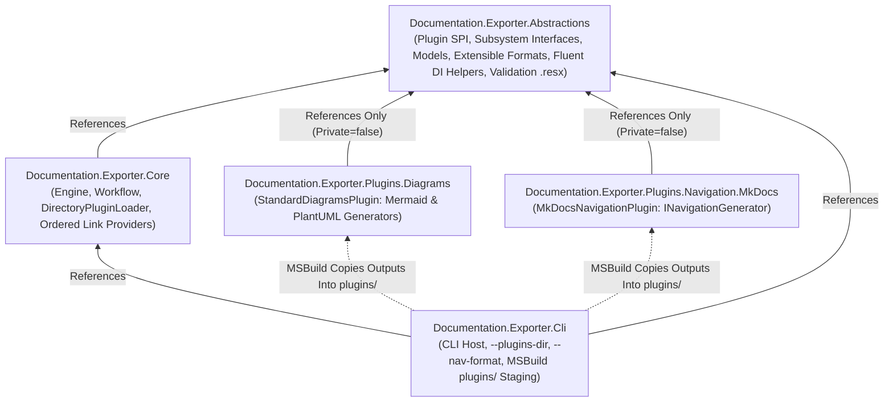
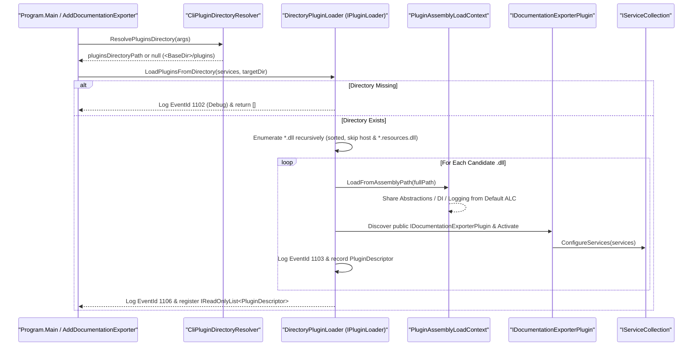

# Plugin Architecture, Isolation, & Abstractions Contract

This specification details how `Documentation.Exporter` decouples external subsystem extension points into [`Documentation.Exporter.Abstractions`](../../../src/Documentation.Exporter.Abstractions/Documentation.Exporter.Abstractions.csproj), dynamically discovers and loads plugin assemblies from a `plugins/` subdirectory via [`DirectoryPluginLoader`](../../../src/Documentation.Exporter.Core/Plugins/DirectoryPluginLoader.cs) and [`PluginAssemblyLoadContext`](../../../src/Documentation.Exporter.Core/Plugins/PluginAssemblyLoadContext.cs), isolates diagram and MkDocs navigation generation inside [`Documentation.Exporter.Plugins.Diagrams`](../../../src/Documentation.Exporter.Plugins.Diagrams/Documentation.Exporter.Plugins.Diagrams.csproj) and [`Documentation.Exporter.Plugins.Navigation.MkDocs`](../../../src/Documentation.Exporter.Plugins.Navigation.MkDocs/Documentation.Exporter.Plugins.Navigation.MkDocs.csproj), and supports extensible custom diagram, navigation, report, and link-resolution plugins without editing Core or CLI.

> **Related Docs:** [Architecture Overview](../../architectural/index.md) · [Functionality Catalog](../../architectural/functionality-catalog.md) · [Extensibility Guide](../extensibility-guide.md) · [Markdown & Diagram Generation](markdown-and-diagram-generation.md) · [User Diagrams & Insights Guide](../../user/diagrams-and-assembly-insights.md)

---

## 1. Assembly Topology & Dependency Direction

Plugin assemblies depend **only** on [`Documentation.Exporter.Abstractions`](../../../src/Documentation.Exporter.Abstractions/Documentation.Exporter.Abstractions.csproj) (`<Private>false</Private>` and `<ExcludeAssets>runtime</ExcludeAssets>`). Neither [`Documentation.Exporter.Core`](../../../src/Documentation.Exporter.Core/Documentation.Exporter.Core.csproj) nor [`Documentation.Exporter.Cli`](../../../src/Documentation.Exporter.Cli/Documentation.Exporter.Cli.csproj) is referenced by plugins or contains hardcoded default diagram generators:



### Shared Contracts in `Documentation.Exporter.Abstractions`

| Namespace | Key Exposed Types & Entry Points | Purpose |
| :--- | :--- | :--- |
| **`Plugins`** | [`IDocumentationExporterPlugin`](../../../src/Documentation.Exporter.Abstractions/Plugins/IDocumentationExporterPlugin.cs), [`IPluginLoader`](../../../src/Documentation.Exporter.Abstractions/Plugins/IPluginLoader.cs), [`PluginDescriptor`](../../../src/Documentation.Exporter.Abstractions/Plugins/PluginDescriptor.cs) | Plugin bootstrap entry point (`Name`, `ConfigureServices(IServiceCollection)`), directory scanner interface, and immutable metadata record |
| **`DependencyInjection`** | [`DocumentationExporterPluginServiceCollectionExtensions`](../../../src/Documentation.Exporter.Abstractions/DependencyInjection/DocumentationExporterPluginServiceCollectionExtensions.cs), [`DiagramGeneratorServiceCollectionExtensions`](../../../src/Documentation.Exporter.Abstractions/DependencyInjection/DiagramGeneratorServiceCollectionExtensions.cs) | Fluent zero-Core DI helpers: `AddTypeDiagramGenerator<T>()`, `AddArchitectureDiagramGenerator<T>()`, `AddAssemblyDependencyDiagramGenerator<T>()`, `AddMarkdownSectionRenderer<T>()`, `AddXmlTagHandler<T>()`, `AddTypeDocumentationEnricher<T>()`, `AddQualityReportFormatter<T>()`, `AddNamespaceHandler<T>()`, `AddNamespaceHandlerProvider<T>()`, `AddNavigationGenerator<T>()`, `AddExportWorkflowStep<T>()` |
| **`Models`** | [`DiagramFormat`](../../../src/Documentation.Exporter.Abstractions/Models/DiagramFormat.cs), [`NavigationFormat`](../../../src/Documentation.Exporter.Abstractions/Models/NavigationFormat.cs), [`QualityReportFormat`](../../../src/Documentation.Exporter.Abstractions/Models/QualityReportFormat.cs), [`ExporterOptions`](../../../src/Documentation.Exporter.Abstractions/Models/ExporterOptions.cs), [`TypeDocumentationModel`](../../../src/Documentation.Exporter.Abstractions/Models/TypeDocumentationModel.cs), [`ExportResult`](../../../src/Documentation.Exporter.Abstractions/Models/ExportResult.cs), etc. | Extensible format value objects (`DiagramFormat`, `NavigationFormat`, `QualityReportFormat`) and all immutable DTO/domain records and enums |
| **`Generation` & `Generation.Diagrams`** | [`INavigationGenerator`](../../../src/Documentation.Exporter.Abstractions/Generation/INavigationGenerator.cs), [`IDiagramGenerator`](../../../src/Documentation.Exporter.Abstractions/Generation/Diagrams/IDiagramGenerator.cs), [`ITypeDiagramGenerator`](../../../src/Documentation.Exporter.Abstractions/Generation/Diagrams/ITypeDiagramGenerator.cs), [`IArchitectureDiagramGenerator`](../../../src/Documentation.Exporter.Abstractions/Generation/Diagrams/IArchitectureDiagramGenerator.cs), [`IAssemblyDependencyDiagramGenerator`](../../../src/Documentation.Exporter.Abstractions/Generation/Diagrams/IAssemblyDependencyDiagramGenerator.cs), [`IDiagramGeneratorSelector`](../../../src/Documentation.Exporter.Abstractions/Generation/Diagrams/IDiagramGeneratorSelector.cs), [`IDiagramIdentifierFormatter`](../../../src/Documentation.Exporter.Abstractions/Generation/Diagrams/IDiagramIdentifierFormatter.cs) | Static-site navigation and diagram strategy interfaces plus localized `DependencyTreeLegend` & node sanitization |
| **`Resolution`** | [`ITypeLinkResolver`](../../../src/Documentation.Exporter.Abstractions/Resolution/ITypeLinkResolver.cs), [`INamespaceHandler`](../../../src/Documentation.Exporter.Abstractions/Resolution/INamespaceHandler.cs) (`Order`), [`INamespaceHandlerProvider`](../../../src/Documentation.Exporter.Abstractions/Resolution/INamespaceHandlerProvider.cs), [`TypeDocumentationPaths`](../../../src/Documentation.Exporter.Abstractions/Resolution/TypeDocumentationPaths.cs) | Ordered link resolution contracts, run-scoped handler factory SPI, and canonical type page path calculation helpers |
| **Other Extension Points** | [`IExportWorkflowStep`](../../../src/Documentation.Exporter.Abstractions/Workflow/IExportWorkflowStep.cs), [`ExportWorkflowContext`](../../../src/Documentation.Exporter.Abstractions/Workflow/ExportWorkflowContext.cs), [`ITypeDocumentationEnricher`](../../../src/Documentation.Exporter.Abstractions/Enrichment/ITypeDocumentationEnricher.cs), [`IMarkdownSectionRenderer`](../../../src/Documentation.Exporter.Abstractions/Generation/Sections/IMarkdownSectionRenderer.cs), [`IXmlTagHandler`](../../../src/Documentation.Exporter.Abstractions/Parsing/Tags/IXmlTagHandler.cs), [`IQualityReportFormatter`](../../../src/Documentation.Exporter.Abstractions/Quality/IQualityReportFormatter.cs), [`IFileSystem`](../../../src/Documentation.Exporter.Abstractions/IO/IFileSystem.cs) | Full external subsystem contracts and localized [`ValidationMessagesResources`](../../../src/Documentation.Exporter.Abstractions/Resources/ValidationMessagesResources.cs) |

---

## 2. Subdirectory Plugin Discovery & `AssemblyLoadContext` Isolation

At CLI startup (`Program.Main`), [`CliPluginDirectoryResolver.ResolvePluginsDirectory`](../../../src/Documentation.Exporter.Cli/CliPluginDirectoryResolver.cs) inspects `--plugins-dir` before DI container construction so custom plugin folders participate in initial service composition. When omitted (or when calling `services.AddDocumentationExporter()` directly), [`DocumentationExporterServiceCollectionExtensions.AddDocumentationExporterPlugins`](../../../src/Documentation.Exporter.Core/DependencyInjection/DocumentationExporterServiceCollectionExtensions.cs) scans `<AppContext.BaseDirectory>/plugins`:



### Identity Continuity & Fault Isolation Rules

1. **Shared Host Contracts (`PluginAssemblyLoadContext`)**: [`PluginAssemblyLoadContext`](../../../src/Documentation.Exporter.Core/Plugins/PluginAssemblyLoadContext.cs) wraps `AssemblyDependencyResolver(pluginAssemblyPath)`. When resolving `Documentation.Exporter.Abstractions`, `Microsoft.Extensions.DependencyInjection.Abstractions`, `Microsoft.Extensions.Logging.Abstractions`, or `Microsoft.Extensions.Options`, `Load(...)` returns `null` so the runtime resolves them from `AssemblyLoadContext.Default`. This guarantees `typeof(ITypeDiagramGenerator)` and `typeof(IDocumentationExporterPlugin)` have **identical runtime `Type` identity** across host and plugin boundaries, while plugin-private dependencies stay isolated per plugin directory.
2. **Skipped Host & Satellite Files**: [`DirectoryPluginLoader`](../../../src/Documentation.Exporter.Core/Plugins/DirectoryPluginLoader.cs) skips `Documentation.Exporter.Abstractions.dll`, `Documentation.Exporter.Core.dll`, `Documentation.Exporter.Cli.dll`, and any `*.resources.dll` files during directory traversal. Dependency DLLs that contain no public non-abstract `IDocumentationExporterPlugin` classes are ignored cleanly without warnings.
3. **Fault Isolation (`EventId` `1104` & `1105`)**: Corrupt or non-.NET native DLLs (`BadImageFormatException`, `IOException`, `FileLoadException`) log a warning (`EventId` `1104`) and exceptions thrown inside `ConfigureServices` log a warning (`EventId` `1105`) without aborting discovery of sibling plugins in the same directory.

> [!IMPORTANT]
> **MSBuild Staging (`plugins/`):** Both [`Documentation.Exporter.Cli.csproj`](../../../src/Documentation.Exporter.Cli/Documentation.Exporter.Cli.csproj) and [`Documentation.Exporter.Core.Tests.csproj`](../../../test/Documentation.Exporter.Core.Tests/Documentation.Exporter.Core.Tests.csproj) execute post-build (and post-publish in CLI / [`Dockerfile`](../../../Dockerfile)) MSBuild targets copying [`Documentation.Exporter.Plugins.Diagrams`](../../../src/Documentation.Exporter.Plugins.Diagrams/Documentation.Exporter.Plugins.Diagrams.csproj) and [`Documentation.Exporter.Plugins.Navigation.MkDocs`](../../../src/Documentation.Exporter.Plugins.Navigation.MkDocs/Documentation.Exporter.Plugins.Navigation.MkDocs.csproj) outputs (`*.dll`, `*.pdb`, `*.deps.json`) into `plugins/Documentation.Exporter.Plugins.Diagrams/` and `plugins/Documentation.Exporter.Plugins.Navigation.MkDocs/`. Because `Abstractions` carries `<Private>false</Private>` and `<ExcludeAssets>runtime</ExcludeAssets>`, host contracts are never duplicated inside `plugins/`.

---

## 3. Built-In Standard Plugins (`Plugins.Diagrams` & `Plugins.Navigation.MkDocs`)

### Standard Diagrams Plugin (`Documentation.Exporter.Plugins.Diagrams`)

[`StandardDiagramsPlugin`](../../../src/Documentation.Exporter.Plugins.Diagrams/StandardDiagramsPlugin.cs) moves all Mermaid and PlantUML diagram emitters out of Core into an independent plugin assembly:

| Interface | Mermaid Implementation | PlantUML Implementation |
| :--- | :--- | :--- |
| [`ITypeDiagramGenerator`](../../../src/Documentation.Exporter.Abstractions/Generation/Diagrams/ITypeDiagramGenerator.cs) | [`MermaidTypeDiagramGenerator`](../../../src/Documentation.Exporter.Plugins.Diagrams/MermaidTypeDiagramGenerator.cs) | [`PlantUmlTypeDiagramGenerator`](../../../src/Documentation.Exporter.Plugins.Diagrams/PlantUmlTypeDiagramGenerator.cs) |
| [`IArchitectureDiagramGenerator`](../../../src/Documentation.Exporter.Abstractions/Generation/Diagrams/IArchitectureDiagramGenerator.cs) | [`MermaidArchitectureDiagramGenerator`](../../../src/Documentation.Exporter.Plugins.Diagrams/MermaidArchitectureDiagramGenerator.cs) | [`PlantUmlArchitectureDiagramGenerator`](../../../src/Documentation.Exporter.Plugins.Diagrams/PlantUmlArchitectureDiagramGenerator.cs) |
| [`IAssemblyDependencyDiagramGenerator`](../../../src/Documentation.Exporter.Abstractions/Generation/Diagrams/IAssemblyDependencyDiagramGenerator.cs) | [`MermaidAssemblyDependencyDiagramGenerator`](../../../src/Documentation.Exporter.Plugins.Diagrams/MermaidAssemblyDependencyDiagramGenerator.cs) | [`PlantUmlAssemblyDependencyDiagramGenerator`](../../../src/Documentation.Exporter.Plugins.Diagrams/PlantUmlAssemblyDependencyDiagramGenerator.cs) |

All assembly dependency generators obtain their localized legend caption from [`IDiagramIdentifierFormatter.DependencyTreeLegend`](../../../src/Documentation.Exporter.Abstractions/Generation/Diagrams/IDiagramIdentifierFormatter.cs), preserving complete localization without coupling the plugin to `Documentation.Exporter.Core.Resources`.

### MkDocs Navigation Plugin (`Documentation.Exporter.Plugins.Navigation.MkDocs`)

[`MkDocsNavigationPlugin`](../../../src/Documentation.Exporter.Plugins.Navigation.MkDocs/MkDocsNavigationPlugin.cs) registers [`MkDocsNavigationGenerator`](../../../src/Documentation.Exporter.Plugins.Navigation.MkDocs/MkDocsNavigationGenerator.cs) (`INavigationGenerator` with `Format = NavigationFormat.MkDocs`, `DefaultFileName = "mkdocs.nav.yml"`) and computes page URLs purely through [`TypeDocumentationPaths.GetTypeRelativeUrlPath`](../../../src/Documentation.Exporter.Abstractions/Resolution/TypeDocumentationPaths.cs).

---

## 4. Extensible Formats (`DiagramFormat`, `NavigationFormat`, `QualityReportFormat`) & Link Resolution Plugins

All three format value types share an extensible `readonly record struct` pattern (case-insensitive `OrdinalIgnoreCase` equality, `*JsonConverter`, `[Valid*Format]` DataAnnotations attribute, and CLI flag parsing):

- [`DiagramFormat`](../../../src/Documentation.Exporter.Abstractions/Models/DiagramFormat.cs) (`--diagram-format`): `Mermaid`, `PlantUml`, `None`, or `DiagramFormat.Custom("D2")`
- [`NavigationFormat`](../../../src/Documentation.Exporter.Abstractions/Models/NavigationFormat.cs) (`--nav-format`): `MkDocs`, `None`, or `NavigationFormat.Custom("Docusaurus")`
- [`QualityReportFormat`](../../../src/Documentation.Exporter.Abstractions/Models/QualityReportFormat.cs) (`--report-format`): `Json`, `Markdown`, `Sarif`, or `QualityReportFormat.Custom("JUnit")`

Plugins can also register [`INamespaceHandler`](../../../src/Documentation.Exporter.Abstractions/Resolution/INamespaceHandler.cs) (`Order`) and [`INamespaceHandlerProvider`](../../../src/Documentation.Exporter.Abstractions/Resolution/INamespaceHandlerProvider.cs) via [`DocumentationExporterPluginServiceCollectionExtensions`](../../../src/Documentation.Exporter.Abstractions/DependencyInjection/DocumentationExporterPluginServiceCollectionExtensions.cs) to customize link resolution cleanly ahead of or between built-in providers (`-1000` Local, `-500` CustomOptions, `500` Pattern, `1000` MicrosoftDocs).

### Creating & Deploying an External Diagram Plugin (e.g., D2)

1. Create a class library referencing only `Documentation.Exporter.Abstractions` (`<Private>false</Private><ExcludeAssets>runtime</ExcludeAssets>`):

```csharp
using Documentation.Exporter.Abstractions.DependencyInjection;
using Documentation.Exporter.Abstractions.Generation.Diagrams;
using Documentation.Exporter.Abstractions.Models;
using Documentation.Exporter.Abstractions.Plugins;
using Microsoft.Extensions.DependencyInjection;

public sealed class D2DiagramsPlugin : IDocumentationExporterPlugin
{
    public string Name => "D2 Diagrams Plugin";

    public void ConfigureServices(IServiceCollection services)
    {
        ArgumentNullException.ThrowIfNull(services);
        _ = services.AddTypeDiagramGenerator<D2TypeDiagramGenerator>();
    }
}

public sealed class D2TypeDiagramGenerator : ITypeDiagramGenerator
{
    public DiagramFormat Format => DiagramFormat.Custom("D2");

    public bool CanGenerate(TypeDocumentationModel typeModel) =>
        typeModel.TypeCategory != TypeCategory.Enum && !string.IsNullOrWhiteSpace(typeModel.TypeName);

    public string GenerateTypeDiagram(TypeDocumentationModel typeModel) =>
        $"```d2\n{typeModel.TypeName}\n```\n\n";
}
```

2. Drop the compiled plugin folder into `<AppDir>/plugins/D2Diagrams/` (or pass `--plugins-dir ./my-plugins`) and invoke `--diagram-format D2`.

---

## 5. Owning Source & Test Files

- **Abstractions SPI**: [`IDocumentationExporterPlugin.cs`](../../../src/Documentation.Exporter.Abstractions/Plugins/IDocumentationExporterPlugin.cs), [`IPluginLoader.cs`](../../../src/Documentation.Exporter.Abstractions/Plugins/IPluginLoader.cs), [`PluginDescriptor.cs`](../../../src/Documentation.Exporter.Abstractions/Plugins/PluginDescriptor.cs), [`DiagramFormat.cs`](../../../src/Documentation.Exporter.Abstractions/Models/DiagramFormat.cs), [`NavigationFormat.cs`](../../../src/Documentation.Exporter.Abstractions/Models/NavigationFormat.cs), [`QualityReportFormat.cs`](../../../src/Documentation.Exporter.Abstractions/Models/QualityReportFormat.cs), [`INavigationGenerator.cs`](../../../src/Documentation.Exporter.Abstractions/Generation/INavigationGenerator.cs), [`INamespaceHandlerProvider.cs`](../../../src/Documentation.Exporter.Abstractions/Resolution/INamespaceHandlerProvider.cs), [`ITypeLinkResolver.cs`](../../../src/Documentation.Exporter.Abstractions/Resolution/ITypeLinkResolver.cs), [`TypeDocumentationPaths.cs`](../../../src/Documentation.Exporter.Abstractions/Resolution/TypeDocumentationPaths.cs), [`DocumentationExporterPluginServiceCollectionExtensions.cs`](../../../src/Documentation.Exporter.Abstractions/DependencyInjection/DocumentationExporterPluginServiceCollectionExtensions.cs), [`DiagramGeneratorServiceCollectionExtensions.cs`](../../../src/Documentation.Exporter.Abstractions/DependencyInjection/DiagramGeneratorServiceCollectionExtensions.cs)
- **Loader & CLI Integration**: [`DirectoryPluginLoader.cs`](../../../src/Documentation.Exporter.Core/Plugins/DirectoryPluginLoader.cs), [`PluginAssemblyLoadContext.cs`](../../../src/Documentation.Exporter.Core/Plugins/PluginAssemblyLoadContext.cs), [`DocumentationExporterServiceCollectionExtensions.cs`](../../../src/Documentation.Exporter.Core/DependencyInjection/DocumentationExporterServiceCollectionExtensions.cs), [`CliPluginDirectoryResolver.cs`](../../../src/Documentation.Exporter.Cli/CliPluginDirectoryResolver.cs)
- **Built-In Plugins**: [`StandardDiagramsPlugin.cs`](../../../src/Documentation.Exporter.Plugins.Diagrams/StandardDiagramsPlugin.cs), [`MkDocsNavigationPlugin.cs`](../../../src/Documentation.Exporter.Plugins.Navigation.MkDocs/MkDocsNavigationPlugin.cs)
- **Tests**: [`DirectoryPluginLoaderTests.cs`](../../../test/Documentation.Exporter.Core.Tests/Plugins/DirectoryPluginLoaderTests.cs), [`StandardDiagramsPluginTests.cs`](../../../test/Documentation.Exporter.Core.Tests/Plugins/StandardDiagramsPluginTests.cs), [`CustomPluginExtensionPointsEndToEndTests.cs`](../../../test/Documentation.Exporter.Core.Tests/Plugins/CustomPluginExtensionPointsEndToEndTests.cs), [`DiagramFormatTests.cs`](../../../test/Documentation.Exporter.Core.Tests/Models/DiagramFormatTests.cs), [`ExtensibleFormatsTests.cs`](../../../test/Documentation.Exporter.Core.Tests/Models/ExtensibleFormatsTests.cs), [`DocumentationExporterPluginServiceCollectionExtensionsTests.cs`](../../../test/Documentation.Exporter.Core.Tests/DependencyInjection/DocumentationExporterPluginServiceCollectionExtensionsTests.cs), [`CliPluginDirectoryResolverTests.cs`](../../../test/Documentation.Exporter.Core.Tests/Cli/CliPluginDirectoryResolverTests.cs), [`DocumentationExporterServiceCollectionExtensionsTests.cs`](../../../test/Documentation.Exporter.Core.Tests/DependencyInjection/DocumentationExporterServiceCollectionExtensionsTests.cs)
