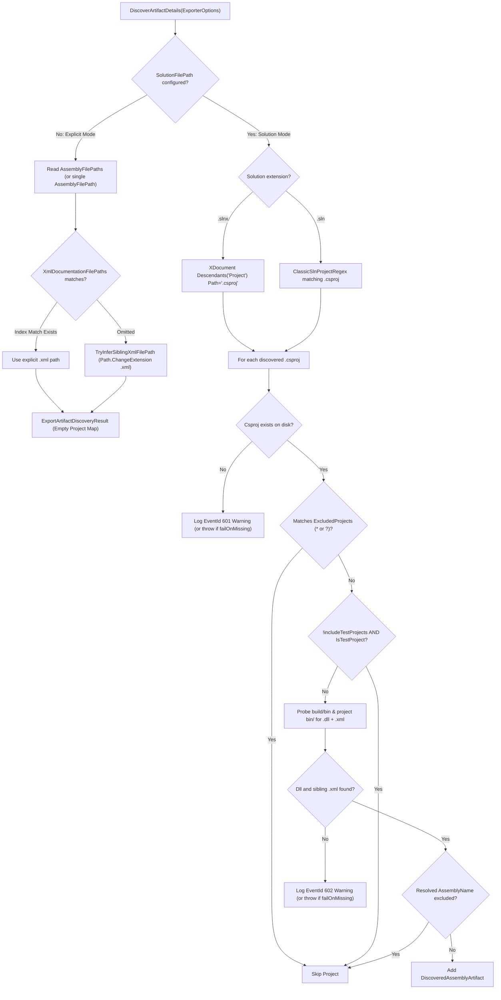
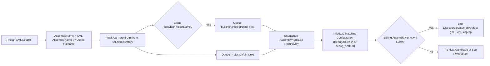

# Solution & Build Artifact Discovery

This deep-dive explains Step 2's front-end discovery pipeline: how [`ExportArtifactDiscoveryService`](../../../src/Documentation.Exporter.Core/Parsing/ExportArtifactDiscoveryService.cs) and [`SolutionAssemblyResolver`](../../../src/Documentation.Exporter.Core/Parsing/SolutionAssemblyResolver.cs) turn either a solution path (`.sln` or `.slnx`) or an explicit list of compiled assemblies into a validated set of `.dll` binaries, `.xml` documentation files, and originating `.csproj` mappings.

> **Related Docs:** [Functionality Catalog](../../architectural/functionality-catalog.md) · [Component Interactions](../../architectural/component-interactions.md) · [Assembly Loading & Reflection](assembly-loading-and-reflection.md) · [Assembly References & Dependency Tree](assembly-references-and-dependency-tree.md)

---

## 1. Unified Discovery Decision Tree (`ExportArtifactDiscoveryService`)

[`LoadAssemblyTypesStep`](../../../src/Documentation.Exporter.Core/Workflow/Steps/LoadAssemblyTypesStep.cs) delegates path discovery to [`IExportArtifactDiscoveryService.DiscoverArtifactDetails`](../../../src/Documentation.Exporter.Core/Parsing/IExportArtifactDiscoveryService.cs), which returns an [`ExportArtifactDiscoveryResult`](../../../src/Documentation.Exporter.Core/Parsing/IExportArtifactDiscoveryService.cs) containing three outputs:

1. `AssemblyFilePaths`: ordered `.dll` paths to load in the isolated context.
2. `XmlDocumentationFilePaths`: matching `.xml` compiler doc paths.
3. `ProjectFilePathsByAssemblyPath`: dictionary mapping each full `.dll` path back to its `.csproj` file path (only populated in solution mode, consumed downstream by [`AssemblyReferenceAnalyzer`](../../../src/Documentation.Exporter.Core/Parsing/AssemblyReferenceAnalyzer.cs)).

---

## 2. Parsing Classic `.sln` and Modern XML `.slnx` Files

Inside [`SolutionAssemblyResolver`](../../../src/Documentation.Exporter.Core/Parsing/SolutionAssemblyResolver.cs), all file paths normalize cleanly across Windows (`\`) and Linux (`/`) separators by replacing both `/` and `\` with `Path.DirectorySeparatorChar` relative to `solutionDirectory` before passing them through [`IFileSystem.GetFullPath`](../../../src/Documentation.Exporter.Abstractions/IO/IFileSystem.cs):

- **Modern `.slnx`**: Opens the file via [`IFileSystem.OpenRead`](../../../src/Documentation.Exporter.Abstractions/IO/IFileSystem.cs), parses with `XDocument`, selects every `<Project Path="..." />` attribute ending in `.csproj`, and resolves relative paths against the solution folder. Solution folders without `.csproj` extensions are skipped naturally.
- **Classic `.sln`**: Runs a compiled regex (`ClassicSlnProjectRegex`) matching `Project("{TypeGuid}") = "Name", "RelativePath", "{ProjectGuid}"` lines where the path ends in `.csproj` (automatically skipping solution folder items).

---

## 3. Filtering Heuristics: Test Projects & Wildcards

Before probing binary outputs, [`SolutionAssemblyResolver`](../../../src/Documentation.Exporter.Core/Parsing/SolutionAssemblyResolver.cs) applies two layers of filtering:

1. **Wildcard Pattern Exclusion (`ExcludedProjects`)**: Checked against the project stem (`MyProject`), filename (`MyProject.csproj`), and later the actual `<AssemblyName>` once resolved. Matching uses `FileSystemName.MatchesSimpleExpression(pattern, candidateName, ignoreCase: true)`, supporting `*` and `?` wildcards (for example `"*.Tests"` or `"*.Benchmarks"`).
2. **Automatic Test Project Detection** *(unless `--include-tests` is passed)*: A project is classified as a test project when **any** of the following holds:
   - The `.csproj` filename stem ends with `.Tests` or `.Test` (case-insensitive).
   - `<IsTestProject>true</IsTestProject>` is present in the project XML.
   - Any `<PackageReference Include="..." />` equals `Microsoft.NET.Test.Sdk` or starts with `xunit` (case-insensitive).

---

## 4. Build Output Probing: Centralized `ArtifactsPath` vs. Standard `bin/`

Modern .NET solutions often centralize compiler outputs at the repository root using `<ArtifactsPath>` (as configured in [`Directory.Build.props`](../../../Directory.Build.props) via `build/`), whereas standard SDK projects emit under `<ProjectDir>/bin/`. [`SolutionAssemblyResolver`](../../../src/Documentation.Exporter.Core/Parsing/SolutionAssemblyResolver.cs) handles both layouts seamlessly:

Walking upward from `solutionDirectory` ensures solutions nested inside a subfolder (such as [`demo/Documentation.Exporter.Demo.slnx`](../../../demo/Documentation.Exporter.Demo.slnx)) locate repository-root `build/bin/Documentation.Exporter.DemoLibrary/` before falling back to local `bin/` directories. Candidate `.dll` matches are ordered with `PathContainsConfigurationSegment` (matching either exact `Debug`/`Release` folders or `<config>_<tfm>` pivot folders such as `release_linux-x64`), and only accepted if a companion `<AssemblyName>.xml` exists in the exact same directory.

---

## 5. Strict Validation with `--fail-on-missing`

When `FailOnMissingProjectArtifacts` (`--fail-on-missing`) is `false` (default), missing `.sln`/`.slnx` files return empty results, missing `.csproj` files log a warning at **`EventId` `601`**, and unbuilt projects without both `.dll` and `.xml` log a warning at **`EventId` `602`**. When `FailOnMissingProjectArtifacts` is `true`, [`SolutionAssemblyResolver`](../../../src/Documentation.Exporter.Core/Parsing/SolutionAssemblyResolver.cs) throws `FileNotFoundException`, causing [`LoadAssemblyTypesStep`](../../../src/Documentation.Exporter.Core/Workflow/Steps/LoadAssemblyTypesStep.cs) to log **`EventId` `815`** and abort the export cleanly with exit code `1`.

---

## 6. Owning Source & Test Files

- **Source**: [`ISolutionAssemblyResolver.cs`](../../../src/Documentation.Exporter.Core/Parsing/ISolutionAssemblyResolver.cs), [`SolutionAssemblyResolver.cs`](../../../src/Documentation.Exporter.Core/Parsing/SolutionAssemblyResolver.cs), [`IExportArtifactDiscoveryService.cs`](../../../src/Documentation.Exporter.Core/Parsing/IExportArtifactDiscoveryService.cs), [`ExportArtifactDiscoveryService.cs`](../../../src/Documentation.Exporter.Core/Parsing/ExportArtifactDiscoveryService.cs), [`LoadAssemblyTypesStep.cs`](../../../src/Documentation.Exporter.Core/Workflow/Steps/LoadAssemblyTypesStep.cs)
- **Tests**: [`SolutionAssemblyResolverTests.cs`](../../../test/Documentation.Exporter.Core.Tests/Parsing/SolutionAssemblyResolverTests.cs), [`ExportArtifactDiscoveryServiceTests.cs`](../../../test/Documentation.Exporter.Core.Tests/Parsing/ExportArtifactDiscoveryServiceTests.cs), [`LoadAssemblyTypesStepTests.cs`](../../../test/Documentation.Exporter.Core.Tests/Workflow/Steps/LoadAssemblyTypesStepTests.cs)
