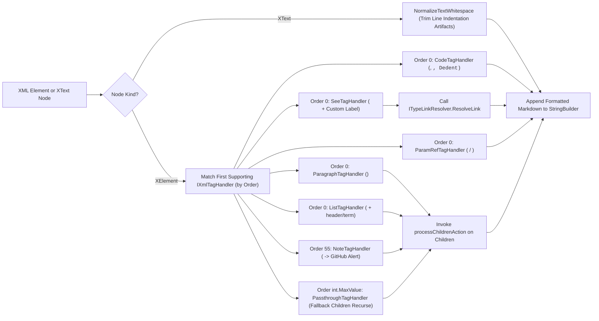
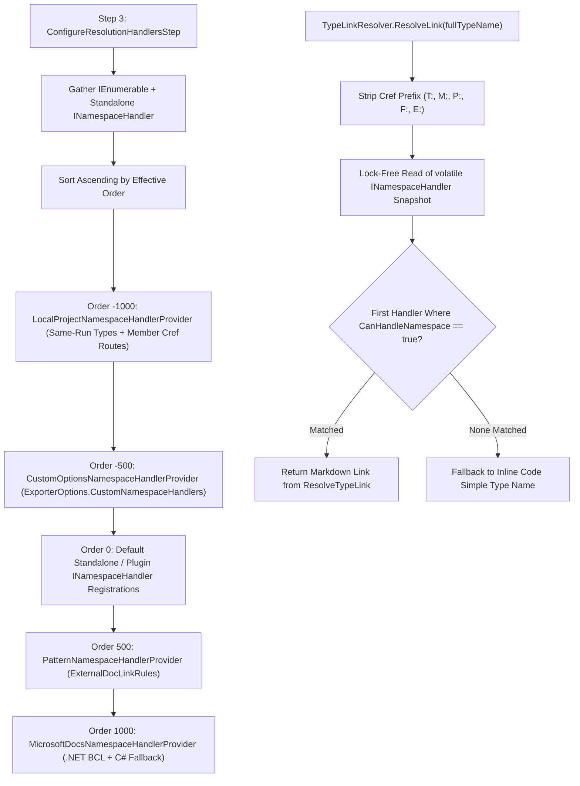

# XML Documentation Parsing, Tag Transformation, & Link Resolution

This deep-dive explains how Step 3 ([`ConfigureResolutionHandlersStep`](../../../src/Documentation.Exporter.Core/Workflow/Steps/ConfigureResolutionHandlersStep.cs)) and Step 4 ([`LoadXmlDocumentationStep`](../../../src/Documentation.Exporter.Core/Workflow/Steps/LoadXmlDocumentationStep.cs)) prepare scoped XML lookup and link-resolution infrastructure: how [`XmlDocumentationParser`](../../../src/Documentation.Exporter.Core/Parsing/XmlDocumentationParser.cs) indexes compiler XML files, how [`XmlTagTransformer`](../../../src/Documentation.Exporter.Core/Parsing/XmlTagTransformer.cs) delegates to ordered [`IXmlTagHandler`](../../../src/Documentation.Exporter.Abstractions/Parsing/Tags/IXmlTagHandler.cs) strategies, and how [`TypeLinkResolver`](../../../src/Documentation.Exporter.Core/Resolution/TypeLinkResolver.cs) resolves cross-links across a 5-tier handler chain.

> **Related Docs:** [Functionality Catalog](../../architectural/functionality-catalog.md) · [Component Interactions](../../architectural/component-interactions.md) · [Enrichment, Snippets, & Overrides](enrichment-snippets-and-overrides.md) · [User XML Authoring Guide](../../user/xml-documentation-authoring.md)

---

## 1. Compiler XML Indexing (`XmlDocumentationParser`)

Compiler-generated `<Assembly>.xml` documentation files follow the `.NET` XML documentation comment ID schema (`T:` types, `M:` methods/constructors, `P:` properties, `F:` fields, `E:` events). Because multiple assemblies in a solution may each have their own `.xml` file, [`XmlDocumentationParser`](../../../src/Documentation.Exporter.Core/Parsing/XmlDocumentationParser.cs) is registered as **`Scoped`** per export run and initialized in Step 4 ([`LoadXmlDocumentationStep`](../../../src/Documentation.Exporter.Core/Workflow/Steps/LoadXmlDocumentationStep.cs)):

1. Calls `Clear()` to ensure a clean per-run dictionary (`memberElementsMap` keyed by ordinal string comparison).
2. Calls `TryLoadXmlDocumentationFilesAsync(...)`, which iterates through all resolved `.xml` paths asynchronously using [`IFileSystem.OpenRead`](../../../src/Documentation.Exporter.Abstractions/IO/IFileSystem.cs) and `XDocument.LoadAsync`.
3. Validates parameters (`EventId` `201` missing path, `202` file not found), logs loading (`EventId` `203`), warns if `<members>` is absent (`EventId` `204`), indexes every `<member name="...">` element into memory (`EventId` `205`), and catches malformed XML safely (`EventId` `206`).

### Key Capabilities Exposed by `XmlDocumentationParser`

- **Type & Primary Constructor Inheritance (`ApplyTypeDocumentation`)**: Populates `SummaryDescription`, `RemarksDescription`, `HasInheritDoc`, `InheritDocCref`, `IsExcludedByXmlDoc`, `<example>`, `<seealso>`, `<typeparam>`, and `<exception>`, then propagates matching primary-constructor `<param>` and `<exception>` entries down to primary constructors—and falls back to class-level summary ONLY on the primary constructor or a single parameterless default constructor (so undocumented secondary constructors are accurately flagged).
- **Duplicate `<exception cref="...">` Merging (`MergeExceptions`)**: When a member documents multiple distinct conditions throwing the same exception type (for example `ArgumentException`), `MergeExceptions` resolves the exception type link once via [`ITypeLinkResolver`](../../../src/Documentation.Exporter.Abstractions/Resolution/ITypeLinkResolver.cs) and joins distinct conditions in one row separated by ` `.
- **Flexible `<inheritdoc cref="..."/>` Resolution (`ResolveCrefKey`)**: Resolves exact keys (`M:...`), unprefixed keys (using `defaultPrefix`), declaring-type-qualified method/overload keys, or suffix matches across all indexed members.

---

## 2. Recursive XML Tag Transformation (`XmlTagTransformer` & `IXmlTagHandler`)

[`XmlTagTransformer`](../../../src/Documentation.Exporter.Core/Parsing/XmlTagTransformer.cs) accepts `IEnumerable<IXmlTagHandler>` via Dependency Injection, sorts handlers ascending by `Order`, and walks XML DOM child nodes recursively:

Key handler enhancements:
- **`ListTagHandler`**: Supports `<list type="table">` with `<listheader>`, `<item>`, `<term>`, and `<description>` (falling back to localized `Term`/`Description` or `Column N` headers, padding uneven rows, and escaping `|` and line breaks cleanly), as well as `<term>`+`<description>` bold pairs in `bullet` and `number` lists.
- **`SeeTagHandler`**: Preserves inner label text on `<see cref="...">custom text</see>` and `<seealso cref="...">custom text</seealso>` while retaining `href` and `langword` handling.
- **`CodeTagHandler`**: Reads `language` or `lang` attributes (sanitizing characters and defaulting to `csharp`) and removes common multi-line leading indentation via `DedentCodeBlock`.
- **`NoteTagHandler` (`Order = 55`)**: Converts `<note type="tip | important | implement | inherit | caller | warning | caution | security | note">` into GitHub Alert blockquotes (`> [!TIP]`, `> [!WARNING]`, etc.).

Because `XmlTagTransformer` normalizes XML source indentation in `NormalizeTextWhitespace` and wraps unknown tags cleanly via [`PassthroughTagHandler`](../../../src/Documentation.Exporter.Core/Parsing/Tags/PassthroughTagHandler.cs) (`Order = int.MaxValue`), custom XML tags can be introduced cleanly anywhere in DI without editing [`XmlTagTransformer`](../../../src/Documentation.Exporter.Core/Parsing/XmlTagTransformer.cs) (see [Extensibility Guide](../extensibility-guide.md)).

---

## 3. Ordered Namespace Link Resolution (`ConfigureResolutionHandlersStep` & `TypeLinkResolver`)

Before XML files are transformed, Step 3 ([`ConfigureResolutionHandlersStep`](../../../src/Documentation.Exporter.Core/Workflow/Steps/ConfigureResolutionHandlersStep.cs)) clears [`ITypeLinkResolver`](../../../src/Documentation.Exporter.Abstractions/Resolution/ITypeLinkResolver.cs), collects handlers from all DI-registered [`INamespaceHandlerProvider`](../../../src/Documentation.Exporter.Abstractions/Resolution/INamespaceHandlerProvider.cs) factories and standalone [`INamespaceHandler`](../../../src/Documentation.Exporter.Abstractions/Resolution/INamespaceHandler.cs) strategies, sorts them ascending by effective `Order` (with deterministic registration order tie-breaking), and registers them on `ITypeLinkResolver`:

### Handler Details & Concurrency Guarantees

- **Pluggable Precedence (`INamespaceHandler.Order` & `INamespaceHandlerProvider`)**: External plugins or custom DI registrations can slot ahead of local types (`Order = -2000`), between local/custom rules and pattern templates (`Order = 0`), or between pattern rules and Microsoft Learn (`Order = 750`) without editing [`ConfigureResolutionHandlersStep`](../../../src/Documentation.Exporter.Core/Workflow/Steps/ConfigureResolutionHandlersStep.cs).
- **Thread-Safe Lock-Free Lookups (`TypeLinkResolver`)**: Uses C# 13 `Lock` on registration writes (`RegisterHandler`, `ClearHandlers`) paired with a `volatile INamespaceHandler[] handlersSnapshot` array so concurrent Step 5 worker threads resolve links without lock contention.
- **Directory-Aware Local Paths & Exact Overload Routes ([`TypeDocumentationPaths`](../../../src/Documentation.Exporter.Abstractions/Resolution/TypeDocumentationPaths.cs), [`LocalProjectNamespaceHandler`](../../../src/Documentation.Exporter.Core/Resolution/LocalProjectNamespaceHandler.cs), & [`MemberCrefRouteIndexBuilder`](../../../src/Documentation.Exporter.Core/Resolution/MemberCrefRouteIndexBuilder.cs))**: Computes canonical target page URLs (`TypeDocumentationPaths.GetTypeRelativeUrlPath`, `GetTypeDirectoryUrlPath`, `GetTypeDirectoryFilePath`) honoring `useAssemblySubdirectories`, `ExcludeEditorBrowsableNever`, and full nested type chains (`Outer/Middle/Inner/index.md`), and checks pre-indexed prefixless XML member keys (for example `Demo.TagShowcaseProcessor.FormatResult(System.String)` -> `FormatResult_String.md`) **before** stripping parameter parentheses.
- **Templated 3rd-Party Rules ([`PatternNamespaceHandler`](../../../src/Documentation.Exporter.Core/Resolution/PatternNamespaceHandler.cs))**: Supports `{fullName}`, `{fullNameLower}`, `{fullNameUnderscore}`, `{fullNameSlash}`, `{namespace}`, `{namespaceLower}`, `{namespaceSlash}`, `{name}`, and `{nameLower}`, or appends lowercased type names to plain base URLs.
- **Canonical Microsoft Learn Registry ([`MicrosoftDocsNamespaceHandler`](../../../src/Documentation.Exporter.Core/Resolution/MicrosoftDocsNamespaceHandler.cs) & [`MicrosoftLearnReferenceRegistry`](../../../src/Documentation.Exporter.Core/Resolution/MicrosoftLearnReferenceRegistry.cs))**: Validates standard `.NET` types and member `cref`s safely (sharing a static process-wide assembly probe cache, stripping method parameter parentheses, normalizing nested `+` tokens to `.`, and logging filtered reflection failures at **`EventId` `701`**) and supplies canonical docs links for C# type categories, `[Obsolete]`, and generic constraints.

### Canonical Microsoft Learn Reference Registry (`MicrosoftLearnReferenceRegistry`)

[`MicrosoftLearnReferenceRegistry`](../../../src/Documentation.Exporter.Core/Resolution/MicrosoftLearnReferenceRegistry.cs) centralizes every Microsoft Learn keyword, modifier, and alert template used downstream by section and detail generators:

- **Multi-Word Access Modifier Splitting (`FormatAccessModifierLink`)**: Splits compound visibility strings such as `protected internal` and `private protected` on spaces and links each keyword token individually via `AccessKeywordUrls`.
- **Modern C# Type & Modifier URLs**: Exposes canonical URLs for `record`, `readonly`, `ref struct`, `scoped`, `allows ref struct`, `notnull`, `in`/`out`/`ref`/`ref readonly`, `params`, `[Experimental]`, `[Obsolete]`, `Primary Constructor`, and async/cancellation badges.
- **Callout Alert Formatting**: Builds `> [!WARNING]`/`> [!CAUTION]` alerts in `FormatObsoleteWarningBlock` and `> [!IMPORTANT]` alerts in `FormatExperimentalWarningBlock` through a shared `FormatDiagnosticBadge` helper (expanding `UrlFormat` `{0}` placeholders with `diagnosticId` across both `[Obsolete]` and `[Experimental]`).

---

## 4. Owning Source & Test Files

- **Parsing & Tags**: [`IXmlDocumentationParser.cs`](../../../src/Documentation.Exporter.Core/Parsing/IXmlDocumentationParser.cs), [`XmlDocumentationParser.cs`](../../../src/Documentation.Exporter.Core/Parsing/XmlDocumentationParser.cs), [`IXmlTagTransformer.cs`](../../../src/Documentation.Exporter.Core/Parsing/IXmlTagTransformer.cs), [`XmlTagTransformer.cs`](../../../src/Documentation.Exporter.Core/Parsing/XmlTagTransformer.cs), [`IXmlTagHandler.cs`](../../../src/Documentation.Exporter.Abstractions/Parsing/Tags/IXmlTagHandler.cs), [`CodeTagHandler.cs`](../../../src/Documentation.Exporter.Core/Parsing/Tags/CodeTagHandler.cs), [`SeeTagHandler.cs`](../../../src/Documentation.Exporter.Core/Parsing/Tags/SeeTagHandler.cs), [`ParamRefTagHandler.cs`](../../../src/Documentation.Exporter.Core/Parsing/Tags/ParamRefTagHandler.cs), [`ParagraphTagHandler.cs`](../../../src/Documentation.Exporter.Core/Parsing/Tags/ParagraphTagHandler.cs), [`ListTagHandler.cs`](../../../src/Documentation.Exporter.Core/Parsing/Tags/ListTagHandler.cs), [`NoteTagHandler.cs`](../../../src/Documentation.Exporter.Core/Parsing/Tags/NoteTagHandler.cs), [`PassthroughTagHandler.cs`](../../../src/Documentation.Exporter.Core/Parsing/Tags/PassthroughTagHandler.cs)
- **Resolution & Workflow**: [`ITypeLinkResolver.cs`](../../../src/Documentation.Exporter.Abstractions/Resolution/ITypeLinkResolver.cs), [`INamespaceHandler.cs`](../../../src/Documentation.Exporter.Abstractions/Resolution/INamespaceHandler.cs), [`INamespaceHandlerProvider.cs`](../../../src/Documentation.Exporter.Abstractions/Resolution/INamespaceHandlerProvider.cs), [`TypeDocumentationPaths.cs`](../../../src/Documentation.Exporter.Abstractions/Resolution/TypeDocumentationPaths.cs), [`TypeLinkResolver.cs`](../../../src/Documentation.Exporter.Core/Resolution/TypeLinkResolver.cs), [`LocalProjectNamespaceHandlerProvider.cs`](../../../src/Documentation.Exporter.Core/Resolution/Providers/LocalProjectNamespaceHandlerProvider.cs), [`CustomOptionsNamespaceHandlerProvider.cs`](../../../src/Documentation.Exporter.Core/Resolution/Providers/CustomOptionsNamespaceHandlerProvider.cs), [`PatternNamespaceHandlerProvider.cs`](../../../src/Documentation.Exporter.Core/Resolution/Providers/PatternNamespaceHandlerProvider.cs), [`MicrosoftDocsNamespaceHandlerProvider.cs`](../../../src/Documentation.Exporter.Core/Resolution/Providers/MicrosoftDocsNamespaceHandlerProvider.cs), [`IMemberCrefRouteIndexBuilder.cs`](../../../src/Documentation.Exporter.Core/Resolution/IMemberCrefRouteIndexBuilder.cs), [`MemberCrefRouteIndexBuilder.cs`](../../../src/Documentation.Exporter.Core/Resolution/MemberCrefRouteIndexBuilder.cs), [`LocalProjectNamespaceHandler.cs`](../../../src/Documentation.Exporter.Core/Resolution/LocalProjectNamespaceHandler.cs), [`PatternNamespaceHandler.cs`](../../../src/Documentation.Exporter.Core/Resolution/PatternNamespaceHandler.cs), [`MicrosoftDocsNamespaceHandler.cs`](../../../src/Documentation.Exporter.Core/Resolution/MicrosoftDocsNamespaceHandler.cs), [`IMicrosoftLearnReferenceRegistry.cs`](../../../src/Documentation.Exporter.Core/Resolution/IMicrosoftLearnReferenceRegistry.cs), [`MicrosoftLearnReferenceRegistry.cs`](../../../src/Documentation.Exporter.Core/Resolution/MicrosoftLearnReferenceRegistry.cs), [`ConfigureResolutionHandlersStep.cs`](../../../src/Documentation.Exporter.Core/Workflow/Steps/ConfigureResolutionHandlersStep.cs), [`LoadXmlDocumentationStep.cs`](../../../src/Documentation.Exporter.Core/Workflow/Steps/LoadXmlDocumentationStep.cs)
- **Tests**: [`XmlDocumentationParserTests.cs`](../../../test/Documentation.Exporter.Core.Tests/Parsing/XmlDocumentationParserTests.cs), [`XmlTagTransformerTests.cs`](../../../test/Documentation.Exporter.Core.Tests/Parsing/XmlTagTransformerTests.cs), [`CodeTagHandlerTests.cs`](../../../test/Documentation.Exporter.Core.Tests/Parsing/Tags/CodeTagHandlerTests.cs), [`ListTagHandlerTests.cs`](../../../test/Documentation.Exporter.Core.Tests/Parsing/Tags/ListTagHandlerTests.cs), [`NoteTagHandlerTests.cs`](../../../test/Documentation.Exporter.Core.Tests/Parsing/Tags/NoteTagHandlerTests.cs), [`ParagraphTagHandlerTests.cs`](../../../test/Documentation.Exporter.Core.Tests/Parsing/Tags/ParagraphTagHandlerTests.cs), [`ParamRefTagHandlerTests.cs`](../../../test/Documentation.Exporter.Core.Tests/Parsing/Tags/ParamRefTagHandlerTests.cs), [`PassthroughTagHandlerTests.cs`](../../../test/Documentation.Exporter.Core.Tests/Parsing/Tags/PassthroughTagHandlerTests.cs), [`SeeTagHandlerTests.cs`](../../../test/Documentation.Exporter.Core.Tests/Parsing/Tags/SeeTagHandlerTests.cs), [`TypeLinkResolverTests.cs`](../../../test/Documentation.Exporter.Core.Tests/Resolution/TypeLinkResolverTests.cs), [`TypeDocumentationPathsTests.cs`](../../../test/Documentation.Exporter.Core.Tests/Resolution/TypeDocumentationPathsTests.cs), [`MemberCrefRouteIndexBuilderTests.cs`](../../../test/Documentation.Exporter.Core.Tests/Resolution/MemberCrefRouteIndexBuilderTests.cs), [`LocalProjectNamespaceHandlerTests.cs`](../../../test/Documentation.Exporter.Core.Tests/Resolution/LocalProjectNamespaceHandlerTests.cs), [`PatternNamespaceHandlerTests.cs`](../../../test/Documentation.Exporter.Core.Tests/Resolution/PatternNamespaceHandlerTests.cs), [`MicrosoftDocsNamespaceHandlerTests.cs`](../../../test/Documentation.Exporter.Core.Tests/Resolution/MicrosoftDocsNamespaceHandlerTests.cs), [`MicrosoftLearnReferenceRegistryTests.cs`](../../../test/Documentation.Exporter.Core.Tests/Resolution/MicrosoftLearnReferenceRegistryTests.cs)
