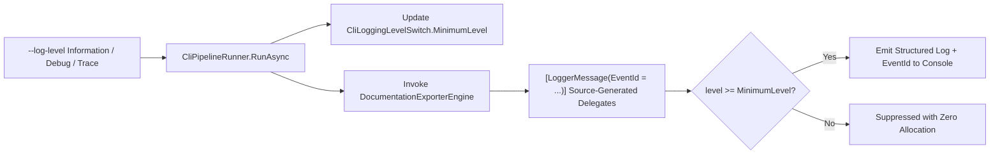
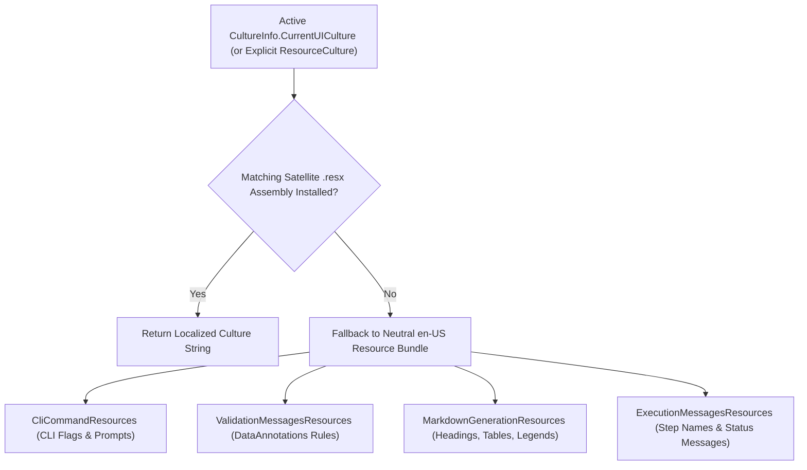

# Structured Logging (`EventId` Ranges) & Localization (`.resx`)

`Documentation.Exporter` enforces source-generated structured logging (`[LoggerMessage]`) across dedicated component `EventId` blocks and externalizes all user-facing feedback, headings, validation messages, and CLI prompts into strongly typed `.resx` resource assemblies.

---

## 1. Dynamic Logging & `[LoggerMessage]` Telemetry

In [`CliServiceCollectionExtensions`](../../src/Documentation.Exporter.Cli/CliServiceCollectionExtensions.cs), [`CliLoggingLevelSwitch`](../../src/Documentation.Exporter.Cli/CliLoggingLevelSwitch.cs) is registered as a singleton and bound to `loggingBuilder.AddFilter((_, level) => level >= loggingLevelSwitch.MinimumLevel)`. Before each export runs, [`CliPipelineRunner.RunAsync`](../../src/Documentation.Exporter.Cli/CliPipelineRunner.cs) updates `MinimumLevel`, giving callers instant `Trace`-to-`None` filtering without rebuilding the DI container:

### Component `EventId` Allocations (`100` – `1199`)

When adding or modifying structured log delegates, allocate the next unused sequential integer inside the target component's designated range below and resolve user-facing status templates from [`ExecutionMessagesResources.resx`](../../src/Documentation.Exporter.Core/Resources/ExecutionMessagesResources.resx):

| Range | Component / Layer | Assigned EventIds |
| :--- | :--- | :--- |
| **100 – 199** | [`IsolatedAssemblyLoader`](../../src/Documentation.Exporter.Core/Parsing/IsolatedAssemblyLoader.cs) (Loading & Reflection) | `101` (missing assembly path), `102` (file not found), `103` (loading assembly), `104` (exported type count), `105` (load failed error), `106` (`ReflectionTypeLoadException` partial recovery warning), `107` (duplicate type collision warning) |
| **200 – 299** | [`XmlDocumentationParser`](../../src/Documentation.Exporter.Core/Parsing/XmlDocumentationParser.cs) (XML Parsing) | `201` (missing path error), `202` (file not found error), `203` (loading XML file), `204` (missing root warning), `205` (indexed member count), `206` (XML parse failed error) |
| **300 – 399** | [`DocumentationExporterEngine`](../../src/Documentation.Exporter.Core/DocumentationExporterEngine.cs) (Engine Façade) | `301` (starting documentation export) |
| **400 – 499** | [`FileExampleProvider`](../../src/Documentation.Exporter.Core/Injection/FileExampleProvider.cs) (Snippet Injection) | `401` (member example loaded), `402` (type example loaded), `403` (example enumeration warning) |
| **500 – 599** | [`FileDocumentationInjector`](../../src/Documentation.Exporter.Core/Injection/FileDocumentationInjector.cs) (Sidecar Overrides) | `501` (sidecar override loaded), `502` (overrides directory enumeration warning) |
| **600 – 699** | [`SolutionAssemblyResolver`](../../src/Documentation.Exporter.Core/Parsing/SolutionAssemblyResolver.cs) & [`AssemblyReferenceAnalyzer`](../../src/Documentation.Exporter.Core/Parsing/AssemblyReferenceAnalyzer.cs) | `601` (missing project file warning), `602` (missing binary/XML artifact warning), `603` (malformed `.deps.json` / `.csproj` / [`Directory.Packages.props`](../../Directory.Packages.props) / DLL probe fallback warning) |
| **700 – 799** | Link & Namespace Resolvers ([`MicrosoftDocsNamespaceHandler`](../../src/Documentation.Exporter.Core/Resolution/MicrosoftDocsNamespaceHandler.cs)) | `701` (debug log when an assembly throws a reflection load error during dynamic framework probing) |
| **800 – 899** | [`ExportWorkflow`](../../src/Documentation.Exporter.Core/Workflow/ExportWorkflow.cs) & Workflow Steps (1–10) | `801` (workflow started), `802` (step executing debug), `803` (step failed error), `804` (workflow completed), `805` (failure quality report persist warning), `811` (validation error), `812` (no types warning), `813` (types filtered info), `814` (XML load failed error), `815` (missing project artifact error), `816` (output dir creation failed error), `817` (files generated info), `818` (cleaned output dir info), `819` (navigation generator missing warning), `820` (coverage summary info), `821` (coverage threshold failed error), `822` (quality diagnostics summary info), `830` (strict link validation error), `831` (broken link warning), `832` (links verified summary info), `833` (broken `#anchor` warning), `840` (quality report written info), `841` (quality report write failed error) |
| **900 – 999** | Type Enrichment Pipeline ([`TypeDocumentationPipeline`](../../src/Documentation.Exporter.Core/Enrichment/TypeDocumentationPipeline.cs)) | *Reserved (`901+`)* |
| **1000 – 1099** | [`Documentation.Exporter.Cli`](../../src/Documentation.Exporter.Cli/Documentation.Exporter.Cli.csproj) ([`CliPipelineRunner`](../../src/Documentation.Exporter.Cli/CliPipelineRunner.cs)) | `1001` (initializing CLI), `1002` (CLI completed successfully), `1003` (CLI export failure error), `1004` (unhandled pipeline exception error), `1005` (quality diagnostics summary info) |
| **1100 – 1199** | Subdirectory Plugin Loader ([`DirectoryPluginLoader`](../../src/Documentation.Exporter.Core/Plugins/DirectoryPluginLoader.cs)) | `1101` (scanning plugins directory debug), `1102` (missing plugins directory debug), `1103` (plugin loaded info), `1104` (plugin assembly load/inspection failure warning), `1105` (plugin activation/registration failure warning), `1106` (loaded plugin summary info) |

---

## 2. Multi-Language Resource Localization (`.resx`)

All direct user feedback is separated by concern across three resource bundles in [`src/Documentation.Exporter.Core/Resources/`](../../src/Documentation.Exporter.Core/Resources) plus the DataAnnotations validation bundle in [`src/Documentation.Exporter.Abstractions/Resources/`](../../src/Documentation.Exporter.Abstractions/Resources):

| Resource Bundle | Strongly Typed Wrapper | Scope |
| :--- | :--- | :--- |
| [`CliCommandResources.resx`](../../src/Documentation.Exporter.Core/Resources/CliCommandResources.resx) | [`CliCommandResources`](../../src/Documentation.Exporter.Core/Resources/CliCommandResources.cs) | CLI command names/descriptions, option descriptions (including `--diagram-format`, `--nav-format`, `--report-file`, `--report-format`, `--plugins-dir`), and CLI argument/config error templates |
| [`ValidationMessagesResources.resx`](../../src/Documentation.Exporter.Abstractions/Resources/ValidationMessagesResources.resx) | [`ValidationMessagesResources`](../../src/Documentation.Exporter.Abstractions/Resources/ValidationMessagesResources.cs) | Localized `[Required]`, `[MinLength]`, `[Range]`, `[EnumDataType]`, `[ValidDiagramFormat]`, `[ValidNavigationFormat]`, and `[ValidQualityReportFormat]` error messages for [`ExporterOptions`](../../src/Documentation.Exporter.Abstractions/Models/ExporterOptions.cs), [`ExternalDocLinkRule`](../../src/Documentation.Exporter.Abstractions/Models/ExternalDocLinkRule.cs), [`AssemblyReferenceModel`](../../src/Documentation.Exporter.Abstractions/Models/AssemblyReferenceModel.cs), [`AssemblyDependencyEdgeModel`](../../src/Documentation.Exporter.Abstractions/Models/AssemblyDependencyEdgeModel.cs), [`DocumentationInjectionModel`](../../src/Documentation.Exporter.Abstractions/Models/DocumentationInjectionModel.cs), [`DocumentationDiagnostic`](../../src/Documentation.Exporter.Abstractions/Models/DocumentationDiagnostic.cs), [`DocumentationQualityReport`](../../src/Documentation.Exporter.Abstractions/Models/DocumentationQualityReport.cs), and [`TypeDocumentationModel`](../../src/Documentation.Exporter.Abstractions/Models/TypeDocumentationModel.cs) |
| [`MarkdownGenerationResources.resx`](../../src/Documentation.Exporter.Core/Resources/MarkdownGenerationResources.resx) | [`MarkdownGenerationResources`](../../src/Documentation.Exporter.Core/Resources/MarkdownGenerationResources.cs) | Generated Markdown page titles, headings (`## Type Diagram`, `## Assembly References`, `## Assembly Dependency Tree`, `## Architecture Diagram`), table column headers (including `TableTermHeader`), quality report title, badges, and legends |
| [`ExecutionMessagesResources.resx`](../../src/Documentation.Exporter.Core/Resources/ExecutionMessagesResources.resx) | [`ExecutionMessagesResources`](../../src/Documentation.Exporter.Core/Resources/ExecutionMessagesResources.cs) | Console status strings, [`IExportWorkflowStep.StepName`](../../src/Documentation.Exporter.Abstractions/Workflow/IExportWorkflowStep.cs) display titles, and structured log templates |

### Adding a New UI Culture

1. Create culture-specific satellite `.resx` files alongside the neutral `en-US` files in [`src/Documentation.Exporter.Core/Resources/`](../../src/Documentation.Exporter.Core/Resources) (for example, `CliCommandResources.de.resx`, `ValidationMessagesResources.de.resx`, `MarkdownGenerationResources.de.resx`, `ExecutionMessagesResources.de.resx`).
2. Add corresponding assertions or culture tests in [`test/Documentation.Exporter.Core.Tests/Resources/`](../../test/Documentation.Exporter.Core.Tests/Resources) verifying every new resource key.
3. At runtime, `ResourceCulture ?? CultureInfo.CurrentUICulture` automatically selects the active satellite resource assembly.
