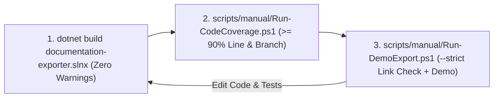

# Developer Onboarding & New Developer Guide

Welcome to `Documentation.Exporter`. This guide gets you from a clean checkout to building, running the 90%+ coverage gate, executing the end-to-end demo showcase, locating any subsystem cleanly, and shipping your first compliant PR without hitting analyzer or architectural traps.

---

## 1. Prerequisites & Tooling

Install the following tools locally:

1. **.NET 11 SDK** (`TargetFramework` is `net11.0` across all projects).
2. **PowerShell**: Windows PowerShell 5.1+ or cross-platform PowerShell 7+ (`pwsh`) to execute manual helper scripts in [`scripts/manual/`](../../scripts/manual).
3. **Git** and an [`.editorconfig`](../../.editorconfig)-aware editor (Visual Studio, VS Code with C# Dev Kit, or Rider) so C# style rules match the build.
4. **Docker Engine / Docker Desktop** *(optional)*: Only needed when running or testing containerized Linux builds via [`scripts/manual/Run-DemoExport-Docker.ps1`](../../scripts/manual/Run-DemoExport-Docker.ps1) and [`Dockerfile`](../../Dockerfile).

---

## 2. Repository Map

| Path | Purpose |
| :--- | :--- |
| [`README.md`](../../README.md) | Top-level repository landing page, quick-start guide, CLI/library examples, and entry point into [`docs/index.md`](../index.md) |
| [`CONTRIBUTING.md`](../../CONTRIBUTING.md) | Contribution workflow, PR verification checklist, `CI Gate`, and release-note label conventions |
| [`SECURITY.md`](../../SECURITY.md) | Supported versions, private vulnerability reporting, and assembly/plugin operational security notes |
| [`CODE_OF_CONDUCT.md`](../../CODE_OF_CONDUCT.md) | Contributor Covenant v2.1 community standards |
| [`LICENSE`](../../LICENSE) | MIT License governing `Documentation.Exporter` |
| [`documentation-exporter.slnx`](../../documentation-exporter.slnx) | Modern XML solution file grouping `src/`, `test/`, and `demo/` |
| [`Directory.Build.props`](../../Directory.Build.props) | Solution-wide MSBuild properties (`ArtifactsPath = build/`, `net11.0`, `TreatWarningsAsErrors = true`, `EnforceCodeStyleInBuild = true`, `AnalysisLevel = latest-recommended`) |
| [`src/Directory.Build.props`](../../src/Directory.Build.props) | `src/`-scoped MSBuild configuration enabling MinVer Git tag-driven Semantic Versioning (`v` prefix, `PrivateAssets="all"`) for all shippable assemblies |
| [`Directory.Packages.props`](../../Directory.Packages.props) | Enables Central Package Management (`ManagePackageVersionsCentrally = true`); package versions are pinned per scope in [`src/Directory.Packages.props`](../../src/Directory.Packages.props) and [`test/Directory.Packages.props`](../../test/Directory.Packages.props) |
| [`src/Documentation.Exporter.Abstractions/`](../../src/Documentation.Exporter.Abstractions/Documentation.Exporter.Abstractions.csproj) | External subsystem contracts base assembly: [`Plugins/`](../../src/Documentation.Exporter.Abstractions/Plugins), [`Models/`](../../src/Documentation.Exporter.Abstractions/Models), [`DependencyInjection/`](../../src/Documentation.Exporter.Abstractions/DependencyInjection), subsystem interfaces, and [`ValidationMessagesResources`](../../src/Documentation.Exporter.Abstractions/Resources/ValidationMessagesResources.cs) |
| [`src/Documentation.Exporter.Core/`](../../src/Documentation.Exporter.Core/Documentation.Exporter.Core.csproj) | Core class library: [`Configuration`](../../src/Documentation.Exporter.Core/Configuration), [`DependencyInjection`](../../src/Documentation.Exporter.Core/DependencyInjection), [`Enrichment`](../../src/Documentation.Exporter.Core/Enrichment), [`Generation`](../../src/Documentation.Exporter.Core/Generation) ([`Diagrams/`](../../src/Documentation.Exporter.Core/Generation/Diagrams), [`Sections/`](../../src/Documentation.Exporter.Core/Generation/Sections)), [`Injection`](../../src/Documentation.Exporter.Core/Injection), [`IO`](../../src/Documentation.Exporter.Core/IO), [`Parsing`](../../src/Documentation.Exporter.Core/Parsing) ([`Tags/`](../../src/Documentation.Exporter.Core/Parsing/Tags)), [`Plugins`](../../src/Documentation.Exporter.Core/Plugins), [`Quality`](../../src/Documentation.Exporter.Core/Quality), [`Resolution`](../../src/Documentation.Exporter.Core/Resolution), [`Resources`](../../src/Documentation.Exporter.Core/Resources), [`Workflow`](../../src/Documentation.Exporter.Core/Workflow) ([`Steps/`](../../src/Documentation.Exporter.Core/Workflow/Steps)) |
| [`src/Documentation.Exporter.Plugins.Diagrams/`](../../src/Documentation.Exporter.Plugins.Diagrams/Documentation.Exporter.Plugins.Diagrams.csproj) | Built-in diagram plugin implementing [`IDocumentationExporterPlugin`](../../src/Documentation.Exporter.Abstractions/Plugins/IDocumentationExporterPlugin.cs) with all Mermaid and PlantUML diagram generators, copied to `plugins/` on build/publish |
| [`src/Documentation.Exporter.Plugins.Navigation.MkDocs/`](../../src/Documentation.Exporter.Plugins.Navigation.MkDocs/Documentation.Exporter.Plugins.Navigation.MkDocs.csproj) | Built-in MkDocs navigation plugin implementing [`IDocumentationExporterPlugin`](../../src/Documentation.Exporter.Abstractions/Plugins/IDocumentationExporterPlugin.cs) and [`INavigationGenerator`](../../src/Documentation.Exporter.Abstractions/Generation/INavigationGenerator.cs), copied to `plugins/` on build/publish |
| [`src/Documentation.Exporter.Cli/`](../../src/Documentation.Exporter.Cli/Documentation.Exporter.Cli.csproj) | Standalone executable (`OutputType = Exe`, `UseAppHost = true`): `System.CommandLine` commands, [`CliPluginDirectoryResolver`](../../src/Documentation.Exporter.Cli/CliPluginDirectoryResolver.cs), [`SharedCliOptions`](../../src/Documentation.Exporter.Cli/SharedCliOptions.cs), [`CliPipelineRunner`](../../src/Documentation.Exporter.Cli/CliPipelineRunner.cs), [`CliServiceCollectionExtensions`](../../src/Documentation.Exporter.Cli/CliServiceCollectionExtensions.cs) |
| [`test/Documentation.Exporter.Core.Tests/`](../../test/Documentation.Exporter.Core.Tests/Documentation.Exporter.Core.Tests.csproj) | xUnit + `AwesomeAssertions`/`FluentAssertions` + Moq test suite strictly mirroring the `Core` and `Cli` directory hierarchy |
| [`demo/`](../../demo) | Real multi-project showcase ([`Documentation.Exporter.Demo.slnx`](../../demo/Documentation.Exporter.Demo.slnx), [`DemoContracts`](../../demo/Documentation.Exporter.DemoContracts/Documentation.Exporter.DemoContracts.csproj), [`DemoLibrary`](../../demo/Documentation.Exporter.DemoLibrary/Documentation.Exporter.DemoLibrary.csproj), [`doc-exporter.demo.json`](../../demo/doc-exporter.demo.json), [`mkdocs.base.nav.yml`](../../demo/mkdocs.base.nav.yml), [`docs_extra/examples/`](../../demo/Documentation.Exporter.DemoLibrary/docs_extra/examples), [`docs_extra/overrides/`](../../demo/Documentation.Exporter.DemoLibrary/docs_extra/overrides)) |
| [`scripts/manual/`](../../scripts/manual) | Manual PowerShell automation scripts: [`Run-CodeCoverage.ps1`](../../scripts/manual/Run-CodeCoverage.ps1), [`Run-DemoExport.ps1`](../../scripts/manual/Run-DemoExport.ps1), [`Run-DemoExport-Docker.ps1`](../../scripts/manual/Run-DemoExport-Docker.ps1) |
| [`.github/workflows/ci.yml`](../../.github/workflows/ci.yml) | GitHub Actions gated CI workflow (`CI Gate`) building, testing, publishing, checking coverage, and verifying the demo on `ubuntu-latest` and `windows-latest` |
| [`.github/workflows/release.yml`](../../.github/workflows/release.yml) | Automatic merge-to-`main` (and `v*.*.*` tag / manual dispatch) release workflow publishing `doc-exporter` & `Abstractions` to GitHub Releases and NuGet.org |
| [`.github/release.yml`](../../.github/release.yml) | GitHub Release notes categorization rules grouping merged PRs by label (`breaking-change`, `feature`, `bug`, `plugin`, `documentation`, `ci`, etc.) |
| [`.github/dependabot.yml`](../../.github/dependabot.yml) | Weekly automated NuGet, GitHub Actions, and Docker dependency update PRs |
| [`.github/PULL_REQUEST_TEMPLATE.md`](../../.github/PULL_REQUEST_TEMPLATE.md) & [`ISSUE_TEMPLATE/`](../../.github/ISSUE_TEMPLATE) | GitHub PR checklist and structured bug report / feature request forms |
| [`docs/`](../index.md) | Modular Architecture, Developer (plus 9 functionality deep-dives), and User documentation ([`docs/index.md`](../index.md)) |
| [`mkdocs.yml`](../../mkdocs.yml) & [`scripts/mkdocs_hooks.py`](../../scripts/mkdocs_hooks.py) | MkDocs Material site configuration and GitHub Alert / source-link build hooks deployed to GitHub Pages on release |
| `build/` | Centralized compiler, NuGet restore, and demo export outputs configured by `<ArtifactsPath>` (not checked in; regenerated on build) |
| `build/.demo-output/` | Local demo export output generated by [`Run-DemoExport.ps1`](../../scripts/manual/Run-DemoExport.ps1) |
| [`.editorconfig`](../../.editorconfig) & [`.agents/AGENTS.md`](../../.agents/AGENTS.md) | Enforced C# formatting/style severities and project engineering rules |

---

## 3. Day-1 Quickstart & Verification Loop

Run all commands from the repository root:



### Step 1: Build the Entire Solution

```powershell
dotnet build documentation-exporter.slnx
```

Because `<TreatWarningsAsErrors>true</TreatWarningsAsErrors>` and `<EnforceCodeStyleInBuild>true</EnforceCodeStyleInBuild>` are enabled globally in [`Directory.Build.props`](../../Directory.Build.props), a clean build guarantees zero compiler, XML documentation (`CS1591`), and [`.editorconfig`](../../.editorconfig) style violations.

### Step 2: Run the Test Suite & Code Coverage Gate

```powershell
powershell -ExecutionPolicy Bypass -File scripts/manual/Run-CodeCoverage.ps1 -MinimumLineCoverage 90.0 -MinimumBranchCoverage 90.0
```

This runs all tests in [`Documentation.Exporter.Core.Tests`](../../test/Documentation.Exporter.Core.Tests/Documentation.Exporter.Core.Tests.csproj) with Coverlet Cobertura instrumentation across `[Documentation.Exporter.Abstractions]*,[Documentation.Exporter.Core]*,[Documentation.Exporter.Cli]*,[Documentation.Exporter.Plugins.Diagrams]*,[Documentation.Exporter.Plugins.Navigation.MkDocs]*` via [`scripts/manual/Run-CodeCoverage.ps1`](../../scripts/manual/Run-CodeCoverage.ps1) and fails if either line or branch coverage drops below **90%**.

### Step 3: Execute the Real Demo Pipeline

```powershell
powershell -ExecutionPolicy Bypass -File scripts/manual/Run-DemoExport.ps1
```

[`scripts/manual/Run-DemoExport.ps1`](../../scripts/manual/Run-DemoExport.ps1) compiles [`demo/Documentation.Exporter.Demo.slnx`](../../demo/Documentation.Exporter.Demo.slnx) and [`Documentation.Exporter.Cli`](../../src/Documentation.Exporter.Cli/Documentation.Exporter.Cli.csproj), exports multi-assembly Markdown documentation with `--strict` relative-link checking into `build/.demo-output/`, and merges navigation into `build/.demo-output/mkdocs.nav.yml`. Inspect `build/.demo-output/index.md` once generated or switch diagram syntax with `-DiagramFormat PlantUml`.

*(If chaining multiple commands in Windows PowerShell 5.1, separate commands with `; if ($LASTEXITCODE -ne 0) { exit $LASTEXITCODE };` rather than `&&`.)*

---

## 4. Where to Look First (By Task or Symptom)

Use this quick locator map before editing files—each subsystem is documented in depth in its own dedicated specification:

| If You Are Working On... | Read This Deep-Dive First | Key Entry Types |
| :--- | :--- | :--- |
| CLI arguments, `doc-exporter.json`, or exit codes | [CLI Hosting, Subcommands, & JSON Configuration](functionalities/cli-and-configuration.md) | [`SharedCliOptions`](../../src/Documentation.Exporter.Cli/SharedCliOptions.cs), [`ExporterConfigurationLoader`](../../src/Documentation.Exporter.Core/Configuration/ExporterConfigurationLoader.cs) |
| Missing projects or `.sln`/`.slnx` build paths | [Solution & Build Artifact Discovery](functionalities/solution-and-artifact-discovery.md) | [`SolutionAssemblyResolver`](../../src/Documentation.Exporter.Core/Parsing/SolutionAssemblyResolver.cs), [`ExportArtifactDiscoveryService`](../../src/Documentation.Exporter.Core/Parsing/ExportArtifactDiscoveryService.cs) |
| Assembly load errors, reflection signatures, or exclusions | [Isolated Assembly Loading, Reflection, & Cross-Assembly Indexing](functionalities/assembly-loading-and-reflection.md) | [`IsolatedAssemblyLoader`](../../src/Documentation.Exporter.Core/Parsing/IsolatedAssemblyLoader.cs), [`AssemblyTypeReflector`](../../src/Documentation.Exporter.Core/Parsing/AssemblyTypeReflector.cs) |
| `## Assembly References` table or dependency tree edges | [Assembly Reference & Transitive Dependency Tree Analysis](functionalities/assembly-references-and-dependency-tree.md) | [`AssemblyReferenceAnalyzer`](../../src/Documentation.Exporter.Core/Parsing/AssemblyReferenceAnalyzer.cs) |
| XML tags (`<see>`, `<list>`, `<code>`) or external URLs | [XML Documentation Parsing, Tag Transformation, & Link Resolution](functionalities/xml-parsing-and-link-resolution.md) | [`XmlDocumentationParser`](../../src/Documentation.Exporter.Core/Parsing/XmlDocumentationParser.cs), [`XmlTagTransformer`](../../src/Documentation.Exporter.Core/Parsing/XmlTagTransformer.cs), [`ITypeLinkResolver`](../../src/Documentation.Exporter.Abstractions/Resolution/ITypeLinkResolver.cs) |
| `<inheritdoc/>`, `.cs` snippets, or `.md` sidecars | [Enrichment Pipeline, External Snippets, & Sidecar Overrides](functionalities/enrichment-snippets-and-overrides.md) | [`XmlDocumentationEnricher`](../../src/Documentation.Exporter.Core/Enrichment/XmlDocumentationEnricher.cs), [`FileExampleProvider`](../../src/Documentation.Exporter.Core/Injection/FileExampleProvider.cs), [`FileDocumentationInjector`](../../src/Documentation.Exporter.Core/Injection/FileDocumentationInjector.cs) |
| Type page sections, member filenames, or Mermaid/PlantUML fallback | [Markdown Emission, Section Renderers, & Single-Diagram Selection](functionalities/markdown-and-diagram-generation.md) | [`TypePageMarkdownGenerator`](../../src/Documentation.Exporter.Core/Generation/TypePageMarkdownGenerator.cs), [`DiagramGeneratorSelector`](../../src/Documentation.Exporter.Core/Generation/Diagrams/DiagramGeneratorSelector.cs) |
| `mkdocs.nav.yml` merging, `--nav-format`, `--clean`, coverage %, `--strict`, or `--report-file` | [MkDocs Navigation Merging, Quality Gates, & Localization](functionalities/navigation-quality-gates-and-localization.md) | [`MkDocsNavigationGenerator`](../../src/Documentation.Exporter.Plugins.Navigation.MkDocs/MkDocsNavigationGenerator.cs), [`ValidateMarkdownLinksStep`](../../src/Documentation.Exporter.Core/Workflow/Steps/ValidateMarkdownLinksStep.cs), [`EmitQualityReportStep`](../../src/Documentation.Exporter.Core/Workflow/Steps/EmitQualityReportStep.cs) |

---

## 5. Walkthrough: Making Your First Feature or Bugfix

Follow this checklist whenever you add or modify behavior in `Documentation.Exporter`:

1. **Locate the Right Architectural Seam**:
   - Parsing/discovery? [`src/Documentation.Exporter.Core/Parsing/`](../../src/Documentation.Exporter.Core/Parsing)
   - Enriching reflected models? Implement [`ITypeDocumentationEnricher`](../../src/Documentation.Exporter.Abstractions/Enrichment/ITypeDocumentationEnricher.cs) in [`Enrichment/`](../../src/Documentation.Exporter.Core/Enrichment)
   - Rendering a new type page section? Implement [`IMarkdownSectionRenderer`](../../src/Documentation.Exporter.Abstractions/Generation/Sections/IMarkdownSectionRenderer.cs) in [`Generation/Sections/`](../../src/Documentation.Exporter.Core/Generation/Sections)
   - Rendering a new diagram syntax? Implement [`ITypeDiagramGenerator`](../../src/Documentation.Exporter.Abstractions/Generation/Diagrams/ITypeDiagramGenerator.cs), [`IArchitectureDiagramGenerator`](../../src/Documentation.Exporter.Abstractions/Generation/Diagrams/IArchitectureDiagramGenerator.cs), or [`IAssemblyDependencyDiagramGenerator`](../../src/Documentation.Exporter.Abstractions/Generation/Diagrams/IAssemblyDependencyDiagramGenerator.cs) in [`Generation/Diagrams/`](../../src/Documentation.Exporter.Core/Generation/Diagrams)
   - Adding a workflow phase? Implement [`IExportWorkflowStep`](../../src/Documentation.Exporter.Abstractions/Workflow/IExportWorkflowStep.cs) in [`Workflow/Steps/`](../../src/Documentation.Exporter.Core/Workflow/Steps)
   - Adding a quality analyzer or report format? Implement [`IDocumentationQualityAnalyzer`](../../src/Documentation.Exporter.Core/Quality/IDocumentationQualityAnalyzer.cs) or [`IQualityReportFormatter`](../../src/Documentation.Exporter.Abstractions/Quality/IQualityReportFormatter.cs) in [`Quality/`](../../src/Documentation.Exporter.Core/Quality)
   - Adding CLI flags or commands? Edit [`SharedCliOptions.cs`](../../src/Documentation.Exporter.Cli/SharedCliOptions.cs) or register an [`ICliSubcommand`](../../src/Documentation.Exporter.Cli/ICliSubcommand.cs) in [`src/Documentation.Exporter.Cli/`](../../src/Documentation.Exporter.Cli/Documentation.Exporter.Cli.csproj)
2. **Design with Mandates from Day 1**:
   - Read [Coding Standards, Mandates, & DI Setup](coding-standards-and-di.md) before writing code.
   - Use **primary constructors**, **`ArgumentNullException.ThrowIfNull`** / **`ArgumentException.ThrowIfNullOrWhiteSpace`**, **early return guard clauses**, and **fully spelled-out variable names** (`>= 4` chars; never `i`, `ex`, `fs`, `sb`, `kv`).
   - Add XML doc comments (`/// <summary>`) on every public type/member/parameter to satisfy `GenerateDocumentationFile` (`CS1591`).
   - Add DataAnnotations + [`ValidationMessagesResources`](../../src/Documentation.Exporter.Abstractions/Resources/ValidationMessagesResources.cs) entries for any new option or model property, and `.resx` strings in [`MarkdownGenerationResources`](../../src/Documentation.Exporter.Core/Resources/MarkdownGenerationResources.resx) / [`ExecutionMessagesResources`](../../src/Documentation.Exporter.Core/Resources/ExecutionMessagesResources.resx) / [`CliCommandResources`](../../src/Documentation.Exporter.Core/Resources/CliCommandResources.resx) for user-visible text.
   - Assign explicit `[LoggerMessage(EventId = ...)]` IDs inside the component's range documented in [Structured Logging & Localization](logging-and-localization.md).
3. **Wire Through Dependency Injection Only**:
   - Register every new service or strategy in [`DocumentationExporterServiceCollectionExtensions.cs`](../../src/Documentation.Exporter.Core/DependencyInjection/DocumentationExporterServiceCollectionExtensions.cs) or [`CliServiceCollectionExtensions.cs`](../../src/Documentation.Exporter.Cli/CliServiceCollectionExtensions.cs) (never construct default lists inside consumers).
4. **Write Mirrored Defensive Tests**:
   - Place unit tests in the matching namespace/folder under [`test/Documentation.Exporter.Core.Tests/`](../../test/Documentation.Exporter.Core.Tests/Documentation.Exporter.Core.Tests.csproj) (see [Testing Architecture & Code Coverage](testing-and-coverage.md)).
   - Assert every state, exception, and collection explicitly with `FluentAssertions` and descriptive `because` messages.
   - Keep [`IFileSystem`](../../src/Documentation.Exporter.Abstractions/IO/IFileSystem.cs) mocked or overlaid cleanly instead of leaving temp files behind (always clean up in `finally`).
5. **Update Documentation & Verify End-to-End**:
   - Synchronize relevant pages across [`docs/architectural/`](../architectural/index.md), [`docs/developer/`](index.md), and [`docs/user/`](../user/index.md).
   - Run the full build + [`scripts/manual/Run-CodeCoverage.ps1`](../../scripts/manual/Run-CodeCoverage.ps1) + [`scripts/manual/Run-DemoExport.ps1`](../../scripts/manual/Run-DemoExport.ps1) pipeline and confirm zero warnings, `>= 90%` line & branch coverage, and `0` broken links in the demo output.

---

## 6. Common Pitfalls for New Developers

| Trap | Why It Happens | How to Avoid It |
| :--- | :--- | :--- |
| **Build fails with `IDE0022`, `IDE0046`, `IDE0058`, `IDE0072`, `IDE0290`** | [`.editorconfig`](../../.editorconfig) elevates style & analyzer categories to `warning`, and [`Directory.Build.props`](../../Directory.Build.props) sets `TreatWarningsAsErrors = true` | Use primary constructors (`IDE0290`), expression bodies for single-statement methods (`IDE0022`), ternary `?:` before trailing `return` (`IDE0046`), `_ = ...` discards (`IDE0058`), and exhaustive `switch` arms (`IDE0072`) |
| **Build fails trying to access `internal` members from tests** | [`Documentation.Exporter.Core`](../../src/Documentation.Exporter.Core/Documentation.Exporter.Core.csproj) intentionally has **no** `InternalsVisibleTo` for test assemblies | Test through public interfaces ([`IAssemblyReferenceAnalyzer`](../../src/Documentation.Exporter.Core/Parsing/IAssemblyReferenceAnalyzer.cs), [`IMarkdownSectionRenderer`](../../src/Documentation.Exporter.Abstractions/Generation/Sections/IMarkdownSectionRenderer.cs), [`IDocumentationExporterEngine`](../../src/Documentation.Exporter.Core/IDocumentationExporterEngine.cs)) rather than calling private/internal helpers |
| **Short identifiers in loops or lambdas** | [`.agents/AGENTS.md`](../../.agents/AGENTS.md) strictly prohibits 1–3 char names | Write `index`, `typeModel`, `fileSystem`, `stringBuilder`, `keyValuePair`, `exception`, `dependencyEdge` |
| **Direct `System.IO.File` / `Directory` calls inside Core** | Breaks unit test isolation via [`IFileSystem`](../../src/Documentation.Exporter.Abstractions/IO/IFileSystem.cs) | Inject [`IFileSystem`](../../src/Documentation.Exporter.Abstractions/IO/IFileSystem.cs) via primary constructor and use `fileSystem.FileExists`, `OpenRead`, `WriteAllTextAsync`, `FindFileCaseInsensitive`, etc. |
| **Adding hardcoded fallback collections in constructors** | Violates Open-Closed & DI Composition rules | Accept `IEnumerable<T>` directly and validate non-null with `throw new ArgumentNullException(...)` |
| **Missing Linux case-insensitivity on snippets/overrides** | Tests or Docker runs execute on case-sensitive Linux containers | Use `fileSystem.FindFileCaseInsensitive` / `FindDirectoryCaseInsensitive` and `Path.Combine` instead of `\` |
| **Stale `build/.demo-output/` inspection after changing Core without rebuilding CLI** | [`Run-DemoExport.ps1`](../../scripts/manual/Run-DemoExport.ps1) runs the compiled [`Documentation.Exporter.Cli`](../../src/Documentation.Exporter.Cli/Documentation.Exporter.Cli.csproj) binary | Run [`scripts/manual/Run-DemoExport.ps1`](../../scripts/manual/Run-DemoExport.ps1), which rebuilds both [`Documentation.Exporter.Demo.slnx`](../../demo/Documentation.Exporter.Demo.slnx) and [`Documentation.Exporter.Cli`](../../src/Documentation.Exporter.Cli/Documentation.Exporter.Cli.csproj) before exporting |
