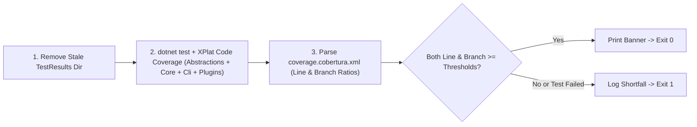
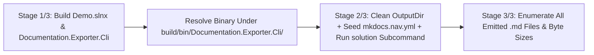
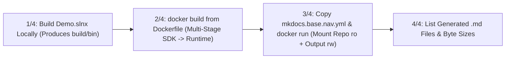
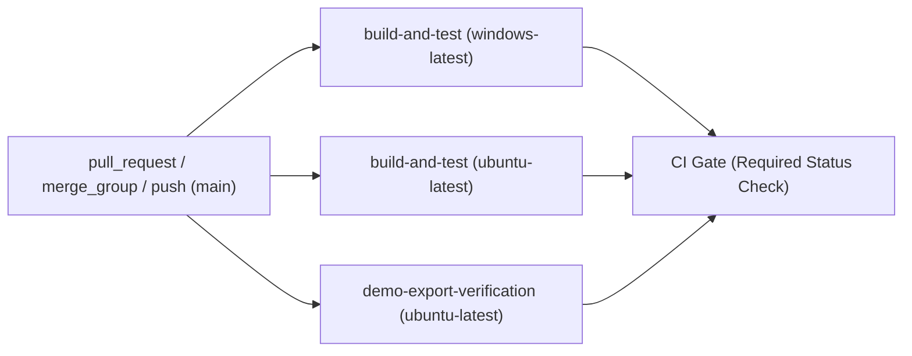
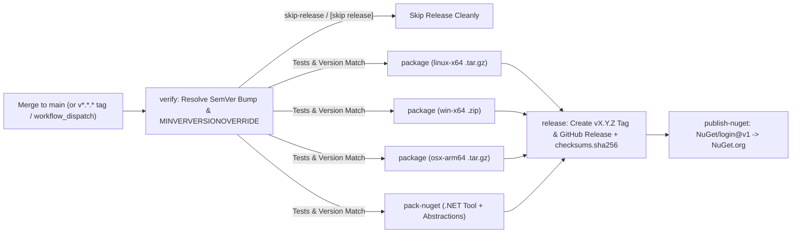

# Scripts, Build System, & Containerization

This reference documents every manual PowerShell automation script in [`scripts/manual/`](../../scripts/manual), the GitHub Actions gated check-in ([`.github/workflows/ci.yml`](../../.github/workflows/ci.yml)) and automated release ([`.github/workflows/release.yml`](../../.github/workflows/release.yml)) workflows, the multi-stage Docker container setup ([`Dockerfile`](../../Dockerfile)), and MSBuild / NuGet / MinVer workspace configuration ([`Directory.Build.props`](../../Directory.Build.props), [`src/Directory.Build.props`](../../src/Directory.Build.props), [`Directory.Packages.props`](../../Directory.Packages.props)).

---

## 1. Manual PowerShell Automation Scripts (`scripts/manual/`)

Every script in [`scripts/manual/`](../../scripts/manual) includes full PowerShell comment-based help (`.SYNOPSIS`, `.DESCRIPTION`, `.PARAMETER`, and `.EXAMPLE` blocks) at the top of the `.ps1` file, so opening the script or running `Get-Help .\scripts\manual\<ScriptName>.ps1 -Full` displays all parameter descriptions, valid values, defaults, and copy-ready invocation examples.

### A. `scripts/manual/Run-CodeCoverage.ps1`

Executes the full xUnit suite via [`scripts/manual/Run-CodeCoverage.ps1`](../../scripts/manual/Run-CodeCoverage.ps1) with Coverlet Cobertura code coverage instrumentation and enforces minimum line and branch coverage percentages:



#### Parameters

| Parameter | Type | Default | Description |
| :--- | :--- | :--- | :--- |
| `-MinimumLineCoverage` | `double` | `90.0` | Minimum acceptable line coverage percentage across `Abstractions`, `Core`, `Cli`, `Plugins.Diagrams`, and `Plugins.Navigation.MkDocs` |
| `-MinimumBranchCoverage` | `double` | `90.0` | Minimum acceptable branch coverage percentage across `Abstractions`, `Core`, `Cli`, `Plugins.Diagrams`, and `Plugins.Navigation.MkDocs` |
| `-TestProject` | `string` | [`test/Documentation.Exporter.Core.Tests/Documentation.Exporter.Core.Tests.csproj`](../../test/Documentation.Exporter.Core.Tests/Documentation.Exporter.Core.Tests.csproj) | Target test project path |
| `-ResultsDir` | `string` | `"TestResults"` | Output folder cleared and populated with `coverage.cobertura.xml` |
| `-Category` | `string` | `"All"` | Optional xUnit test category filter (`"All"`, `"Unit"`, or `"Integration"`); non-`All` values pass `--filter "Category=$Category"` to `dotnet test` |

```powershell
# Run full suite coverage gate (Unit + Integration)
powershell -ExecutionPolicy Bypass -File scripts/manual/Run-CodeCoverage.ps1 -MinimumLineCoverage 90.0 -MinimumBranchCoverage 90.0

# Run filtered category subsets (override thresholds when measuring a single slice)
powershell -ExecutionPolicy Bypass -File scripts/manual/Run-CodeCoverage.ps1 -Category Unit -MinimumLineCoverage 0 -MinimumBranchCoverage 0
powershell -ExecutionPolicy Bypass -File scripts/manual/Run-CodeCoverage.ps1 -Category Integration -MinimumLineCoverage 0 -MinimumBranchCoverage 0
```

#### Coverlet Collector Filters & Execution

1. Removes any stale `TestResults` directory.
2. Invokes `dotnet test` with `--collect:"XPlat Code Coverage"` and Coverlet collector arguments:
   - **Included Assemblies**: `[Documentation.Exporter.Abstractions]*,[Documentation.Exporter.Core]*,[Documentation.Exporter.Cli]*,[Documentation.Exporter.Plugins.Diagrams]*,[Documentation.Exporter.Plugins.Navigation.MkDocs]*`
   - **Excluded Attributes**: `Obsolete`, `GeneratedCodeAttribute`, `CompilerGeneratedAttribute`
   - **Excluded Files**: `**/*.g.cs`
3. Parses the generated `coverage.cobertura.xml` attributes (`lines-covered` / `lines-valid` and `branches-covered` / `branches-valid`), rounds percentages to 2 decimals, prints the summary banner, and exits with code `1` if `dotnet test` fails or either coverage percentage is below threshold.

#### Usage Examples

```powershell
# Run with default 90% line & branch thresholds
powershell -ExecutionPolicy Bypass -File scripts/manual/Run-CodeCoverage.ps1

# Run with custom thresholds
powershell -ExecutionPolicy Bypass -File scripts/manual/Run-CodeCoverage.ps1 -MinimumLineCoverage 95.0 -MinimumBranchCoverage 90.0
```

---

### B. `scripts/manual/Run-DemoExport.ps1`

Builds the showcase demo C# solution ([`demo/Documentation.Exporter.Demo.slnx`](../../demo/Documentation.Exporter.Demo.slnx)) and local CLI executable ([`Documentation.Exporter.Cli`](../../src/Documentation.Exporter.Cli/Documentation.Exporter.Cli.csproj)) via [`scripts/manual/Run-DemoExport.ps1`](../../scripts/manual/Run-DemoExport.ps1), then runs a full end-to-end documentation export into `.demo-output/` using the local `.exe` / binary:



#### Parameters

| Parameter | Type | Valid Values | Default | Description |
| :--- | :--- | :--- | :--- | :--- |
| `-Configuration` | `string` | `Debug`, `Release` | `Debug` | MSBuild configuration for demo projects and CLI binary lookup |
| `-OutputDir` | `string` | Any relative folder | `.demo-output` | Output directory relative to repository root |
| `-LogLevel` | `string` | Any `Microsoft.Extensions.Logging.LogLevel` | `Information` | Console logging threshold forwarded to `--log-level` |
| `-DiagramFormat` | `string` | `Mermaid`, `PlantUml`, `None` | `Mermaid` | Preferred diagram generator forwarded to `--diagram-format` |

#### Execution Stages

1. **`[1/3]` Build Demo & CLI**: Runs `dotnet build` on [`demo/Documentation.Exporter.Demo.slnx`](../../demo/Documentation.Exporter.Demo.slnx) and [`src/Documentation.Exporter.Cli/Documentation.Exporter.Cli.csproj`](../../src/Documentation.Exporter.Cli/Documentation.Exporter.Cli.csproj) under `-c $Configuration`. Resolves the CLI binary under `build/bin/Documentation.Exporter.Cli/{configLower}/` (`Documentation.Exporter.Cli.exe` on Windows, `Documentation.Exporter.Cli` on Linux/macOS).
2. **`[2/3]` Clean Target & Execute `solution` Command**: Recreates `$OutputDir`, copies [`demo/mkdocs.base.nav.yml`](../../demo/mkdocs.base.nav.yml) into `$OutputDir/mkdocs.nav.yml`, and invokes:
   `Documentation.Exporter.Cli solution --solution demo/Documentation.Exporter.Demo.slnx --configuration $Configuration --exclude "*.Tests" "*.Benchmarks" --diagram-format $DiagramFormat --output ... --examples-dir ... --overrides-dir ... --nav-file ... --nav-entry-point "Developer Portal/API Reference" --strict --report-file .demo-output/quality-report.json --report-format Json --log-level $LogLevel`
3. **`[3/3]` Report Output**: Enumerates every generated `.md` file and `quality-report.json` in `$OutputDir` with its byte size.

#### Usage Examples

```powershell
# Default Debug showcase with Mermaid diagrams
powershell -ExecutionPolicy Bypass -File scripts/manual/Run-DemoExport.ps1

# Release showcase emitting PlantUML diagrams + standalone architecture.puml files
powershell -ExecutionPolicy Bypass -File scripts/manual/Run-DemoExport.ps1 -Configuration Release -DiagramFormat PlantUml
```

---

### C. `scripts/manual/Run-DemoExport-Docker.ps1`

[`scripts/manual/Run-DemoExport-Docker.ps1`](../../scripts/manual/Run-DemoExport-Docker.ps1) mirrors [`Run-DemoExport.ps1`](../../scripts/manual/Run-DemoExport.ps1) inside an isolated Linux Docker container built from [`Dockerfile`](../../Dockerfile), verifying cross-platform Linux execution and path handling. *(Requires Docker Engine running locally.)*



#### Parameters

| Parameter | Type | Valid Values | Default | Description |
| :--- | :--- | :--- | :--- | :--- |
| `-Configuration` | `string` | `Debug`, `Release` | `Debug` | Build configuration for compiling [`Documentation.Exporter.Demo.slnx`](../../demo/Documentation.Exporter.Demo.slnx) locally before mounting |
| `-OutputDirectory` | `string` | Any relative folder | `.demo-output` | Host folder bind-mounted to `/output` inside the container |
| `-LogLevel` | `string` | Any `LogLevel` | `Information` | Console logging threshold forwarded to `--log-level` |
| `-DiagramFormat` | `string` | `Mermaid`, `PlantUml`, `None` | `Mermaid` | Preferred diagram generator forwarded to `--diagram-format` |
| `-ImageTag` | `string` | Docker image tag | `documentation-exporter:demo` | Tag built and invoked by Docker |
| `-NoCache` | `switch` | Present / omitted | Off | Passes `--no-cache` to `docker build` |

#### Execution Stages

1. **`[1/4]` Local Demo Build**: Compiles [`demo/Documentation.Exporter.Demo.slnx`](../../demo/Documentation.Exporter.Demo.slnx) locally so `.dll` and `.xml` artifacts exist in `build/bin/`.
2. **`[2/4]` Container Image Build**: Runs `docker build -t $ImageTag -f Dockerfile .` using [`Dockerfile`](../../Dockerfile) (adding `--no-cache` if `-NoCache` is passed).
3. **`[3/4]` Mount & Execute Container**: Recreates `$OutputDirectory`, copies [`demo/mkdocs.base.nav.yml`](../../demo/mkdocs.base.nav.yml) into `$OutputDirectory/mkdocs.nav.yml`, and runs `docker run --rm -v "${repositoryRoot}:/workspace:ro" -v "${resolvedOutputDirectory}:/output:rw" $ImageTag solution ...` passing Linux container paths (`/workspace/demo/...`, `/output/mkdocs.nav.yml`, `/output/quality-report.json`), `--exclude *.Tests *.Benchmarks`, `--diagram-format $DiagramFormat`, `--nav-entry-point "Developer Portal/API Reference"`, `--strict`, `--report-file /output/quality-report.json`, and `--report-format Json`.
4. **`[4/4]` Report Output**: Lists all emitted `.md` files and `quality-report.json` in `$OutputDirectory` with byte sizes.

#### Usage Examples

```powershell
# Default Docker showcase with Mermaid diagrams
powershell -ExecutionPolicy Bypass -File scripts/manual/Run-DemoExport-Docker.ps1

# Rebuild image cleanly without cache and export PlantUML diagrams
powershell -ExecutionPolicy Bypass -File scripts/manual/Run-DemoExport-Docker.ps1 -NoCache -DiagramFormat PlantUml
```

---

## 2. Multi-Stage `Dockerfile`

The repository root [`Dockerfile`](../../Dockerfile) (paired with [`.dockerignore`](../../.dockerignore)) produces a lean Linux runtime image targeting .NET 11 without shipping build SDK tooling in the final image:

- **Stage 1 (`mcr.microsoft.com/dotnet/sdk:11.0 AS build`)**: Copies [`Directory.Build.props`](../../Directory.Build.props), [`Directory.Packages.props`](../../Directory.Packages.props), [`src/Directory.Build.props`](../../src/Directory.Build.props), [`src/Directory.Packages.props`](../../src/Directory.Packages.props), and `.csproj` files first for NuGet restore layer caching (`dotnet restore`), then copies `src/` sources, accepts an optional `--build-arg MINVERVERSIONOVERRIDE=<semver>` (because [`.dockerignore`](../../.dockerignore) excludes `.git/`), and runs `dotnet publish src/Documentation.Exporter.Cli/Documentation.Exporter.Cli.csproj -c Release --no-restore` ([`Documentation.Exporter.Cli.csproj`](../../src/Documentation.Exporter.Cli/Documentation.Exporter.Cli.csproj)), which emits into `/src/build/publish/Documentation.Exporter.Cli/release` via `<ArtifactsPath>`.
- **Stage 2 (`mcr.microsoft.com/dotnet/runtime:11.0 AS final`)**: Sets `WORKDIR /workspace`, copies `/app` from Stage 1, and configures `ENTRYPOINT ["/app/Documentation.Exporter.Cli"]`.

---

## 3. Centralized MSBuild & Package Configuration

- **[`Directory.Build.props`](../../Directory.Build.props)**: Sets `<ArtifactsPath>$(MSBuildThisFileDirectory)build</ArtifactsPath>` so all `bin/`, `obj/`, and `publish/` outputs land cleanly in `build/` rather than cluttering `src/` or `test/`. Enforces `TreatWarningsAsErrors = true`, `AnalysisLevel = latest-recommended`, `EnforceCodeStyleInBuild = true`, `LangVersion = latest`, and `NeutralLanguage = en-US`.
- **Central Package Management (CPM)**: Root [`Directory.Packages.props`](../../Directory.Packages.props) enables `<ManagePackageVersionsCentrally>true</ManagePackageVersionsCentrally>`, while [`src/Directory.Packages.props`](../../src/Directory.Packages.props) and [`test/Directory.Packages.props`](../../test/Directory.Packages.props) pin production and test package versions separately without `<Version>` attributes inside individual `.csproj` files.
- **[`.editorconfig`](../../.editorconfig)**: Enforces file-scoped namespaces, expression-bodied members (`IDE0022`), primary constructors (`IDE0290`), simplified `if`/ternaries (`IDE0045`, `IDE0046`), discarded return values (`IDE0058`), exhaustive switches (`IDE0072`), and compiler analyzer warnings across Style, Design, Documentation (`CS1591`), Globalization, Interoperability, Maintainability, Naming, and Performance.

---

## 4. GitHub Actions CI & Gated Check-In (`.github/workflows/ci.yml`)

[`.github/workflows/ci.yml`](../../.github/workflows/ci.yml) enforces automated cross-platform build, plugin-staging, unit/integration testing, code coverage, and end-to-end demo export verification on every pull request targeting `main`, `merge_group`, direct push to `main`, and manual `workflow_dispatch`.



### Workflow Jobs & Gates

| Job | Runner(s) | Checks Executed |
| :--- | :--- | :--- |
| **`build-and-test`** | `ubuntu-latest`, `windows-latest` | Full-history checkout (`fetch-depth: 0`) for MinVer, `dotnet restore` & `dotnet build -c Release` (zero warnings/errors), resolved SemVer logging, `dotnet publish` CLI + verification of staged `Plugins.Diagrams` & `Plugins.Navigation.MkDocs` without duplicate `Abstractions.dll`, `dotnet pack` + `doc-exporter` `.NET Tool` ZIP & install smoke test, full `dotnet test` (482 tests) with Coverlet Cobertura coverage (`MIN_LINE_COVERAGE: 90.0%`, `MIN_BRANCH_COVERAGE: 85.0%`), Job Summary reporting, and `TestResults/` artifact upload |
| **`demo-export-verification`** | `ubuntu-latest` | Builds [`demo/Documentation.Exporter.Demo.slnx`](../../demo/Documentation.Exporter.Demo.slnx) and [`Documentation.Exporter.Cli`](../../src/Documentation.Exporter.Cli/Documentation.Exporter.Cli.csproj) in `Release`, runs [`scripts/manual/Run-DemoExport.ps1`](../../scripts/manual/Run-DemoExport.ps1) with `--strict` for both `Mermaid` and `PlantUml`, verifies `.demo-output/mkdocs.nav.yml`, `architecture.puml`, and `quality-report.json`, and uploads `.demo-output/` |
| **`ci-gate`** (`CI Gate`) | `ubuntu-latest` | Aggregator job (`if: always()`) that passes **only** when both `build-and-test` (all OS matrix runs) and `demo-export-verification` succeed |

> [!TIP]
> **Branch Coverage Threshold:** `MIN_BRANCH_COVERAGE` in [`.github/workflows/ci.yml`](../../.github/workflows/ci.yml) starts at `85.0%` (matching the ~87.9% baseline) while `MIN_LINE_COVERAGE` is `90.0%`. Raise `MIN_BRANCH_COVERAGE` to `90.0` once overall branch coverage reaches `>= 90%`.

### Enabling Gated Check-In on `main` in GitHub

1. Open **Settings → Branches** (or **Settings → Rules → Rulesets**) in the GitHub repository.
2. Add a branch protection rule / ruleset targeting `main`.
3. Enable **Require a pull request before merging** and **Require status checks to pass before merging** (optionally enable **Require branches to be up to date before merging**).
4. Select **`CI Gate`** as the required status check.

### GitHub Free Compatibility (Public vs. Private Repositories)

| Feature | Public Repo (GitHub Free) | Private Repo (GitHub Free) |
| :--- | :--- | :--- |
| **GitHub Actions Minutes** | **Unlimited** on `ubuntu-latest`, `windows-latest`, and `macos-latest` | **2,000 free min/month** (`ubuntu-latest` = 1×, `windows-latest` = 2×, `macos-latest` = 10×) |
| **Branch Protection / Rulesets (`CI Gate` on `main`)** | **Supported** (free on all public repos) | **Not available** on GitHub Free (requires Public visibility or GitHub Pro/Team) |
| **Artifact Storage (`TestResults`, `.demo-output`)** | **500 MB free** (runs upload a few MB with 7–14 day retention) | **500 MB free** (shared across account; 7–14 day retention keeps usage minimal) |
| **GitHub Releases (`release.yml`)** | **Unlimited** (`GITHUB_TOKEN` + `permissions: contents: write`, no PAT needed) | **Supported** (`GITHUB_TOKEN` + `permissions: contents: write`, no PAT needed) |

> [!IMPORTANT]
> If you keep the repository **Public** on GitHub Free, both `CI Gate` branch protection on `main` and unlimited cross-OS runner minutes (`ubuntu-latest`, `windows-latest`, `macos-latest`) work out of the box at zero cost. On a **Private** GitHub Free repository, the workflows still run within your 2,000-minute monthly quota (though `merge_group` remains idle without Merge Queue), and `main` branch protection enforcement requires upgrading to GitHub Pro/Team or making the repository public.

---

## 5. Semantic Versioning (MinVer) & Automated Releases (`.github/workflows/release.yml`)

`Documentation.Exporter` uses **MinVer** ([`src/Directory.Build.props`](../../src/Directory.Build.props)) for zero-touch Git tag-driven Semantic Versioning (`SemVer 2.0`) across all shippable `src/` assemblies, while leaving `demo/` and `test/` assemblies at their default `1.0.0.0` version so demo reference tests remain deterministic.



### Automatic SemVer Bump & Skip Rules on Merge to `main`

`release.yml` queues merges sequentially (`concurrency: group: release-pipeline, cancel-in-progress: false`) and resolves the next `vX.Y.Z` tag from PR labels, Conventional Commit prefixes, or `workflow_dispatch` inputs before passing `MINVERVERSIONOVERRIDE` to all build, publish, and pack jobs:

| Signal (PR Label or Commit Message) | Resolved Bump / Action | Notes |
| :--- | :--- | :--- |
| `skip-release` / `no-release` label or `[skip release]` in commit | **Skip release** | Exits cleanly without tagging or publishing |
| `breaking-change` / `breaking` label, `BREAKING CHANGE`, or `type!:` | **Major** (`(X+1).0.0`) | Starts at `1.0.0` if no prior stable `v*` tag exists |
| `feature` / `enhancement` label or `feat:` commit prefix | **Minor** (`X.(Y+1).0`) | Starts at `0.1.0` if no prior stable `v*` tag exists |
| All other merges (`bug`, `plugin`, `documentation`, `ci`, `dependencies`, unlabeled) | **Patch** (`X.Y.(Z+1)`) | Starts at `0.1.0` if no prior stable `v*` tag exists |
| Explicit `v*.*.*` tag push or `workflow_dispatch` `version` input | **Exact SemVer** | Supports pre-releases (`v1.0.0-rc.1` -> `--prerelease`) |

### MinVer Configuration (`src/Directory.Build.props`)

| Property | Value | Effect |
| :--- | :--- | :--- |
| **`MinVerTagPrefix`** | `v` | Tags like `v1.0.0` or `v1.2.0-rc.1` resolve directly to `1.0.0` / `1.2.0-rc.1` |
| **`MinVerDefaultPreReleaseIdentifiers`** | `alpha.0` | Commits after a release tag auto-increment as `1.0.1-alpha.0.1`, `1.0.1-alpha.0.2`, etc. |
| **`MinVerMinimumMajorMinor`** | `0.1` | Commits before the first `v*` tag (or builds without `.git/`) resolve to `0.1.0-alpha.0.*` |
| **`MinVerAutoIncrement`** | `patch` | Un-tagged commits bump the patch component ahead of the next release |
| **`PrivateAssets="all"`** | Enabled | Keeps MinVer strictly build-time so `MinVer.dll` is never copied into `bin/` or `plugins/` |

### Cutting a Release & Container Versioning

```powershell
# 1. Inspect the current resolved SemVer locally
dotnet msbuild src/Documentation.Exporter.Cli/Documentation.Exporter.Cli.csproj -target:MinVer -getProperty:Version -p:Configuration=Release

# 2. Tag a release on main and push to trigger .github/workflows/release.yml
git tag v1.0.0
git push origin v1.0.0

# 3. Optional: stamp an explicit SemVer when building the Docker image (where .git/ is ignored)
docker build --build-arg MINVERVERSIONOVERRIDE=1.0.0 -t documentation-exporter:1.0.0 .
```

When a PR merges into `main` (or when a `v*.*.*` tag is pushed / `workflow_dispatch` is triggered), [`.github/workflows/release.yml`](../../.github/workflows/release.yml) resolves the next SemVer version, builds and tests in `Release` with `MINVERVERSIONOVERRIDE`, publishes framework-dependent packages with staged `plugins/` for `linux-x64` (`.tar.gz`), `win-x64` (`.zip`), and `osx-arm64` (`.tar.gz`), packs both `Documentation.Exporter.Cli` (`.NET Tool` `doc-exporter` bundling `tools/net11.0/any/plugins/`) and `Documentation.Exporter.Abstractions` (`.nupkg` + `.snupkg`), generates `checksums.sha256`, atomically creates the GitHub tag + Release via `--target "${{ github.sha }}"` and `--repo` using `GITHUB_TOKEN` (automatically marking `-alpha` / `-rc` tags as `--prerelease`), and pushes the `.nupkg` packages to **NuGet.org** via OIDC Trusted Publishing (`NuGet/login@v1`).

### NuGet Packaging & `.NET Tool` (`doc-exporter`)

| Package | Project | Output & Bundled Assets |
| :--- | :--- | :--- |
| **`Documentation.Exporter.Cli`** | [`Documentation.Exporter.Cli.csproj`](../../src/Documentation.Exporter.Cli/Documentation.Exporter.Cli.csproj) | `<PackAsTool>true</PackAsTool>` (`<ToolCommandName>doc-exporter</ToolCommandName>`). `CopyBuiltInPluginsToPublish` bundles `Documentation.Exporter.Plugins.Diagrams` and `Documentation.Exporter.Plugins.Navigation.MkDocs` under `tools/net11.0/any/plugins/` without duplicating `Documentation.Exporter.Abstractions.dll` or `MinVer.dll`. |
| **`Documentation.Exporter.Abstractions`** | [`Documentation.Exporter.Abstractions.csproj`](../../src/Documentation.Exporter.Abstractions/Documentation.Exporter.Abstractions.csproj) | Packable library (`.nupkg` + `.snupkg` symbols + XML docs + `README.md`) for third-party plugin authors. |

### NuGet.org Trusted Publishing Setup (OIDC, No Static API Key)

The `publish-nuget` job in [`.github/workflows/release.yml`](../../.github/workflows/release.yml) uses `permissions: id-token: write` and `NuGet/login@v1` (skipping cleanly whenever `vars.NUGET_USER` is unset):

1. On **nuget.org**, go to **Account → Trusted Publishing** and add a policy for repository owner `trodent83`, repository `documentation-exporter`, and workflow file `release.yml`.
2. In your GitHub repository, open **Settings → Secrets and variables → Actions → Variables** and create **`NUGET_USER`** set to your exact NuGet.org profile username.

### Categorized Release Notes (`.github/release.yml`)

`gh release create --generate-notes` reads [`.github/release.yml`](../../.github/release.yml) automatically to group merged PRs into changelog sections by GitHub PR label (excluding `ignore-for-release`, `duplicate`, `invalid`, and `wontfix`, and placing any unlabeled PRs under `Other Changes`):

| Release Note Section | Matching PR Labels |
| :--- | :--- |
| **Breaking Changes** | `breaking-change`, `breaking` |
| **Features & Enhancements** | `feature`, `enhancement` |
| **Bug Fixes** | `bug`, `fix` |
| **Plugins & Extensibility** | `plugin`, `plugins` |
| **Documentation** | `documentation`, `docs` |
| **CI, Build, & Dependencies** | `ci`, `build`, `dependencies` |
| **Other Changes** | `*` (catch-all for unlabeled PRs) |
