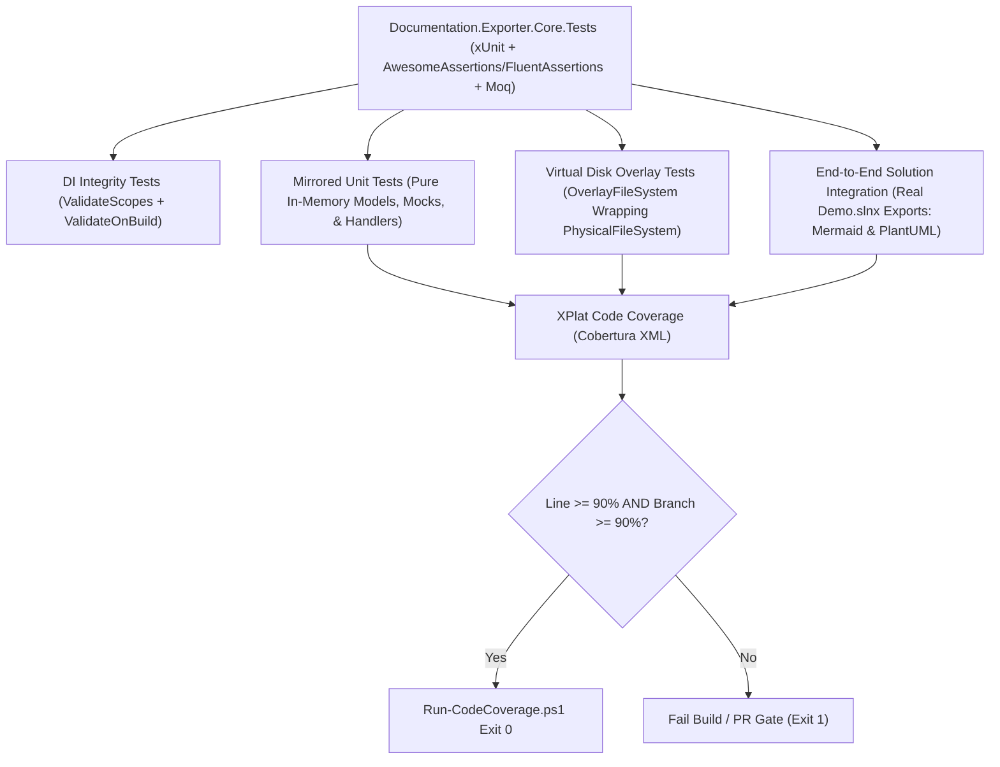

# Testing Architecture & Code Coverage

The automated test suite lives in [`test/Documentation.Exporter.Core.Tests/`](../../test/Documentation.Exporter.Core.Tests/Documentation.Exporter.Core.Tests.csproj) and enforces strict defensive testing alongside `>= 90.0%` combined line and branch coverage across [`Documentation.Exporter.Abstractions`](../../src/Documentation.Exporter.Abstractions/Documentation.Exporter.Abstractions.csproj), [`Documentation.Exporter.Core`](../../src/Documentation.Exporter.Core/Documentation.Exporter.Core.csproj), [`Documentation.Exporter.Cli`](../../src/Documentation.Exporter.Cli/Documentation.Exporter.Cli.csproj), [`Documentation.Exporter.Plugins.Diagrams`](../../src/Documentation.Exporter.Plugins.Diagrams/Documentation.Exporter.Plugins.Diagrams.csproj), and [`Documentation.Exporter.Plugins.Navigation.MkDocs`](../../src/Documentation.Exporter.Plugins.Navigation.MkDocs/Documentation.Exporter.Plugins.Navigation.MkDocs.csproj).

---

## Test Pyramid & Isolation Architecture

Every layer—from single helper unit assertions up through end-to-end solution exports—is tested strictly through public contracts without internal visibility shortcuts:



---

## 1. Mirrored Test Suite Hierarchy

The test project strictly mirrors the folder and namespace structure of [`src/Documentation.Exporter.Core/`](../../src/Documentation.Exporter.Core/Documentation.Exporter.Core.csproj) and [`src/Documentation.Exporter.Cli/`](../../src/Documentation.Exporter.Cli/Documentation.Exporter.Cli.csproj):

| Folder / Scope | Test Classes |
| :--- | :--- |
| Root | [`DocumentationExporterEngineTests.cs`](../../test/Documentation.Exporter.Core.Tests/DocumentationExporterEngineTests.cs) |
| [`Cli/`](../../test/Documentation.Exporter.Core.Tests/Cli) | [`CliLoggingLevelSwitchTests.cs`](../../test/Documentation.Exporter.Core.Tests/Cli/CliLoggingLevelSwitchTests.cs), [`CliPipelineRunnerTests.cs`](../../test/Documentation.Exporter.Core.Tests/Cli/CliPipelineRunnerTests.cs), [`CliPluginDirectoryResolverTests.cs`](../../test/Documentation.Exporter.Core.Tests/Cli/CliPluginDirectoryResolverTests.cs), [`CliServiceCollectionExtensionsTests.cs`](../../test/Documentation.Exporter.Core.Tests/Cli/CliServiceCollectionExtensionsTests.cs), [`DocumentationExporterCliTests.cs`](../../test/Documentation.Exporter.Core.Tests/Cli/DocumentationExporterCliTests.cs), [`SystemConsoleOutputTests.cs`](../../test/Documentation.Exporter.Core.Tests/Cli/SystemConsoleOutputTests.cs) |
| [`DependencyInjection/`](../../test/Documentation.Exporter.Core.Tests/DependencyInjection) | [`DocumentationExporterServiceCollectionExtensionsTests.cs`](../../test/Documentation.Exporter.Core.Tests/DependencyInjection/DocumentationExporterServiceCollectionExtensionsTests.cs), [`DocumentationExporterPluginServiceCollectionExtensionsTests.cs`](../../test/Documentation.Exporter.Core.Tests/DependencyInjection/DocumentationExporterPluginServiceCollectionExtensionsTests.cs) |
| [`Enrichment/`](../../test/Documentation.Exporter.Core.Tests/Enrichment) | [`ExampleSnippetEnricherTests.cs`](../../test/Documentation.Exporter.Core.Tests/Enrichment/ExampleSnippetEnricherTests.cs), [`SidecarOverrideEnricherTests.cs`](../../test/Documentation.Exporter.Core.Tests/Enrichment/SidecarOverrideEnricherTests.cs), [`TypeDocumentationPipelineTests.cs`](../../test/Documentation.Exporter.Core.Tests/Enrichment/TypeDocumentationPipelineTests.cs), [`XmlDocumentationEnricherTests.cs`](../../test/Documentation.Exporter.Core.Tests/Enrichment/XmlDocumentationEnricherTests.cs) |
| [`Generation/`](../../test/Documentation.Exporter.Core.Tests/Generation) | [`ExceptionTableFormatterTests.cs`](../../test/Documentation.Exporter.Core.Tests/Generation/ExceptionTableFormatterTests.cs), [`IndexPageMarkdownGeneratorTests.cs`](../../test/Documentation.Exporter.Core.Tests/Generation/IndexPageMarkdownGeneratorTests.cs), [`MemberDetailMarkdownGeneratorTests.cs`](../../test/Documentation.Exporter.Core.Tests/Generation/MemberDetailMarkdownGeneratorTests.cs), [`MemberFileNameFormatterTests.cs`](../../test/Documentation.Exporter.Core.Tests/Generation/MemberFileNameFormatterTests.cs), [`MkDocsNavigationGeneratorTests.cs`](../../test/Documentation.Exporter.Core.Tests/Generation/MkDocsNavigationGeneratorTests.cs), [`RelativeLinkRewriterTests.cs`](../../test/Documentation.Exporter.Core.Tests/Generation/RelativeLinkRewriterTests.cs), [`TypePageMarkdownGeneratorTests.cs`](../../test/Documentation.Exporter.Core.Tests/Generation/TypePageMarkdownGeneratorTests.cs) |
| [`Generation/Diagrams/`](../../test/Documentation.Exporter.Core.Tests/Generation/Diagrams) | [`DiagramGeneratorSelectorTests.cs`](../../test/Documentation.Exporter.Core.Tests/Generation/Diagrams/DiagramGeneratorSelectorTests.cs), [`DiagramIdentifierFormatterTests.cs`](../../test/Documentation.Exporter.Core.Tests/Generation/Diagrams/DiagramIdentifierFormatterTests.cs), [`MermaidArchitectureDiagramGeneratorTests.cs`](../../test/Documentation.Exporter.Core.Tests/Generation/Diagrams/MermaidArchitectureDiagramGeneratorTests.cs), [`MermaidAssemblyDependencyDiagramGeneratorTests.cs`](../../test/Documentation.Exporter.Core.Tests/Generation/Diagrams/MermaidAssemblyDependencyDiagramGeneratorTests.cs), [`MermaidTypeDiagramGeneratorTests.cs`](../../test/Documentation.Exporter.Core.Tests/Generation/Diagrams/MermaidTypeDiagramGeneratorTests.cs), [`PlantUmlArchitectureDiagramGeneratorTests.cs`](../../test/Documentation.Exporter.Core.Tests/Generation/Diagrams/PlantUmlArchitectureDiagramGeneratorTests.cs), [`PlantUmlAssemblyDependencyDiagramGeneratorTests.cs`](../../test/Documentation.Exporter.Core.Tests/Generation/Diagrams/PlantUmlAssemblyDependencyDiagramGeneratorTests.cs), [`PlantUmlTypeDiagramGeneratorTests.cs`](../../test/Documentation.Exporter.Core.Tests/Generation/Diagrams/PlantUmlTypeDiagramGeneratorTests.cs) |
| [`Generation/Sections/`](../../test/Documentation.Exporter.Core.Tests/Generation/Sections) | [`DerivedAndMermaidSectionRenderersTests.cs`](../../test/Documentation.Exporter.Core.Tests/Generation/Sections/DerivedAndMermaidSectionRenderersTests.cs), [`ExamplesSectionRendererTests.cs`](../../test/Documentation.Exporter.Core.Tests/Generation/Sections/ExamplesSectionRendererTests.cs), [`ExceptionsSectionRendererTests.cs`](../../test/Documentation.Exporter.Core.Tests/Generation/Sections/ExceptionsSectionRendererTests.cs), [`HeaderTitleSectionRendererTests.cs`](../../test/Documentation.Exporter.Core.Tests/Generation/Sections/HeaderTitleSectionRendererTests.cs), [`ImplementedInterfacesSectionRendererTests.cs`](../../test/Documentation.Exporter.Core.Tests/Generation/Sections/ImplementedInterfacesSectionRendererTests.cs), [`InheritanceHierarchySectionRendererTests.cs`](../../test/Documentation.Exporter.Core.Tests/Generation/Sections/InheritanceHierarchySectionRendererTests.cs), [`MembersSectionRendererTests.cs`](../../test/Documentation.Exporter.Core.Tests/Generation/Sections/MembersSectionRendererTests.cs), [`NestedTypesSectionRendererTests.cs`](../../test/Documentation.Exporter.Core.Tests/Generation/Sections/NestedTypesSectionRendererTests.cs), [`RemarksSectionRendererTests.cs`](../../test/Documentation.Exporter.Core.Tests/Generation/Sections/RemarksSectionRendererTests.cs), [`SeeAlsoSectionRendererTests.cs`](../../test/Documentation.Exporter.Core.Tests/Generation/Sections/SeeAlsoSectionRendererTests.cs), [`SidecarAfterExamplesSectionRendererTests.cs`](../../test/Documentation.Exporter.Core.Tests/Generation/Sections/SidecarAfterExamplesSectionRendererTests.cs), [`SidecarAfterRemarksSectionRendererTests.cs`](../../test/Documentation.Exporter.Core.Tests/Generation/Sections/SidecarAfterRemarksSectionRendererTests.cs), [`SidecarBeforeRemarksSectionRendererTests.cs`](../../test/Documentation.Exporter.Core.Tests/Generation/Sections/SidecarBeforeRemarksSectionRendererTests.cs), [`SidecarPageAppendSectionRendererTests.cs`](../../test/Documentation.Exporter.Core.Tests/Generation/Sections/SidecarPageAppendSectionRendererTests.cs), [`SyntaxDeclarationSectionRendererTests.cs`](../../test/Documentation.Exporter.Core.Tests/Generation/Sections/SyntaxDeclarationSectionRendererTests.cs), [`TypeDiagramSectionRendererTests.cs`](../../test/Documentation.Exporter.Core.Tests/Generation/Sections/TypeDiagramSectionRendererTests.cs) |
| [`Injection/`](../../test/Documentation.Exporter.Core.Tests/Injection) | [`FileDocumentationInjectorTests.cs`](../../test/Documentation.Exporter.Core.Tests/Injection/FileDocumentationInjectorTests.cs), [`FileExampleProviderTests.cs`](../../test/Documentation.Exporter.Core.Tests/Injection/FileExampleProviderTests.cs) |
| [`IO/`](../../test/Documentation.Exporter.Core.Tests/IO) | [`PhysicalFileSystemTests.cs`](../../test/Documentation.Exporter.Core.Tests/IO/PhysicalFileSystemTests.cs) |
| [`Models/`](../../test/Documentation.Exporter.Core.Tests/Models) | [`AssemblyDependencyEdgeModelTests.cs`](../../test/Documentation.Exporter.Core.Tests/Models/AssemblyDependencyEdgeModelTests.cs), [`AssemblyReferenceModelTests.cs`](../../test/Documentation.Exporter.Core.Tests/Models/AssemblyReferenceModelTests.cs), [`DiagramFormatTests.cs`](../../test/Documentation.Exporter.Core.Tests/Models/DiagramFormatTests.cs), [`ExtensibleFormatsTests.cs`](../../test/Documentation.Exporter.Core.Tests/Models/ExtensibleFormatsTests.cs), [`DocumentationInjectionModelTests.cs`](../../test/Documentation.Exporter.Core.Tests/Models/DocumentationInjectionModelTests.cs), [`ExporterOptionsTests.cs`](../../test/Documentation.Exporter.Core.Tests/Models/ExporterOptionsTests.cs), [`ExportResultTests.cs`](../../test/Documentation.Exporter.Core.Tests/Models/ExportResultTests.cs), [`MemberDocumentationModelTests.cs`](../../test/Documentation.Exporter.Core.Tests/Models/MemberDocumentationModelTests.cs), [`ParameterDocumentationModelTests.cs`](../../test/Documentation.Exporter.Core.Tests/Models/ParameterDocumentationModelTests.cs), [`TypeDocumentationModelTests.cs`](../../test/Documentation.Exporter.Core.Tests/Models/TypeDocumentationModelTests.cs) |
| [`Plugins/`](../../test/Documentation.Exporter.Core.Tests/Plugins) | [`DirectoryPluginLoaderTests.cs`](../../test/Documentation.Exporter.Core.Tests/Plugins/DirectoryPluginLoaderTests.cs), [`StandardDiagramsPluginTests.cs`](../../test/Documentation.Exporter.Core.Tests/Plugins/StandardDiagramsPluginTests.cs), [`MkDocsNavigationPluginTests.cs`](../../test/Documentation.Exporter.Core.Tests/Plugins/MkDocsNavigationPluginTests.cs), [`CustomPluginExtensionPointsEndToEndTests.cs`](../../test/Documentation.Exporter.Core.Tests/Plugins/CustomPluginExtensionPointsEndToEndTests.cs) |
| [`Parsing/`](../../test/Documentation.Exporter.Core.Tests/Parsing) | [`AssemblyReferenceAnalyzerTests.cs`](../../test/Documentation.Exporter.Core.Tests/Parsing/AssemblyReferenceAnalyzerTests.cs), [`AssemblyTypeReflectorTests.cs`](../../test/Documentation.Exporter.Core.Tests/Parsing/AssemblyTypeReflectorTests.cs), [`CustomAttributeExtractorTests.cs`](../../test/Documentation.Exporter.Core.Tests/Parsing/CustomAttributeExtractorTests.cs), [`CSharpSignatureFormatterTests.cs`](../../test/Documentation.Exporter.Core.Tests/Parsing/CSharpSignatureFormatterTests.cs), [`ExportArtifactDiscoveryServiceTests.cs`](../../test/Documentation.Exporter.Core.Tests/Parsing/ExportArtifactDiscoveryServiceTests.cs), [`IsolatedAssemblyLoaderTests.cs`](../../test/Documentation.Exporter.Core.Tests/Parsing/IsolatedAssemblyLoaderTests.cs), [`SolutionAssemblyResolverTests.cs`](../../test/Documentation.Exporter.Core.Tests/Parsing/SolutionAssemblyResolverTests.cs), [`XmlDocumentationParserTests.cs`](../../test/Documentation.Exporter.Core.Tests/Parsing/XmlDocumentationParserTests.cs), [`XmlTagTransformerTests.cs`](../../test/Documentation.Exporter.Core.Tests/Parsing/XmlTagTransformerTests.cs) |
| [`Parsing/Tags/`](../../test/Documentation.Exporter.Core.Tests/Parsing/Tags) | [`CodeTagHandlerTests.cs`](../../test/Documentation.Exporter.Core.Tests/Parsing/Tags/CodeTagHandlerTests.cs), [`ListTagHandlerTests.cs`](../../test/Documentation.Exporter.Core.Tests/Parsing/Tags/ListTagHandlerTests.cs), [`NoteTagHandlerTests.cs`](../../test/Documentation.Exporter.Core.Tests/Parsing/Tags/NoteTagHandlerTests.cs), [`ParagraphTagHandlerTests.cs`](../../test/Documentation.Exporter.Core.Tests/Parsing/Tags/ParagraphTagHandlerTests.cs), [`ParamRefTagHandlerTests.cs`](../../test/Documentation.Exporter.Core.Tests/Parsing/Tags/ParamRefTagHandlerTests.cs), [`PassthroughTagHandlerTests.cs`](../../test/Documentation.Exporter.Core.Tests/Parsing/Tags/PassthroughTagHandlerTests.cs), [`SeeTagHandlerTests.cs`](../../test/Documentation.Exporter.Core.Tests/Parsing/Tags/SeeTagHandlerTests.cs) |
| [`Quality/`](../../test/Documentation.Exporter.Core.Tests/Quality) | [`DocumentationQualityAnalyzerTests.cs`](../../test/Documentation.Exporter.Core.Tests/Quality/DocumentationQualityAnalyzerTests.cs), [`QualityReportFormattersAndWriterTests.cs`](../../test/Documentation.Exporter.Core.Tests/Quality/QualityReportFormattersAndWriterTests.cs) |
| [`Resolution/`](../../test/Documentation.Exporter.Core.Tests/Resolution) | [`LocalProjectNamespaceHandlerTests.cs`](../../test/Documentation.Exporter.Core.Tests/Resolution/LocalProjectNamespaceHandlerTests.cs), [`TypeDocumentationPathsTests.cs`](../../test/Documentation.Exporter.Core.Tests/Resolution/TypeDocumentationPathsTests.cs), [`MemberCrefRouteIndexBuilderTests.cs`](../../test/Documentation.Exporter.Core.Tests/Resolution/MemberCrefRouteIndexBuilderTests.cs), [`MicrosoftDocsNamespaceHandlerTests.cs`](../../test/Documentation.Exporter.Core.Tests/Resolution/MicrosoftDocsNamespaceHandlerTests.cs), [`MicrosoftLearnReferenceRegistryTests.cs`](../../test/Documentation.Exporter.Core.Tests/Resolution/MicrosoftLearnReferenceRegistryTests.cs), [`PatternNamespaceHandlerTests.cs`](../../test/Documentation.Exporter.Core.Tests/Resolution/PatternNamespaceHandlerTests.cs), [`TypeLinkResolverTests.cs`](../../test/Documentation.Exporter.Core.Tests/Resolution/TypeLinkResolverTests.cs) |
| [`Resources/`](../../test/Documentation.Exporter.Core.Tests/Resources) | [`CliCommandResourcesTests.cs`](../../test/Documentation.Exporter.Core.Tests/Resources/CliCommandResourcesTests.cs), [`ExecutionMessagesResourcesTests.cs`](../../test/Documentation.Exporter.Core.Tests/Resources/ExecutionMessagesResourcesTests.cs), [`MarkdownGenerationResourcesTests.cs`](../../test/Documentation.Exporter.Core.Tests/Resources/MarkdownGenerationResourcesTests.cs), [`ValidationMessagesResourcesTests.cs`](../../test/Documentation.Exporter.Core.Tests/Resources/ValidationMessagesResourcesTests.cs) |
| [`TestCategories/`](../../test/Documentation.Exporter.Core.Tests/TestCategories) | [`TestCategoryNames.cs`](../../test/Documentation.Exporter.Core.Tests/TestCategories/TestCategoryNames.cs), [`UnitTestAttribute.cs`](../../test/Documentation.Exporter.Core.Tests/TestCategories/UnitTestAttribute.cs), [`UnitTestTraitDiscoverer.cs`](../../test/Documentation.Exporter.Core.Tests/TestCategories/UnitTestTraitDiscoverer.cs), [`IntegrationTestAttribute.cs`](../../test/Documentation.Exporter.Core.Tests/TestCategories/IntegrationTestAttribute.cs), [`IntegrationTestTraitDiscoverer.cs`](../../test/Documentation.Exporter.Core.Tests/TestCategories/IntegrationTestTraitDiscoverer.cs), [`TestCategoryGovernanceTests.cs`](../../test/Documentation.Exporter.Core.Tests/TestCategories/TestCategoryGovernanceTests.cs) |
| [`Workflow/`](../../test/Documentation.Exporter.Core.Tests/Workflow) | [`ExportWorkflowContextTests.cs`](../../test/Documentation.Exporter.Core.Tests/Workflow/ExportWorkflowContextTests.cs), [`ExportWorkflowTests.cs`](../../test/Documentation.Exporter.Core.Tests/Workflow/ExportWorkflowTests.cs) |
| [`Workflow/Steps/`](../../test/Documentation.Exporter.Core.Tests/Workflow/Steps) | [`CalculateDocumentationCoverageStepTests.cs`](../../test/Documentation.Exporter.Core.Tests/Workflow/Steps/CalculateDocumentationCoverageStepTests.cs), [`CompileTypeDocumentationModelsStepTests.cs`](../../test/Documentation.Exporter.Core.Tests/Workflow/Steps/CompileTypeDocumentationModelsStepTests.cs), [`ConfigureResolutionHandlersStepTests.cs`](../../test/Documentation.Exporter.Core.Tests/Workflow/Steps/ConfigureResolutionHandlersStepTests.cs), [`EmitMarkdownDocumentationStepTests.cs`](../../test/Documentation.Exporter.Core.Tests/Workflow/Steps/EmitMarkdownDocumentationStepTests.cs), [`EmitQualityReportStepTests.cs`](../../test/Documentation.Exporter.Core.Tests/Workflow/Steps/EmitQualityReportStepTests.cs), [`EnsureOutputDirectoryStepTests.cs`](../../test/Documentation.Exporter.Core.Tests/Workflow/Steps/EnsureOutputDirectoryStepTests.cs), [`LoadAssemblyTypesStepTests.cs`](../../test/Documentation.Exporter.Core.Tests/Workflow/Steps/LoadAssemblyTypesStepTests.cs), [`LoadXmlDocumentationStepTests.cs`](../../test/Documentation.Exporter.Core.Tests/Workflow/Steps/LoadXmlDocumentationStepTests.cs), [`ValidateMarkdownLinksStepTests.cs`](../../test/Documentation.Exporter.Core.Tests/Workflow/Steps/ValidateMarkdownLinksStepTests.cs), [`ValidateOptionsStepTests.cs`](../../test/Documentation.Exporter.Core.Tests/Workflow/Steps/ValidateOptionsStepTests.cs) |
| [`Integration/`](../../test/Documentation.Exporter.Core.Tests/Integration) | [`CliAndQualityGatesEndToEndTests.cs`](../../test/Documentation.Exporter.Core.Tests/Integration/CliAndQualityGatesEndToEndTests.cs), [`DemoLibraryDocumentationTagsEndToEndTests.cs`](../../test/Documentation.Exporter.Core.Tests/Integration/DemoLibraryDocumentationTagsEndToEndTests.cs), [`EndToEndExportTests.cs`](../../test/Documentation.Exporter.Core.Tests/Integration/EndToEndExportTests.cs), [`MultiAssemblyAndSolutionEndToEndTests.cs`](../../test/Documentation.Exporter.Core.Tests/Integration/MultiAssemblyAndSolutionEndToEndTests.cs) |

---

## 2. Test Categorization (`Unit` vs. `Integration`) & Governance

Every test method (`[Fact]` or `[Theory]`) in [`Documentation.Exporter.Core.Tests`](../../test/Documentation.Exporter.Core.Tests/Documentation.Exporter.Core.Tests.csproj) belongs strictly to **either** pure unit tests or integration tests through custom xUnit trait attributes:

- **`[UnitTest]`** ([`UnitTestAttribute.cs`](../../test/Documentation.Exporter.Core.Tests/TestCategories/UnitTestAttribute.cs) + [`UnitTestTraitDiscoverer.cs`](../../test/Documentation.Exporter.Core.Tests/TestCategories/UnitTestTraitDiscoverer.cs)): Emits the xUnit trait `Category=Unit` for fast, isolated in-memory tests, virtual filesystem overlays, or mocked dependencies.
- **`[IntegrationTest]`** ([`IntegrationTestAttribute.cs`](../../test/Documentation.Exporter.Core.Tests/TestCategories/IntegrationTestAttribute.cs) + [`IntegrationTestTraitDiscoverer.cs`](../../test/Documentation.Exporter.Core.Tests/TestCategories/IntegrationTestTraitDiscoverer.cs)): Emits the xUnit trait `Category=Integration` for tests that touch physical disk I/O, load compiled `.dll` assemblies into `AssemblyLoadContext`, parse real `.xml`/`.sln`/`.slnx` artifacts, or execute the DI engine end-to-end.
- **Automated Enforcement ([`TestCategoryGovernanceTests.cs`](../../test/Documentation.Exporter.Core.Tests/TestCategories/TestCategoryGovernanceTests.cs))**: Reflects over every `[Fact]` and `[Theory]` in the test assembly and fails the build/test suite if any test lacks a resolved category (`Unit` or `Integration`) or carries both categories simultaneously (whether applied at the class or method level).

---

## 3. Defensive Testing Rules & Patterns

1. **Mandatory `AwesomeAssertions` / `FluentAssertions` with `because` Reasons**: Assert every return value, state mutation, exception type, DataAnnotations validation message, and generated Markdown snippet explicitly. Conditional null checks that silently skip assertions are forbidden.
2. **Test Public Contracts Without `InternalsVisibleTo`**: [`Documentation.Exporter.Core`](../../src/Documentation.Exporter.Core/Documentation.Exporter.Core.csproj) does not expose `InternalsVisibleTo`. Always exercise behavior through public interfaces ([`IAssemblyReferenceAnalyzer`](../../src/Documentation.Exporter.Core/Parsing/IAssemblyReferenceAnalyzer.cs), [`IMarkdownSectionRenderer`](../../src/Documentation.Exporter.Abstractions/Generation/Sections/IMarkdownSectionRenderer.cs), [`IDocumentationExporterEngine`](../../src/Documentation.Exporter.Core/IDocumentationExporterEngine.cs), etc.).
3. **DI Container Integrity**: [`DocumentationExporterServiceCollectionExtensionsTests`](../../test/Documentation.Exporter.Core.Tests/DependencyInjection/DocumentationExporterServiceCollectionExtensionsTests.cs) builds the container using `new ServiceProviderOptions { ValidateScopes = true, ValidateOnBuild = true }` to guarantee zero captive dependencies or missing registrations across all scoped, transient, and singleton services.
4. **Virtual `OverlayFileSystem` & Safe Cleanup**: When testing complex `.csproj`, `.deps.json`, or `Directory.Packages.props` combinations (for example [`OverlayFileSystem`](../../test/Documentation.Exporter.Core.Tests/Parsing/AssemblyReferenceAnalyzerTests.cs) in [`AssemblyReferenceAnalyzerTests`](../../test/Documentation.Exporter.Core.Tests/Parsing/AssemblyReferenceAnalyzerTests.cs)), wrap [`PhysicalFileSystem`](../../src/Documentation.Exporter.Core/IO/PhysicalFileSystem.cs) in a lightweight [`IFileSystem`](../../src/Documentation.Exporter.Abstractions/IO/IFileSystem.cs) overlay backed by `MemoryStream` and strings. Whenever tests create temporary folders or dummy `.dll` files on disk, delete them inside a `finally` block using `Path.GetTempPath()` (never hardcoded drive letters).
5. **End-to-End Integration Verification**: [`MultiAssemblyAndSolutionEndToEndTests`](../../test/Documentation.Exporter.Core.Tests/Integration/MultiAssemblyAndSolutionEndToEndTests.cs) and [`CliAndQualityGatesEndToEndTests`](../../test/Documentation.Exporter.Core.Tests/Integration/CliAndQualityGatesEndToEndTests.cs) compile/load the real [`demo/Documentation.Exporter.Demo.slnx`](../../demo/Documentation.Exporter.Demo.slnx) showcase, invoke real `Program.Main` CLI `solution` / `assembly` / `config` subcommands, verify idempotent second-pass `mkdocs.nav.yml` updates, check `## Assembly References`, `## Assembly Dependency Tree`, `## Architecture Diagram`, `## Type Diagram`, external `.cs` snippet & `.md` sidecar injection, `--clean` asset preservation, `DiagramFormat.None`, type/namespace/`<exclude/>` filters, coverage & `--strict` (`DOC001`–`DOC007`) failure-gate report flushing across JSON/Markdown/SARIF, modern C# 9–14 outputs (`Extension Properties`, `[Record]`, `[ReadOnly]`, `[Ref Struct]`, `[Experimental]`, `scoped`), zero compiler metadata leaks (`<G>$`, `<M>$`, `EqualityContract`, `DefaultMemberAttribute`, `ParamCollectionAttribute`, compiler-synthesized `[Obsolete]`), and strict relative-link & `#anchor` validation.

---

## 4. Running Tests & Coverage Gates

Run all tests, or filter strictly by category ([`documentation-exporter.slnx`](../../documentation-exporter.slnx)):

```powershell
# All tests (Unit + Integration)
dotnet test documentation-exporter.slnx

# Pure Unit tests only
dotnet test test/Documentation.Exporter.Core.Tests/Documentation.Exporter.Core.Tests.csproj --filter "Category=Unit"

# Integration tests only
dotnet test test/Documentation.Exporter.Core.Tests/Documentation.Exporter.Core.Tests.csproj --filter "Category=Integration"
```

Enforce the full Coverlet Cobertura line & branch coverage threshold (`90.0%`) via [`scripts/manual/Run-CodeCoverage.ps1`](../../scripts/manual/Run-CodeCoverage.ps1) (supports `-Category All`, `-Category Unit`, or `-Category Integration`):

```powershell
powershell -ExecutionPolicy Bypass -File scripts/manual/Run-CodeCoverage.ps1 -MinimumLineCoverage 90.0 -MinimumBranchCoverage 90.0
```

When branch coverage drops below `90.0%` after adding new logic, inspect the Cobertura report (`TestResults/*/coverage.cobertura.xml`) for untested `else`/fallback/malformed-input branches and add dedicated edge-case unit tests covering null guards, fallback branches, and empty inputs.

See [Scripts, Build System, & Containerization](scripts-and-automation.md) for detailed parameter and Coverlet filter documentation for [`Run-CodeCoverage.ps1`](../../scripts/manual/Run-CodeCoverage.ps1).
