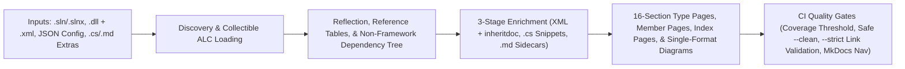

# Documentation.Exporter Documentation

> **Repository Entry Point:** [Project Overview, Quick Start, & Capabilities (`README.md`)](../README.md) · [License (MIT)](../LICENSE)

Welcome to the central documentation portal for **Documentation.Exporter** — a .NET 11 contracts base ([`Documentation.Exporter.Abstractions`](../src/Documentation.Exporter.Abstractions/Documentation.Exporter.Abstractions.csproj)), modular core engine ([`Documentation.Exporter.Core`](../src/Documentation.Exporter.Core/Documentation.Exporter.Core.csproj)), dynamic plugins ([`Documentation.Exporter.Plugins.Diagrams`](../src/Documentation.Exporter.Plugins.Diagrams/Documentation.Exporter.Plugins.Diagrams.csproj) and [`Documentation.Exporter.Plugins.Navigation.MkDocs`](../src/Documentation.Exporter.Plugins.Navigation.MkDocs/Documentation.Exporter.Plugins.Navigation.MkDocs.csproj)), cross-platform CLI tool ([`Documentation.Exporter.Cli`](../src/Documentation.Exporter.Cli/Documentation.Exporter.Cli.csproj)), and Docker-ready generator ([`Dockerfile`](../Dockerfile)) that exports C# XML documentation comments, compiled CLR reflection metadata, NuGet/project reference tables, transitive dependency trees, and extensible single-format diagrams into Microsoft Learn-styled MkDocs Markdown documentation.

---

## What Documentation.Exporter Does

Starting from either a C# solution (`.sln` / `.slnx`), a list of compiled `.dll` / `.xml` artifacts, or a portable `doc-exporter.json` file, the engine loads target binaries inside a collectible `AssemblyLoadContext`, extracts public API surfaces, merges compiler XML comments (`<inheritdoc/>` included), attaches external `.cs` snippet files and `.md` sidecar overrides, draws Mermaid or PlantUML diagrams, updates `mkdocs.nav.yml` in place, and verifies every generated relative hyperlink on disk.

---

## Choose Your Path

| Audience | Start Here | What You Will Learn |
| :--- | :--- | :--- |
| **Users & Technical Writers** | [User Documentation](user/index.md) | Choosing between `solution`/`assembly`/`config`, writing rich XML doc tags, demo examples, assembly references & dependency trees, diagrams, and MkDocs CI pipelines |
| **New Developers** | [Developer Onboarding & New Developer Guide](developer/onboarding.md) | Environment setup, repository anatomy, day-1 build & test commands, debugging locator map, first-contribution walkthrough, and analyzer guardrails |
| **Contributors & Maintainers** | [Developer Documentation](developer/index.md) | Coding mandates, DI setup, **9 dedicated functionality specifications** (including the plugin system), manual automation scripts ([`Run-DemoExport.ps1`](../scripts/manual/Run-DemoExport.ps1), [`Run-DemoExport-Docker.ps1`](../scripts/manual/Run-DemoExport-Docker.ps1), [`Run-CodeCoverage.ps1`](../scripts/manual/Run-CodeCoverage.ps1)), extensibility recipes, and testing |
| **Architects & Reviewers** | [Architecture Documentation](architectural/index.md) | System boundaries, complete functionality catalog, end-to-end runtime interactions, immutable domain models, and DI service lifetimes |

---

## Portal Navigation Map

```mermaid
flowchart TD
    Readme["Project Overview & Quick Start (README.md)"] --> Root["Documentation Portal (docs/index.md)"]
    Root --> Arch["Architecture (docs/architectural/)"]
    Root --> Dev["Developer Docs (docs/developer/)"]
    Root --> Funcs["Functionality Deep Dives (docs/developer/functionalities/)"]
    Root --> Usr["User Guide (docs/user/)"]

    Arch --> A1["Architecture Overview & Design Principles"]
    Arch --> A2["Functionality Catalog (9 Subsystem Domains)"]
    Arch --> A3[".NET & C# Language Support Matrix"]
    Arch --> A4["Component Interactions & Data Flow"]
    Arch --> A5["Domain Models, Enums, & DI Lifetimes"]

    Dev --> D1["Onboarding & New Developer Guide"]
    Dev --> D2["Coding Standards & DI Composition"]
    Dev --> D3["Extensibility Recipes (8 Seams)"]
    Dev --> D4["Testing & 90% Coverage Gates"]
    Dev --> D5["Scripts, Build, & Dockerfile"]
    Dev --> D6["Structured Logging & Localization"]

    Funcs --> F1["CLI & JSON Configuration"]
    Funcs --> F2["Solution & Artifact Discovery"]
    Funcs --> F3["Assembly Loading & Reflection"]
    Funcs --> F4["References & Dependency Tree"]
    Funcs --> F5["XML Parsing & Link Resolution"]
    Funcs --> F6["Enrichment, Snippets, & Overrides"]
    Funcs --> F7["Markdown & Single-Diagram Generation"]
    Funcs --> F8["MkDocs Nav, Quality Gates, & Resources"]
    Funcs --> F9["Plugin System & Abstractions SPI"]
```

---

## Complete Documentation Map

### Repository Entry Point

| Document | Description |
| :--- | :--- |
| [Project Overview & Quick Start (`README.md`)](../README.md) | Top-level repository landing page, capability summary, CLI & programmatic quick-start examples, and audience routing into this portal |
| [Contributing Guide (`CONTRIBUTING.md`)](../CONTRIBUTING.md) | PR workflow, local verification loop, `CI Gate` requirements, and release-note label conventions |
| [Security Policy (`SECURITY.md`)](../SECURITY.md) | Supported versions, private vulnerability reporting, and assembly/plugin operational security guidance |
| [Code of Conduct (`CODE_OF_CONDUCT.md`)](../CODE_OF_CONDUCT.md) | Contributor Covenant v2.1 community standards and reporting guidance |
| [MIT License (`LICENSE`)](../LICENSE) | Open-source license governing `Documentation.Exporter` |

### Architecture (`docs/architectural/`)

| Document | Description |
| :--- | :--- |
| [Architecture Overview](architectural/index.md) | System landscape diagram, layer dependency boundaries, design rationales, and architectural trade-offs |
| [Functionality Catalog](architectural/functionality-catalog.md) | Complete capability matrix mapping every feature to interfaces, classes, inputs, outputs, and its dedicated deep-dive specification |
| [.NET & C# Language Support Matrix](architectural/dotnet-language-support-matrix.md) | Itemized C# 1–14 & .NET SDK feature tracking table linked to functional descriptions, primary code entry points, and intentional exclusions |
| [Component Interactions & Data Flow](architectural/component-interactions.md) | Runtime sequence diagrams, plugin discovery handshake, 10-step [`ExportWorkflowContext`](../src/Documentation.Exporter.Abstractions/Workflow/ExportWorkflowContext.cs) state handoffs, parallel enrichment fan-out, and scoped isolation |
| [Domain Models, Strong Enums, & DI Lifetimes](architectural/domain-models-and-lifetimes.md) | Immutable `sealed record` domain contracts, class relationships, extensible [`DiagramFormat`](../src/Documentation.Exporter.Abstractions/Models/DiagramFormat.cs) / [`NavigationFormat`](../src/Documentation.Exporter.Abstractions/Models/NavigationFormat.cs) / [`QualityReportFormat`](../src/Documentation.Exporter.Abstractions/Models/QualityReportFormat.cs) & strong enums, DataAnnotations rules, and `Singleton`/`Scoped`/`Transient` lifetime boundaries |

### Developer Guide (`docs/developer/`)

| Document | Description |
| :--- | :--- |
| [Developer Documentation Hub](developer/index.md) | Developer learning path, links to all 9 dedicated functionality specifications, engineering guides, and scripts |
| [Developer Onboarding & New Developer Guide](developer/onboarding.md) | Day-1 setup, repository layout, build/test quickstart, debugging map, step-by-step first PR guide, and common compiler/style pitfalls |
| [Coding Standards, Mandates, & DI Setup](developer/coding-standards-and-di.md) | Zero-hardcoded-lists mandate, primary constructors, throw helpers, [`IFileSystem`](../src/Documentation.Exporter.Abstractions/IO/IFileSystem.cs) cross-platform rules, and modular DI container composition |
| [Extensibility Guide](developer/extensibility-guide.md) | Complete C# recipes for external plugin assemblies (`IDocumentationExporterPlugin`), custom workflow steps, enrichers, section renderers, XML handlers, diagram generators, namespace handlers, and CLI subcommands |
| [Testing Architecture & Code Coverage](developer/testing-and-coverage.md) | Mirrored test suite map, `AwesomeAssertions`/`FluentAssertions` defensive rules, virtual [`OverlayFileSystem`](../test/Documentation.Exporter.Core.Tests/Parsing/AssemblyReferenceAnalyzerTests.cs) testing, and `>= 90%` line/branch coverage enforcement |
| [Scripts, Build System, & Containerization](developer/scripts-and-automation.md) | Parameter and stage walkthroughs for [`Run-CodeCoverage.ps1`](../scripts/manual/Run-CodeCoverage.ps1), [`Run-DemoExport.ps1`](../scripts/manual/Run-DemoExport.ps1), [`Run-DemoExport-Docker.ps1`](../scripts/manual/Run-DemoExport-Docker.ps1), [`Dockerfile`](../Dockerfile), Central Package Management, MinVer Semantic Versioning ([`src/Directory.Build.props`](../src/Directory.Build.props)), and GitHub Actions workflows ([`.github/workflows/ci.yml`](../.github/workflows/ci.yml), [`.github/workflows/release.yml`](../.github/workflows/release.yml)) |
| [Structured Logging & Localization](developer/logging-and-localization.md) | `[LoggerMessage]` `EventId` component ranges (`100`–`1199`), logger switch, `.resx` resource bundles, and adding new UI cultures |

### Dedicated Functionality Deep-Dives (`docs/developer/functionalities/`)

| Functionality Domain | Deep-Dive Specification |
| :--- | :--- |
| **1. CLI Hosting & JSON Configuration** | [CLI Hosting, Subcommands, & JSON Configuration](developer/functionalities/cli-and-configuration.md) |
| **2. Solution & Build Artifact Discovery** | [Solution & Build Artifact Discovery](developer/functionalities/solution-and-artifact-discovery.md) |
| **3. Isolated Loading & Reflection** | [Isolated Assembly Loading, Reflection, & Cross-Assembly Indexing](developer/functionalities/assembly-loading-and-reflection.md) |
| **4. Assembly References & Dependency Tree** | [Assembly Reference & Transitive Dependency Tree Analysis](developer/functionalities/assembly-references-and-dependency-tree.md) |
| **5. XML Parsing & Type Link Resolution** | [XML Documentation Parsing, Tag Transformation, & Link Resolution](developer/functionalities/xml-parsing-and-link-resolution.md) |
| **6. Enrichment, Snippets, & Sidecars** | [Enrichment Pipeline, External Snippets, & Sidecar Overrides](developer/functionalities/enrichment-snippets-and-overrides.md) |
| **7. Markdown & Single-Diagram Selection** | [Markdown Emission, Section Renderers, & Single-Diagram Selection](developer/functionalities/markdown-and-diagram-generation.md) |
| **8. MkDocs Nav, Quality Gates, & Localization** | [MkDocs Navigation Merging, Quality Gates, & Localization](developer/functionalities/navigation-quality-gates-and-localization.md) |
| **9. Plugin Architecture & Abstractions SPI** | [Plugin Architecture, Isolation, & Abstractions Contract](developer/functionalities/plugin-system.md) |

### User Guide (`docs/user/`)

| Document | Description |
| :--- | :--- |
| [User Documentation Hub](user/index.md) | End-to-end user workflow, export mode selection guide, and guide navigation |
| [Getting Started & Demo Showcase](user/getting-started-and-demo.md) | Building the CLI, running the real [`demo/Documentation.Exporter.Demo.slnx`](../demo/Documentation.Exporter.Demo.slnx) showcase locally or in Docker, and exploring `.demo-output/` |
| [CLI Commands, Options, & JSON Configuration](user/cli-and-configuration.md) | `solution`, `assembly`, and `config` subcommands, full CLI flags, `doc-exporter.json` schema with the real demo config, and exit-code troubleshooting |
| [Authoring XML Documentation Comments](user/xml-documentation-authoring.md) | Enabling XML output, XML tag-to-Markdown reference, `<inheritdoc/>` resolution, `[Obsolete]`, custom attributes, generics, enums, and extension methods from the demo project |
| [AI Agent Command for Authoring C# Interface & API XML Documentation](user/ai-agent-documentation-command.md) | Copy-ready AI agent workflow/slash command (`document-interfaces.md`) for enriching another C# project's interfaces and contracts with rich XML documentation comments, examples, and remarks prior to running `Documentation.Exporter.Cli` |
| [Recommended AI Agent Rules for Any C# / .NET Project (`AGENTS.md`)](user/ai-agent-recommended-csharp-rules.md) | Universal, copy-ready `AGENTS.md` / `CLAUDE.md` / `.cursorrules` engineering rules template distilled from this repository's SOLID, DI-first, primary-constructor, defensive-testing, and documentation mandates |
| [External Examples, Sidecar Overrides, & External Links](user/examples-overrides-and-external-links.md) | `.cs` snippet files, visual anchor map of `.md` YAML-frontmatter sidecars across all 5 slots, and `{placeholder}` external link templates |
| [Diagrams, Assembly References, & Dependency Tree](user/diagrams-and-assembly-insights.md) | Single-diagram preference & fallback (`Mermaid`, `PlantUml`, `None`), the `## Assembly References` table, the transitive `## Assembly Dependency Tree`, and rendered demo outputs |
| [MkDocs Navigation, Quality Gates, & Linux/Docker CI](user/mkdocs-and-ci-integration.md) | Extending existing `mkdocs.yml`/`mkdocs.nav.yml` files idempotently, coverage & strict link gates, Linux usage, Docker execution, and localization |
