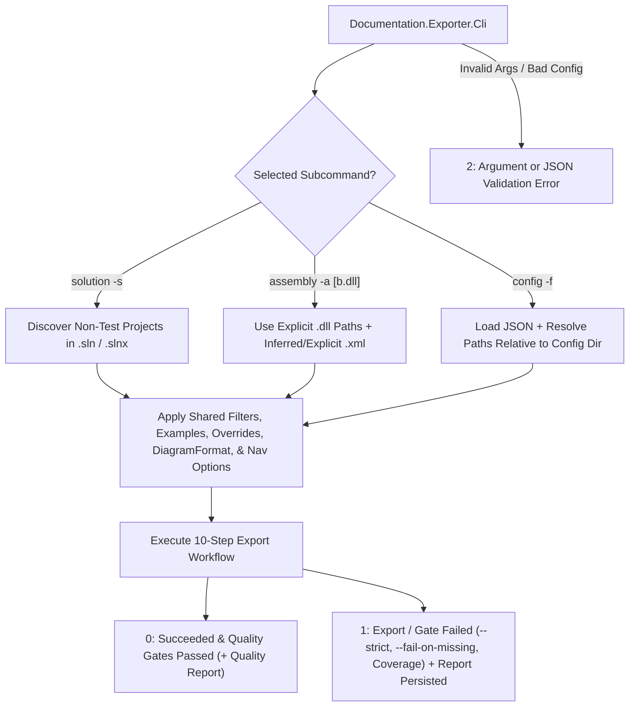

# CLI Commands, Options, & JSON Configuration

[`Documentation.Exporter.Cli`](../../src/Documentation.Exporter.Cli/Documentation.Exporter.Cli.csproj) supports three subcommands: `solution` ([`SolutionCliSubcommand`](../../src/Documentation.Exporter.Cli/SolutionCliSubcommand.cs)), `assembly` ([`AssemblyCliSubcommand`](../../src/Documentation.Exporter.Cli/AssemblyCliSubcommand.cs)), and `config` ([`ConfigCliSubcommand`](../../src/Documentation.Exporter.Cli/ConfigCliSubcommand.cs)).

---

## Subcommand Routing & Input Resolution



---

## 1. Subcommand Usage Examples

### Exporting a C# Solution (`solution`)

Discovers every non-test project in `.sln` or `.slnx`, correlates `.csproj` and `.deps.json` references, resolves cross-assembly links, and writes per-assembly subdirectories:

```powershell
.\build\bin\Documentation.Exporter.Cli\release\Documentation.Exporter.Cli.exe solution `
  --solution "demo\Documentation.Exporter.Demo.slnx" `
  --configuration Debug `
  --exclude "*.Tests" "*.Benchmarks" `
  --diagram-format Mermaid `
  --output ".demo-output" `
  --examples-dir "demo\Documentation.Exporter.DemoLibrary\docs_extra\examples" `
  --overrides-dir "demo\Documentation.Exporter.DemoLibrary\docs_extra\overrides" `
  --external-docs "Newtonsoft.Json=https://www.newtonsoft.com/json/help/html/T_{fullNameUnderscore}.htm" `
  --nav-file ".demo-output\mkdocs.nav.yml" `
  --nav-entry-point "Developer Portal/API Reference" `
  --strict `
  --report-file ".demo-output\quality-report.json" `
  --report-format Json `
  --log-level Information
```

### Exporting Explicit Assemblies (`assembly`)

Exports one or more compiled `.dll` files. If `--xml` is omitted, the tool automatically checks for a sibling `<AssemblyName>.xml` next to each `.dll`:

```powershell
.\build\bin\Documentation.Exporter.Cli\release\Documentation.Exporter.Cli.exe assembly `
  --assembly "build\bin\Documentation.Exporter.DemoContracts\debug\Documentation.Exporter.DemoContracts.dll" `
             "build\bin\Documentation.Exporter.DemoLibrary\debug\Documentation.Exporter.DemoLibrary.dll" `
  --xml "build\bin\Documentation.Exporter.DemoContracts\debug\Documentation.Exporter.DemoContracts.xml" `
        "build\bin\Documentation.Exporter.DemoLibrary\debug\Documentation.Exporter.DemoLibrary.xml" `
  --output ".demo-output" `
  --examples-dir "demo\Documentation.Exporter.DemoLibrary\docs_extra\examples" `
  --overrides-dir "demo\Documentation.Exporter.DemoLibrary\docs_extra\overrides" `
  --msdocs-url "https://learn.microsoft.com/en-us/dotnet/api/" `
  --log-level Information
```

### Exporting via Declarative JSON Configuration (`config`)

Execute directly against a checked-in `doc-exporter.json` file (all relative paths—including singular `assemblyFilePath`/`xmlDocumentationFilePath` and collection paths—are resolved against the **folder containing the JSON file**, not your current working directory, unknown/misspelled JSON properties are rejected with exit code `2`, and you can pass optional CLI flags like `--strict`, `--clean`, `--diagram-format`, or `--report-file` to override JSON settings in CI):

```powershell
.\build\bin\Documentation.Exporter.Cli\release\Documentation.Exporter.Cli.exe config `
  --config "demo\doc-exporter.demo.json" `
  --log-level Information
```

---

## 2. Declarative JSON Configuration (`demo/doc-exporter.demo.json`)

Here is the real configuration file shipped in [`demo/doc-exporter.demo.json`](../../demo/doc-exporter.demo.json) (deserialized into [`ExporterOptions`](../../src/Documentation.Exporter.Abstractions/Models/ExporterOptions.cs) by [`ExporterConfigurationLoader`](../../src/Documentation.Exporter.Core/Configuration/ExporterConfigurationLoader.cs)):

```json
{
  "solutionFilePath": "Documentation.Exporter.Demo.slnx",
  "solutionConfiguration": "Debug",
  "includeTestProjects": false,
  "excludedProjects": [
    "*.Tests",
    "*.Benchmarks"
  ],
  "diagramFormat": "Mermaid",
  "strictLinkValidation": true,
  "outputDirectoryPath": "../.demo-output",
  "examplesDirectoryPath": "Documentation.Exporter.DemoLibrary/docs_extra/examples",
  "overridesDirectoryPath": "Documentation.Exporter.DemoLibrary/docs_extra/overrides",
  "navigationFilePath": "../.demo-output/mkdocs.nav.yml",
  "navigationEntryPoint": "Developer Portal/API Reference",
  "reportFilePath": "../.demo-output/quality-report.json",
  "reportFormat": "Json",
  "microsoftDocsBaseUrl": "https://learn.microsoft.com/en-us/dotnet/api/",
  "externalDocLinkRules": [
    {
      "namespacePrefix": "Newtonsoft.Json",
      "urlTemplate": "https://www.newtonsoft.com/json/help/html/T_{fullNameUnderscore}.htm"
    }
  ]
}
```

### JSON Property Reference

| JSON Property | Type | Description |
| :--- | :--- | :--- |
| `solutionFilePath` | `string?` | Path to a `.sln` or `.slnx` solution file |
| `solutionConfiguration` | `string` | Build configuration (`"Debug"` or `"Release"`, default `"Debug"`) |
| `includeTestProjects` | `bool` | Include test projects when exporting a solution (default `false`) |
| `excludedProjects` | `string[]` | Project/assembly names or wildcard patterns (`"*.Tests"`, `"*.Benchmarks"`) to exclude |
| `assemblyFilePaths` | `string[]` | List of compiled `.dll` assembly paths (when `solutionFilePath` is omitted) |
| `xmlDocumentationFilePaths` | `string[]` | Matching `.xml` documentation paths (inferred from `.dll` when omitted) |
| `outputDirectoryPath` | `string` | Target directory where Markdown documentation will be written |
| `diagramFormat` | `string` | Preferred diagram generator (`"Mermaid"`, `"PlantUml"`, or `"None"`, default `"Mermaid"`); falls back only when unsupported |
| `cleanOutputDirectory` | `bool` | Purge stale `.md` and `.puml` files from output before export (default `false`) |
| `strictLinkValidation` | `bool` | Validate all generated relative links and heading `#anchor` fragments (ignoring code blocks/spans) and fail export if any target is missing (default `false`) |
| `reportFilePath` | `string?` | Optional output path for the structured quality & diagnostics report |
| `reportFormat` | `string` | Serialization format for `reportFilePath`: `"Json"` (default), `"Markdown"`, `"Sarif"`, or any custom plugin format name |
| `failOnMissingProjectArtifacts` | `bool` | Fail solution export if any included project lacks `.dll` or `.xml` artifacts (default `false`) |
| `failOnUndocumentedThreshold` | `double?` | Enforce minimum documentation coverage percentage (`0.0` – `100.0`) |
| `excludedTypes` | `string[]` | Type names or wildcard patterns (e.g. `"*Internal*"`) to exclude |
| `excludedNamespaces` | `string[]` | Namespace names or wildcard patterns (e.g. `"*.Migrations"`) to exclude |
| `excludeEditorBrowsableNever` | `bool` | Automatically exclude types/members with `[EditorBrowsable(EditorBrowsableState.Never)]` (default `true`) |
| `examplesDirectoryPath` | `string?` | Optional directory containing `.cs` example snippets |
| `overridesDirectoryPath` | `string?` | Optional directory containing `.md` sidecar overrides |
| `microsoftDocsBaseUrl` | `string` | Default fallback base URL for Microsoft Learn API links |
| `externalDocLinkRules` | `object[]` | Array of `{ "namespacePrefix": "...", "urlTemplate": "..." }` rules |
| `navigationFormat` | `string` | Target navigation generator format (`"MkDocs"` default, `"None"` to disable, or custom plugin format identifier) |
| `navigationFilePath` | `string?` | Target navigation manifest (such as `mkdocs.yml`, `mkdocs.nav.yml`, or plugin `DefaultFileName`) to generate or extend in-place |
| `navigationEntryPoint` | `string?` | Section path (`"Developer Portal/API Reference"`) or `# COMMENT-MARKER` target |
| `navigationUrlPrefix` | `string?` | Relative URL prefix prepended to generated links inside `nav:` (e.g. `"api"`) |

---

## 3. Complete CLI Subcommands & Options Reference

| Subcommand / Flag | Description | Required | Default |
| :--- | :--- | :--- | :--- |
| `solution` | Discover and export projects in a `.sln` or `.slnx` solution | | |
| `assembly` | Export one or more explicit `.dll` / `.xml` assemblies | | |
| `config` | Execute export from a `doc-exporter.json` configuration file | | |
| `-s, --solution` | Path to C# solution file (`.sln` or `.slnx`, on `solution`) | Yes (`solution`) | |
| `-c, --configuration` | Build configuration (`Debug` or `Release`, on `solution`) | No | `Debug` |
| `-t, --include-tests` | Include test projects when exporting a solution (`solution`) | No | `false` |
| `-a, --assembly` | One or more `.dll` paths (`assembly`, multiple allowed) | Yes (`assembly`) | |
| `-x, --xml` | One or more `.xml` paths (`assembly`, multiple allowed) | No | Sibling `.xml` |
| `-f, --config` | Path to JSON config file (`config`) | Yes (`config`) | |
| `-o, --output` | Target directory for generated Markdown files | Yes (`solution`/`assembly`) | |
| `--exclude` | Project/assembly wildcard patterns (`*`, `?`, multiple allowed) | No | |
| `--exclude-types` | Type wildcard patterns to exclude (multiple allowed) | No | |
| `--exclude-namespaces` | Namespace wildcard patterns to exclude (multiple allowed) | No | |
| `--exclude-editor-browsable-never` | Exclude types/members decorated with `[EditorBrowsable(EditorBrowsableState.Never)]` | No | `true` |
| `-e, --examples-dir` | Directory containing external `.cs` snippet files | No | |
| `-v, --overrides-dir` | Directory containing Markdown frontmatter sidecar `.md` overrides | No | |
| `-m, --msdocs-url` | Fallback base URL for Microsoft Learn API links | No | `https://learn.microsoft.com/en-us/dotnet/api/` |
| `-d, --external-docs` | Third-party link mappings (`Prefix=UrlTemplate`, multiple allowed) | No | |
| `-n, --nav-file` | Existing or target navigation manifest file to generate or extend | No | `<OutputDir>/<DefaultFileName>` (`mkdocs.nav.yml`) |
| `--nav-format` | Target navigation generator format (`MkDocs`, `None`, or custom plugin format identifier) | No | `MkDocs` |
| `-p, --nav-entry-point` | Section path (`"A/B"`) or `# COMMENT` marker inside `nav:` | No | |
| `-u, --nav-url-prefix` | Relative URL prefix prepended to YAML navigation links | No | |
| `-g, --diagram-format` | Preferred diagram generator (`Mermaid`, `PlantUml`, `None`, or custom plugin format identifier); falls back if unsupported | No | `Mermaid` |
| `--plugins-dir` | Directory containing external plugin `.dll` assemblies implementing `IDocumentationExporterPlugin` | No | `<AppDir>/plugins` |
| `--clean` | Remove existing `.md` and `.puml` files from output before generating | No | `false` |
| `--strict` | Fail export (`exit code 1`) if any relative Markdown link or `#anchor` is broken | No | `false` |
| `-r, --report-file` | Output file path for the documentation quality & diagnostics report | No | |
| `--report-format` | Quality report format (`Json`, `Markdown`, `Sarif`, or custom plugin format identifier) | No | `Json` |
| `--fail-on-missing` | Fail `solution` export (`exit code 1`) if an included project lacks `.dll` or `.xml` | No | `false` |
| `--fail-on-undocumented` | Minimum required coverage % (`0.0`–`100.0`); fails if coverage is lower | No | |
| `-l, --log-level` | Console log threshold (`Trace`, `Debug`, `Information`, `Warning`, `Error`, `Critical`, `None`) | No | `Information` |

---

## 4. Sample Console Output, Exit Codes, & Troubleshooting

Running the demo export logs structured progress telemetry:

```text
info: Documentation.Exporter.Cli.CliPipelineRunner[1001]
      Initializing Documentation Exporter Pipeline...
info: Documentation.Exporter.Core.DocumentationExporterEngine[301]
      Starting documentation export for target assembly: ./demo/Documentation.Exporter.Demo.slnx
info: Documentation.Exporter.Core.Workflow.ExportWorkflow[801]
      Starting documentation export workflow with 10 steps.
...
info: Documentation.Exporter.Core.Workflow.Steps.CalculateDocumentationCoverageStep[820]
      Documentation coverage: ...
info: Documentation.Exporter.Core.Workflow.Steps.EmitMarkdownDocumentationStep[817]
      Generated ... Markdown documentation files.
info: Documentation.Exporter.Core.Workflow.Steps.ValidateMarkdownLinksStep[832]
      Verified ... relative documentation links across ... generated Markdown files. No broken links detected.
info: Documentation.Exporter.Core.Workflow.Steps.EmitQualityReportStep[840]
      Documentation quality report (Json) written to: ...
info: Documentation.Exporter.Cli.CliPipelineRunner[1002]
      Documentation export completed successfully.
```

| Exit Code | Meaning & Common Fixes |
| :--- | :--- |
| **`0`** | Export succeeded and all quality gates (`--fail-on-missing`, `--fail-on-undocumented`, `--strict`) passed |
| **`1`** | Workflow failed: build the target solution first (`dotnet build`), verify `<GenerateDocumentationFile>true</GenerateDocumentationFile>` is present for missing `.xml` (`EventId` `815`/`814`), check `--fail-on-undocumented` threshold (`EventId` `821`), or fix broken links reported at `EventId` `831` |
| **`2`** | Invalid CLI arguments or config: verify `--external-docs` uses `Prefix=Template` format, verify the `--config` path exists, and ensure all required fields (`--output`, `--solution`/`--assembly`) are provided |
