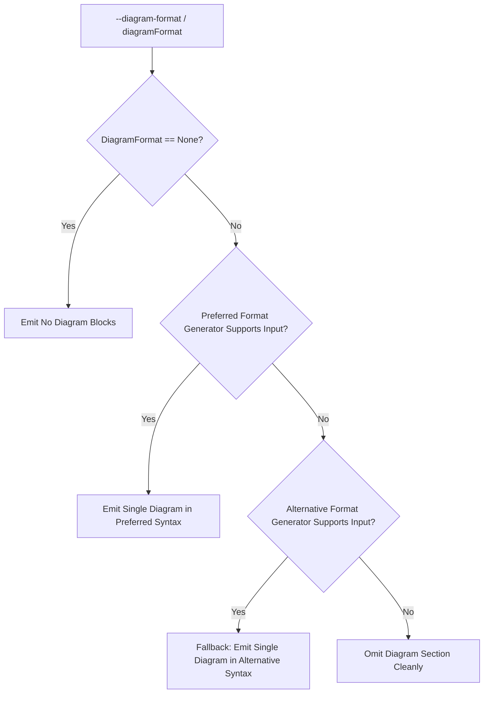
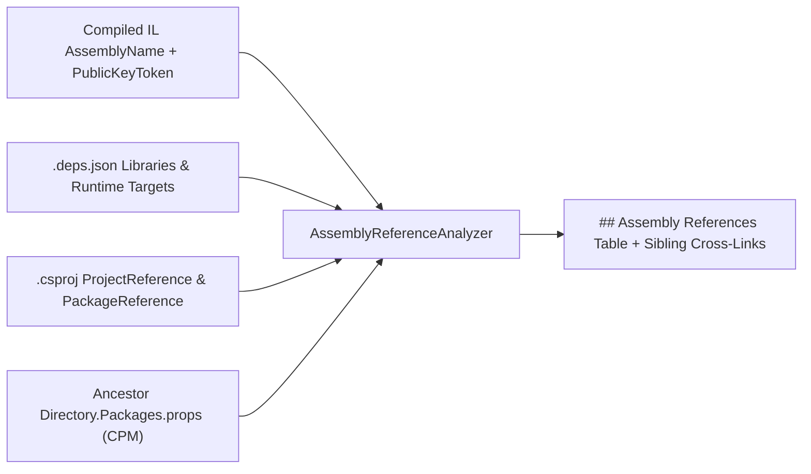
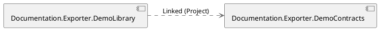
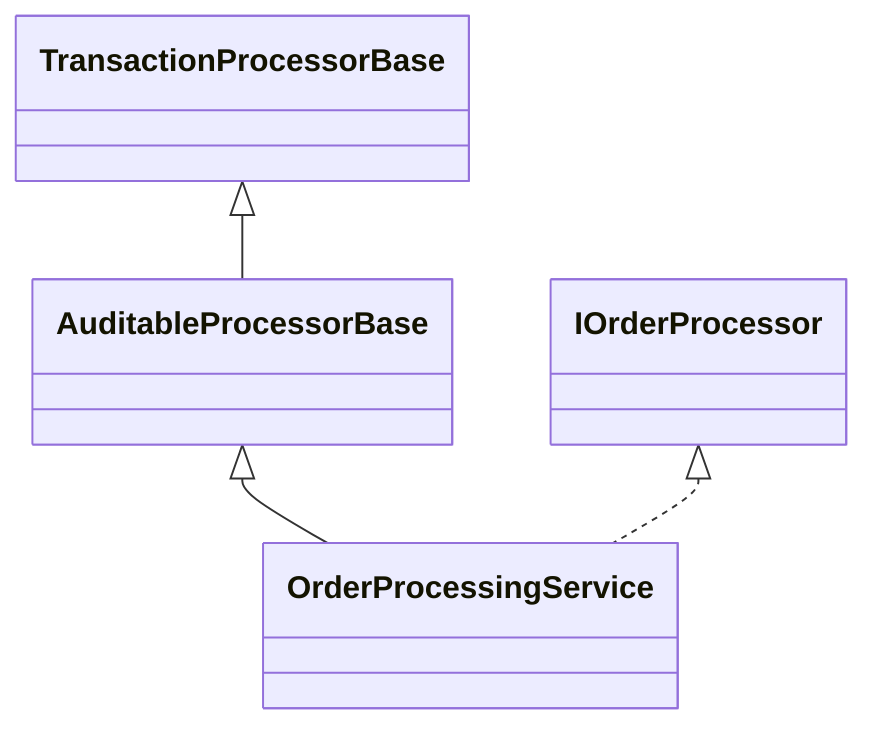

# Diagrams, Assembly References, & Dependency Tree

`Documentation.Exporter` automatically extracts hierarchy diagrams, assembly reference tables, and transitive dependency graphs. This guide shows how diagram selection works, how reference metadata is correlated across project/build files, and displays actual outputs generated from the [`demo/`](../../demo) showcase solution ([`Documentation.Exporter.Demo.slnx`](../../demo/Documentation.Exporter.Demo.slnx)).

---

## 1. Selecting a Preferred Diagram Generator (`--diagram-format`)

Pass `--diagram-format` (`-g`) on the CLI or `"diagramFormat"` in `doc-exporter.json` (corresponding to [`DiagramFormat`](../../src/Documentation.Exporter.Abstractions/Models/DiagramFormat.cs) selected via [`IDiagramGeneratorSelector`](../../src/Documentation.Exporter.Abstractions/Generation/Diagrams/IDiagramGeneratorSelector.cs)). Built-in generators are loaded dynamically from the `plugins/` subdirectory ([`Documentation.Exporter.Plugins.Diagrams`](../../src/Documentation.Exporter.Plugins.Diagrams/Documentation.Exporter.Plugins.Diagrams.csproj)); drop additional diagram plugin assemblies into `plugins/` (or specify `--plugins-dir <path>`) to support custom diagram formats without recompiling the CLI:

| Value | Behavior |
| :--- | :--- |
| **`Mermaid`** *(Default)* | Prefers Mermaid fenced code blocks (`classDiagram` for type/architecture diagrams, `flowchart LR` for dependency trees). Never emits duplicate PlantUML blocks alongside Mermaid. |
| **`PlantUml`** | Prefers PlantUML (`@startuml ... @enduml`) fenced code blocks and emits standalone `architecture.puml` files at the root and assembly directory levels. |
| **`None`** | Disables all automatic diagram generation across type and index pages with no fallback. |
| **`<CustomFormat>`** | Selects any third-party diagram generator matching the custom format name (for example `D2` or `Graphviz`) loaded from `plugins/` or `--plugins-dir`. |

### Single-Diagram Selection & Automatic Fallback

Only **one** diagram block is generated per section. If the preferred generator (`Mermaid` or `PlantUml`) does not support a diagram kind (`CanGenerate == false`), [`IDiagramGeneratorSelector`](../../src/Documentation.Exporter.Abstractions/Generation/Diagrams/IDiagramGeneratorSelector.cs) automatically falls back to another registered generator that supports it—preventing blank diagram sections without ever emitting duplicates:

---

## 2. `## Assembly References` Table (Assembly `index.md`)

To show accurate package policies rather than just compiled assembly versions, [`AssemblyReferenceAnalyzer`](../../src/Documentation.Exporter.Core/Parsing/AssemblyReferenceAnalyzer.cs) merges four inputs into each assembly's `## Assembly References` table:

- **Sibling Solution Cross-Linking**: If a referenced assembly is part of the same exported solution or multi-assembly run (for example [`Documentation.Exporter.DemoLibrary`](../../demo/Documentation.Exporter.DemoLibrary/Documentation.Exporter.DemoLibrary.csproj) referencing [`Documentation.Exporter.DemoContracts`](../../demo/Documentation.Exporter.DemoContracts/Documentation.Exporter.DemoContracts.csproj)), its `Reference` cell links directly to `../<AssemblyName>/index.md`.
- **Strong-Name Signing (`PublicKeyToken`)**: Displays `Yes (\`<PublicKeyToken>\`)` for strong-named references and `No` for unsigned references.

### Version Linking Policy Reference

| Policy Display | Meaning & Origin |
| :--- | :--- |
| **`Linked (Project)`** | Live sibling `<ProjectReference>` within the solution or `.deps.json` `"project"` reference |
| **`Fixed ([x.y.z])`** | Exact pinned NuGet bracket (`[1.2.3]`) or `<Reference SpecificVersion="true">` |
| **`Range ([a, b))`** | Bounded NuGet interval constraint (`[13.0.1, 14.0.0)`) |
| **`Minimum (>= x.y.z)`** | Standard NuGet package reference without upper bound or CPM `<PackageVersion>` |
| **`Floating (x.*)`** | Wildcard floating NuGet version pattern |
| **`Framework (netX.Y)`** | Target `.NET` BCL framework reference |
| **`Compiled`** | Bound assembly version from IL metadata when no project/package constraint applies |

**Real Generated Output from `build/.demo-output/Documentation.Exporter.DemoLibrary/index.md`:**

| Reference | Kind | Version | Version Linking | Strong-Named |
| :--- | :--- | :--- | :--- | :--- |
| `[Documentation.Exporter.DemoContracts](../Documentation.Exporter.DemoContracts/index.md)` | Project | `1.0.0.0` | Linked (Project) | No |
| `System.Collections` | Framework | `11.0.0.0` | Framework (`net11.0`) | Yes (`b03f5f7f11d50a3a`) |
| `System.ComponentModel.Annotations` | Framework | `11.0.0.0` | Framework (`net11.0`) | Yes (`b03f5f7f11d50a3a`) |
| `System.Runtime` | Framework | `11.0.0.0` | Framework (`net11.0`) | Yes (`b03f5f7f11d50a3a`) |
| `System.Threading` | Framework | `11.0.0.0` | Framework (`net11.0`) | Yes (`b03f5f7f11d50a3a`) |

---

## 3. `## Assembly Dependency Tree` (Assembly `index.md`)

On per-assembly `index.md` pages (and single-assembly root `index.md`, omitted on multi-assembly solution roots and on assemblies that have zero non-framework references such as [`DemoContracts`](../../demo/Documentation.Exporter.DemoContracts/Documentation.Exporter.DemoContracts.csproj)), `Documentation.Exporter` draws the **full transitive non-framework dependency tree**:

- **Scope**: Expands all solution `<ProjectReference>` links, `<PackageReference>` packages (including transitive `.deps.json` dependencies), and direct `<Reference>` binaries while excluding `.NET` BCL framework assemblies (`System.*`, `mscorlib`, `netstandard`, etc.).
- **Edge Labels**: Shows the version linking policy and version constraint on each arrow (for example `Linked (Project)`, `Range ([13.0.1, 14.0.0))`, `Minimum (>= 9.0.2)`, `Fixed ([9.0.2])`).
- **Color Distinction by Signing Status**:
  - **Strong-Named target assembly**: Solid green link (`#2E7D32`).
  - **Unsigned target assembly**: Dashed gray link (`#757575`).

**Real Generated Output from `build/.demo-output/Documentation.Exporter.DemoLibrary/index.md` (Default `Mermaid` Mode):**

*Legend: solid green link = strong-named assembly; dashed gray link = unsigned assembly.*

When `--diagram-format PlantUml` is used instead, the equivalent `@startuml` component diagram is emitted (solid green `-[#2E7D32,bold]->` vs. dashed gray `-[#757575,dashed]->`):

---

## 4. `## Architecture Diagram` & `## Type Diagram`

### Index Architecture Diagram

Root `index.md` (solution-wide) and each assembly `index.md` (scoped to that assembly) include an `## Architecture Diagram` grouping namespaces and plotting inheritance (`<|--`) and interface realization (`<|..`) edges. When `--diagram-format PlantUml` is active, standalone `architecture.puml` files are also written beside each `index.md`.

### Type Page Diagram (`OrderProcessingService`)

Each non-enum type with base classes, implemented interfaces, or derived types renders a **`## Type Diagram`** block directly beneath `## Implemented Interfaces`.

**Real Generated Output from `build/.demo-output/Documentation.Exporter.DemoLibrary/Services/OrderProcessingService/index.md`:**

