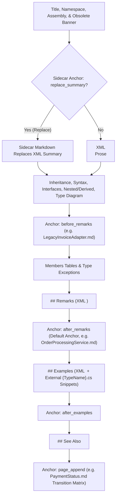
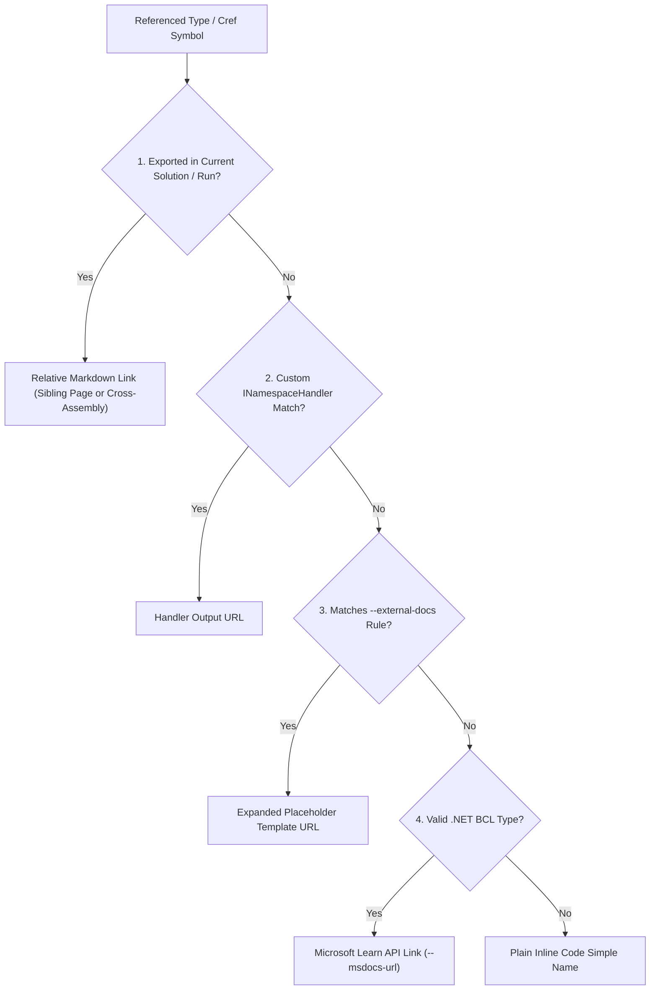

# External Code Examples, Sidecar Overrides, & External Links

Beyond compiler XML comments, `Documentation.Exporter` lets technical writers attach runnable `.cs` examples, Markdown callouts/tables, and third-party API link mappings without recompiling assemblies. All examples below come directly from [`demo/Documentation.Exporter.DemoLibrary/docs_extra/`](../../demo/Documentation.Exporter.DemoLibrary/docs_extra) and [`demo/doc-exporter.demo.json`](../../demo/doc-exporter.demo.json).

---

## Where External Examples & Sidecar Anchors Appear

Every generated type overview page (`index.md`) renders sections in a fixed sequence so sidecar `.md` blocks and `.cs` snippet files slot predictably around generated API tables:



---

## 1. External C# Code Snippets (`--examples-dir`)

Pass `--examples-dir` (or `"examplesDirectoryPath"` in `doc-exporter.json`) pointing to a folder containing `.cs` snippet files handled by [`FileExampleProvider`](../../src/Documentation.Exporter.Core/Injection/FileExampleProvider.cs) organized by clean type and member names (namespace and generic `` `1 `` suffixes removed):

| Target Scope | Expected File Path | Real Demo File |
| :--- | :--- | :--- |
| **Type Overview (`index.md`)** | `{ExamplesDir}/{TypeName}.cs` | [`demo/.../docs_extra/examples/OrderProcessingService.cs`](../../demo/Documentation.Exporter.DemoLibrary/docs_extra/examples/OrderProcessingService.cs) |
| **Specific Member (`.md`)** | `{ExamplesDir}/{TypeName}/{MemberName}.cs` | [`demo/.../docs_extra/examples/OrderProcessingService/ProcessOrderAsync.cs`](../../demo/Documentation.Exporter.DemoLibrary/docs_extra/examples/OrderProcessingService/ProcessOrderAsync.cs) |

*(Lookups fall back to case-insensitive directory/file matching so Windows-authored files resolve cleanly on Linux and Docker containers.)*

### Demo Example: Type Snippet (`OrderProcessingService.cs`)

[`demo/Documentation.Exporter.DemoLibrary/docs_extra/examples/OrderProcessingService.cs`](../../demo/Documentation.Exporter.DemoLibrary/docs_extra/examples/OrderProcessingService.cs):

```csharp
// External snippet injected from docs_extra/examples/OrderProcessingService.cs
var orderService = new OrderProcessingService("AdyenEnterprise")
{
    RequireManualApprovalForHighValue = true
};

orderService.OrderStatusChanged += (_, eventArgs) =>
    Console.WriteLine($"Order {eventArgs.OrderIdentifier} transitioned to {eventArgs.UpdatedStatus}");
```

### Demo Example: Member Snippet (`OrderProcessingService/ProcessOrderAsync.cs`)

[`demo/Documentation.Exporter.DemoLibrary/docs_extra/examples/OrderProcessingService/ProcessOrderAsync.cs`](../../demo/Documentation.Exporter.DemoLibrary/docs_extra/examples/OrderProcessingService/ProcessOrderAsync.cs):

```csharp
// External member-level snippet injected from docs_extra/examples/OrderProcessingService/ProcessOrderAsync.cs
using var cancellationSource = new CancellationTokenSource(TimeSpan.FromSeconds(30));
var finalStatus = await orderService.ProcessOrderAsync(
    new OrderRequest
    {
        OrderIdentifier = "ORD-2026-999",
        CustomerEmail = "enterprise@example.com",
        TotalAmount = new MonetaryValue(25_000m, "EUR")
    },
    cancellationSource.Token);
```

These snippets are appended alongside XML `<example>` blocks under **`## Examples`** on `OrderProcessingService/index.md` and **`### Examples`** on `OrderProcessingService/ProcessOrderAsync.md`.

---

## 2. Sidecar Markdown Overrides (`--overrides-dir`)

Pass `--overrides-dir` (or `"overridesDirectoryPath"` in `doc-exporter.json`) to inject rich Markdown blocks (alerts, migration matrices, architecture notes) into `{OverridesDir}/{TypeName}.md` for type pages or `{OverridesDir}/{TypeName}.{MemberName}.md` for member detail pages using [`FileDocumentationInjector`](../../src/Documentation.Exporter.Core/Injection/FileDocumentationInjector.cs) YAML frontmatter ([`InjectionMode`](../../src/Documentation.Exporter.Abstractions/Models/InjectionMode.cs), [`SidecarAnchor`](../../src/Documentation.Exporter.Abstractions/Models/SidecarAnchor.cs)):

```markdown
---
injection_mode: extend # extend (default) | replace (replace honored at replace_summary)
target_anchor: after_remarks # replace_summary | before_remarks | after_remarks | after_examples | page_append
---
```

- **`extend`** *(default)*: Emits your Markdown in the chosen positional anchor without replacing built-in XML text.
- **`replace`**: Replaces the built-in summary when paired with `target_anchor: replace_summary`. *(When frontmatter is omitted completely, files default to `extend` at `after_remarks`.)*

### Anchor Points Demonstrated in `demo/Documentation.Exporter.DemoLibrary/docs_extra/overrides/`

#### `before_remarks` (`LegacyInvoiceAdapter.md`)

[`LegacyInvoiceAdapter.md`](../../demo/Documentation.Exporter.DemoLibrary/docs_extra/overrides/LegacyInvoiceAdapter.md) injects a deprecation notice right before `## Remarks`:

```markdown
---
injection_mode: extend
target_anchor: before_remarks
---

> [!WARNING]
> **Sidecar Migration Notice (`before_remarks`)**: `LegacyInvoiceAdapter` is deprecated in favor of `OrderProcessingService`. Use this adapter only when migrating historical ERP invoice codes.
```

#### `after_remarks` (`OrderProcessingService.md`)

[`OrderProcessingService.md`](../../demo/Documentation.Exporter.DemoLibrary/docs_extra/overrides/OrderProcessingService.md) places an operational rule note after `## Remarks`:

```markdown
---
injection_mode: extend
target_anchor: after_remarks
---

> [!IMPORTANT]
> **Sidecar Override (`after_remarks`)**: High-value orders exceeding `MaxInstantSettlementThreshold` (`10,000.00`) are held in the `Authorized` state until a compliance officer approves settlement.
```

#### `page_append` (`PaymentStatus.md`)

[`PaymentStatus.md`](../../demo/Documentation.Exporter.DemoLibrary/docs_extra/overrides/PaymentStatus.md) appends a full state transition table at the bottom of the enum's page:

```markdown
---
injection_mode: extend
target_anchor: page_append
---

## State Transition Matrix (Sidecar `page_append`)

| From State | To State | Trigger |
| :--- | :--- | :--- |
| `Pending` | `Authorized` | Gateway reserve succeeded |
| `Authorized` | `Settled` | Capture completed |
| `Pending` | `Declined` | Issuer rejected authorization |
```

---

## 3. Third-Party External Documentation Links (`--external-docs`)

When `<see cref="..."/>`, method parameters, return types, or base classes reference external symbols, `Documentation.Exporter` resolves targets through a deterministic priority cascade:



When referencing third-party NuGet libraries (such as `Newtonsoft.Json` or `Serilog`), map namespace prefixes to custom URL templates using `--external-docs` on the CLI or `"externalDocLinkRules"` ([`ExternalDocLinkRule`](../../src/Documentation.Exporter.Abstractions/Models/ExternalDocLinkRule.cs), [`PatternNamespaceHandler`](../../src/Documentation.Exporter.Core/Resolution/PatternNamespaceHandler.cs)) in `doc-exporter.json`:

```powershell
--external-docs "Newtonsoft.Json=https://www.newtonsoft.com/json/help/html/T_{fullNameUnderscore}.htm"
```

*(As configured in [`demo/doc-exporter.demo.json`](../../demo/doc-exporter.demo.json).)*

### Supported URL Template Placeholders

| Placeholder | Example Input (`Newtonsoft.Json.JsonConvert`) | Expanded Output |
| :--- | :--- | :--- |
| `{fullName}` | `Newtonsoft.Json.JsonConvert` | `Newtonsoft.Json.JsonConvert` |
| `{fullNameLower}` | `Newtonsoft.Json.JsonConvert` | `newtonsoft.json.jsonconvert` |
| `{fullNameUnderscore}` | `Newtonsoft.Json.JsonConvert` | `Newtonsoft_Json_JsonConvert` |
| `{fullNameSlash}` | `Newtonsoft.Json.JsonConvert` | `Newtonsoft/Json/JsonConvert` |
| `{namespace}` | `Newtonsoft.Json` | `Newtonsoft.Json` |
| `{namespaceLower}` | `Newtonsoft.Json` | `newtonsoft.json` |
| `{namespaceSlash}` | `Newtonsoft.Json` | `Newtonsoft/Json` |
| `{name}` | `JsonConvert` | `JsonConvert` |
| `{nameLower}` | `JsonConvert` | `jsonconvert` |
