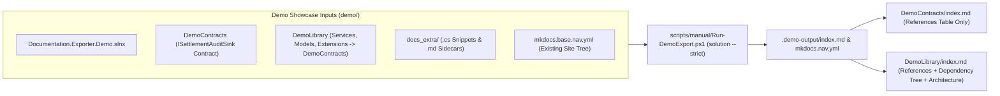

# Getting Started & Demo Showcase

This repository includes a complete multi-project showcase solution ([`demo/Documentation.Exporter.Demo.slnx`](../../demo/Documentation.Exporter.Demo.slnx)) so you can run `Documentation.Exporter` out of the box and inspect real generated documentation in `.demo-output/`.

---

## Demo Solution Architecture & Export Flow



---

## 1. Prerequisites & Building the CLI

- Install the **.NET 11 SDK**.
- Build the CLI executable ([`Documentation.Exporter.Cli.csproj`](../../src/Documentation.Exporter.Cli/Documentation.Exporter.Cli.csproj)) into `build/bin/Documentation.Exporter.Cli/`:

```powershell
dotnet build src/Documentation.Exporter.Cli/Documentation.Exporter.Cli.csproj -c Release
```

The standalone executable lands at:
- **Windows**: `.\build\bin\Documentation.Exporter.Cli\release\Documentation.Exporter.Cli.exe`
- **Linux / macOS**: `./build/bin/Documentation.Exporter.Cli/release/Documentation.Exporter.Cli`

---

## 2. Running the Included Demo Showcase

### Option A: Local Execution (`scripts/manual/Run-DemoExport.ps1`)

[`scripts/manual/Run-DemoExport.ps1`](../../scripts/manual/Run-DemoExport.ps1) builds both [`demo/Documentation.Exporter.Demo.slnx`](../../demo/Documentation.Exporter.Demo.slnx) and [`Documentation.Exporter.Cli`](../../src/Documentation.Exporter.Cli/Documentation.Exporter.Cli.csproj), copies [`demo/mkdocs.base.nav.yml`](../../demo/mkdocs.base.nav.yml), and exports the full demo documentation set into `.demo-output/` using `--diagram-format Mermaid` by default:

```powershell
# Default Debug showcase with Mermaid diagrams
powershell -ExecutionPolicy Bypass -File scripts/manual/Run-DemoExport.ps1

# Switch preferred diagram generator to PlantUML (also emits standalone architecture.puml files)
powershell -ExecutionPolicy Bypass -File scripts/manual/Run-DemoExport.ps1 -DiagramFormat PlantUml
```

### Option B: Containerized Docker Execution (`scripts/manual/Run-DemoExport-Docker.ps1`)

[`scripts/manual/Run-DemoExport-Docker.ps1`](../../scripts/manual/Run-DemoExport-Docker.ps1) runs the same showcase inside an isolated Linux container built from [`Dockerfile`](../../Dockerfile):

```powershell
powershell -ExecutionPolicy Bypass -File scripts/manual/Run-DemoExport-Docker.ps1
# Or with explicit PlantUML preference:
powershell -ExecutionPolicy Bypass -File scripts/manual/Run-DemoExport-Docker.ps1 -DiagramFormat PlantUml
```

*(For all parameters on both scripts, see [Scripts, Build System, & Containerization](../developer/scripts-and-automation.md).)*

---

## 3. Inside the Demo Project (`demo/`)

The demo solution illustrates multi-assembly documentation generation, cross-assembly contracts, XML tags, snippets, sidecar overrides, external links, and MkDocs navigation merging:

| Demo File / Folder | Purpose & Demonstrated Features |
| :--- | :--- |
| [`demo/Documentation.Exporter.Demo.slnx`](../../demo/Documentation.Exporter.Demo.slnx) | Solution linking [`Documentation.Exporter.DemoContracts`](../../demo/Documentation.Exporter.DemoContracts/Documentation.Exporter.DemoContracts.csproj) and [`Documentation.Exporter.DemoLibrary`](../../demo/Documentation.Exporter.DemoLibrary/Documentation.Exporter.DemoLibrary.csproj) |
| [`demo/doc-exporter.demo.json`](../../demo/doc-exporter.demo.json) | Portable JSON configuration file (used by the `config` subcommand and [`MultiAssemblyAndSolutionEndToEndTests`](../../test/Documentation.Exporter.Core.Tests/Integration/MultiAssemblyAndSolutionEndToEndTests.cs)) |
| [`demo/mkdocs.base.nav.yml`](../../demo/mkdocs.base.nav.yml) | Existing MkDocs YAML template whose `Developer Portal/API Reference` node is extended in-place |
| [`demo/Documentation.Exporter.DemoContracts/Auditing/ISettlementAuditSink.cs`](../../demo/Documentation.Exporter.DemoContracts/Auditing/ISettlementAuditSink.cs) | Contract interface implemented across assemblies by [`CrossAssemblyAuditReporter`](../../demo/Documentation.Exporter.DemoLibrary/Auditing/CrossAssemblyAuditReporter.cs) |
| [`demo/Documentation.Exporter.DemoLibrary/Diagnostics/TagShowcaseProcessor.cs`](../../demo/Documentation.Exporter.DemoLibrary/Diagnostics/TagShowcaseProcessor.cs) | Exercises `<remarks>`, `<para>`, `<list type="bullet|number|table">` with `<listheader>`/`<term>`, `<note type="tip">`, indented `<code language="json">`, multi-`<example>` blocks, type-level `<exception>`, `<seealso>`, custom-label `<see cref="...">label</see>`, overloaded `FormatResult(...)` `cref` routing, and primary constructor inheritance |
| [`demo/Documentation.Exporter.DemoLibrary/Services/OrderProcessingService.cs`](../../demo/Documentation.Exporter.DemoLibrary/Services/OrderProcessingService.cs) | Overloaded constructors/methods, `async`, `CancellationToken`, `IAsyncEnumerable<OrderRequest>` + `[EnumeratorCancellation]`, `in`/`out`/`params`/default modifiers, events, `<inheritdoc/>`, [`[StabilityTier("Stable")]`](../../demo/Documentation.Exporter.DemoLibrary/Attributes/StabilityTierAttribute.cs) on class, constructor, field (`MaxInstantSettlementThreshold`), event (`OrderStatusChanged`), method (`ProcessOrderAsync`), `[Required]` constructor parameter, and `[return: StabilityTier("Stable")]` |
| [`demo/Documentation.Exporter.DemoLibrary/Models/`](../../demo/Documentation.Exporter.DemoLibrary/Models) | [`AuditableEnvelope<TPayload>`](../../demo/Documentation.Exporter.DemoLibrary/Models/AuditableEnvelope.cs) generic type/method constraints + `[StabilityTier]` on type/method generic parameters (`TPayload`, `TMetric`), multi-level nested [`OrderRequest.ItemLine.TaxBreakdown`](../../demo/Documentation.Exporter.DemoLibrary/Models/OrderRequest.cs) record chain, [`PaymentStatus`](../../demo/Documentation.Exporter.DemoLibrary/Models/PaymentStatus.cs) enum (including `[Display]` on `Pending`), [`MonetaryValue`](../../demo/Documentation.Exporter.DemoLibrary/Models/MonetaryValue.cs) `readonly struct` |
| [`demo/Documentation.Exporter.DemoLibrary/ModernCSharp/ModernCSharpShowcase.cs`](../../demo/Documentation.Exporter.DemoLibrary/ModernCSharp/ModernCSharpShowcase.cs) | Comprehensive C# 9–14 showcase: C# 14 `extension(...)` blocks (`OrderRequestModernExtensions` instance & static extension properties/methods) and `field` accessors (`SettlementLedger`), unsealed `record` + `required`/`init` + primary/secondary constructor overloads (`SettlementRecordBase`), `readonly record struct` (`CurrencyPair`), `readonly ref struct` (`OrderSpanReader`), `allows ref struct` + `params ReadOnlySpan<string>` (`SpanFormatter`), `static abstract`/`static virtual` (`ISettlementMetric<TSelf>`), covariant/contravariant generic delegate & `notnull` interface (`SettlementTransformHandler<in TInput, out TOutput>`, `IMetricConverter<in TSource, out TResult>`), `[Experimental("DEMO001")]` callout banners (`ExperimentalSettlementPreview`, `CombineScopedTag`), `scoped ref readonly`, `checked` / compound `+=` operators, indexers `this[...]`, NRT `?` annotations, and `protected internal` members |
| [`demo/Documentation.Exporter.DemoLibrary/Extensions/OrderRequestExtensions.cs`](../../demo/Documentation.Exporter.DemoLibrary/Extensions/OrderRequestExtensions.cs) | Extension methods discovered across assemblies ([`OrderRequest`](../../demo/Documentation.Exporter.DemoLibrary/Models/OrderRequest.cs) and [`ISettlementAuditSink`](../../demo/Documentation.Exporter.DemoContracts/Auditing/ISettlementAuditSink.cs)) |
| [`demo/Documentation.Exporter.DemoLibrary/Adapters/LegacyInvoiceAdapter.cs`](../../demo/Documentation.Exporter.DemoLibrary/Adapters/LegacyInvoiceAdapter.cs) | `[Obsolete]` warning banners with `DiagnosticId = "DEMO002"` + `UrlFormat` (on type) and `DiagnosticId = "DEMO003"` (on `NormalizeInvoiceCode`), plus `before_remarks` sidecar override |
| [`demo/Documentation.Exporter.DemoLibrary/docs_extra/examples/`](../../demo/Documentation.Exporter.DemoLibrary/docs_extra/examples) | External `.cs` code snippets for [`OrderProcessingService`](../../demo/Documentation.Exporter.DemoLibrary/docs_extra/examples/OrderProcessingService.cs) and [`OrderProcessingService.ProcessOrderAsync`](../../demo/Documentation.Exporter.DemoLibrary/docs_extra/examples/OrderProcessingService/ProcessOrderAsync.cs) |
| [`demo/Documentation.Exporter.DemoLibrary/docs_extra/overrides/`](../../demo/Documentation.Exporter.DemoLibrary/docs_extra/overrides) | Markdown frontmatter sidecar overrides ([`OrderProcessingService.md`](../../demo/Documentation.Exporter.DemoLibrary/docs_extra/overrides/OrderProcessingService.md), [`PaymentStatus.md`](../../demo/Documentation.Exporter.DemoLibrary/docs_extra/overrides/PaymentStatus.md), [`LegacyInvoiceAdapter.md`](../../demo/Documentation.Exporter.DemoLibrary/docs_extra/overrides/LegacyInvoiceAdapter.md)) |

---

## 4. What Gets Generated in `.demo-output/`

After running [`scripts/manual/Run-DemoExport.ps1`](../../scripts/manual/Run-DemoExport.ps1), `.demo-output/` has this MkDocs-ready layout (**164** Markdown files, **952** verified relative links & heading anchors under `--strict`, **94.6%** documentation coverage across **32** exported types, plus `quality-report.json`):

```text
.demo-output/
├── index.md                                   # Root solution index + solution Architecture Diagram
├── mkdocs.nav.yml                             # Extended navigation under Developer Portal -> API Reference
├── quality-report.json                        # Structured quality & diagnostics report (DOC001–DOC007)
├── Documentation.Exporter.DemoContracts/
│   ├── index.md                               # Assembly overview + Assembly References table (no non-framework tree)
│   └── Auditing/ISettlementAuditSink/
│       ├── index.md                           # Interface overview + Extension Methods + Known Implementations
│       ├── SinkChannelName.md
│       └── WriteAuditEvent.md
└── Documentation.Exporter.DemoLibrary/
    ├── index.md                               # Assembly overview + Assembly References + Assembly Dependency Tree + Architecture Diagram
    ├── Diagnostics/TagShowcaseProcessor/
    │   ├── index.md                           # Tables, > [!TIP] alerts, json fence, custom <see> labels, overloaded FormatResult
    │   └── ... (member .md pages)
    ├── Models/OrderRequest/ItemLine/TaxBreakdown/
    │   └── index.md                           # 3-level nested DeclaringTypeChain hierarchy
    ├── ModernCSharp/
    │   ├── SettlementLedger/                  # Primary+secondary ctors, indexer this[...], operators, [Experimental], scoped, field
    │   ├── SettlementRecordBase/              # Unsealed record + required/init
    │   ├── CurrencyPair/                      # readonly record struct
    │   ├── OrderSpanReader/                   # readonly ref struct
    │   ├── OrderRequestModernExtensions/      # C# 14 extension(...) blocks (instance + static properties & methods)
    │   └── ...                                # ISettlementMetric, IMetricConverter, SpanFormatter, ExperimentalSettlementPreview, SettlementTransformHandler
    └── Services/OrderProcessingService/
        ├── index.md
        ├── ProcessOrder_OrderRequest.md       # Overload-disambiguated filenames
        ├── ProcessOrder_String_Decimal.md
        └── ...
```

### Guided Walkthrough of Key Emitted Files

- **`.demo-output/index.md`**: Links directly to `Documentation.Exporter.DemoContracts/index.md` and `Documentation.Exporter.DemoLibrary/index.md`, paired with a solution-wide `## Architecture Diagram`.
- **`.demo-output/quality-report.json`**: Machine-readable quality summary reporting symbol coverage, verified links count, severity tallies, and structured `DOC001`–`DOC007` findings.
- **`.demo-output/Documentation.Exporter.DemoContracts/index.md`**: Shows `## Assembly References` containing only `.NET` framework assemblies (`net11.0`), so `## Assembly Dependency Tree` is omitted cleanly.
- **`.demo-output/Documentation.Exporter.DemoLibrary/index.md`**: Links `Documentation.Exporter.DemoContracts` directly across assemblies inside `## Assembly References`, and renders `## Assembly Dependency Tree` showing the `Linked (Project)` arrow.
- **`.demo-output/Documentation.Exporter.DemoContracts/Auditing/ISettlementAuditSink/index.md`**: Even though `DemoContracts` does not depend on `DemoLibrary`, cross-assembly indexing automatically lists `CrossAssemblyAuditReporter` under `## Known Implementations` and `TryWriteVerifiedAudit` under `## Extension Methods`.

Continue to [CLI Commands, Options, & JSON Configuration](cli-and-configuration.md) to run the exporter against your own solutions, or grab the [AI Agent Command for Authoring C# Interface & API XML Documentation](ai-agent-documentation-command.md) to have an AI coding agent document your project's interfaces and public API contracts before exporting.
