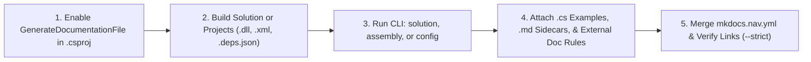

# User Guide

`Documentation.Exporter` transforms compiled .NET 11 assemblies and compiler XML documentation comments into Microsoft Learn-styled MkDocs Markdown documentation, complete with cross-assembly links, Mermaid or PlantUML diagrams, assembly reference & dependency insights, external code examples, sidecar Markdown overrides, and automated link validation.

---

## End-to-End User Workflow

1. **Enable XML Documentation** in your `.csproj` files (`<GenerateDocumentationFile>true</GenerateDocumentationFile>`) and author C# XML doc comments (or use the ready-made [AI Agent Command for Authoring C# Interface & API XML Documentation](ai-agent-documentation-command.md) to have an AI coding agent document your interfaces and contracts automatically).
2. **Build your solution or project(s)** so `.dll`, `.xml`, and `.deps.json` artifacts exist on disk.
3. **Run the exporter CLI** ([`Documentation.Exporter.Cli`](../../src/Documentation.Exporter.Cli/Documentation.Exporter.Cli.csproj)) using the mode matching your workflow.
4. *(Optional)* Enrich pages with external `.cs` snippet files (`--examples-dir`), `.md` frontmatter sidecar overrides (`--overrides-dir`), third-party external API doc mappings (`--external-docs`), and existing `mkdocs.yml` navigation injection (`--nav-file`).

---

## Choosing Your Export Mode

| Mode | Best For | Key Advantage |
| :--- | :--- | :--- |
| **`solution`** | Multi-project `.sln` or `.slnx` repositories | Automatically discovers non-test projects, reads `<ProjectReference>`/`<PackageReference>`/CPM metadata, emits per-assembly folders, and cross-links sibling assemblies |
| **`assembly`** | Standalone NuGet/SDK `.dll` binaries without a solution file | Targets explicit compiled `.dll`/`.xml` paths directly (infers sibling `.xml` automatically when `--xml` is omitted) |
| **`config`** | Reproducible CI/CD builds and team-shared settings | Stores all options in a checked-in `doc-exporter.json` (like [`demo/doc-exporter.demo.json`](../../demo/doc-exporter.demo.json)) where paths resolve relative to the config file |

---

## User Guides Map

| Guide | What You Will Learn |
| :--- | :--- |
| [Getting Started & Demo Showcase](getting-started-and-demo.md) | Building the CLI ([`Documentation.Exporter.Cli`](../../src/Documentation.Exporter.Cli/Documentation.Exporter.Cli.csproj)), running the real [`demo/`](../../demo) solution showcase ([`Documentation.Exporter.Demo.slnx`](../../demo/Documentation.Exporter.Demo.slnx)) locally or in Docker, and exploring the generated `build/.demo-output/` tree |
| [CLI Commands, Options, & JSON Configuration](cli-and-configuration.md) | `solution`, `assembly`, and `config` usage, full option reference ([`ExporterOptions`](../../src/Documentation.Exporter.Abstractions/Models/ExporterOptions.cs)), `doc-exporter.json` properties backed by [`demo/doc-exporter.demo.json`](../../demo/doc-exporter.demo.json), console logs, exit codes, and troubleshooting |
| [Authoring XML Documentation Comments](xml-documentation-authoring.md) | Every supported XML tag, `<inheritdoc/>` resolution, `[Obsolete]`, `[StabilityTier]`, generics, extension methods, nested types, and enum tables with real C# examples from [`Documentation.Exporter.DemoLibrary`](../../demo/Documentation.Exporter.DemoLibrary/Documentation.Exporter.DemoLibrary.csproj) |
| [AI Agent Command for Authoring C# Interface & API XML Documentation](ai-agent-documentation-command.md) | Copy-ready AI agent workflow/slash command (`document-interfaces.md`) for Antigravity, Claude Code, and GitHub Copilot to automatically enrich another C# project's interfaces and public contracts with detailed `
`, `<remarks>`, `<example>`, `<param>`, `<returns>`, `<exception>`, and `<see>` tags |
| [Recommended AI Agent Rules for Any C# / .NET Project (`AGENTS.md`)](ai-agent-recommended-csharp-rules.md) | Project-agnostic, copy-ready `AGENTS.md` / `CLAUDE.md` / `.cursorrules` engineering rules template covering SOLID, DI-first, primary constructors, defensive testing, early returns, descriptive naming, and documentation sync for any C# repository |
| [External Examples, Sidecar Overrides, & External Links](examples-overrides-and-external-links.md) | Injecting `.cs` snippet files, visual page layout of `.md` YAML-frontmatter sidecar blocks across all 5 anchors ([`SidecarAnchor`](../../src/Documentation.Exporter.Abstractions/Models/SidecarAnchor.cs)), and `{placeholder}` external link templates ([`ExternalDocLinkRule`](../../src/Documentation.Exporter.Abstractions/Models/ExternalDocLinkRule.cs)) |
| [Diagrams, Assembly References, & Dependency Tree](diagrams-and-assembly-insights.md) | Choosing `Mermaid`, `PlantUml`, or `None` ([`DiagramFormat`](../../src/Documentation.Exporter.Abstractions/Models/DiagramFormat.cs)), reading the `## Assembly References` table, and interpreting the transitive `## Assembly Dependency Tree` |
| [MkDocs Navigation, Quality Gates, & Linux/Docker CI](mkdocs-and-ci-integration.md) | Idempotent in-place `mkdocs.nav.yml` merging using [`demo/mkdocs.base.nav.yml`](../../demo/mkdocs.base.nav.yml), `--clean`, `--strict`, `--fail-on-missing`, `--fail-on-undocumented`, Linux/Docker execution ([`Dockerfile`](../../Dockerfile)), CI workflow example, and localization |

Related references:
- [Documentation Portal Home](../index.md)
- [Architecture Overview & Functionality Catalog](../architectural/index.md)
- [Developer Guide & Functionality Deep-Dives](../developer/index.md)
