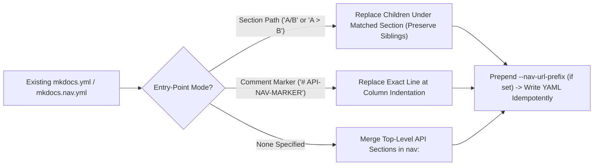
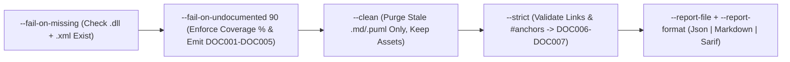

# MkDocs Navigation, Quality Gates, & Linux/Docker CI

This guide covers integrating exported documentation seamlessly into an existing MkDocs site, enforcing strict CI quality checks, running inside Linux Docker containers, automating in GitHub Actions, and localizing output.

---

## 1. Generating or Extending `mkdocs.yml` / `mkdocs.nav.yml`

By default, the [`Documentation.Exporter.Plugins.Navigation.MkDocs`](../../src/Documentation.Exporter.Plugins.Navigation.MkDocs/Documentation.Exporter.Plugins.Navigation.MkDocs.csproj) plugin ([`MkDocsNavigationGenerator`](../../src/Documentation.Exporter.Plugins.Navigation.MkDocs/MkDocsNavigationGenerator.cs)) writes a standalone `<OutputDir>/mkdocs.nav.yml`. Pass `--nav-format None` (`"navigationFormat": "None"`) to disable navigation file generation, or pass `--nav-format <CustomName>` when using an external [`INavigationGenerator`](../../src/Documentation.Exporter.Abstractions/Generation/INavigationGenerator.cs) plugin (such as Docusaurus or DocFX). When integrating into an existing MkDocs site, pass `--nav-file` (`"navigationFilePath"`) and `--nav-entry-point` (`"navigationEntryPoint"`) to **update the file in-place** while preserving `site_name`, `theme`, `plugins`, and all sibling `nav:` entries:



### Demo Example: Extending `demo/mkdocs.base.nav.yml`

**Input File ([`demo/mkdocs.base.nav.yml`](../../demo/mkdocs.base.nav.yml)):**

```yaml
site_name: Contoso Settlement Platform Documentation
nav:
  - Home: home.md
  - Architecture Guide:
      - System Overview: architecture/overview.md
      - Security & Compliance: architecture/security.md
  - Developer Portal:
      - Getting Started: developer/getting-started.md
      - API Reference:
  - Release Notes: changelog.md
```

**Command (Matching [`scripts/manual/Run-DemoExport.ps1`](../../scripts/manual/Run-DemoExport.ps1)):**

```powershell
.\build\bin\Documentation.Exporter.Cli\release\Documentation.Exporter.Cli.exe solution `
  --solution "demo\Documentation.Exporter.Demo.slnx" `
  --output "docs_site\docs\api" `
  --nav-file "docs_site\mkdocs.yml" `
  --nav-entry-point "Developer Portal/API Reference" `
  --nav-url-prefix "api"
```

### Entry-Point Modes & Idempotency

- **Section Path (`/` or `>`)**: Pass `"API Reference"` or `"Developer Portal/API Reference"` (or `"Developer Portal > API Reference"`). If the section already exists, only its children are replaced—so re-running the exporter on CI builds updates navigation idempotently without duplicate entries. Missing intermediate sections are created automatically.
- **Comment Placeholder Marker (`# ...`)**: Place a marker such as `# API-NAV-MARKER` inside `nav:` and pass `--nav-entry-point "# API-NAV-MARKER"` to insert the API tree at that exact indentation level (bounded by `# API-NAV-MARKER` and `# API-NAV-MARKER-END` so repeated runs update the block idempotently).
- **URL Prefixing (`--nav-url-prefix`)**: If `mkdocs.yml` lives above an API subfolder (for example `docs_site/mkdocs.yml` pointing into `docs_site/docs/api/`), set `--nav-url-prefix "api"` so every generated link begins with `api/`.

---

## 2. Filtering & CI Quality Gates

Enable quality flags together in automated builds so undocumented public APIs, unbuilt targets, stale files, or broken links fail the pipeline early:



| Option | Purpose in CI/CD Pipelines |
| :--- | :--- |
| `--clean` | Deletes stale `.md` and `.puml` files inside `--output` before exporting while keeping images, CSS, and hand-authored assets intact |
| `--strict` | Validates every relative Markdown link and `#anchor` heading fragment across generated `.md` files (skipping fenced/inline code spans) and exits with code `1` if any target or heading is missing |
| `--report-file` / `-r` | Writes an actionable diagnostics and coverage report to disk (persisted even when a quality gate fails with exit code `1`) |
| `--report-format` | Controls `--report-file` format: `Json` (structured automation), `Markdown` (PR comment / `$GITHUB_STEP_SUMMARY`), `Sarif` (SARIF v2.1.0 for GitHub Code Scanning), or any custom plugin format name |
| `--fail-on-missing` | On `solution` exports, fails (`exit code 1`) if any non-excluded project lacks a compiled `.dll` or `.xml` artifact |
| `--fail-on-undocumented <percent>` | Enforces a minimum percentage (`0.0`–`100.0`) of documented public types and members |
| `--exclude <patterns...>` | Skips solution projects matching wildcards such as `"*.Tests"` `"*.Benchmarks"` |
| `--exclude-types <patterns...>` | Omits matching internal/generated type names |
| `--exclude-namespaces <patterns...>` | Omits entire namespaces (e.g. `"*.Migrations"`) |
| `--exclude-editor-browsable-never` | Automatically hides types/members annotated with `[EditorBrowsable(EditorBrowsableState.Never)]` (`true` by default) |

### Quality Diagnostic Rule Codes (`DOC001`–`DOC007`)

| Code | Diagnostic Kind | Trigger Condition |
| :--- | :--- | :--- |
| **`DOC001`** | `MissingTypeSummary` | Public or protected type lacks an XML `<summary>` |
| **`DOC002`** | `MissingMemberSummary` | Accessible constructor, method, property, indexer, field, or event lacks an XML `<summary>` |
| **`DOC003`** | `MissingParameterDocumentation` | Method, constructor, or indexer parameter lacks an XML `<param>` description |
| **`DOC004`** | `MissingTypeParameterDocumentation` | Generic type or method type parameter lacks an XML `<typeparam>` description |
| **`DOC005`** | `MissingReturnDocumentation` | Non-void / value-returning method lacks an XML `<returns>` description |
| **`DOC006`** | `BrokenMarkdownLink` | Relative Markdown hyperlink points to a missing file or directory (exact line number recorded) |
| **`DOC007`** | `BrokenMarkdownAnchor` | Relative or intra-page `#anchor` fragment points to a missing heading slug (exact line number recorded) |

---

## 3. Running Natively on Linux & Inside Docker

`Documentation.Exporter` uses OS-agnostic path handling (`Path.Combine`), `.deps.json` resolution, and case-insensitive sidecar/example matching on case-sensitive filesystems (`ext4`, `XFS`).

### Native Linux / macOS Execution

```bash
dotnet run --project src/Documentation.Exporter.Cli/Documentation.Exporter.Cli.csproj -- \
  solution \
  --solution "/workspace/demo/Documentation.Exporter.Demo.slnx" \
  --configuration Debug \
  --output "/workspace/build/.demo-output" \
  --examples-dir "/workspace/demo/Documentation.Exporter.DemoLibrary/docs_extra/examples" \
  --overrides-dir "/workspace/demo/Documentation.Exporter.DemoLibrary/docs_extra/overrides" \
  --strict \
  --log-level Information
```

### Docker Image Build & Container Execution

Build the multi-stage .NET 11 runtime image from the repository root [`Dockerfile`](../../Dockerfile):

```bash
docker build -t documentation-exporter:latest .
```

Run either the `solution`, `assembly`, or `config` subcommand by mounting your workspace and output volumes:

```bash
docker run --rm \
  -v "$(pwd):/workspace:ro" \
  -v "$(pwd)/build/.demo-output:/output:rw" \
  documentation-exporter:latest \
  assembly \
  --assembly "/workspace/build/bin/Documentation.Exporter.DemoLibrary/debug/Documentation.Exporter.DemoLibrary.dll" \
  --xml "/workspace/build/bin/Documentation.Exporter.DemoLibrary/debug/Documentation.Exporter.DemoLibrary.xml" \
  --output "/output" \
  --examples-dir "/workspace/demo/Documentation.Exporter.DemoLibrary/docs_extra/examples" \
  --overrides-dir "/workspace/demo/Documentation.Exporter.DemoLibrary/docs_extra/overrides" \
  --diagram-format Mermaid \
  --log-level Information
```

You can also run the automated PowerShell wrapper [`scripts/manual/Run-DemoExport-Docker.ps1`](../../scripts/manual/Run-DemoExport-Docker.ps1) via `powershell -ExecutionPolicy Bypass -File scripts/manual/Run-DemoExport-Docker.ps1` (see [Scripts, Build System, & Containerization](../developer/scripts-and-automation.md)).

### Example GitHub Actions Workflow Snippet

```yaml
- name: Build solution
  run: dotnet build MySolution.slnx -c Release

- name: Generate and validate API documentation
  run: |
    dotnet run --project src/Documentation.Exporter.Cli/Documentation.Exporter.Cli.csproj -c Release --no-build -- \
      solution \
      --solution MySolution.slnx \
      --configuration Release \
      --output docs_site/docs/api \
      --nav-file docs_site/mkdocs.yml \
      --nav-entry-point "Developer Portal/API Reference" \
      --nav-url-prefix "api" \
      --fail-on-missing \
      --fail-on-undocumented 85 \
      --clean \
      --strict \
      --report-file docs-quality.sarif \
      --report-format Sarif

- name: Upload Documentation Diagnostics (SARIF)
  if: always()
  uses: github/codeql-action/upload-sarif@v3
  with:
    sarif_file: docs-quality.sarif
```

---

## 4. Localization Support

All CLI prompts, validation diagnostics, console logs, and Markdown headings/labels are backed by `.resx` resource files ([`CliCommandResources`](../../src/Documentation.Exporter.Core/Resources/CliCommandResources.resx), [`ValidationMessagesResources`](../../src/Documentation.Exporter.Abstractions/Resources/ValidationMessagesResources.resx), [`MarkdownGenerationResources`](../../src/Documentation.Exporter.Core/Resources/MarkdownGenerationResources.resx), [`ExecutionMessagesResources`](../../src/Documentation.Exporter.Core/Resources/ExecutionMessagesResources.resx)). When satellite resource assemblies for your target culture are installed, the tool automatically respects `CultureInfo.CurrentUICulture`.
