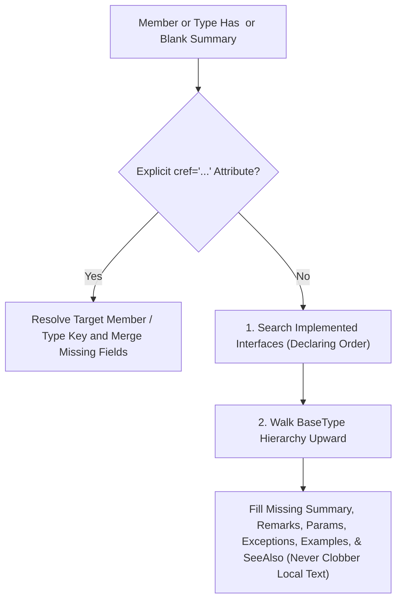

# Authoring XML Documentation Comments

`Documentation.Exporter` converts standard C# XML documentation comments and compiler reflection metadata into richly cross-linked Markdown pages. All examples below come directly from [`demo/Documentation.Exporter.DemoLibrary/`](../../demo/Documentation.Exporter.DemoLibrary/Documentation.Exporter.DemoLibrary.csproj).

> [!TIP]
> **Using an AI Coding Agent to Document Your Target Project?**
> Copy the ready-to-use slash command and prompt template from **[AI Agent Command for Authoring C# Interface & API XML Documentation](ai-agent-documentation-command.md)** into your repository (`.agents/workflows/document-interfaces.md`, `.claude/commands/document-interfaces.md`, or `.github/prompts/document-interfaces.prompt.md`) so your agent automatically adds detailed descriptions, `<remarks>` tables/notes, runnable `<example>` snippets, `<exception>` matrices, and cross-references before you run `Documentation.Exporter.Cli`.

---

## 1. Enable Compiler XML Documentation Output

Add `<GenerateDocumentationFile>true</GenerateDocumentationFile>` inside every `.csproj` you intend to document (see [`demo/Documentation.Exporter.DemoLibrary/Documentation.Exporter.DemoLibrary.csproj`](../../demo/Documentation.Exporter.DemoLibrary/Documentation.Exporter.DemoLibrary.csproj)):

```xml
<Project Sdk="Microsoft.NET.Sdk">
  <PropertyGroup>
    <TargetFramework>net11.0</TargetFramework>
    <GenerateDocumentationFile>true</GenerateDocumentationFile>
  </PropertyGroup>
</Project>
```

Without `<GenerateDocumentationFile>true</GenerateDocumentationFile>`, C# compiles `.dll` files without companion `.xml` documentation files, leaving `<summary>`, `<remarks>`, `<param>`, and `<exception>` blocks empty.

---

## 2. Supported XML Tag to Markdown Reference

| XML Tag | Rendered Markdown Output | Notes |
| :--- | :--- | :--- |
| `<summary>` | Introductory prose on index tables, type header, & member pages | Also drives documentation coverage % calculations |
| `<remarks>` | Dedicated `## Remarks` / `### Remarks` section | Supports nested `<para>`, `<list>`, and `<c>` |
| `<para>` | Separated Markdown paragraphs | Prevents run-on text walls inside `<remarks>` |
| `<list type="bullet \| number \| table">` | Markdown lists or GitHub Flavored Markdown tables | Supports `<listheader>`, `<item>`, `<term>` + `<description>` bold pairs, pipe/newline escaping, and default `Term`/`Description` table headers |
| `<c>` / `<code>` | Inline `` `code` `` (or `` `` code `` `` when containing backticks) or fenced code blocks (expanding to 4-backtick fences when containing ```` ``` ````) | Respects `language="..."` / `lang="..."` (defaults to `csharp`) and trims common multi-line leading indentation |
| `<note type="...">` | GitHub Alert callout blockquotes (`> [!NOTE]`, `> [!TIP]`, `> [!IMPORTANT]`, `> [!WARNING]`, `> [!CAUTION]`) | Maps `note`, `tip`, `important`, `implement`, `inherit`, `caller`, `warning`, `caution`, and `security` types automatically |
| `<example>` | Dedicated `## Examples` / `### Examples` section | Multiple `<example>` tags on one symbol are all emitted |
| `<param>` / `<typeparam>` | Parameter & Type Parameter tables | Automatically propagates from type `<typeparam>`/`<param>` to C# 12 primary constructors (without masking undocumented secondary constructors) |
| `<paramref>` / `<typeparamref>` | Bold/code inline parameter reference | Keeps parameter names consistent across refactors |
| `<returns>` / `<value>` | Return Value / Property Value section | Paired automatically with reflected return type links |
| `<exception cref="...">` | `## Exceptions` / `#### Exceptions` table | Duplicate conditions on the same exception type merge cleanly into one row |
| `<see cref="..." />` / `<see href="..." />` | Relative API link or external URL | Preserves custom inner label text (`<see cref="...">label</see>`), routes overloaded `cref` targets (`FormatResult_String.md`), and falls back to `--external-docs` / Microsoft Learn |
| `<seealso cref="..." />` | `## See Also` section | Accepts both `cref` API targets and external `href` URLs |
| `<inheritdoc />` | Inherited missing sections from interfaces/base types | Preserves any explicitly overridden local tags |
| `<exclude />` | Excludes type or member from output & coverage math | Clean way to omit internal helpers that must remain `public` |

---

## 3. Rich Documentation Tags (`TagShowcaseProcessor`)

Excerpt from [`demo/Documentation.Exporter.DemoLibrary/Diagnostics/TagShowcaseProcessor.cs`](../../demo/Documentation.Exporter.DemoLibrary/Diagnostics/TagShowcaseProcessor.cs):

```csharp
/// <summary>
/// Showcase processor demonstrating <c>&lt;remarks&gt;</c>, <c>&lt;exception&gt;</c> and <c>&lt;example&gt;</c>
/// documentation on every kind of member (constructor, property, field, event, instance and static methods).
/// </summary>
/// <remarks>
/// <para>
/// Type-level remarks may span several paragraphs and contain lists:
/// </para>
/// <list type="number">
/// <item><description>Construct a <see cref="TagShowcaseProcessor"/>.</description></item>
/// <item><description>Adjust <see cref="RetryLimit"/> (never above <see cref="MaximumRetryLimit"/>).</description></item>
/// <item><description>Call <see cref="Execute"/> with a <see cref="ShowcaseMode"/>.</description></item>
/// </list>
/// <para>
/// See <see href="https://learn.microsoft.com/en-us/dotnet/csharp/language-reference/xmldoc/">XML documentation comments</see>
/// for the full tag reference.
/// </para>
/// </remarks>
/// <example>
/// Create a processor and run a command:
/// <code>
/// var processor = new TagShowcaseProcessor("Primary");
/// var result = processor.Execute("ping");
/// </code>
/// </example>
/// <seealso cref="IShowcaseCommandHandler"/>
/// <seealso cref="ShowcaseMode"/>
/// <exception cref="ArgumentException">Thrown by constructors and commands when a name or command text is empty or too long.</exception>
/// <exception cref="InvalidOperationException">Thrown by <see cref="Execute"/> when the configured retry limit is not supported.</exception>
public sealed class TagShowcaseProcessor : IShowcaseCommandHandler
```

Key formatting behaviors demonstrated in [`TagShowcaseProcessor`](../../demo/Documentation.Exporter.DemoLibrary/Diagnostics/TagShowcaseProcessor.cs):
- **Multiple `<example>` tags & `<code language="...">`**: All `<example>` blocks are preserved, with `<code language="json">` emitted as dedented ```` ```json ```` fences alongside default ```` ```csharp ```` blocks.
- **Tables, `<term>` bullets, & `<note type="tip">`**: Demonstrates `<list type="table">` with `<listheader>`, `<term>` + `<description>` bold bullets, and `<note type="tip">` rendered as `> [!TIP]`.
- **Custom `<see cref>` labels & overloaded method routing**: Demonstrates `<see cref="IShowcaseCommandHandler">command handler contract</see>` and exact overload links (`<seealso cref="FormatResult(string)"/>` -> `FormatResult_String.md`, `<seealso cref="FormatResult(string, bool)"/>` -> `FormatResult_String_Boolean.md`).
- **Type-level `<exception>` tags**: Appear in `## Exceptions` on the type's `index.md` page and are inherited by primary constructors. Duplicate `<exception cref="...">` entries on the same member merge cleanly into a single row separated by `<br/>`.
- **`<see href="..."/>` and `<seealso href="..."/>`**: Preserve external web links cleanly alongside resolved API links.

---

## 4. Documentation Inheritance (`<inheritdoc/>`)

Avoid repeating interface and base-class docs across implementations using `<inheritdoc/>`:



- **Implicit `<inheritdoc/>`**: Automatically pulls missing `<summary>`, `<remarks>`, `<returns>`, `<param>`, `<typeparam>`, `<exception>`, `<example>`, and `<seealso>` blocks from implemented interfaces and base types (e.g., [`OrderProcessingService`](../../demo/Documentation.Exporter.DemoLibrary/Services/OrderProcessingService.cs) inheriting [`IOrderProcessor`](../../demo/Documentation.Exporter.DemoLibrary/Contracts/IOrderProcessor.cs) and [`AuditableProcessorBase`](../../demo/Documentation.Exporter.DemoLibrary/Services/AuditableProcessorBase.cs)).
- **Explicit `cref` targeting**: Use `<inheritdoc cref="Normalize(string)"/>` or `<inheritdoc cref="IShowcaseCommandHandler"/>` ([`IShowcaseCommandHandler`](../../demo/Documentation.Exporter.DemoLibrary/Diagnostics/IShowcaseCommandHandler.cs)) to inherit documentation from a specific overload or contract.
- **Partial overrides**: Writing your own `<summary>` alongside `<inheritdoc/>` keeps your custom summary while still merging missing parameter, return, and exception descriptions.

---

## 5. Special C# Constructs Demonstrated in the Demo Library

### Generics & Type Constraints (`AuditableEnvelope<TPayload>`)

Using `<typeparam>` alongside `where TPayload : class, new()` (and method-level `<typeparam>` in `ProjectPayload<TMetric>` in [`demo/Documentation.Exporter.DemoLibrary/Models/AuditableEnvelope.cs`](../../demo/Documentation.Exporter.DemoLibrary/Models/AuditableEnvelope.cs)) produces both the C# `where TPayload : class, new()` clause inside the `## Syntax` block and a **`#### Type Parameters`** table linking constraint keywords (`class`, `struct`, `unmanaged`, `notnull`, `new()`, `allows ref struct`, interfaces) to Microsoft Learn C# docs. Named tuples (`(string Id, int Count)`), native integers (`nint` / `nuint`), `dynamic`, function pointers (`delegate*<...>`), `[InlineArray(N)]` structs, `fixed` buffers, Default Interface Methods (DIMs), explicit interface implementations, and class finalizers (`~ClassName()`) are also reconstructed automatically from compiled assembly metadata.

### Enumerations (`PaymentStatus`)

Enum types in [`demo/Documentation.Exporter.DemoLibrary/Models/PaymentStatus.cs`](../../demo/Documentation.Exporter.DemoLibrary/Models/PaymentStatus.cs) render an inline **`## Values`** table (`Name`, `Value`, `Description`) directly on the enum's `index.md` page (without cluttering the output folder with individual member pages), plus per-value `<remarks>` and `<example>` blocks when authored.

### Extension Methods & C# 14 `extension(...)` Blocks (`OrderRequestExtensions`, `OrderRequestModernExtensions`)

Classic static extension methods in [`demo/Documentation.Exporter.DemoLibrary/Extensions/OrderRequestExtensions.cs`](../../demo/Documentation.Exporter.DemoLibrary/Extensions/OrderRequestExtensions.cs) (for example `IsHighValueOrder(this OrderRequest, ...)` and `TryWriteVerifiedAudit(this ISettlementAuditSink, ...)`) and C# 14 `extension(...)` blocks in [`demo/Documentation.Exporter.DemoLibrary/ModernCSharp/ModernCSharpShowcase.cs`](../../demo/Documentation.Exporter.DemoLibrary/ModernCSharp/ModernCSharpShowcase.cs) (`OrderRequestModernExtensions`) automatically surface on the target type's overview page under **`## Extension Methods`** and **`## Extension Properties`** across both intra-assembly types ([`OrderRequest`](../../demo/Documentation.Exporter.DemoLibrary/Models/OrderRequest.cs)) and sibling-assembly contracts ([`ISettlementAuditSink`](../../demo/Documentation.Exporter.DemoContracts/Auditing/ISettlementAuditSink.cs) in [`DemoContracts`](../../demo/Documentation.Exporter.DemoContracts/Documentation.Exporter.DemoContracts.csproj)). Static extension members preserve `static`, while compiler-generated container types (`<G>$...`, `<M>$...`) and raw accessor methods (`get_*`, `set_*`) are hidden cleanly.

### Modern C# 9–14 Language Constructs (`ModernCSharpShowcase`)

[`demo/Documentation.Exporter.DemoLibrary/ModernCSharp/ModernCSharpShowcase.cs`](../../demo/Documentation.Exporter.DemoLibrary/ModernCSharp/ModernCSharpShowcase.cs) demonstrates full fidelity across C# 9 through C# 14 constructs:

- **Records, `readonly struct`, & `ref struct`**: `record` (`SettlementRecordBase`), `readonly record struct` (`CurrencyPair`), and `readonly ref struct` (`OrderSpanReader`) render dedicated `Record`, `ReadOnly`, and `Ref Struct` metadata rows without leaking compiler `EqualityContract` properties or Roslyn's `ref struct` compatibility `[Obsolete]` attribute.
- **Primary + Secondary Constructors, `init`, `required`, & C# 14 `field`**: Primary constructors combined with secondary `: this(...)` overloads inherit class-level `<summary>` and `<param>` docs (`SettlementRecordBase`, `SettlementLedger`), while `required`/`init` properties and C# 14 `field`-backed accessors render clean property signatures without compiler `required`-constructor `[Obsolete]` noise.
- **`allows ref struct`, `notnull`, `in`/`out` Variance, & `static abstract`/`static virtual`**: Generic interfaces and delegates (`IMetricConverter<in TSource, out TResult>`, `ISettlementMetric<TSelf>`, `SpanFormatter`, `SettlementTransformHandler<in TInput, out TOutput>`) preserve variance modifiers, `allows ref struct` constraints, and `static abstract` / `static virtual` interface contracts.
- **Indexers, Checked & Compound Assignment Operators, `scoped`, & Nullable Reference Types (`?`)**: `SettlementLedger` demonstrates indexers (`this[...]`), multi-dimensional arrays (`decimal[,]`), `protected internal` members, `scoped ref readonly` parameter badges, `Task<OrderRequest?>` / `IReadOnlyList<string?>` nullable annotations across signatures and tables, and operators (`+`, `checked +`, `operator +=`, `implicit operator decimal`) emitted with path-safe `op_*` filenames.
- **`[Experimental("DEMO001")]` Preview Banners (`ExperimentalSettlementPreview`, `CombineScopedTag`)**: Types and members marked with `[Experimental]` emit `> [!IMPORTANT]` banners linking to the diagnostic `UrlFormat` (when supplied) and `[Experimental]` prefixes in namespace index tables.

### Nested Types (`OrderRequest.ItemLine.TaxBreakdown`) & Custom Attributes (`[StabilityTier("Stable")]`)

- Multi-level nested public types such as [`OrderRequest.ItemLine`](../../demo/Documentation.Exporter.DemoLibrary/Models/OrderRequest.cs) and [`OrderRequest.ItemLine.TaxBreakdown`](../../demo/Documentation.Exporter.DemoLibrary/Models/OrderRequest.cs) preserve their full enclosing directory hierarchy (`Models/OrderRequest/ItemLine/TaxBreakdown/index.md`) and are linked under **`## Nested Types`** on their immediate declaring type.
- Public custom attributes are extracted automatically across **all C# targets** and rendered with clickable links to their documentation descriptions (local exported Markdown pages, `--external-docs` templates, or Microsoft Learn API docs):
  - **Assemblies** (`[assembly: StabilityTier("Stable")]` in [`StabilityTierAttribute.cs`](../../demo/Documentation.Exporter.DemoLibrary/Attributes/StabilityTierAttribute.cs)) -> rendered under **`Attributes:`** at the top of `<Assembly>/index.md` (and root `index.md` in single-assembly exports).
  - **Types & Generic Type Parameters** (classes, interfaces, structs, **enums** such as [`PaymentStatus`](../../demo/Documentation.Exporter.DemoLibrary/Models/PaymentStatus.cs), delegates, and generic type parameters such as `[StabilityTier("Stable")] TPayload` on [`AuditableEnvelope<TPayload>`](../../demo/Documentation.Exporter.DemoLibrary/Models/AuditableEnvelope.cs) and `[StabilityTier("Preview")] TMetric` on `ProjectPayload<TMetric>`) -> rendered in the **`Attributes:`** metadata header, assembly namespace tables, and **`#### Type Parameters`** tables.
  - **Enum Values & All Member Kinds** (`[Display(Name = "Pending Verification")]` on `PaymentStatus.Pending`, and `[StabilityTier("Stable")]` across constructors like `OrderProcessingService(string)`, fields like `MaxInstantSettlementThreshold`, events like `OrderStatusChanged`, properties, and methods like `ProcessOrderAsync` in [`OrderProcessingService.cs`](../../demo/Documentation.Exporter.DemoLibrary/Services/OrderProcessingService.cs)) -> rendered on both `<Type>/index.md` overview tables and individual member detail pages.
  - **Parameters & Return Values** (such as `[Required]` on `gatewayProviderName` and `[return: StabilityTier("Stable")]` on `ProcessOrderAsync` in [`OrderProcessingService.cs`](../../demo/Documentation.Exporter.DemoLibrary/Services/OrderProcessingService.cs)) -> rendered in the **`Modifiers`**, **`Constraints / Attributes`**, and **`Returns`** sections of `<Member>.md`.

### Deprecation & Hiding APIs (`[Obsolete]`, `[EditorBrowsable]`, `<exclude/>`)

- **`[Obsolete("Message", DiagnosticId = "...", UrlFormat = "...")]`**: Adds a prominent `> [!WARNING]` banner (or `> [!CAUTION]` when `IsError = true`) with optional diagnostic ID badge links (`([DEMO002](...))`) at the top of the type/member page and highlights the entry in namespace index tables (see [`LegacyInvoiceAdapter`](../../demo/Documentation.Exporter.DemoLibrary/Adapters/LegacyInvoiceAdapter.cs)).
- **`[EditorBrowsable(EditorBrowsableState.Never)]`**: Excluded automatically by default (`--exclude-editor-browsable-never true`).
- **`<exclude/>`**: Adding `<exclude/>` inside a type or member's XML comment removes it from both exported Markdown pages and coverage denominators.
